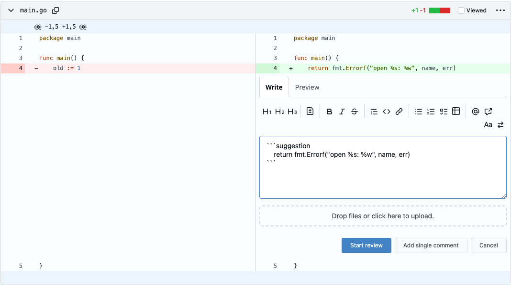

<!-- Generated by SpecStory, Markdown v2.1.0 -->

# 2026-11-12 17:30:03Z

<!-- Claude Code Session 646ba614-2221-4f76-be07-51b20bcdad38 (2026-11-12 17:30:03Z) -->

_**User (2026-11-12 17:30:03Z)**_

<command-message>anthropic-skills:csci435-pr-review</command-message>
<command-name>/anthropic-skills:csci435-pr-review</command-name>

---

_**User (2026-11-12 17:30:03Z)**_

Base directory for this skill: /home/mont9393/.claude/skills/synced/da1ac504-0074-42b0-94c4-3970b6fd0e2c_c7898bc9-9bcc-4cef-be87-a761eb24a2fb/csci435-pr-review

# CSCI 435 PR review

You are drafting a code review that the user (GitHub login `ab-wm`) will test, edit and post on a
teammate's PR in `CSCI-435-SE/gitea`, a course fork of Gitea. The review is a graded course
deliverable, so the user stays its author: you gather the facts, check them, and hand back a
draft in their format. Don't post, approve or comment on the PR, and don't push to it. Don't offer
to fix the author's code either. In this course the author makes each change themselves, one
change per commit.

The user's standing instruction for reviews is "not *that* deep". That doesn't mean overlooking
real problems, and it doesn't mean nitpicking every small one. The code is not going upstream. A
finding belongs in the draft only if it would change a score, or if the author would want to know
about it before merging.

## 1. Find your footing

Work out where you are running, because that decides how you fetch the PR and where the draft goes.

- **Claude Code inside the repo clone** (`gh` works, and the working tree is the fork). Use `gh`
  for PR data and read source files locally. The user is usually on their own feature branch, so
  don't switch it. Fetch the PR head with `git fetch origin pull/<N>/head:pr-<N>` and read files
  with `git show pr-<N>:<path>`. Compare with `git diff origin/main...pr-<N>`, because local
  `main` is often behind.
- **Chat, or anywhere without the clone.** The repo is public. Use a GitHub connector if one is
  attached. Otherwise fetch the URLs in `references/fetching-without-the-repo.md`. If nothing can
  reach GitHub, ask the user for the PR link and the diff.

## 2. Triage

First get the PR's title, author, changed files and linked issue (`Closes #N`). Then decide how
much review it needs. The user only does a full review when code changed:

- **The PR is already merged, or the user has already reviewed it.** Say so first, quoting their
  existing review in a line. Continue only if they want a fresh look, for example a re-review
  after new commits. Don't let their earlier scores steer yours.
- **The user approved, and commits were pushed after that.** In Sprint 3 a PR may only be merged
  after an approval on its latest commit, so it needs a new approval. Check only the new commits,
  as in a follow-up, and suggest a short re-approval if they're fine.
- **The PR only touches check-ins, docs, course files, showcase material, AI logs, or config like
  `.coderabbit.yaml`.** Skip the rubric. Skim the files for anything surprising, such as code
  hiding in a "docs" PR, a secret, or a file in the wrong folder. Then suggest a one-line
  approval in the user's voice, for example "All good, just the check-in doc and AI log. No need
  for complete review."
- **The PR is a mutation-testing write-up** (`docs/sprint3/mutation/**`). If it holds only the
  write-up and the reports, treat it like a docs PR. If it also adds or changes a test, run that test
  (section 4) and check it the way section 5 describes. Also check that the mutant the write-up says
  it kills shows as killed in the `-after` report. Search the report for that location rather than
  reading it whole, since the reports can be large.
- **The PR is the user's own.** Nobody approves their own PR in this course. Say so, and offer a
  list of findings instead of a rubric.
- **This is a follow-up after the user asked for changes.** Check only the items they asked for.
  If those are done, suggest a short approval such as "All good now!"
- **The PR changes code or tests.** Do the full review described below.

## 3. Gather, lightly

Read these in order, and stop once you can score every rubric row:

1. The PR description, including its `## Test Evidence` section, and the linked issue's
   acceptance criteria (ACs) and design decisions. The rubric is scored against the ACs.
2. The diff. Skip `ai-logs/**`: those files are thousands of lines of chat transcript, and they
   are not reviewed.
3. The review bots' comments and the author's replies, so you don't repeat what was already raised
   and fixed:
   - **CodeRabbit**, configured by the repo's `.coderabbit.yaml`.
   - **Gitar** (Sonar's AI reviewer, mentioned as `@gitar-bot`), if the team turns it on. It keeps
     one dashboard comment that it updates on every push, holding its verdict and, when CI fails, a
     root-cause analysis. It also posts inline findings rated Critical, Important or Minor, and moves
     resolved ones into a collapsed section. Its rules, if any, are in the repo's `.gitar/` folder.
4. The CI status, if you can see it. Gitar's root-cause note on a failure is a lead, not a verdict;
   check it. If the course connects the repo to SonarQube Cloud, its quality gate shows up among the
   PR's checks.
5. SonarQube for IDE, if it's running in the user's VS Code and Claude Code is connected (`/ide`).
   Read its diagnostics for the PR's changed files. Only findings on changed lines count, and each is
   a lead to check like any other finding. If nothing shows, skip this step rather than setting it up.
6. Just enough of the code the diff touches or depends on to check its claims. In the clone,
   `.claude-students/INDEX.md` lists short docs for each area if you need background.

Don't run lint; CI does that. Do run the PR's tests (section 4), so the user doesn't have to. Don't
split the review across subagents.

Aim for about 10–15 tool calls for reading and checking, plus what the test runs need. In testing,
runs that went to 35 calls produced no better drafts than shorter ones would have. Spend those calls
on checking the findings that will go in the draft, one check each. Don't chase ideas you won't
include. Don't read the author's AI logs, and only download a library's source when a finding depends
on it. If you go over the budget, write the draft with what you have, and say what you didn't check.
Reviewers are expected to answer within 24 hours, which is one more reason to keep it short.

## 4. Run the PR's tests

In the clone, run the tests the PR adds or changes, plus the existing test files for the source files
it changes, and record the real counts. In chat you can't run anything: say so, give the user the exact
commands to run, and leave the testing line as a TODO.

- **Work in a throwaway worktree**, so the user's branch and their own server aren't touched:
  `git worktree add --detach .specstory/review-<N> pr-<N>`, then `CI=true pnpm install
  --frozen-lockfile` inside it. Never symlink `node_modules` into a worktree.
- **Unit tests:** `pnpm exec vitest run <files>` for the frontend, and `go test -run '<names>' ./<pkg>/`
  for Go. Go must match `go.mod`: a newer system Go breaks things, so put `~/sdk/go1.26.4/bin` first on
  `PATH` (check `go version` against `go.mod`).
- **Can the new unit tests fail?** This check is cheap. Restore the PR's changed source files to
  `origin/main` in the worktree, re-run the new unit tests, then restore the PR's versions. Tests for
  new behaviour should now fail. One that still passes may not test the change. Use it as evidence for
  the Test coverage row, not as a finding on its own.
- **Playwright tests the PR adds or changes:** `make test-e2e` can't run on this machine.
  1. Build the worktree (`make frontend backend`).
  2. Start its own server from a copy of `custom/conf/app.ini` with `WORK_PATH` set to the worktree
     and port 3001. Start it inside a helper script and stop it by PID, never with `pkill -f`. Create
     the `e2e-admin` user (password `password`) with `./gitea admin user create` if that instance
     doesn't have it.
  3. Run Playwright with a scratch config that extends `playwright.config.ts` and points Chromium at
     `/usr/bin/chromium` (`launchOptions.executablePath`). Set `GITEA_TEST_E2E_URL`,
     `GITEA_TEST_E2E_USER=e2e-admin`, `GITEA_TEST_E2E_PASSWORD=password` and
     `GITEA_TEST_E2E_DOMAIN=localhost`. Run on Chromium and Firefox.

  If the setup still fails after one fix, stop and say so; CI's e2e run is the fallback. The shell is
  zsh, so write environment variables out instead of using unquoted `$VARS`.
- **Read only the summary lines** of each run (pass, fail and skip counts, plus the names of any
  failures), not the full output.
- **A failure isn't a finding yet.** `multiselect-aria.test.ts` already fails locally on untouched
  main, and CI passes it. For any other failure, re-run it on `origin/main`. Only a failure the PR
  causes is a required fix, because the course allows no new test failures.
- **Clean up:** stop the server, then `git worktree remove --force .specstory/review-<N>`.

On a follow-up after new commits, re-run only the tests those commits touch.

## 5. What to check

- **Each AC.** Find where it is implemented and where it is tested. A missing AC is the main
  reason to lower the Correctness score.
- **Whether the tests can fail.** A test that would still pass with the feature removed doesn't
  count as coverage. Look for:
  - assertions that read a value without first asserting it exists;
  - `test.fail()` or skips that cover more than the one known failure;
  - checks that only test whether something is present.
- **The Test Evidence section** (required in every PR since Sprint 3). It needs:
  - one row per AC (for a bug fix, its Expected Behavior; for a PR with no behaviour change, "N/A"
    and a reason);
  - for each row, a named test or "Manual:" steps with what was seen;
  - a Level of unit, integration, E2E or manual;
  - a Source of expected value of AC, issue discussion, docs, upstream behavior, or other
    (explained);
  - a "Not tested automatically, and why" line that lists only the manual ACs;
  - an "AI-written tests" line, saying which tests and how their expected values were checked.

  Spot-check one or two rows: open the test, read its expected value, and compare it with the cited
  source. A value that only matches what the code happens to output (a pasted snapshot, or a number
  the AC never mentions) is exactly what the sprint page rules out.
- **Course rules that graders look at:**
  - `Closes #<N>` in the description, and the PR on the `Sprint 3` milestone;
  - a `## Tech Debt` section;
  - an AI assistance section;
  - before/after screenshots when templates, CSS or Vue files change;
  - Conventional Commit messages that end in `(#N)`;
  - `Assisted-by` trailers, and no `Co-Authored-By`;
  - commits small enough to review, for example split by layer;
  - a skipped test, `test.fail()`, `t.Skip` or disabled CI check has a linked issue and a reason in
    a code comment;
  - no new test failures: a red CI check on code the PR touches is a required fix;
  - commits pushed by a bot (for example a Gitar fix) are AI-made changes, so the AI section should
    mention them.

  A bot's approval (Gitar can auto-approve) doesn't count: the course needs a teammate's approval.

  The current sprint's rules are on https://csci-435-se.github.io/sprint3/. The repo's
  `.claude-students/COURSE-WORKFLOW.md` still described Sprint 2 on Nov 4, so where the two
  disagree, the sprint page wins.
- **Claims in the PR description.** Descriptions are often drafted by AI. Check one or two
  concrete claims against the code, such as a timing, a count, or "every test does X".

Check every finding against the source before it goes in the draft. Reviews of AI-written code
tend to produce confident findings that turn out wrong. A wrong finding in a posted review costs
the user more than a missed nit. If checking disproves your idea, drop the finding or reword it.
For example, on #105 a suspected "silent pass" turned out to fail loudly, so the finding became
about the unhelpful error message instead.

Leave out style nits, anything lint or CI catches, CodeRabbit or Gitar findings the author already
fixed (credit those in one line), and anything that wouldn't change a score. A bot or Sonar finding
that's still open goes in the draft only if you checked it against the code yourself. A Sonar rule
that fights Gitea's conventions isn't a finding.

## 6. Scoring

Start every row at 10, and deduct points only for a concrete gap you can name. Past reviews show
how the user scores:

- A UI change without before/after screenshots: Documentation 8, Overall 9, "Yes, once the
  screenshots are added".
- One large commit instead of commits split by layer: AI transparency 7.
- A factual error in the description or the Tech Debt section: Documentation 8.
- Everything checks out: 10s, and Overall 10, "Yes".

A deduction needs a *required* point behind it, something you would ask the author to change before
merging. An observation you'd only file under "Strictly optional" (one AC covered by unit tests but not
end to end, a small AI-assisted commit the description doesn't mention) leaves the score at 10. The user
has scored a feature PR 10 on every row even though optional observations like these existed.

Overall is "Yes" unless something required is missing. Nits don't block a merge. Any score below
7 needs a note saying what would raise it, because the course rubric requires one.

The test-evidence row is new, so there are no posted examples of it yet. Score it like the other
rows. A missing Test Evidence section, an AC with no row, or an expected value with no real source is
a required fix and lowers the score. A source that is valid but could be stronger is optional and
leaves it at 10. The row also asks which tests the reviewer ran locally: answer it from the section 4
runs, with real counts. If nothing could be run, put a visible `TODO (you): which tests you ran
locally` there instead.

## 7. Draft format

Use the rows from the course rubric. Read `.github/code-review-rubric.md` from the repo, or from
raw GitHub, so the draft picks up any change to the rubric. The template below matches the rubric
as of Sprint 3: the sprint page adds the test-evidence row. On Nov 4 the repo's rubric file didn't
have that row yet, so keep it even if the file still lacks it.

Write in the user's voice:

- short, plain sentences;
- one sentence per table note;
- no rule citations in the table;
- `file:line` for code findings.

Skim one of the reviews in `references/posted-examples.md` before you draft. These are reviews
the user actually posted.

```markdown
### Code Review — @ab-wm

Ran the PR's tests locally with Claude Code: <each command or file, with its pass/fail/skip counts>. TODO (you): anything you clicked or checked by hand, or delete this.

| Criterion | Score (1–10) | Notes |
| --- | --- | --- |
| Correctness — implements issue requirements | | |
| Test coverage — tests present and meaningful | | |
| Test evidence — does every AC have a test? Are the expected values justified? Which tests did you run locally? | | <finding>. Ran <which tests> locally: <counts>. |
| Code quality — style, naming, no duplication | | |
| Documentation — comments and PR description clear | | |
| AI transparency — evidence of human verification if AI used | | |
| Overall — merge as-is? | | |

### Strictly optional for completeness
**<the point in a few words>.** <one or two sentences, with file:line>

### AI-Log
Review was drafted by AI, and then changed to better fit the review structure and my inspection of the files. Log available on #<linked issue>.
```

- **Required changes** go in the note of the row they affect, written as a request ("please add
  before/after screenshots, as they are required"). Overall then says "Yes, once X is added".
- **Optional points** go in their own section after the table. Keep at most one or two, and drop
  the section if there are none.
- **The testing line** states only the test runs that really happened in section 4, with their
  counts, and says Claude Code ran them. What the user clicked or checked by hand stays a visible
  `TODO` for them to write or delete. Never fill it with your own checks; a visible placeholder can't
  be posted by accident without being noticed.

## 8. Hand it back

- **In Claude Code**, write the draft to `.specstory/pr-<N>-review.md` (the folder is
  gitignored). If that file already exists, it may be the user's edited copy, so write the draft
  to `pr-<N>-review-2.md` (or the next free number) instead.
- **In chat**, give the draft as one fenced markdown block, so the table copies cleanly.

Then write a short summary in chat, about 10–15 lines:

- the verdict;
- each finding, marked required or optional;
- the test results, and what you didn't run or check (for example, "e2e setup failed, so I relied
  on CI"), so the user knows what is left for them;
- any idea you couldn't verify, offered as something the user could try in their own testing.
  Unverified ideas never go in the draft.

End there. Remind the user to file this session's AI log in `ai-logs/sprint3/ab-wm/`, as
`ai-logs/README.md` describes, since the AI-Log section points to it. If they approve, mention once
that any commit the author pushes afterwards needs a new approval before the merge.

---

_**Agent (claude-opus-5-5 2026-11-12 17:30:09Z)**_

<tool-use data-tool-type="shell" data-tool-name="Bash"><details>
<summary>Tool use: **Bash**</summary>
List open PRs awaiting the user's review

`gh pr list --repo CSCI-435-SE/gitea --state open --search "review-requested:@me" --json number,title,author,updatedAt 2>&1 | head -50; echo ---; gh pr list --repo CSCI-435-SE/gitea --state open --json number,title,author,isDraft,updatedAt --limit 20 2>&1`

```text
[]
---
[{"author":{"id":"U_kgDOCJmaXw","is_bot":false,"login":"vvchopra","name":""},"isDraft":false,"number":163,"title":"feat(pull): render suggestion blocks in review comments as a diff (#154)","updatedAt":"2026-11-12T15:04:06Z"},{"author":{"id":"U_kgDODF4cJA","is_bot":false,"login":"controlled-opposition","name":""},"isDraft":false,"number":162,"title":"feat(pulls): add a \"Suggest change\" button to the code comment form (#155)","updatedAt":"2026-11-11T22:06:59Z"},{"author":{"id":"U_kgDOCJeTNQ","is_bot":false,"login":"CarsonRackley","name":""},"isDraft":false,"number":161,"title":"feat(notifications): badge tab icon and opt-in desktop alerts (#118)","updatedAt":"2026-11-11T20:01:07Z"}]
```
</details></tool-use>

_**Agent (claude-opus-5-5 2026-11-12 17:30:18Z)**_

<tool-use data-tool-type="shell" data-tool-name="Bash"><details>
<summary>Tool use: **Bash**</summary>
Check review state and head branch of each open PR

`for n in 161 162 163; do echo "=== #$n"; gh pr view $n --repo CSCI-435-SE/gitea --json headRefName,reviewRequests,reviews,commits,createdAt --jq '{head: .headRefName, created: .createdAt, requested: [.reviewRequests[].login], reviews: [.reviews[] | {a: .author.login, s: .state, at: .submittedAt}], lastCommit: (.commits[-1] | {oid: .oid[0:10], date: .committedDate, h: .messageHeadline})}'; done; echo; git log -5 --format='%h %an <%ae> %s'`

```text
=== #161
{"created":"2026-11-11T14:58:59Z","head":"feat/issue-118-notification-alerts","lastCommit":{"date":"2026-11-11T19:33:11Z","h":"fix(notifications): keep polling when the browser refuses a desktop a…","oid":"d859485343"},"requested":[],"reviews":[{"a":"gitar-bot","at":"2026-11-11T15:01:01Z","s":"COMMENTED"}]}
=== #162
{"created":"2026-11-11T20:07:37Z","head":"feat/issue-155-suggest-change-button","lastCommit":{"date":"2026-11-11T21:37:31Z","h":"test(pulls): cover the Suggest change click handler in Vitest (#155)","oid":"b81696c450"},"requested":[],"reviews":[{"a":"gitar-bot","at":"2026-11-11T20:09:11Z","s":"COMMENTED"},{"a":"controlled-opposition","at":"2026-11-11T20:53:31Z","s":"COMMENTED"}]}
=== #163
{"created":"2026-11-12T03:29:55Z","head":"feat/issue-154-suggestion-diff","lastCommit":{"date":"2026-11-12T03:23:24Z","h":"style(pull): style suggestion diffs with theme diff colours (#154)","oid":"601cc86c7d"},"requested":[],"reviews":[]}

b81696c450 Ethan Turner <207494180+controlled-opposition@users.noreply.github.com> test(pulls): cover the Suggest change click handler in Vitest (#155)
39d8f0b967 Ethan Turner <207494180+controlled-opposition@users.noreply.github.com> chore(ai-log): add AI logs for #155 and Sprint 3 reviews (#155)
67c35a4cfd Ethan Turner <207494180+controlled-opposition@users.noreply.github.com> fix(pulls): never cut into a fenced block when a selection ends inside it (#155)
a502fb3cad Ethan Turner <207494180+controlled-opposition@users.noreply.github.com> docs(pulls): add the Suggest change screenshot for the PR (#155)
79e9a789bc Ethan Turner <207494180+controlled-opposition@users.noreply.github.com> feat(pulls): add a "Suggest change" button to the code comment form (#155)
```
</details></tool-use>

_**Agent (claude-opus-5-5 2026-11-12 17:30:22Z)**_

The user has PR #162's branch checked out (Ethan Turner's "Suggest change" button, #155) and hasn't reviewed it yet, so I'll review #162.

_**Agent (claude-opus-5-5 2026-11-12 17:30:26Z)**_

<tool-use data-tool-type="shell" data-tool-name="Bash"><details>
<summary>Tool use: **Bash**</summary>
Fetch PR #162 description, files and checks

`gh pr view 162 --repo CSCI-435-SE/gitea --json title,body,milestone,files,statusCheckRollup --jq '"TITLE: \(.title)\nMILESTONE: \(.milestone.title)\nFILES:\n" + ([.files[] | "  \(.path) +\(.additions) -\(.deletions)"] | join("\n")) + "\nCHECKS:\n" + ([.statusCheckRollup[] | "  \(.name // .context): \(.conclusion // .state)"] | join("\n")) + "\n\nBODY:\n" + .body'`

```text
TITLE: feat(pulls): add a "Suggest change" button to the code comment form (#155)
MILESTONE: Sprint 3
FILES:
  ai-logs/sprint3/controlled-opposition/2026-11-11_claude-code_issue-155-impl.md +5660 -0
  ai-logs/sprint3/controlled-opposition/2026-11-11_claude-code_issue-155-spec-draft.md +1102 -0
  ai-logs/sprint3/controlled-opposition/2026-11-11_claude-code_issue-155-spec-revision.md +1474 -0
  ai-logs/sprint3/controlled-opposition/2026-11-11_claude-code_issue-156-157-spec-review.md +714 -0
  ai-logs/sprint3/controlled-opposition/2026-11-11_claude-code_pr-149-review.md +1464 -0
  ai-logs/sprint3/controlled-opposition/2026-11-11_claude-code_pr-150-review.md +1754 -0
  docs/sprint3/screenshots/issue-155-suggest-change-after.png +0 -0
  options/locale/locale_en-US.json +1 -0
  templates/repo/diff/comment_form.tmpl +1 -0
  templates/shared/combomarkdowneditor.tmpl +6 -0
  tests/e2e/pr-suggest-change.test.ts +113 -0
  web_src/js/features/repo-diff-suggestion.test.ts +98 -0
  web_src/js/features/repo-diff-suggestion.ts +73 -0
  web_src/js/features/repo-issue.ts +5 -0
CHECKS:
  giteabot: SKIPPED
  files-changed / detect: SUCCESS
  files-changed / detect: SUCCESS
  files-changed / detect: SUCCESS
  files-changed / detect: SUCCESS
  labeler: SUCCESS
  labeler: SUCCESS
  container-amd64: SKIPPED
  lint-backend: SUCCESS
  test-pgsql-shard-1: SUCCESS
  test-e2e: SUCCESS
  pr-title: SUCCESS
  pr-title: SUCCESS
  container-arm64: SKIPPED
  lint-on-demand: SUCCESS
  test-pgsql-shard-2: SUCCESS
  container-riscv64: SKIPPED
  checks-backend: SUCCESS
  test-sqlite: SUCCESS
  frontend: SUCCESS
  test-unit: SUCCESS
  backend: SUCCESS
  test-mysql: SUCCESS
  test-mssql: SUCCESS
  sonarqube: SUCCESS
  CodeRabbit: SKIPPED
  Gitar: SUCCESS
  SonarCloud Code Analysis: SUCCESS

BODY:
Closes #155

## What changed

New-side code comment forms get a "Suggest change" button in the toolbar. It inserts a ```` ```suggestion ```` block holding the commented line's text and leaves the cursor at the end of that line. The text comes from the diff row already on the page, read as `textContent` from the row's new-side `.code-inner`. When the line itself contains a run of 3 or more backticks, the fence is one backtick longer than that run. If the cursor is already inside a fenced block, the new block goes after that block, so blocks never nest. A selection is replaced by the block (AC2), unless either end of it is inside a fenced block: then nothing is replaced and the block goes after that block, so no block is cut into. Old-side lines and reply forms don't get the button. There are no Go, database or API changes.

- `web_src/js/features/repo-diff-suggestion.ts`: the pure `suggestionFence`, `buildSuggestionInsert`, `suggestionInsertPos` and `suggestionInsertRange` functions, plus the click handler
- `web_src/js/features/repo-issue.ts`: the `+` handler shows the button for `side === 'right'` only
- `templates/shared/combomarkdowneditor.tmpl`: an optional `SuggestChange` toolbar group, hidden until JS shows it
- `templates/repo/diff/comment_form.tmpl`: sets `SuggestChange` for new comments, not replies
- `options/locale/locale_en-US.json`: `repo.diff.comment.suggest_change`



## Why

To write a suggestion, reviewers had to copy the line by hand and remember the syntax. This is S2 of #151 and covers AC1–AC12.

For AC12, the second block goes right after the first one and not at the raw cursor position. After the first click the cursor sits inside the first block, so inserting there would split that block, and the AC says the first block must be left as is.

## Test Evidence

| Acceptance criterion | Test(s) | Level | Source of expected value |
|---|---|---|---|
| AC1: block with the line's exact text, in split and unified view and on expanded lines | `buildSuggestionInsert`, `initSuggestChangeButton` (markup and trailing newline dropped); e2e `suggest change button in the code comment form` (unified line 5, split line 6), `suggest change on a line revealed by expand` | unit, E2E | AC |
| AC2: inserted at the cursor on a line of its own, followed by a newline, replacing selected text | `buildSuggestionInsert`, `suggestionInsertPos`, `suggestionInsertRange`; e2e selecting `rename this` in `nit: rename this` | unit, E2E | AC |
| AC3: textarea focused, cursor at the end of the line | `initSuggestChangeButton`; e2e `toBeFocused` and `selectionStart/End` | unit, E2E | AC |
| AC4: N+1 backtick fence for runs of N ≥ 3, otherwise 3 | `suggestionFence`; e2e on a line holding ```` ```js ```` | unit, E2E | AC, CommonMark fence rule |
| AC5: empty or whitespace-only line kept as is | `buildSuggestionInsert`; e2e on empty line 6 | unit, E2E | AC |
| AC6: no button on the old side | e2e on left line 4 | E2E | AC |
| AC7: no button in other editors | e2e reply form; only the new code comment form passes `SuggestChange` | E2E | AC |
| AC8: signed-out visitor gets no form | e2e expects no `.add-code-comment` buttons | E2E | AC, upstream behavior |
| AC9: works on a closed PR | e2e in split view after closing the PR through the API | E2E | AC |
| AC10: focusable `<button>` whose name and tooltip come from the new key | e2e `getByRole('button', {name: 'Suggest change'})` | E2E | AC |
| AC11: stored content is the textarea text | e2e reads the review comment back through the API; newlines arrive as CRLF, as with every form submit | E2E | AC, HTML spec form encoding |
| AC12: a second click adds a second block and leaves the first as is | `suggestionInsertPos`, `suggestionInsertRange` (a selection ending inside a block); e2e second click | unit, E2E | AC, CommonMark fence rule |

**Not tested automatically, and why:** None.

**AI-written tests:** Claude Code wrote every test in `web_src/js/features/repo-diff-suggestion.test.ts` (`suggestionFence`, `buildSuggestionInsert`, `suggestionInsertPos`, `suggestionInsertRange`, and the two `initSuggestChangeButton` DOM tests) and both tests in `tests/e2e/pr-suggest-change.test.ts`. I checked their expected values against the ACs and CommonMark's fence rules. A code review caught one e2e expectation that had been copied from the code's output (the old AC12 check), and I corrected it.

## CI / manual verification

Locally: Vitest 6/6, Playwright 4/4 on chromium and webkit, eslint, tsc, `make lint-templates` and `.claude-students/check.sh` all pass. Firefox can't launch on this machine, so CI is the first place it runs. I also drove the feature by hand on a fresh dev instance (`/verify`), which is where the screenshot comes from.

## Design

As in the issue's Design Decision and Decision 2.

## Tech Debt

**Introduced:** The line text depends on the diff row markup (`.code-inner` in the row's new-side cell or the `+` button's cell) and drops the cell's trailing newline. The e2e tests guard both. `suggestionInsertPos` is a small CommonMark fence scanner of its own, since the frontend has no markdown parser to reuse.

**Encountered:** `make lint-json` fails on a clean `main` in this environment, while eslint on the edited locale file passes. Not addressed here.

## AI assistance

Claude Code (claude-opus-5-5) drafted the module, the template and locale changes and the tests, ran them, and drove the feature live for the screenshot. I reviewed every line, ran a code review on it and chose which findings to apply, both from that review and from Gitar's. I can explain each change. AI log: see the AI Assistance comment on the linked issue.

🤖 Generated with [Claude Code](https://claude.com/claude-code)
```
</details></tool-use>

_**Agent (claude-opus-5-5 2026-11-12 17:30:27Z)**_

<tool-use data-tool-type="shell" data-tool-name="Bash"><details>
<summary>Tool use: **Bash**</summary>
Fetch linked issue #155 with comments

`gh issue view 155 --repo CSCI-435-SE/gitea --json title,body,comments --jq '"TITLE: \(.title)\n\n\(.body)\n\nCOMMENTS:\n" + ([.comments[] | "--- \(.author.login):\n\(.body[0:1500])"] | join("\n"))'`

```text
TITLE: S2. Add a "Suggest change" button to the diff comment form

### User Story

Labels: `enhancement`, `scope: small` · Type: Feature · Part of #151

As a reviewer, I want a button that fills in a suggestion block with the current line so that I
only edit the code instead of copying it and remembering the syntax.

### User Scenario

Ana opens the Files tab of an open PR and clicks the `+` next to new-side line 18. The code
comment form that opens has a "Suggest change" button in its toolbar. She clicks it and the
textarea gets a ```` ```suggestion ```` block holding line 18's current text, with the cursor at the
end of that line inside the block. She edits the line and clicks "Add single comment". The comment
is saved with the block as she typed it; showing it as a diff is S1's job.

### Acceptance Criteria

- [ ] AC1: Given the code comment form opened on a new-side line (an added line, or an unchanged
  context line, including lines revealed by "expand"), in split or unified view, when the reviewer
  clicks "Suggest change", then the textarea contains a block made of a fence line
  ```` ```suggestion ````, the line's exact text (leading tabs and spaces kept, no `+` or space
  diff marker, no highlighting markup), and a closing fence.
- [ ] AC2: Given the textarea already has text, when the reviewer clicks "Suggest change", then the
  block is inserted at the cursor (replacing any selected text), starts on a line of its own and is
  followed by a newline, and the text before and after it is kept.
- [ ] AC3: Given the code comment form, when the reviewer clicks "Suggest change", then the
  textarea has focus and the cursor sits at the end of the line's text inside the block.
- [ ] AC4: Given the line's text contains a run of N backticks with N ≥ 3 (for example
  ```` ```js ````), when the block is inserted, then both fences use N+1 backticks, so the block
  is not closed early. With fewer than 3 backticks in a row, the fences stay at 3.
- [ ] AC5: Given an empty or whitespace-only line, when the block is inserted, then the block
  holds that line as is (an empty line or the same whitespace) between the fences.
- [ ] AC6: Given the form opened on an old-side line (a deleted line, or the left column of a
  changed line in split view), when the form is shown, then the "Suggest change" button is not
  shown. If the customer's answer to question 5 on #151 allows old-side suggestions, this AC is
  updated before coding starts.
- [ ] AC7: Given any markdown editor other than the code comment form (issue or PR conversation
  comment, review summary, editing an existing comment, a reply in an existing conversation), when
  it is shown, then it has no "Suggest change" button.
- [ ] AC8: Given a visitor who is not signed in, or a repository that is archived, when the Files
  tab is shown, then there is no code comment form and so no button (behaviour unchanged,
  regression test).
- [ ] AC9: Given a merged or closed PR, when the reviewer opens the code comment form, then the
  button is shown and works as in AC1 (Gitea still allows code comments there). If the customer
  answers that suggestions on closed PRs should be blocked, this AC is updated before coding.
- [ ] AC10: The button is a keyboard-focusable `<button>` with an accessible name and tooltip
  from a new locale key `repo.diff.comment.suggest_change` (English "Suggest change", added to
  `locale_en-US.json` only).
- [ ] AC11: Given a comment with a suggestion block, when it is submitted, then the stored comment
  content is exactly the textarea text (no server-side change to comment content).
- [ ] AC12: Given a block was already inserted, when the reviewer clicks "Suggest change" again,
  then a second block is inserted at the cursor and the first block is left as is.

### Out of Scope

- Selecting several lines (S5).
- Rendering the block as a diff (S1) and applying it (S3).
- The button in reply forms of an existing conversation. A line that already has a conversation
  has no `+`, so suggestions there wait for a later issue.
- The legacy EasyMDE editor: switching to it hides the button, and switching back shows it again.
- Server-side checks on suggestion blocks. The server stores them as plain markdown.

### Open Questions

- Customer question 5 on #151: are suggestions on the old (deleted) side allowed? AC6 assumes no.
- New question for the customer: should a reviewer be able to write a suggestion on a merged or
  closed PR, where it can never be applied? AC9 assumes yes, since the form is already there.

### Design Decision

**Decision:** Read the line text from the diff row already in the DOM (the `.code-inner` cell of
the row the form belongs to, as `textContent`) and insert it with the existing
`replaceTextareaSelection` helper from `EditorMarkdown.ts`; no server call. The button is added to
the shared markdown toolbar only when the editor sits inside a code comment form for the right
side.

**Alternatives Considered:**
- *Fetch the raw line from the server.* Exact, but a round trip for text already on the page, and a
  new endpoint with its own permission checks.
- *Server-render the block into the form's initial value.* Forces a suggestion on every comment and
  the reviewer has to delete it for a plain comment.

**Rationale:** The diff row holds the exact text the reviewer is looking at, which is what the
suggestion is anchored to.

**Consequences:** Depends on the diff row markup; highlighted spans must be read as plain text
(`textContent`), and an e2e test guards it. If the markup changes upstream, the e2e test fails
instead of the button inserting the wrong text.

### Decision 2

**Decision:** Build the fences from backticks, one longer than the longest backtick run in the line
and never shorter than 3. The text-building function is pure and unit-tested in Vitest.

**Alternatives Considered:**
- *Always use 3 backticks.* Breaks on any line holding ```` ``` ````, such as markdown files or
  code that embeds fenced blocks.
- *Use a tilde fence (`~~~suggestion`).* Fails the same way on lines holding `~~~`, and S1's
  renderer would need to accept both fence styles.

**Rationale:** CommonMark closes a fence only on a run at least as long as the opening one, so a
longer opening fence always holds the line, whatever it contains.

**Consequences:** S1 (#154) reads the rendered `code.language-suggestion` block, and the markdown
renderer gives a longer fence the same element, so longer fences already work there; S1 should
still test one.

### Scope

small

### Scope Justification

Frontend only: one toolbar button in the shared markdown editor template shown for code comment
forms, a small TypeScript module with a pure text builder (Vitest) and the click handler, one
locale key, and one Playwright e2e test. No Go, database, API or permission changes.


COMMENTS:
--- CarsonRackley:
Spec reviewed — @CarsonRackley

**Acceptance criteria:** All 11 are clear and testable. AC4 (backtick fences) and AC5 (blank
line) are good edge cases. One small fix: AC3 has no "when" step. Merge it into AC1 or add
"when the reviewer clicks Suggest change".

**Cases considered:** Split and unified view, expanded lines, text already in the box, backticks
in the line, empty lines, old-side lines, other editors, signed-out and archived repos, and
closed/merged PRs are all covered. Missing:
- clicking the button twice (I assume it inserts a second block, but say so)
- Decision 2 means S1 (#154) must accept fences longer than 3 backticks. #154 doesn't say that
  yet, so it should be added there.

**Scope:** Small fits. It's frontend only: one button, a small TS module, one locale key and
tests, with no Go or DB changes. The justification names the components, and the label and
milestone are set.

**Verdict:** Approved. The notes above are minor and don't block coding.
--- controlled-opposition:
> Reply to spec review — posted by @controlled-opposition, drafted with Claude Code

Thanks @CarsonRackley. I updated the body:

- AC3 now has a "when" step: "when the reviewer clicks "Suggest change", then the textarea has focus…"
- New AC12: clicking the button again inserts a second block at the cursor and leaves the first one alone.
- On #154: S1 works on the rendered `<pre><code class="language-suggestion">`, and the markdown renderer gives a ```` ````suggestion ```` fence that same element, so longer fences already work and need no code change. I reworded Decision 2's Consequences to say so. Adding a test for that on #154 is @vvchopra's call.

--- controlled-opposition:
### AI Assistance — @controlled-opposition

**Role in this issue:** Implementation

| # | Tool | Log | What AI helped with |
|---|---|---|---|
| 1 | claude-code | [2026-11-11_claude-code_issue-155-spec-draft.md](https://github.com/CSCI-435-SE/gitea/blob/feat/issue-155-suggest-change-button/ai-logs/sprint3/controlled-opposition/2026-11-11_claude-code_issue-155-spec-draft.md) | Checked the open issues against the spec-review rules and drafted revised acceptance criteria and the customer question for #155 |
| 2 | claude-code | [2026-11-11_claude-code_issue-155-spec-revision.md](https://github.com/CSCI-435-SE/gitea/blob/feat/issue-155-suggest-change-button/ai-logs/sprint3/controlled-opposition/2026-11-11_claude-code_issue-155-spec-revision.md) | Revised the #155 spec to the Sprint 3 format, then updated the issue body, label and links |
| 3 | claude-code | [2026-11-11_claude-code_issue-155-impl.md](https://github.com/CSCI-435-SE/gitea/blob/feat/issue-155-suggest-change-button/ai-logs/sprint3/controlled-opposition/2026-11-11_claude-code_issue-155-impl.md) | Wrote the Suggest change module, template and locale changes and the unit and e2e tests, ran them, and drove the feature live for the screenshot |
```
</details></tool-use>

_**Agent (claude-opus-5-5 2026-11-12 17:30:32Z)**_

<tool-use data-tool-type="shell" data-tool-name="Bash"><details>
<summary>Tool use: **Bash**</summary>
Fetch PR head and show diff excluding AI logs

`git fetch -q origin main pull/162/head:pr-162 2>&1; git rev-parse --short pr-162; git diff origin/main...pr-162 -- . ':(exclude)ai-logs/**' ':(exclude)*.png'`

```text
b81696c450
diff --git a/options/locale/locale_en-US.json b/options/locale/locale_en-US.json
index a87b3017d5..9a8d05ef47 100644
--- a/options/locale/locale_en-US.json
+++ b/options/locale/locale_en-US.json
@@ -2710,6 +2710,7 @@
   "repo.diff.comment.add_review_comment": "Add comment",
   "repo.diff.comment.start_review": "Start review",
   "repo.diff.comment.reply": "Reply",
+  "repo.diff.comment.suggest_change": "Suggest change",
   "repo.diff.review": "Review",
   "repo.diff.review.header": "Submit review",
   "repo.diff.review.placeholder": "Review comment",
diff --git a/templates/repo/diff/comment_form.tmpl b/templates/repo/diff/comment_form.tmpl
index 0f51e4fc3d..618bf076ba 100644
--- a/templates/repo/diff/comment_form.tmpl
+++ b/templates/repo/diff/comment_form.tmpl
@@ -16,6 +16,7 @@
 			"TextareaPlaceholder" (ctx.Locale.Tr "repo.diff.comment.placeholder")
 			"DropzoneParentContainer" "form"
 			"DisableAutosize" "true"
+			"SuggestChange" (not $.reply)
 		)}}
 		</div>
 		{{if $.root.IsAttachmentEnabled}}
diff --git a/templates/shared/combomarkdowneditor.tmpl b/templates/shared/combomarkdowneditor.tmpl
index 7678270ed3..c9eed39aaa 100644
--- a/templates/shared/combomarkdowneditor.tmpl
+++ b/templates/shared/combomarkdowneditor.tmpl
@@ -10,6 +10,7 @@
 * TextareaAriaLabel: aria-label attribute for the textarea
 * DropzoneParentContainer: container for file upload (leave it empty if no upload)
 * DisableAutosize: whether to disable automatic height resizing
+* SuggestChange: render the hidden "Suggest change" button, shown by JS for new-side code comments
 */}}
 {{$ariaLabel := or .TextareaAriaLabel .TextareaPlaceholder}}
 {{$editorContext := .MarkdownEditorContext}}
@@ -39,6 +40,11 @@
 				<md-header class="markdown-toolbar-button" level="2" data-tooltip-content="{{ctx.Locale.Tr "editor.buttons.heading.tooltip"}}">{{svg "octicon-heading"}}</md-header>
 				<md-header class="markdown-toolbar-button" level="3" data-tooltip-content="{{ctx.Locale.Tr "editor.buttons.heading.tooltip"}}">{{svg "octicon-heading"}}</md-header>
 			</div>
+			{{if .SuggestChange}}{{/* hide the group, not the button, so no empty group draws a divider */}}
+			<div class="markdown-toolbar-group tw-hidden">
+				<button class="markdown-toolbar-button markdown-button-suggest-change" data-tooltip-content="{{ctx.Locale.Tr "repo.diff.comment.suggest_change"}}">{{svg "octicon-file-diff"}}</button>
+			</div>
+			{{end}}
 			<div class="markdown-toolbar-group">
 				<md-bold class="markdown-toolbar-button" data-tooltip-content="{{ctx.Locale.Tr "editor.buttons.bold.tooltip"}}">{{svg "octicon-bold"}}</md-bold>
 				<md-italic class="markdown-toolbar-button" data-tooltip-content="{{ctx.Locale.Tr "editor.buttons.italic.tooltip"}}">{{svg "octicon-italic"}}</md-italic>
diff --git a/tests/e2e/pr-suggest-change.test.ts b/tests/e2e/pr-suggest-change.test.ts
new file mode 100644
index 0000000000..3e4f64b118
--- /dev/null
+++ b/tests/e2e/pr-suggest-change.test.ts
@@ -0,0 +1,113 @@
+import {env} from 'node:process';
+import {test, expect} from '@playwright/test';
+import type {Locator, Page} from '@playwright/test';
+import {apiCreateFile, apiCreatePR, apiCreateRepo, apiHeaders, baseUrl, login, randomString} from './utils.ts';
+
+const owner = env.GITEA_TEST_E2E_USER;
+const base64 = (s: string) => Buffer.from(s, 'utf8').toString('base64');
+
+// line 4 changes (old side and new side), line 5 holds a fence, line 6 is empty; expected blocks follow #155's ACs
+const before = 'package main\n\nfunc main() {\n\told := 1\n}\n';
+const after = 'package main\n\nfunc main() {\n\tx := 1\n\ts := "```js"\n\n}\n';
+
+async function openCommentForm(page: Page, side: 'left' | 'right', line: number): Promise<Locator> {
+  const plus = page.locator(`.add-code-comment[data-side="${side}"][data-idx="${line}"]`).first();
+  const row = plus.locator('xpath=ancestor::tr');
+  await row.hover();
+  await plus.click();
+  return row.locator(`xpath=following-sibling::tr[1]`).locator(`.add-comment-${side} form`);
+}
+
+test('suggest change button in the code comment form', async ({page, request}) => {
+  const repo = `e2e-suggest-${randomString(8)}`;
+  await apiCreateRepo(request, {name: repo});
+  await apiCreateFile(request, owner, repo, 'main.go', before);
+  expect((await request.post(`${baseUrl()}/api/v1/repos/${owner}/${repo}/contents`, {
+    headers: apiHeaders(),
+    data: {new_branch: 'feat', files: [{operation: 'upload', path: 'main.go', content: base64(after)}]},
+  })).ok()).toBe(true);
+  const index = await apiCreatePR(request, owner, repo, 'feat', 'main', 'suggest');
+  const filesUrl = `/${owner}/${repo}/pulls/${index}/files`;
+  await login(page);
+
+  // unified view, added line holding a 3-backtick run (AC1, AC3, AC4, AC10)
+  await page.goto(`${filesUrl}?style=unified`);
+  let form = await openCommentForm(page, 'right', 5);
+  const textarea = form.locator('textarea[name="content"]');
+  const suggest = form.getByRole('button', {name: 'Suggest change'});
+  await expect(suggest).toBeVisible();
+  await suggest.click();
+  const block = '````suggestion\n\ts := "```js"\n````\n';
+  await expect(textarea).toHaveValue(block);
+  await expect(textarea).toBeFocused();
+  const cursor = '````suggestion\n\ts := "```js"'.length;
+  expect(await textarea.evaluate((el: HTMLTextAreaElement) => [el.selectionStart, el.selectionEnd])).toEqual([cursor, cursor]);
+
+  // a second click, cursor still in the first block, adds a second block after it and leaves the first as is (AC12)
+  await suggest.click();
+  const content = `${block}${block}`;
+  await expect(textarea).toHaveValue(content);
+  expect(await textarea.evaluate((el: HTMLTextAreaElement) => el.selectionStart)).toEqual(block.length + cursor);
+
+  // the stored comment is exactly the textarea text (AC11), with the CRLF newlines every form submit sends (HTML spec)
+  await form.getByRole('button', {name: 'Add single comment'}).click();
+  await expect(page.locator('.conversation-holder .comment-body')).toBeVisible();
+  const reviewsResp = await request.get(`${baseUrl()}/api/v1/repos/${owner}/${repo}/pulls/${index}/reviews`, {headers: apiHeaders()});
+  expect(reviewsResp.ok()).toBe(true);
+  const commentsResp = await request.get(`${baseUrl()}/api/v1/repos/${owner}/${repo}/pulls/${index}/reviews/${(await reviewsResp.json())[0].id}/comments`, {headers: apiHeaders()});
+  expect(commentsResp.ok()).toBe(true);
+  const comments = await commentsResp.json();
+  expect(comments[0].body).toEqual(content.replaceAll('\n', '\r\n'));
+
+  // a reply in an existing conversation has no button (AC7)
+  await page.locator('.conversation-holder .comment-form-reply').click();
+  await expect(page.locator('.conversation-holder form textarea[name="content"]')).toBeVisible();
+  await expect(page.locator('.conversation-holder form').getByRole('button', {name: 'Suggest change'})).toBeHidden();
+
+  // old-side (deleted) line has no button (AC6)
+  form = await openCommentForm(page, 'left', 4);
+  await expect(form.locator('textarea[name="content"]')).toBeVisible();
+  await expect(form.getByRole('button', {name: 'Suggest change'})).toBeHidden();
+
+  // split view, empty added line on a closed PR (AC1, AC5, AC9)
+  expect((await request.patch(`${baseUrl()}/api/v1/repos/${owner}/${repo}/pulls/${index}`, {headers: apiHeaders(), data: {state: 'closed'}})).ok()).toBe(true);
+  await page.goto(`${filesUrl}?style=split`);
+  form = await openCommentForm(page, 'right', 6);
+  await form.getByRole('button', {name: 'Suggest change'}).click();
+  await expect(form.locator('textarea[name="content"]')).toHaveValue('```suggestion\n\n```\n');
+
+  // selected text is replaced by the block, which starts on a line of its own; the text before is kept (AC2)
+  const splitTextarea = form.locator('textarea[name="content"]');
+  await splitTextarea.fill('nit: rename this');
+  await splitTextarea.press('End');
+  for (const key of Array.from('rename this', () => 'Shift+ArrowLeft')) await splitTextarea.press(key);
+  await form.getByRole('button', {name: 'Suggest change'}).click();
+  await expect(splitTextarea).toHaveValue('nit: \n```suggestion\n\n```\n');
+
+  // signed out: no code comment form to hold the button (AC8)
+  await page.context().clearCookies();
+  await page.goto(filesUrl);
+  await expect(page.locator('.diff-file-box')).toBeVisible();
+  await expect(page.locator('.add-code-comment')).toHaveCount(0);
+});
+
+test('suggest change on a line revealed by expand', async ({page, request}) => {
+  const repo = `e2e-suggest-expand-${randomString(8)}`;
+  await apiCreateRepo(request, {name: repo});
+  const lines = Array.from({length: 12}, (_, i) => (i === 1 ? '  keep 2' : `line ${i + 1}`));
+  await apiCreateFile(request, owner, repo, 'a.txt', `${lines.join('\n')}\n`);
+  lines[11] = 'changed 12'; // the hunk shows lines 9-12, so line 2 is hidden behind the expander
+  expect((await request.post(`${baseUrl()}/api/v1/repos/${owner}/${repo}/contents`, {
+    headers: apiHeaders(),
+    data: {new_branch: 'feat', files: [{operation: 'upload', path: 'a.txt', content: base64(`${lines.join('\n')}\n`)}]},
+  })).ok()).toBe(true);
+  const index = await apiCreatePR(request, owner, repo, 'feat', 'main', 'suggest expand');
+  await login(page);
+  await page.goto(`/${owner}/${repo}/pulls/${index}/files?style=unified`);
+
+  await page.locator('.code-expander-button').first().click();
+  await expect(page.locator('tr.line-expanded .add-code-comment[data-side="right"][data-idx="2"]')).toHaveCount(1);
+  const form = await openCommentForm(page, 'right', 2);
+  await form.getByRole('button', {name: 'Suggest change'}).click();
+  await expect(form.locator('textarea[name="content"]')).toHaveValue('```suggestion\n  keep 2\n```\n'); // AC1, expanded line
+});
diff --git a/web_src/js/features/repo-diff-suggestion.test.ts b/web_src/js/features/repo-diff-suggestion.test.ts
new file mode 100644
index 0000000000..e9f117661c
--- /dev/null
+++ b/web_src/js/features/repo-diff-suggestion.test.ts
@@ -0,0 +1,98 @@
+import {buildSuggestionInsert, initSuggestChangeButton, suggestionFence, suggestionInsertPos, suggestionInsertRange} from './repo-diff-suggestion.ts';
+import type {ComboMarkdownEditor} from './comp/ComboMarkdownEditor.ts';
+
+// expected values come from #155's acceptance criteria and CommonMark's fence rule
+test('suggestionFence', () => {
+  // AC4: fewer than 3 backticks in a row keep a 3-backtick fence
+  expect(suggestionFence('return x')).toEqual('```');
+  expect(suggestionFence('const s = `a` + ``b``;')).toEqual('```');
+  // AC4: a run of N >= 3 gives N+1, the longest run wins
+  expect(suggestionFence('```js')).toEqual('````');
+  expect(suggestionFence('`````')).toEqual('``````');
+  expect(suggestionFence('``` and ````')).toEqual('`````');
+});
+
+test('buildSuggestionInsert', () => {
+  // AC1, AC3: fence, the line with its leading tab, closing fence; cursor at the end of the line
+  expect(buildSuggestionInsert('', '\treturn err')).toEqual({
+    text: '```suggestion\n\treturn err\n```\n',
+    cursor: '```suggestion\n\treturn err'.length,
+  });
+  // AC2: text before that does not end a line gets a newline so the block starts on its own line
+  expect(buildSuggestionInsert('looks off:', 'x := 1')).toEqual({
+    text: '\n```suggestion\nx := 1\n```\n',
+    cursor: '\n```suggestion\nx := 1'.length,
+  });
+  // AC2, AC12: text before that ends a line (such as an earlier block) gets no extra newline
+  expect(buildSuggestionInsert('```suggestion\nx := 1\n```\n', 'x := 1').text).toEqual('```suggestion\nx := 1\n```\n');
+  // AC4: the line's own fence is held by a longer one
+  expect(buildSuggestionInsert('', '```js').text).toEqual('````suggestion\n```js\n````\n');
+  // AC5: empty and whitespace-only lines are kept as is
+  expect(buildSuggestionInsert('', '').text).toEqual('```suggestion\n\n```\n');
+  expect(buildSuggestionInsert('', '  \t').text).toEqual('```suggestion\n  \t\n```\n');
+});
+
+test('suggestionInsertPos', () => {
+  const block = '```suggestion\nx := 1\n```\n';
+  // outside any block the cursor stays where it is (AC2)
+  expect(suggestionInsertPos('nit: rename', 4)).toEqual(4);
+  expect(suggestionInsertPos(`${block}after`, block.length + 2)).toEqual(block.length + 2);
+  expect(suggestionInsertPos(`before\n${block}`, 7)).toEqual(7); // at the start of the opening fence line
+  // AC12: a cursor inside a block (in its body, or on either fence line) moves past the closing fence line
+  expect(suggestionInsertPos(block, '```suggestion\nx := 1'.length)).toEqual(block.length);
+  expect(suggestionInsertPos(block, 3)).toEqual(block.length);
+  expect(suggestionInsertPos(`${block}tail`, block.length - 1)).toEqual(block.length);
+  expect(suggestionInsertPos('```suggestion\nx := 1\n```', 15)).toEqual('```suggestion\nx := 1\n```'.length); // no trailing newline
+  // CommonMark: a shorter fence or one with an info string does not close; an unclosed block runs to the end
+  const long = '````suggestion\n```js\n````\nrest';
+  expect(suggestionInsertPos(long, 16)).toEqual('````suggestion\n```js\n````\n'.length);
+  expect(suggestionInsertPos('```go\na\n```suggestion\nb', 7)).toEqual('```go\na\n```suggestion\nb'.length);
+  // CommonMark: a backtick fence whose info string holds a backtick is not a fence
+  expect(suggestionInsertPos('``` a`b\ntext', 10)).toEqual(10);
+});
+
+test('suggestionInsertRange', () => {
+  const block = '```suggestion\nx := 1\n```\n';
+  // AC2: a selection outside any block is replaced; a collapsed cursor stays put
+  expect(suggestionInsertRange('nit: rename this', 5, 16)).toEqual([5, 16]);
+  expect(suggestionInsertRange('nit', 3, 3)).toEqual([3, 3]);
+  // a selection covering a whole block replaces it whole, leaving no broken fence
+  expect(suggestionInsertRange(`a\n${block}b`, 0, block.length + 3)).toEqual([0, block.length + 3]);
+  // AC12: a selection ending inside a block, or starting in one, replaces nothing and inserts after that block
+  const text = `intro\n${block}`;
+  expect(suggestionInsertRange(text, 2, 6 + '```suggestion\nx'.length)).toEqual([text.length, text.length]);
+  expect(suggestionInsertRange(`${block}tail`, 16, block.length + 2)).toEqual([block.length, block.length]);
+});
+
+test('initSuggestChangeButton', () => {
+  document.body.innerHTML = `
+    <div class="combo-markdown-editor">
+      <div class="markdown-toolbar-group tw-hidden"><button class="markdown-button-suggest-change">s</button></div>
+      <textarea></textarea>
+    </div>
+    <code class="code-inner"><span>\treturn</span> err\n</code>`;
+  const container = document.querySelector<HTMLElement>('.combo-markdown-editor')!;
+  const textarea = container.querySelector('textarea')!;
+  const button = container.querySelector<HTMLButtonElement>('.markdown-button-suggest-change')!;
+  initSuggestChangeButton({container, textarea} as ComboMarkdownEditor, document.querySelector<HTMLElement>('.code-inner')!);
+
+  // the hidden group is shown
+  expect(button.parentElement!.classList.contains('tw-hidden')).toBe(false);
+  // AC1, AC3: the line's text without markup or its newline, cursor at the end of the line
+  button.click();
+  const block = '```suggestion\n\treturn err\n```\n';
+  expect(textarea.value).toEqual(block);
+  const cursor = '```suggestion\n\treturn err'.length;
+  expect([textarea.selectionStart, textarea.selectionEnd]).toEqual([cursor, cursor]);
+  // AC12: a second click adds a second block after the first
+  button.click();
+  expect(textarea.value).toEqual(`${block}${block}`);
+  expect(textarea.selectionStart).toEqual(block.length + cursor);
+});
+
+test('initSuggestChangeButton without a button', () => {
+  document.body.innerHTML = '<div class="combo-markdown-editor"><textarea></textarea></div><code class="code-inner">x</code>';
+  const container = document.querySelector<HTMLElement>('.combo-markdown-editor')!;
+  const editor = {container, textarea: container.querySelector('textarea')!} as ComboMarkdownEditor;
+  expect(() => initSuggestChangeButton(editor, document.querySelector<HTMLElement>('.code-inner')!)).not.toThrow();
+});
diff --git a/web_src/js/features/repo-diff-suggestion.ts b/web_src/js/features/repo-diff-suggestion.ts
new file mode 100644
index 0000000000..a4751d8905
--- /dev/null
+++ b/web_src/js/features/repo-diff-suggestion.ts
@@ -0,0 +1,73 @@
+import {replaceTextareaSelection} from './comp/EditorMarkdown.ts';
+import {showElem} from '../utils/dom.ts';
+import type {ComboMarkdownEditor} from './comp/ComboMarkdownEditor.ts';
+
+/** the backtick fence for a suggestion holding `line`: longer than any backtick run in it, at least 3 */
+export function suggestionFence(line: string): string {
+  let longest = 0;
+  for (const run of line.match(/`+/g) ?? []) longest = Math.max(longest, run.length);
+  return '`'.repeat(Math.max(3, longest + 1));
+}
+
+/** the text to insert after `textBefore` (the textarea text before the selection),
+ *  and the offset in it where the cursor goes: the end of `line` inside the block */
+export function buildSuggestionInsert(textBefore: string, line: string): {text: string, cursor: number} {
+  const fence = suggestionFence(line);
+  const prefix = textBefore && !textBefore.endsWith('\n') ? '\n' : ''; // the block starts on a line of its own
+  const head = `${prefix}${fence}suggestion\n${line}`;
+  return {text: `${head}\n${fence}\n`, cursor: head.length};
+}
+
+/** where to insert a block for a cursor at `pos`: after the fenced code block holding `pos`, if any, so a
+ *  block is never nested in another (CommonMark: a closing fence uses the opening's character, is at least
+ *  as long and has no info string; an unclosed block runs to the end) */
+export function suggestionInsertPos(value: string, pos: number): number {
+  let open: {char: string, len: number} | null = null;
+  let lineStart = 0;
+  while (true) {
+    const newline = value.indexOf('\n', lineStart);
+    const lineEnd = newline === -1 ? value.length : newline;
+    const fence = /^ {0,3}(`{3,}|~{3,})(.*)$/.exec(value.slice(lineStart, lineEnd));
+    if (!open) {
+      if (pos <= lineStart) return pos;
+      if (fence && !(fence[1][0] === '`' && fence[2].includes('`'))) {
+        open = {char: fence[1][0], len: fence[1].length};
+      } else if (pos <= lineEnd) {
+        return pos;
+      }
+    } else if (fence?.[1][0] === open.char && fence[1].length >= open.len && !fence[2].trim()) {
+      if (pos <= lineEnd) return newline === -1 ? value.length : newline + 1;
+      open = null;
+    }
+    if (newline === -1) return open ? value.length : pos;
+    lineStart = newline + 1;
+  }
+}
+
+/** the range a block replaces for a selection from `start` to `end`: the selection itself (AC2), or, when
+ *  either end is inside a fenced block, an empty range after that block, so no block is cut into */
+export function suggestionInsertRange(value: string, start: number, end: number): [number, number] {
+  const afterEnd = suggestionInsertPos(value, end);
+  if (afterEnd !== end) return [afterEnd, afterEnd];
+  const afterStart = suggestionInsertPos(value, start);
+  if (afterStart !== start) return [afterStart, afterStart];
+  return [start, end];
+}
+
+/** show the "Suggest change" button of a new code comment's editor, inserting a block with the text of `codeLine` */
+export function initSuggestChangeButton(editor: ComboMarkdownEditor, codeLine: HTMLElement) {
+  const button = editor.container.querySelector<HTMLElement>('.markdown-button-suggest-change');
+  if (!button) return;
+  showElem(button.closest('.markdown-toolbar-group')!);
+  button.addEventListener('click', (e) => {
+    e.preventDefault();
+    const textarea = editor.textarea;
+    const [start, end] = suggestionInsertRange(textarea.value, textarea.selectionStart, textarea.selectionEnd);
+    textarea.setSelectionRange(start, end);
+    // textContent drops the highlighting spans and keeps leading whitespace; the diff cell also holds the line's own newline
+    const line = codeLine.textContent.replace(/[\r\n]+$/, '');
+    const {text, cursor} = buildSuggestionInsert(textarea.value.slice(0, start), line);
+    replaceTextareaSelection(textarea, text);
+    textarea.setSelectionRange(start + cursor, start + cursor);
+  });
+}
diff --git a/web_src/js/features/repo-issue.ts b/web_src/js/features/repo-issue.ts
index 9e5c313816..e8f2e3f791 100644
--- a/web_src/js/features/repo-issue.ts
+++ b/web_src/js/features/repo-issue.ts
@@ -10,6 +10,7 @@ import {
   toggleElem,
 } from '../utils/dom.ts';
 import {setFileFolding} from './file-fold.ts';
+import {initSuggestChangeButton} from './repo-diff-suggestion.ts';
 import {ComboMarkdownEditor, getComboMarkdownEditor, initComboMarkdownEditor} from './comp/ComboMarkdownEditor.ts';
 import {triggerEditorContentChanged} from './comp/EditorMarkdown.ts';
 import {toAbsoluteUrl} from '../utils.ts';
@@ -284,6 +285,8 @@ export function initRepoPullRequestReview() {
       `);
       tr.after(ntr);
     }
+    // taken before the awaits below; a split row's new-side cell, as an expanded split row's right-side [+] sits in the old-side cell
+    const codeLine = tr.querySelector<HTMLElement>('.lines-code-new .code-inner') ?? el.closest('td')!.querySelector<HTMLElement>('.code-inner')!;
     const td = ntr.querySelector(`.add-comment-${side}`)!;
     const commentCloud = td.querySelector('.comment-code-cloud');
     if (!commentCloud && !ntr.querySelector('button[name="pending_review"]')) {
@@ -293,6 +296,8 @@ export function initRepoPullRequestReview() {
       td.querySelector<HTMLInputElement>("input[name='side']")!.value = (side === 'left' ? 'previous' : 'proposed');
       td.querySelector<HTMLInputElement>("input[name='path']")!.value = String(path);
       const editor = await initComboMarkdownEditor(td.querySelector<HTMLElement>('.combo-markdown-editor')!);
+      // suggestions replace new-side lines only, old-side ones have nothing to apply to
+      if (side === 'right') initSuggestChangeButton(editor, codeLine);
       editor.focus();
     }
   });
```
</details></tool-use>

_**Agent (claude-opus-5-5 2026-11-12 17:30:34Z)**_

<tool-use data-tool-type="shell" data-tool-name="Bash"><details>
<summary>Tool use: **Bash**</summary>
Fetch bot and author comments on PR #162

`gh api repos/CSCI-435-SE/gitea/issues/162/comments --jq '.[] | "--- \(.user.login) \(.created_at):\n\(.body[0:2500])\n"'; echo "=== INLINE"; gh api repos/CSCI-435-SE/gitea/pulls/162/comments --jq '.[] | "--- \(.user.login) \(.path):\(.line // .original_line) reply_to=\(.in_reply_to_id):\n\(.body[0:1200])\n"'; echo "=== REVIEWS"; gh api repos/CSCI-435-SE/gitea/pulls/162/reviews --jq '.[] | "--- \(.user.login) \(.state):\n\(.body[0:1500])\n"'`

```text
--- coderabbitai[bot] 2026-11-11T20:07:44Z:
<!-- coderabbit-ai-generated:v1 -->

<!-- This is an auto-generated comment: summarize by coderabbit.ai -->
<!-- pre_merge_checks_walkthrough_start -->

<details>
<summary><strong>Pre-merge checks: <sup><picture></picture></sup> 4</strong></summary>
<dl>
<dd>
<br>

|            Check name           |                                             Status                                             | Explanation                                                                                                                                                                                               |
| :----------------------------- | :--------------------------------------------------------------------------------------------: | :-------------------------------------------------------------------------------------------------------------------------------------------------------------------------------------------------------- |
|      Course Pr Description      |  | The check judges only the PR description. Each requirement holds: - **Closes line:** "Closes `#155`" is on its own line. - **Sections:** All seven required headings are present, each with author text: "… |
|    Screenshots For Ui Changes   |  | Check: Screenshots for UI changes. Applicability: The PR description lists changes to `templates/shared/combomarkdowneditor.tmpl` and `templates/repo/diff/comment_form.tmpl`. Both are under `templates… |
|   Tests For Behaviour Changes   |  | The PR diff against its merge base (1942a0c) to head a502fb3 changes two non-test files under the watched directories: - web_src/js/features/repo-diff-suggestion.ts (added, under web_src/js/) - web_sr… |
| Breaking And Dependency Changes |  | The check applies only when a breaking API/config change or a dependency manifest change is present. I compared the PR head (b81696c) with main (1942a0c) using `git diff --stat main HEAD`. The PR chan… |

<details>
<summary><strong>Full det

--- gitar-bot[bot] 2026-11-11T21:40:07Z:
<details>
<summary><b>Code Review</b> <kbd>✅ Approved</kbd> <kbd>🟡 Medium risk</kbd> <kbd>1 closed / 1 findings</kbd></summary>

Adding client-side suggestion-block insertion to pull-request comments could place malformed or unintended code text in a reviewer’s submitted comment.

Adds a "Suggest change" button to new-side code comment forms that inserts a suggestion block holding the commented line's text, with the fence widened when the line contains backtick runs. Changes requested: the click handler overwrites a non-empty selection, deleting the reviewer's selected comment text or part of an existing suggestion block, which can produce a broken or nested fence. The handler should collapse the selection before inserting, with a test covering a non-empty selection.

<details>
<summary><kbd>✅ 1 closed</kbd></summary>

<details>
<summary>Closed: <b>Bug:</b> Suggest change overwrites text the user has selected</summary>

> <kbd>📄 web_src/js/features/repo-diff-suggestion.ts:55-61</kbd>
> The click handler works out the insert position from `selectionStart` only. It collapses the selection only when that position moves, and then calls `replaceTextareaSelection`, which replaces the range from `selectionStart` to `selectionEnd`. Two cases go wrong:
>
> - **Selection outside a block:** if the reviewer has selected some of their own comment text and clicks Suggest change, that text is deleted and the suggestion block takes its place.
> - **Selection ending inside a block:** if the selection starts outside a suggestion block and ends inside one, part of that block is deleted. The result is a broken or nested fence, which goes against the PR's rule that blocks never nest and the first block is left unchanged.
>
> The unit tests and e2e tests only use a collapsed cursor, so neither case is covered.
>
> Fix: always collapse the selection before inserting, then add a test with a non-empty selection.

</details>

</details>

</details>

<details>
<summary><b>Verification</b> <kbd>Rules 2/2 met</kbd></summary>

<details>
<summary><b>Rules</b> <kbd>2 passed</kbd> <kbd>1 not applicable</kbd></summary>

<dl>
<dd>

✅ Commit messages follow AGENTS.md  
✅ Test expected values come from a source

</dd>
</dl>


</details>

<details>
<summary><b>Functional validation</b> <kbd>Not enabled</kbd></summary>

[Set up](https://docs.gitar.ai/features/functional-validation)

</details>

<sub>For more verification details, comment `gitar display:verbose`.</sub>

</details>

<details>
<s

--- sonarqubecloud[bot] 2026-11-11T22:05:34Z:
## [](https://sonarcloud.io/dashboard?id=CSCI-435-SE_gitea&pullRequest=162) **Quality Gate passed**  
Issues  
 [2 New issues](https://sonarcloud.io/project/issues?id=CSCI-435-SE_gitea&pullRequest=162&issueStatuses=OPEN,CONFIRMED&sinceLeakPeriod=true)  
 [0 Accepted issues](https://sonarcloud.io/project/issues?id=CSCI-435-SE_gitea&pullRequest=162&issueStatuses=ACCEPTED)

Measures  
 [0 Security Hotspots](https://sonarcloud.io/project/security_hotspots?id=CSCI-435-SE_gitea&pullRequest=162&issueStatuses=OPEN,CONFIRMED&sinceLeakPeriod=true)  
 [91.9% Coverage on New Code](https://sonarcloud.io/component_measures?id=CSCI-435-SE_gitea&pullRequest=162&metric=new_coverage&view=list)  
 [0.0% Duplication on New Code](https://sonarcloud.io/component_measures?id=CSCI-435-SE_gitea&pullRequest=162&metric=new_duplicated_lines_density&view=list)  
  
<!-- sqra-placement-anchor -->
[See analysis details on SonarQube Cloud](https://sonarcloud.io/dashboard?id=CSCI-435-SE_gitea&pullRequest=162)


=== INLINE
--- gitar-bot[bot] web_src/js/features/repo-diff-suggestion.ts:61 reply_to=null:
<details>
<summary>⚠️ <b>Bug:</b> Suggest change overwrites text the user has selected</summary>

The click handler works out the insert position from `selectionStart` only. It collapses the selection only when that position moves, and then calls `replaceTextareaSelection`, which replaces the range from `selectionStart` to `selectionEnd`. Two cases go wrong:

- **Selection outside a block:** if the reviewer has selected some of their own comment text and clicks Suggest change, that text is deleted and the suggestion block takes its place.
- **Selection ending inside a block:** if the selection starts outside a suggestion block and ends inside one, part of that block is deleted. The result is a broken or nested fence, which goes against the PR's rule that blocks never nest and the first block is left unchanged.

The unit tests and e2e tests only use a collapsed cursor, so neither case is covered.

Fix: always collapse the selection before inserting, then add a test with a non-empty selection.


**Always collapse to the computed insert position so no existing text is replaced:**
````
const textarea = editor.textarea;
const insertPos = suggestionInsertPos(textarea.value, textarea.sele

--- controlled-opposition web_src/js/features/repo-diff-suggestion.ts:61 reply_to=4542753315:
Fixed the second case in 67c35a4cfd: if either end of the selection is inside a fenced block, nothing is replaced and the block is inserted after it (`suggestionInsertRange`, unit-tested). I'm keeping the first case as is: AC2 on #155 says the block replaces any selected text, so collapsing the selection would break the spec.

— @controlled-opposition, drafted with Claude Code

=== REVIEWS
--- gitar-bot[bot] COMMENTED:


--- controlled-opposition COMMENTED:
```
</details></tool-use>

_**Agent (claude-opus-5-5 2026-11-12 17:30:36Z)**_

Gitar's selection bug was handled (fixed the nested-fence case; kept AC2's replace behaviour with a reason). Now setting up a worktree to run the tests.

_**Agent (claude-opus-5-5 2026-11-12 17:30:57Z)**_

<tool-use data-tool-type="shell" data-tool-name="Bash"><details>
<summary>Tool use: **Bash**</summary>
Create review worktree and install JS dependencies

`git worktree add --detach .specstory/review-162 pr-162 2>&1 | tail -1 && cd .specstory/review-162 && CI=true pnpm install --frozen-lockfile 2>&1 | tail -3; ls web_src/js/features/ | grep -E 'repo-issue|EditorMarkdown|repo-diff' ; ls web_src/js/features/comp | grep -i test`

```text
HEAD is now at b81696c450 test(pulls): cover the Suggest change click handler in Vitest (#155)
+ vue-tsc 3.3.6

Done in 5.5s using pnpm v11.9.0
repo-diff-commitselect.ts
repo-diff-commit.ts
repo-diff-filetree.ts
repo-diff-suggestion.test.ts
repo-diff-suggestion.ts
repo-diff.ts
repo-issue-content.ts
repo-issue-edit.test.ts
repo-issue-edit.ts
repo-issue-list.test.ts
repo-issue-list.ts
repo-issue-pull.ts
repo-issue-sidebar-combolist.test.ts
repo-issue-sidebar-combolist.ts
repo-issue-sidebar.md
repo-issue-sidebar.ts
repo-issue-similar.test.ts
repo-issue-similar.ts
repo-issue-status-button.test.ts
repo-issue-status-button.ts
repo-issue.test.ts
repo-issue.ts
EditorMarkdown.test.ts
EditorUpload.test.ts
ScopedWorkflows.test.ts
```
</details></tool-use>

_**Agent (claude-opus-5-5 2026-11-12 17:30:57Z)**_

<tool-use data-tool-type="shell" data-tool-name="Bash"><details>
<summary>Tool use: **Bash**</summary>
Read the rubric and the user's posted review examples

`cat .github/code-review-rubric.md 2>/dev/null | head -40; echo ===; sed -n 1,80p /home/mont9393/.claude/skills/synced/da1ac504-0074-42b0-94c4-3970b6fd0e2c_c7898bc9-9bcc-4cef-be87-a761eb24a2fb/csci435-pr-review/references/posted-examples.md`

```text
Exit code 1
<!--
CSCI 435 code review rubric. Copy everything below this comment into a PR comment when you review,
in addition to the GitHub review itself. Format source: .claude-students/COURSE-WORKFLOW.md.
Pull the branch and test it when you can; mark each note as (required) or (optional).
Respond within 24 hours. Approve only the latest commit; review again if the author pushes after you approve.
Every student reviews at least one PR per sprint, and every teammate at least once per semester.
-->

### Code Review — @reviewer-username

**Checked:** <what you ran or tried, e.g. pulled the branch, ran `go test -run '^TestX$' ./models/...`, clicked through the page>

| Criterion | Score (1–10) | Notes |
| --- | --- | --- |
| Correctness — implements issue requirements | | |
| Test coverage — tests present and meaningful | | |
| Test evidence — does every AC have a test? Are the expected values justified? Which tests did you run locally? | | |
| Code quality — style, naming, no duplication | | |
| Documentation — comments and PR description clear | | |
| AI transparency — evidence of human verification if AI used | | |
| Overall — merge as-is? | | |
(eval):1: == not found
```
</details></tool-use>

_**Agent (claude-opus-5-5 2026-11-12 17:31:03Z)**_

<tool-use data-tool-type="shell" data-tool-name="Bash"><details>
<summary>Tool use: **Bash**</summary>
Read the user's posted review examples

`sed -n 1,80p /home/mont9393/.claude/skills/synced/da1ac504-0074-42b0-94c4-3970b6fd0e2c_c7898bc9-9bcc-4cef-be87-a761eb24a2fb/csci435-pr-review/references/posted-examples.md`

```text
# Reviews the user actually posted

These are copied as the user posted them, typos included. Use them to match the user's tone,
length and how they score. Don't copy their content.

## Contents
1. Test-only PR, nits only (#105)
2. Feature PR, missing screenshots (#70)
3. Passing on an AI finding, with their own take (#16)
4. Scope question (#31)
5. One-line approvals and follow-ups

## 1. Test-only PR, nits only (#105, Oct 2026, the most recent)

The AI draft had three optional points and scores of 8–9. The user raised three scores to 10,
folded one point into the Documentation note, cut the AC5-wording point, and kept one optional
point.

```markdown
### Code Review — @ab-wm

Tested and ran on my end with no issues. A quick AI code review also did not find any issues, and the found issues were already issued via the coderabbit comments. Lint tests passed as well (although unneeded since CI)

| Criterion | Score (1–10) | Notes |
| --- | --- | --- |
| Correctness — implements issue requirements | 10 | All ACs are covered and implemented|
| Test coverage — tests present and meaningful | 9 | The checks are real ones (`role`, `aria-expanded`, `aria-controls`, `aria-activedescendant` and focus after Escape). `test.fail()` is limited to the single assertion that finds #104. |
| Code quality — style, naming, no duplication | 10 | No problems here, especially with the duplicated code removed |
| Documentation — comments and PR description clear | 8 | Clear and complete. Just some minor nits, like the delay amount being incorrect in the Tech Debt section, but not a deal breaker|
| AI transparency — evidence of human verification if AI used | 10 | The AI section says what you checked, including re-running the failing test without `test.fail()`. The review replies carry attribution. |
| Overall — merge as-is? | 9 | Yes. The implementation is complete, and nits should not block a PR. |

### Strictly optional for completeness
**Assert that `aria-controls` exists before reading it.** `menus.test.ts:48` and `multiselect-aria.test.ts:66` read it with `getAttribute(...)!`. If a later change drops the attribute, that read returns `null` and causes a test failure with an unhelpful message.

### AI-Log
Noted in the comments of Issue #65
```

## 2. Feature PR, missing screenshots (#70, Sprint 1)

This was posted as a PR comment. After the screenshots were added, the user approved with "All
good now!"

```markdown
## Code Review

| Criterion | Score (1–10) | Notes |
|---|---|---|
| Correctness — does the change do what the issue asked? | 10 | All ACs work |
| Test coverage — are tests present and meaningful? | 10 | Yes, there are tests for every set of changes |
| Code quality — consistent style, clear naming, no unnecessary duplication | 10 | Follows existing Gitea patterns, no major problems |
| Documentation — inline comments and PR description are clear | 8 | Clear description and AC list, but per the front-end documentation from Gitea, UI changes need screenshots of before and after  |
| AI transparency — if AI was used, is there evidence of human verification? | 10 | AI use is clearly stated and the commits are split by layer, so it is easy to review. |
| Overall — would you merge this as-is? | 9 | Yes, once the screenshots are added |

### Live testing
Visually inspected the changes myself, and then had AI run a local instance and check the changes via a headless browser to check the HTML as well as the functionality. Everything appears to be in order, and the new UI changes don't interfere with the existing design language of Gitea.

### AI-Log
Review was drafted by AI, and then changed to better fit the review structure and my inspection of the files. The log for this review can be found on issue #51.
```

On #69 the user gave AI transparency a 7: "AI use has been clearly stated with logs. Although,
the only issue I have is that the changes should be split across a few more commits so it is
easier to review".

## 3. Passing on an AI finding, with their own take (#16, Sprint 1)

```markdown
On a first look, and running it on my own machine, I did not see any visual problems with the page, but claude found a few issues. Most of them are nits, but the main ones that were found were:

### Issue one
The condition, {{if .Releases}} only checks if the current page has any releases. In other words, searching for page 3 will show an error that no releases are available, which I was able to replicate on my end
[screenshot]
The suggested fix by claude was to use the a more precise if statement that checks the actual counts of the releases.

### Sorta, but not really, issue 2
Claude is arguing that two primary buttons, that is, the new release button on the top right and the one in the center, are unnecessary.
```
</details></tool-use>

_**Agent (claude-opus-5-5 2026-11-12 17:31:12Z)**_

<tool-use data-tool-type="shell" data-tool-name="Bash"><details>
<summary>Tool use: **Bash**</summary>
Run the PR's Vitest file plus related existing tests

`pnpm exec vitest run web_src/js/features/repo-diff-suggestion.test.ts web_src/js/features/repo-issue.test.ts web_src/js/features/comp/EditorMarkdown.test.ts 2>&1 | grep -E 'Test Files|Tests |FAIL|✗|×' | head -20`

```text
 Test Files  3 passed (3)
      Tests  10 passed (10)
```
</details></tool-use>

_**Agent (claude-opus-5-5 2026-11-12 17:31:48Z)**_

Vitest: 3 files, 10/10 pass (6 are the PR's new tests). Starting the worktree build for the e2e run in the background while I check the code.

_**Agent (claude-opus-5-5 2026-11-12 17:31:52Z)**_

<tool-use data-tool-type="shell" data-tool-name="Bash"><details>
<summary>Tool use: **Bash**</summary>
Build frontend and backend in the review worktree

`export PATH="$HOME/sdk/go1.26.4/bin:$PATH" && go version && grep -m1 '^go ' go.mod && (make frontend backend > /tmp/claude-1000/-home-mont9393-Documents-CSCI435-gitea/646ba614-2221-4f76-be07-51b20bcdad38/scratchpad/build-162.log 2>&1; echo "EXIT $?" >> /tmp/claude-1000/-home-mont9393-Documents-CSCI435-gitea/646ba614-2221-4f76-be07-51b20bcdad38/scratchpad/build-162.log)`

```text
Command running in background with ID: bwe0zob2i. Output is being written to: /tmp/claude-1000/-home-mont9393-Documents-CSCI435-gitea/646ba614-2221-4f76-be07-51b20bcdad38/tasks/bwe0zob2i.output. You will be notified when it completes — do not poll that file or sleep while waiting. Read the file only if the user asks for progress, or if you need a line it prints before you can go on, such as a server's ready line or port.
```
</details></tool-use>

_**Agent (claude-opus-5-5 2026-11-12 17:31:52Z)**_

<tool-use data-tool-type="shell" data-tool-name="Bash"><details>
<summary>Tool use: **Bash**</summary>
Find comment form usages and diff cell markup

`grep -rn 'diff/comment_form' templates/ ; echo ===; grep -n 'lines-code-new\|lines-code-old\|add-code-comment\|code-inner' templates/repo/diff/section_split.tmpl templates/repo/diff/blob_excerpt.tmpl templates/repo/diff/section_unified.tmpl | head -40`

```text
Exit code 1
templates/repo/diff/conversation.tmpl:65:			{{template "repo/diff/comment_form_datahandler" dict "hidden" true "reply" $comment.ReviewID "root" $ "comment" $comment}}
templates/repo/diff/new_comment.tmpl:3:		{{template "repo/diff/comment_form_datahandler" .}}
templates/repo/diff/comment_form_datahandler.tmpl:2:	{{template "repo/diff/comment_form" dict "root" $.root "hidden" $.hidden "reply" $.reply "Line" $.comment.UnsignedLine "File" $.comment.TreePath "Side" $.comment.DiffSide "HasComments" true}}
templates/repo/diff/comment_form_datahandler.tmpl:4:	{{template "repo/diff/comment_form" $}}
templates/repo/diff/comment_form_datahandler.tmpl:6:	{{template "repo/diff/comment_form" dict "root" $}}
templates/repo/issue/view_content/conversation.tmpl:143:			{{template "repo/diff/comment_form_datahandler" dict "hidden" true "reply" $comment.ReviewID "root" $ "comment" $comment}}
(eval):1: == not found
```
</details></tool-use>

_**Agent (claude-opus-5-5 2026-11-12 17:31:58Z)**_

<tool-use data-tool-type="shell" data-tool-name="Bash"><details>
<summary>Tool use: **Bash**</summary>
Show diff cell markup in split, unified and expanded rows

`grep -n 'lines-code-new\|lines-code-old\|add-code-comment\|code-inner\|lines-code ' templates/repo/diff/section_split.tmpl templates/repo/diff/blob_excerpt.tmpl templates/repo/diff/section_unified.tmpl | cut -c1-220 | head -40`

```text
templates/repo/diff/section_unified.tmpl:31:				<td class="chroma lines-code blob-hunk">{{template "repo/diff/section_code" dict "diff" $inlineDiff}}</td>
templates/repo/diff/section_unified.tmpl:33:				<td class="chroma lines-code{{if (not $line.RightIdx)}} lines-code-old{{end}}">
templates/repo/diff/section_unified.tmpl:35:						<button type="button" aria-label="{{ctx.Locale.Tr "repo.diff.comment.add_line_comment"}}" class="ui primary button add-code-comment add-code-comment-{{if $line.RightIdx}}
templates/repo/diff/section_split.tmpl:22:					<td colspan="6" class="lines-code lines-code-old">{{template "repo/diff/section_code" dict "diff" $inlineDiff}}</td>
templates/repo/diff/section_split.tmpl:30:					<td class="lines-code lines-code-old del-code">
templates/repo/diff/section_split.tmpl:32:							<button type="button" aria-label="{{ctx.Locale.Tr "repo.diff.comment.add_line_comment"}}" class="ui primary button add-code-comment add-code-comment-left{{if (not $line.Ca
templates/repo/diff/section_split.tmpl:39:							<code class="code-inner"></code>
templates/repo/diff/section_split.tmpl:45:					<td class="lines-code lines-code-new add-code">
templates/repo/diff/section_split.tmpl:47:							<button type="button" aria-label="{{ctx.Locale.Tr "repo.diff.comment.add_line_comment"}}" class="ui primary button add-code-comment add-code-comment-right{{if (not $match.
templates/repo/diff/section_split.tmpl:54:							<code class="code-inner"></code>
templates/repo/diff/section_split.tmpl:62:					<td class="lines-code lines-code-old">
templates/repo/diff/section_split.tmpl:64:							<button type="button" aria-label="{{ctx.Locale.Tr "repo.diff.comment.add_line_comment"}}" class="ui primary button add-code-comment add-code-comment-left{{if (not $line.Ca
templates/repo/diff/section_split.tmpl:71:							<code class="code-inner"></code>
templates/repo/diff/section_split.tmpl:77:					<td class="lines-code lines-code-new">
templates/repo/diff/section_split.tmpl:79:							<button type="button" aria-label="{{ctx.Locale.Tr "repo.diff.comment.add_line_comment"}}" class="ui primary button add-code-comment add-code-comment-right{{if (not $line.C
templates/repo/diff/section_split.tmpl:86:							<code class="code-inner"></code>
templates/repo/diff/blob_excerpt.tmpl:8:			<td colspan="7" class="lines-code lines-code-old">
templates/repo/diff/blob_excerpt.tmpl:17:			<td class="lines-code lines-code-old">
templates/repo/diff/blob_excerpt.tmpl:20:					<button type="button" aria-label="{{ctx.Locale.Tr "repo.diff.comment.add_line_comment"}}" class="ui primary button add-code-comment add-code-comment-right{{if (not $line.CanC
templates/repo/diff/blob_excerpt.tmpl:27:					<code class="code-inner"></code>
templates/repo/diff/blob_excerpt.tmpl:33:			<td class="lines-code lines-code-new">
templates/repo/diff/blob_excerpt.tmpl:35:					<button type="button" aria-label="{{ctx.Locale.Tr "repo.diff.comment.add_line_comment"}}" class="ui primary button add-code-comment add-code-comment-right{{if (not $line.CanC
templates/repo/diff/blob_excerpt.tmpl:42:					<code class="code-inner"></code>
templates/repo/diff/blob_excerpt.tmpl:74:		<td class="lines-code{{if (not $line.RightIdx)}} lines-code-old{{end}}">
templates/repo/diff/blob_excerpt.tmpl:76:				<button type="button" aria-label="{{ctx.Locale.Tr "repo.diff.comment.add_line_comment"}}" class="ui primary button add-code-comment add-code-comment-{{if $line.RightIdx}}right
templates/repo/diff/blob_excerpt.tmpl:80:			<code class="code-inner {{if $inlineDiff.EscapeStatus.Escaped}}has-escaped{{end}}">{{$inlineDiff.Content}}</code>
```
</details></tool-use>

_**Agent (claude-opus-5-5 2026-11-12 17:32:11Z)**_

<tool-use data-tool-type="shell" data-tool-name="Bash"><details>
<summary>Tool use: **Bash**</summary>
Read expanded split row markup and the + click handler

`sed -n 15,45p templates/repo/diff/blob_excerpt.tmpl | cut -c1-260; echo '---'; sed -n 255,305p web_src/js/features/repo-issue.ts`

```text
			<td class="lines-escape lines-escape-old">{{if $line.LeftIdx}}{{ctx.RenderUtils.RenderUnicodeEscapeToggleButton $inlineDiff.EscapeStatus}}{{end}}</td>
			<td class="lines-type-marker lines-type-marker-old">{{if $line.LeftIdx}}<span class="tw-font-mono" data-type-marker=""></span>{{end}}</td>
			<td class="lines-code lines-code-old">
				{{/* ATTENTION: BLOB-EXCERPT-COMMENT-RIGHT: here it intentionally use "right" side to comment, because the backend code depends on the assumption that the comment only happens on right side*/}}
				{{- if and $canCreateComment $line.RightIdx -}}
					<button type="button" aria-label="{{ctx.Locale.Tr "repo.diff.comment.add_line_comment"}}" class="ui primary button add-code-comment add-code-comment-right{{if (not $line.CanComment)}} tw-invisible{{end}}" data-side="right" data-idx="{{$line.RightIdx}}">
						{{- svg "octicon-plus" -}}
					</button>
				{{- end -}}
				{{- if $line.LeftIdx -}}
					{{- template "repo/diff/section_code" dict "diff" $inlineDiff -}}
				{{- else -}}
					<code class="code-inner"></code>
				{{- end -}}
			</td>
			<td class="lines-num lines-num-new" data-line-num="{{if $line.RightIdx}}{{$line.RightIdx}}{{end}}"><span rel="{{if $line.RightIdx}}diff-{{$.FileNameHash}}R{{$line.RightIdx}}{{end}}"></span></td>
			<td class="lines-escape lines-escape-new">{{if and $line.RightIdx}}{{ctx.RenderUtils.RenderUnicodeEscapeToggleButton $inlineDiff.EscapeStatus}}{{end}}</td>
			<td class="lines-type-marker lines-type-marker-new">{{if $line.RightIdx}}<span class="tw-font-mono" data-type-marker=""></span>{{end}}</td>
			<td class="lines-code lines-code-new">
				{{- if and $canCreateComment $line.RightIdx -}}
					<button type="button" aria-label="{{ctx.Locale.Tr "repo.diff.comment.add_line_comment"}}" class="ui primary button add-code-comment add-code-comment-right{{if (not $line.CanComment)}} tw-invisible{{end}}" data-side="right" data-idx="{{$line.RightIdx}}">
						{{- svg "octicon-plus" -}}
					</button>
				{{- end -}}
				{{- if $line.RightIdx -}}
					{{- template "repo/diff/section_code" dict "diff" $inlineDiff -}}
				{{- else -}}
					<code class="code-inner"></code>
				{{- end -}}
			</td>
		{{end}}
---
    const tippy = createTippy(elReviewBtn, {
      content: elReviewPanel,
      theme: 'default',
      placement: 'bottom',
      trigger: 'click',
      maxWidth: 'none',
      interactive: true,
      hideOnClick: true,
    });
    elReviewPanel.querySelector('.close')!.addEventListener('click', () => tippy.hide());
  }

  addDelegatedEventListener(document, 'click', '.add-code-comment', async (el, e) => {
    e.preventDefault();

    const isSplit = el.closest('.code-diff')?.classList.contains('code-diff-split');
    const side = el.getAttribute('data-side')!;
    const idx = el.getAttribute('data-idx')!;
    const path = el.closest('[data-path]')?.getAttribute('data-path');
    const tr = el.closest('tr')!;
    const lineType = tr.getAttribute('data-line-type')!;

    let ntr = tr.nextElementSibling;
    if (!ntr?.classList.contains('add-comment')) {
      const tdSplit = html`<td class="add-comment-left" colspan="4"></td><td class="add-comment-right" colspan="4"></td>`;
      const tdUnified = html`<td class="add-comment-left add-comment-right" colspan="5"></td>`;
      ntr = createElementFromHTML(html`
        <tr class="add-comment" data-line-type="${lineType}">
          ${isSplit ? htmlRaw(tdSplit) : htmlRaw(tdUnified)}
        </tr>
      `);
      tr.after(ntr);
    }
    // taken before the awaits below; a split row's new-side cell, as an expanded split row's right-side [+] sits in the old-side cell
    const codeLine = tr.querySelector<HTMLElement>('.lines-code-new .code-inner') ?? el.closest('td')!.querySelector<HTMLElement>('.code-inner')!;
    const td = ntr.querySelector(`.add-comment-${side}`)!;
    const commentCloud = td.querySelector('.comment-code-cloud');
    if (!commentCloud && !ntr.querySelector('button[name="pending_review"]')) {
      const response = await GET(el.closest('[data-new-comment-url]')?.getAttribute('data-new-comment-url') ?? '');
      td.innerHTML = await response.text();
      td.querySelector<HTMLInputElement>("input[name='line']")!.value = idx;
      td.querySelector<HTMLInputElement>("input[name='side']")!.value = (side === 'left' ? 'previous' : 'proposed');
      td.querySelector<HTMLInputElement>("input[name='path']")!.value = String(path);
      const editor = await initComboMarkdownEditor(td.querySelector<HTMLElement>('.combo-markdown-editor')!);
      // suggestions replace new-side lines only, old-side ones have nothing to apply to
      if (side === 'right') initSuggestChangeButton(editor, codeLine);
      editor.focus();
    }
  });
}
```
</details></tool-use>

_**Agent (claude-opus-5-5 2026-11-12 17:32:21Z)**_

Code paths check out: unified rows fall back to the `+` cell, split rows read `.lines-code-new`, and reply forms pass `reply` so no button. Now the commit trailers and screenshot rule.

_**Agent (claude-opus-5-5 2026-11-12 17:32:25Z)**_

<tool-use data-tool-type="shell" data-tool-name="Bash"><details>
<summary>Tool use: **Bash**</summary>
Show commit messages, trailers and per-commit size

`git log --format='%h %s%n%(trailers)' origin/main..pr-162; git diff --stat origin/main...pr-162 -- . ':(exclude)ai-logs/**' | tail -1; for c in $(git rev-list --reverse origin/main..pr-162); do echo "$(git rev-parse --short $c): $(git show --stat --format= $c -- . ':(exclude)ai-logs/**' | tail -1)"; done`

```text
b81696c450 test(pulls): cover the Suggest change click handler in Vitest (#155)
Assisted-by: Claude Code:claude-opus-5-5

39d8f0b967 chore(ai-log): add AI logs for #155 and Sprint 3 reviews (#155)
Assisted-by: Claude Code:claude-sonnet-5-5

67c35a4cfd fix(pulls): never cut into a fenced block when a selection ends inside it (#155)
Assisted-by: Claude Code:claude-opus-5-5

a502fb3cad docs(pulls): add the Suggest change screenshot for the PR (#155)
Assisted-by: Claude Code:claude-opus-5-5

79e9a789bc feat(pulls): add a "Suggest change" button to the code comment form (#155)
Assisted-by: Claude Code:claude-opus-5-5

 8 files changed, 297 insertions(+)
79e9a789bc:  7 files changed, 233 insertions(+)
a502fb3cad:  1 file changed, 0 insertions(+), 0 deletions(-)
67c35a4cfd:  3 files changed, 34 insertions(+), 4 deletions(-)
39d8f0b967: 
b81696c450:  1 file changed, 35 insertions(+), 1 deletion(-)
```
</details></tool-use>

_**Agent (claude-opus-5-5 2026-11-12 17:32:25Z)**_

<tool-use data-tool-type="shell" data-tool-name="Bash"><details>
<summary>Tool use: **Bash**</summary>
Check the course screenshot rule wording

`grep -n -i -B1 -A4 'screenshot' .coderabbit.yaml | head -30; grep -n -i 'before.*after\|screenshot' .claude-students/COURSE-WORKFLOW.md | head -10`

```text
149-          - Nothing links to a file under ai-logs/. AI logs belong in the issue's AI Assistance comment (.claude-students/AI-ASSISTANCE.md).
150:      - name: Screenshots for UI changes
151-        mode: warning
152-        instructions: |
153-          Pass if no file under templates/ or web_src/css/, and no .vue file, changed.
154:          Otherwise pass only if the PR description contains at least one image (Markdown image syntax or an  tag), and fail asking for after screenshots, plus before screenshots for a fix (CONTRIBUTING.md, "PR title and summary").
155-      - name: Tests for behaviour changes
156-        mode: warning
157-        instructions: |
158-          Pass if no non-test file under cmd/, models/, modules/, routers/, services/ or web_src/js/ changed.
49:6. Mutation testing with a tool, with before and after reports committed (Mutation testing (D6)).
133:Do this before opening the PR and again if `main` moves while it is in review. A merge pushed after
198:<Version or commit, browser/OS, logs, screenshots.>
235:| Bug fix | A test that fails before the fix and passes after |
236:| Flaky test | The root cause, and repeated runs before and after the fix (e.g. 20 for a unit test, 10 for E2E) |
237:| Broken or missing CI check | Links to CI runs before and after the fix |
238:| Failing tests in the baseline | Pass/fail counts before and after, and the cause of each group of failures |
378:  `docs/sprint3/mutation/reports/<issue#>-<github-username>-before.json` and `-after.json` (`.txt`
407:**Reports:** [before](reports/<issue#>-<username>-before.json) · [after](reports/<issue#>-<username>-after.json)
408:**Mutation score:** before ...% → after ...%
```
</details></tool-use>

_**Agent (claude-opus-5-5 2026-11-12 17:32:50Z)**_

<think><details><summary>Thought Process</summary>
Commits follow Conventional style with `Assisted-by` and no `Co-Authored-By`, and the PR already has its required "after" screenshot. Checking Sonar's two open issues next.

</details></think>

_**Agent (claude-opus-5-5 2026-11-12 17:32:51Z)**_

<tool-use data-tool-type="shell" data-tool-name="Bash"><details>
<summary>Tool use: **Bash**</summary>
List SonarCloud's open issues on PR 162

`curl -s 'https://sonarcloud.io/api/issues/search?componentKeys=CSCI-435-SE_gitea&pullRequest=162&resolved=false' | python3 -I -c 'import json,sys; d=json.load(sys.stdin); [print(i["rule"], i["component"].split(":")[-1], i.get("line"), "-", i["message"]) for i in d.get("issues",[])]'`

```text
typescript:S8786 web_src/js/features/repo-diff-suggestion.ts 30 - Simplify this regular expression to reduce its runtime, as it has super-linear performance due to backtracking.
typescript:S8786 web_src/js/features/repo-diff-suggestion.ts 68 - Simplify this regular expression to reduce its runtime, as it has super-linear performance due to backtracking.
```
</details></tool-use>

_**Agent (claude-opus-5-5 2026-11-12 17:32:59Z)**_

<think><details><summary>Thought Process</summary>
Both Sonar hits are S8786 super-linear regex warnings on a single textarea or diff line, so I'm not treating them as findings. Next I'll start a server on port 3001 for the e2e run.

</details></think>

_**Agent (claude-opus-5-5 2026-11-12 17:33:02Z)**_

<tool-use data-tool-type="shell" data-tool-name="Bash"><details>
<summary>Tool use: **Bash**</summary>
Confirm build and inspect app.ini keys to override

`cd /home/mont9393/Documents/CSCI435/gitea && tail -2 /tmp/claude-1000/-home-mont9393-Documents-CSCI435-gitea/646ba614-2221-4f76-be07-51b20bcdad38/scratchpad/build-162.log; ls -la .specstory/review-162/gitea | cut -c1-80; grep -nE '^\[|^(WORK_PATH|HTTP_PORT|ROOT_URL|DOMAIN|DB_TYPE|PATH|APP_DATA_PATH|ROOT|INSTALL_LOCK|OFFLINE_MODE|SSH_|START_SSH|DISABLE_SSH|LFS_START)' custom/conf/app.ini | head -40`

```text
gitea.dev
EXIT 0
-rwxr-xr-x. 1 mont9393 mont9393 113004704 Nov 12 12:32 .specstory/review-162/git
3:WORK_PATH = /home/mont9393/Documents/CSCI435/gitea
6:[database]
7:DB_TYPE = sqlite3
14:PATH = /home/mont9393/Documents/CSCI435/gitea/data/gitea.db
17:[repository]
18:ROOT = /home/mont9393/Documents/CSCI435/gitea/data/gitea-repositories
20:[server]
21:SSH_DOMAIN = localhost
22:DOMAIN = localhost
23:HTTP_PORT = 3000
24:ROOT_URL = http://localhost:3000/
25:APP_DATA_PATH = /home/mont9393/Documents/CSCI435/gitea/data
26:DISABLE_SSH = false
27:SSH_PORT = 22
28:LFS_START_SERVER = true
31:[lfs]
32:PATH = /home/mont9393/Documents/CSCI435/gitea/data/lfs
34:[mailer]
37:[service]
49:[openid]
53:[cron.update_checker]
56:[session]
59:[log]
62:ROOT_PATH = /home/mont9393/Documents/CSCI435/gitea/log
64:[repository.pull-request]
67:[repository.signing]
70:[security]
71:INSTALL_LOCK = true
75:[oauth2]
```
</details></tool-use>

_**Agent (claude-opus-5-5 2026-11-12 17:33:08Z)**_

<tool-use data-tool-type="shell" data-tool-name="Bash"><details>
<summary>Tool use: **Bash**</summary>
Read Playwright config and e2e env usage

`cd /home/mont9393/Documents/CSCI435/gitea/.specstory/review-162 && cat playwright.config.ts | head -60; grep -n 'env\.' tests/e2e/utils.ts | head`

```text
import {env} from 'node:process';
import {defineConfig, devices} from '@playwright/test';

const timeoutFactor = Number(env.GITEA_TEST_E2E_TIMEOUT_FACTOR) || 1;
const timeout = 5000 * timeoutFactor;

export default defineConfig({
  workers: '50%',
  fullyParallel: true,
  testDir: './tests/e2e/',
  outputDir: './tests/e2e-output/',
  testMatch: /.*\.test\.ts/,
  forbidOnly: Boolean(env.CI),
  reporter: 'list',
  timeout: 2 * timeout,
  expect: {
    timeout,
  },
  use: {
    baseURL: env.GITEA_TEST_E2E_URL?.replace?.(/\/$/, ''),
    locale: 'en-US',
    actionTimeout: timeout,
    navigationTimeout: 2 * timeout,
  },
  projects: [
    {
      name: 'chromium',
      use: {
        ...devices['Desktop Chrome'],
        permissions: ['clipboard-read', 'clipboard-write'],
      },
    },
    {
      name: 'firefox',
      use: {
        ...devices['Desktop Firefox'],
      },
    },
    {
      name: 'webkit',
      use: {
        ...devices['Desktop Safari'],
      },
    },
  ],
});
15:export const timeoutFactor = Number(env.GITEA_TEST_E2E_TIMEOUT_FACTOR) || 1;
18:  return env.GITEA_TEST_E2E_URL?.replace(/\/$/g, '');
26:  return apiAuthHeader(env.GITEA_TEST_E2E_USER, env.GITEA_TEST_E2E_PASSWORD);
142:    data: {username, password: testUserPassword, email: `${username}@${env.GITEA_TEST_E2E_DOMAIN}`, must_change_password: false},
230:export async function login(page: Page, username = env.GITEA_TEST_E2E_USER, password = env.GITEA_TEST_E2E_PASSWORD) {
```
</details></tool-use>

_**Agent (claude-opus-5-5 2026-11-12 17:33:15Z)**_

<tool-use data-tool-type="shell" data-tool-name="Bash"><details>
<summary>Tool use: **Bash**</summary>
Write worktree app.ini on port 3001 and start its server

```bash
set -e
WT=/home/mont9393/Documents/CSCI435/gitea/.specstory/review-162
SP=/tmp/claude-1000/-home-mont9393-Documents-CSCI435-gitea/646ba614-2221-4f76-be07-51b20bcdad38/scratchpad
mkdir -p "$WT/custom/conf"
sed -e "s#/home/mont9393/Documents/CSCI435/gitea#$WT#g" -e 's#^HTTP_PORT = 3000#HTTP_PORT = 3001#' -e 's#localhost:3000#localhost:3001#' -e 's#^DISABLE_SSH = false#DISABLE_SSH = true#' /home/mont9393/Documents/CSCI435/gitea/custom/conf/app.ini > "$WT/custom/conf/app.ini"
grep -nE '^(WORK_PATH|HTTP_PORT|ROOT_URL|DISABLE_SSH|PATH)' "$WT/custom/conf/app.ini"
cat > "$SP/server-162.sh" <<EOF
#!/bin/sh
cd "$WT"
case "\$1" in
  start) GITEA_WORK_DIR="$WT" ./gitea web --config "$WT/custom/conf/app.ini" > "$SP/server-162.log" 2>&1 &
         echo \$! > "$SP/server-162.pid"; echo "started \$(cat $SP/server-162.pid)";;
  stop)  kill "\$(cat $SP/server-162.pid)" && echo stopped;;
esac
EOF
chmod +x "$SP/server-162.sh"; "$SP/server-162.sh" start
```

```text
3:WORK_PATH = /home/mont9393/Documents/CSCI435/gitea/.specstory/review-162
14:PATH = /home/mont9393/Documents/CSCI435/gitea/.specstory/review-162/data/gitea.db
23:HTTP_PORT = 3001
24:ROOT_URL = http://localhost:3001/
26:DISABLE_SSH = true
32:PATH = /home/mont9393/Documents/CSCI435/gitea/.specstory/review-162/data/lfs
started 1537579
```
</details></tool-use>

_**Agent (claude-opus-5-5 2026-11-12 17:33:20Z)**_

<tool-use data-tool-type="unknown" data-tool-name="Monitor"><details>
<summary>Tool use: **Monitor**</summary>
Wait for the review server to become healthy

```text
Monitor started (task bq7z7o5bk, expires in 5m unless the source ends first; you get one notice at expiry — re-arm if you still need the watch). You will be notified on each event. Keep working — do not poll or sleep. Events may arrive while you are waiting for the user — an event is not their reply.
```
</details></tool-use>

_**Agent (claude-opus-5-5 2026-11-12 17:33:25Z)**_

<tool-use data-tool-type="shell" data-tool-name="Bash"><details>
<summary>Tool use: **Bash**</summary>
Check browsers and write scratch Playwright config

```bash
ls ~/.cache/ms-playwright 2>/dev/null; ls /usr/bin/chromium /usr/bin/firefox 2>&1; cat > /home/mont9393/Documents/CSCI435/gitea/.specstory/review-162/playwright.review.config.ts <<'EOF'
import base from './playwright.config.ts';
import {defineConfig} from '@playwright/test';

export default defineConfig({
  ...base,
  projects: base.projects!.filter((p) => p.name !== 'webkit').map((p) => (p.name === 'chromium' ? {...p, use: {...p.use, launchOptions: {executablePath: '/usr/bin/chromium'}}} : p)),
});
EOF
```

```text
/usr/bin/chromium
/usr/bin/firefox
```
</details></tool-use>

_**Agent (claude-opus-5-5 2026-11-12 17:33:27Z)**_

Server is up. Creating the `e2e-admin` user and running the PR's e2e file.

_**Agent (claude-opus-5-5 2026-11-12 17:33:43Z)**_

<tool-use data-tool-type="shell" data-tool-name="Bash"><details>
<summary>Tool use: **Bash**</summary>
Create e2e user and run the PR's Playwright tests

```bash
GITEA_WORK_DIR=$PWD ./gitea --config $PWD/custom/conf/app.ini admin user create --username e2e-admin --password password --email e2e-admin@localhost --admin --must-change-password=false 2>&1 | tail -1
GITEA_TEST_E2E_URL=http://localhost:3001 GITEA_TEST_E2E_USER=e2e-admin GITEA_TEST_E2E_PASSWORD=password GITEA_TEST_E2E_DOMAIN=localhost pnpm exec playwright test -c playwright.review.config.ts tests/e2e/pr-suggest-change.test.ts 2>&1 | grep -E '✓|✘|passed|failed|skipped|flaky|Error:|executable' | head -20
```

```text
New user 'e2e-admin' has been successfully created!
  ✘  3 [firefox] › tests/e2e/pr-suggest-change.test.ts:94:1 › suggest change on a line revealed by expand (2ms)
  ✘  4 [firefox] › tests/e2e/pr-suggest-change.test.ts:21:1 › suggest change button in the code comment form (4ms)
  ✓  1 [chromium] › tests/e2e/pr-suggest-change.test.ts:94:1 › suggest change on a line revealed by expand (4.3s)
  ✓  2 [chromium] › tests/e2e/pr-suggest-change.test.ts:21:1 › suggest change button in the code comment form (6.7s)
    Error: browserType.launch: Executable doesn't exist at /home/mont9393/.cache/ms-playwright/firefox-1532/firefox/firefox
    Error: browserType.launch: Executable doesn't exist at /home/mont9393/.cache/ms-playwright/firefox-1532/firefox/firefox
  2 failed
  2 passed (8.4s)
```
</details></tool-use>

_**Agent (claude-opus-5-5 2026-11-12 17:33:46Z)**_

Chromium passes 2/2. Firefox fails only because Playwright's Firefox build isn't installed, so I'll try one fix: install it.

_**Agent (claude-opus-5-5 2026-11-12 17:34:21Z)**_

<tool-use data-tool-type="shell" data-tool-name="Bash"><details>
<summary>Tool use: **Bash**</summary>
Install Playwright Firefox and rerun on Firefox

`pnpm exec playwright install firefox 2>&1 | tail -2 && GITEA_TEST_E2E_URL=http://localhost:3001 GITEA_TEST_E2E_USER=e2e-admin GITEA_TEST_E2E_PASSWORD=password GITEA_TEST_E2E_DOMAIN=localhost pnpm exec playwright test -c playwright.review.config.ts --project firefox tests/e2e/pr-suggest-change.test.ts 2>&1 | grep -E '✓|✘|passed|failed|skipped|flaky|Error:' | head -20`

```text
|■■■■■■■■■■■■■■■■■■■■■■■■■■■■■■■■■■■■■■■■■■■■■■■■■■■■■■■■■■■■■■■■■■■■■■■■■■■■■■■■| 100% of 2.3 MiB
FFmpeg (playwright ffmpeg v1011) downloaded to /home/mont9393/.cache/ms-playwright/ffmpeg-1011
Error: Project(s) "tests/e2e/pr-suggest-change.test.ts" not found. Available projects: "chromium", "firefox"
```
</details></tool-use>

_**Agent (claude-opus-5-5 2026-11-12 17:34:40Z)**_

<tool-use data-tool-type="shell" data-tool-name="Bash"><details>
<summary>Tool use: **Bash**</summary>
Rerun the PR's e2e tests on Firefox

`GITEA_TEST_E2E_URL=http://localhost:3001 GITEA_TEST_E2E_USER=e2e-admin GITEA_TEST_E2E_PASSWORD=password GITEA_TEST_E2E_DOMAIN=localhost pnpm exec playwright test -c playwright.review.config.ts --project=firefox tests/e2e/pr-suggest-change.test.ts 2>&1 | grep -E '✓|✘|passed|failed|skipped|flaky|Error:' | head -20`

```text
  ✓  2 [firefox] › tests/e2e/pr-suggest-change.test.ts:94:1 › suggest change on a line revealed by expand (5.1s)
  ✓  1 [firefox] › tests/e2e/pr-suggest-change.test.ts:21:1 › suggest change button in the code comment form (8.8s)
  2 passed (11.3s)
```
</details></tool-use>

_**Agent (claude-opus-5-5 2026-11-12 17:34:58Z)**_

<think><details><summary>Thought Process</summary>
Both browsers pass, but the only split-view check uses an empty row, so the e2e test may not be reading the old side at all. I'm pointing the selector at the old side and re-running.

</details></think>

_**Agent (claude-opus-5-5 2026-11-12 17:35:32Z)**_

<tool-use data-tool-type="shell" data-tool-name="Bash"><details>
<summary>Tool use: **Bash**</summary>
Mutate split-view selector, rebuild, rerun e2e on Chromium

`export PATH="$HOME/sdk/go1.26.4/bin:$PATH" && sed -i "s/'.lines-code-new .code-inner'/'.lines-code-old .code-inner'/" web_src/js/features/repo-issue.ts && git diff --stat && make frontend > /tmp/claude-1000/-home-mont9393-Documents-CSCI435-gitea/646ba614-2221-4f76-be07-51b20bcdad38/scratchpad/fe-mut.log 2>&1; echo "frontend exit $?"; S=/tmp/claude-1000/-home-mont9393-Documents-CSCI435-gitea/646ba614-2221-4f76-be07-51b20bcdad38/scratchpad/server-162.sh; $S stop; $S start; until curl -sf -o /dev/null http://localhost:3001/api/healthz; do sleep 1; done; GITEA_TEST_E2E_URL=http://localhost:3001 GITEA_TEST_E2E_USER=e2e-admin GITEA_TEST_E2E_PASSWORD=password GITEA_TEST_E2E_DOMAIN=localhost pnpm exec playwright test -c playwright.review.config.ts --project=chromium tests/e2e/pr-suggest-change.test.ts 2>&1 | grep -E '✓|✘|passed|failed' `

```text
 web_src/js/features/repo-issue.ts | 2 +-
 1 file changed, 1 insertion(+), 1 deletion(-)
frontend exit 0
stopped
started 1542574
  ✓  1 [chromium] › tests/e2e/pr-suggest-change.test.ts:94:1 › suggest change on a line revealed by expand (4.3s)
  ✓  2 [chromium] › tests/e2e/pr-suggest-change.test.ts:21:1 › suggest change button in the code comment form (6.6s)
  2 passed (8.0s)
```
</details></tool-use>

_**Agent (claude-opus-5-5 2026-11-12 17:35:37Z)**_

The tests still pass with the mutation. Before cleanup I'll confirm the mutated selector is in the build that was served.

_**Agent (claude-opus-5-5 2026-11-12 17:35:43Z)**_

<tool-use data-tool-type="shell" data-tool-name="Bash"><details>
<summary>Tool use: **Bash**</summary>
Confirm mutated build, then stop server and remove worktree

`grep -l 'lines-code-old .code-inner' public/assets/js/*.js 2>/dev/null | head -2; grep -l 'lines-code-new .code-inner' public/assets/js/*.js 2>/dev/null | head -2; echo "(above: files with old / new selector)"; git checkout -- web_src/js/features/repo-issue.ts; /tmp/claude-1000/-home-mont9393-Documents-CSCI435-gitea/646ba614-2221-4f76-be07-51b20bcdad38/scratchpad/server-162.sh stop; cd /home/mont9393/Documents/CSCI435/gitea && git worktree remove --force .specstory/review-162 && git worktree list && git branch -D pr-162 >/dev/null && git status --short | head`

```text
public/assets/js/index.Dw_zNtsf.js
(above: files with old / new selector)
stopped
/home/mont9393/Documents/CSCI435/gitea b81696c450 [feat/issue-155-suggest-change-button]
```
</details></tool-use>

_**Agent (claude-opus-5-5 2026-11-12 17:36:08Z)**_

<think><details><summary>Thought Process</summary>
Both tests passed even with only the old-side selector served, so the PR code itself is fine and the gap is in the tests. I'm pulling line numbers for the draft next.

</details></think>

_**Agent (claude-opus-5-5 2026-11-12 17:36:09Z)**_

<tool-use data-tool-type="shell" data-tool-name="Bash"><details>
<summary>Tool use: **Bash**</summary>
Get line numbers for findings and check draft path

`git rev-parse --short HEAD && grep -n 'split view, empty added line\|openCommentForm(page, .right., 6)\|signed out: no code\|add-code-comment.)).toHaveCount(0)' tests/e2e/pr-suggest-change.test.ts && grep -n "lines-code-new .code-inner" web_src/js/features/repo-issue.ts && grep -n 'replaceTextareaSelection' web_src/js/features/repo-diff-suggestion.ts | head -2; ls .specstory/pr-162-review*.md 2>&1`

```text
Exit code 1
b81696c450
72:  // split view, empty added line on a closed PR (AC1, AC5, AC9)
75:  form = await openCommentForm(page, 'right', 6);
87:  // signed out: no code comment form to hold the button (AC8)
91:  await expect(page.locator('.add-code-comment')).toHaveCount(0);
289:    const codeLine = tr.querySelector<HTMLElement>('.lines-code-new .code-inner') ?? el.closest('td')!.querySelector<HTMLElement>('.code-inner')!;
1:import {replaceTextareaSelection} from './comp/EditorMarkdown.ts';
70:    replaceTextareaSelection(textarea, text);
(eval):1: no matches found: .specstory/pr-162-review*.md
```
</details></tool-use>

_**Agent (claude-opus-5-5 2026-11-12 17:36:18Z)**_

<tool-use data-tool-type="write" data-tool-name="Write"><details>
<summary>Tool use: **Write**</summary>

```markdown
### Code Review — @ab-wm

**Checked:** Ran the PR's tests locally with Claude Code: `pnpm exec vitest run` on `repo-diff-suggestion.test.ts` plus the existing `repo-issue.test.ts` and `EditorMarkdown.test.ts` (10 passed, 0 failed), and `tests/e2e/pr-suggest-change.test.ts` on Chromium and Firefox (4 passed, 0 failed). TODO (you): anything you clicked or checked by hand, or delete this.

| Criterion | Score (1–10) | Notes |
| --- | --- | --- |
| Correctness — implements issue requirements | 10 | All 12 ACs are implemented, and the AC12 choice (the second block goes after the first, not at the raw cursor) is explained in the description. |
| Test coverage — tests present and meaningful | 10 | The pure functions are unit-tested with exact values, and every AC has an e2e check, including expanded lines, a closed PR and the API read-back for AC11. |
| Test evidence — does every AC have a test? Are the expected values justified? Which tests did you run locally? | 10 | Every AC has a row, and the values I spot-checked (AC4's N+1 fence, AC11's CRLF) match the AC and HTML form encoding. Ran the Vitest file with the two related test files locally: 10 passed, and the e2e file on Chromium and Firefox: 4 passed. |
| Code quality — style, naming, no duplication | 10 | Small pure functions with clear names, and it reuses `replaceTextareaSelection` as the Design Decision says. |
| Documentation — comments and PR description clear | 10 | Clear description with a screenshot, Tech Debt and Test Evidence, and the claims I checked (6 Vitest tests, 4 Playwright runs) hold up. |
| AI transparency — evidence of human verification if AI used | 10 | AI use is stated, every commit has an `Assisted-by` trailer, and the Gitar finding was fixed where it broke a block and answered with a reason where AC2 disagreed. |
| Overall — merge as-is? | 10 | Yes. |

### Strictly optional for completeness
**Use a non-empty changed line for the split-view check.** The only split-view check (`tests/e2e/pr-suggest-change.test.ts:75`) uses empty line 6, whose old side is empty too, so it can't tell which side was read. When I pointed the selector at `.lines-code-old` (`web_src/js/features/repo-issue.ts:289`), both e2e tests still passed, so checking line 4 in split view (expected `\tx := 1`) would catch that.

**AC8's archived-repo half has no test.** The AC8 row and the e2e check (`tests/e2e/pr-suggest-change.test.ts:87`) only cover a signed-out visitor, so either add an archived-repo check or list it under "Not tested automatically", which currently says "None".

### AI-Log
Review was drafted by AI, and then changed to better fit the review structure and my inspection of the files. Log available on #155.

```

```text
File created successfully at: /home/mont9393/Documents/CSCI435/gitea/.specstory/pr-162-review.md (file state is current in your context — no need to Read it back)
```
</details></tool-use>

_**Agent (claude-opus-5-5 2026-11-12 17:36:29Z)**_

I reviewed #162, Ethan's "Suggest change" button for #155. I picked it because you have its branch checked out and haven't reviewed it yet. The draft is in `.specstory/pr-162-review.md`.

**Verdict:** 10 on every row, Overall "Yes". There's nothing that needs changing before merge.

**What I checked:**
- **ACs:** all 12 are implemented and tested. The description explains why the second block in AC12 goes after the first one rather than at the cursor.
- **Course rules:** all met. That covers `Closes #155`, the Sprint 3 milestone, Tech Debt, Test Evidence, the AI section and the screenshot. The commits follow the naming rules, have `Assisted-by` trailers and no `Co-Authored-By`.
- **Bots:** Gitar's bug about selected text was fixed where it could break a block. Ethan kept the rest with a reason (AC2 says a selection gets replaced). Sonar's two regex warnings are on single lines of the comment box or the diff, so I left them out. CI is green.

**Findings (both optional, scores stay at 10):**
- **The split-view e2e check can't tell which side of the row it read.** It uses empty line 6, and the old side of that row is empty too. I changed the code to read the old side, rebuilt, and both e2e tests still passed. Ethan's actual code reads the correct side, so this is a weak test, not a bug. If you think it should be required, Test coverage would go to 9.
- **The archived-repo half of AC8 has no test.** Only the signed-out case is tested, yet "Not tested automatically" says "None".

**Tests run:**
- **Vitest:** 10 passed. That's the 6 new tests plus `repo-issue.test.ts` and `EditorMarkdown.test.ts`.
- **Playwright** (on a separate server on port 3001): 4 passed on Chromium and Firefox. To get Firefox working I installed Playwright's Firefox build into `~/.cache/ms-playwright`.
- **Can the new unit tests fail?** Yes, trivially: the module is new, so they can't even load on `main`.
- **Not done:** WebKit, and any clicking around by hand. The testing line still has a `TODO (you)` for that.

The server is stopped, and the throwaway worktree and `pr-162` branch are removed. Your own branch wasn't touched.

Please file this session's AI log under `ai-logs/sprint3/ab-wm/`, since the AI-Log section points to #155. If you approve, any commit Ethan pushes afterwards will need a new approval before merging.
