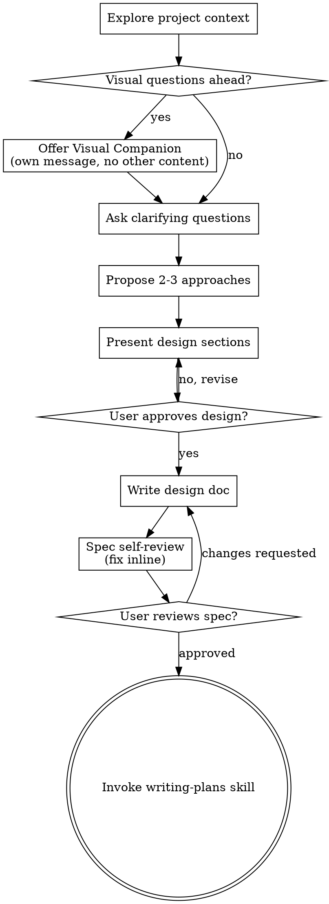

<!-- Generated by SpecStory, Markdown v2.1.0 -->

# 2026-11-10 05:19:42Z

<!-- Claude Code Session 2b62c399-2eb0-471c-8a20-00ddaab0f650 (2026-11-10 05:19:42Z) -->

_**User (2026-11-10 05:19:42Z)**_

Lets split issue 151 into multiple sub issues

---

_**Agent (claude-opus-5-5 2026-11-10 05:19:46Z)**_

<tool-use data-tool-type="unknown" data-tool-name="mcp__ccd_turn__update_plan"><details>
<summary>Tool use: **mcp__ccd_turn__update_plan**</summary>

```text
Plan shown (3 steps).
```
</details></tool-use>

_**Agent (claude-opus-5-5 2026-11-10 05:19:56Z)**_

<tool-use data-tool-type="shell" data-tool-name="Bash"><details>
<summary>Tool use: **Bash**</summary>
Check memory note, gh availability, remotes

`cd "C:/Users/vishc/OneDrive/Documents/repos/gitea"; cat "C:/Users/vishc/.claude/projects/C--Users-vishc-OneDrive-Documents-repos-gitea/memory/build-tools-missing-locally.md"; which gh; git remote -v; ls docs/sprint2`

```text
---
name: build-tools-missing-locally
description: "make, uv, docker/podman and gh are not installed on this machine; run the Makefile's underlying commands directly"
metadata: 
  node_type: memory
  type: project
  originSessionId: 03aeb31d-3d73-4640-8250-43591bb821dd
  modified: 2026-09-16T20:07:08.972Z
---

`make` is not installed on this Windows machine, so every `make <target>` in AGENTS.md must be
translated to the underlying command from the Makefile. Also missing: `uv` (needed by
`lint-templates`' djlint half), `docker`/`podman`, and the `gh` CLI.

Equivalents verified working:

- `make lint-js` -> `pnpm exec eslint --color --max-warnings=0 web_src/js tools *.ts tests/e2e`
  followed by `pnpm exec vue-tsc`. Both must pass; CI runs both.
- `make lint-css` -> `pnpm exec stylelint --color --max-warnings=0 web_src/css web_src/js/components/*.vue`
- `make test-frontend` -> `pnpm exec vitest run`
- `make frontend` -> `pnpm exec vite build`
- `make lint-templates` -> `node tools/lint-templates-svg.ts` works; the `uv run djlint` half cannot run here.

**Why:** Guessing at `make` targets wastes a round trip each time, and a partial lint run gives false
confidence — `lint-js` failing on `vue-tsc` while eslint passes is exactly how a green local run
turned into a red CI job.

Without `gh`, PRs cannot be opened from the CLI. Git pushes also fail: both the Bash and PowerShell
tools are non-interactive, so Git Credential Manager cannot prompt. Hand the user the command to run
in their own terminal instead. GitHub's REST API works unauthenticated for reading public CI results
(`api.github.com/repos/CSCI-435-SE/gitea/...`), but Actions *logs* return 403 and the org requires
sign-in to view them in a browser.

See [[gitea-e2e-needs-bindata-build]] for running e2e tests here.
which: no gh in (/c/Users/vishc/bin:/ucrt64/bin:/usr/local/bin:/usr/bin:/bin:/ucrt64/bin:/usr/bin:/c/Users/vishc/bin:/c/Program Files/Microsoft SDKs/Azure/CLI2/wbin:/c/Program Files/Eclipse Adoptium/jdk-21.0.6.7-hotspot/bin:/c/Python311/Scripts:/c/Python311:/c/Program Files (x86)/Common Files/Oracle/Java/javapath:/c/WINDOWS/system32:/c/WINDOWS:/c/WINDOWS/System32/Wbem:/c/WINDOWS/System32/WindowsPowerShell/v1.0:/c/WINDOWS/System32/OpenSSH:/c/ProgramData/chocolatey/bin:/c/Program Files/Microsoft VS Code/bin:/c/Program Files (x86)/Microsoft SQL Server/160/Tools/Binn:/c/Program Files/Microsoft SQL Server/160/Tools/Binn:/c/Program Files/Microsoft SQL Server/Client SDK/ODBC/170/Tools/Binn:/c/Program Files/Microsoft SQL Server/160/DTS/Binn:/c/Program Files (x86)/Microsoft SQL Server/160/DTS/Binn:/c/Program Files/Microsoft SQL Server/150/Tools/Binn:/c/Program Files/dotnet:/c/Program Files/nodejs:/c/Program Files/Microsoft SQL Server/170/Tools/Binn:/c/Program Files/Tailscale:/c/Program Files/Go/bin:/c/Program Files/Microsoft VS Code/bin/copilot-shim:/cmd:/c/Users/vishc/anaconda3:/c/Users/vishc/anaconda3/Library/mingw-w64/bin:/c/Users/vishc/anaconda3/Library/usr/bin:/c/Users/vishc/anaconda3/Library/bin:/c/Users/vishc/anaconda3/Scripts:/c/Users/vishc/AppData/Local/Microsoft/WindowsApps:/c/Users/vishc/AppData/Local/Programs/Microsoft VS Code/bin:/c/msys64/ucrt64/bin:/c/Users/vishc/.dotnet/tools:/c/Users/vishc/AppData/Roaming/npm:/c/Users/vishc/Downloads/SpecStoryCLI_Windows_x86_64:/c/Users/vishc/go/bin:/c/Users/vishc/AppData/Local/Programs/Microsoft VS Code/bin/copilot-shim:/c/Program Files/nodejs:/usr/bin/vendor_perl:/usr/bin/core_perl)
origin	https://github.com/CSCI-435-SE/gitea.git (fetch)
origin	https://github.com/CSCI-435-SE/gitea.git (push)
checkin
diagrams
issue-100-design.md
issue-100-plan.md
issue-100-pr-and-ai-comment.md
issue-109-spec-review-draft.md
issue-36-split-drafts.md
issue-98-pr-and-ai-comment.md
issue-98-study-guide.md
pr-122-review-draft.md
pr-134-review-draft.md
pr-97-review-draft.md
screenshots
```
</details></tool-use>

_**Agent (claude-opus-5-5 2026-11-10 05:19:56Z)**_

<tool-use data-tool-type="read" data-tool-name="Read"><details>
<summary>Tool use: **Read**</summary>
 `./.claude-students/COURSE-WORKFLOW.md`

```text
1	# Course workflow — issues, PRs, reviews, sprint deliverables
2	
3	Course rules, not upstream Gitea ones. Source: the course site <https://csci-435-se.github.io/>
4	(Sprints pages) and `docs/sprint0/standards.md`. Everyone on the team, and every AI session, uses
5	the formats below so all issues and PRs look the same. The GitHub templates in `.github/` carry the
6	same formats; if they ever disagree with this page, fix the template.
7	
8	AI disclosure has its own page: `AI-ASSISTANCE.md`.
9	
10	## Current sprint: Sprint 2
11	
12	- **Dates:** Oct 13 – Oct 29, 2026. Everything pushed and merged by **Oct 29, 11:59 PM**, except
13	  the D7 check-in, due **Oct 22, 11:59 PM**.
14	- **Points:** 100.
15	- **Zero rule:** no merged PR (D4), no sprint report (D8) or no release (D9) means **0 for the
16	  whole sprint**.
17	- **Carries forward:** anything the Sprint 2 page doesn't change comes from the Sprint 1 page, and
18	  every Sprint 0 standard still applies.
19	
20	| # | Deliverable | Points | Who | Where |
21	| --- | --- | --- | --- | --- |
22	| D1 | Sprint backlog: a `Sprint 2` milestone with every selected issue on it | 10 | Team | GitHub milestone |
23	| D2 | Requirements spec for each issue (formats below), peer-reviewed by a teammate before coding | 20 | Individual | Issue body |
24	| D3 | At least one non-trivial design decision per issue, with **at least two alternatives** | 5 | Individual | Issue body |
25	| D4 | Code changes and PRs, each with a `## Tech Debt` section | 20 | Individual | PRs |
26	| D5 | AI logs | 5 | Individual | `ai-logs/sprint2/<github-username>/` |
27	| D6 | UML class and sequence diagrams plus Q&A for one medium issue you resolved | 15 | Individual | `docs/sprint2/diagrams/` |
28	| D7 | Mid-sprint check-in | 5 | Individual | `docs/sprint2/checkin/<github-username>.md` |
29	| D8 | Sprint report | 10 | Team | `docs/sprint2/report.md` |
30	| D9 | Release: tag `v1.27.3-csci435-s2` plus a GitHub release | 2 | Team | Tags / Releases |
31	| D10 | Reflection survey | 8 | Individual | Blackboard/Zulip link |
32	
33	- **D1 load:** each CSCI 435 student owns at least 2 medium issues; each CSCI 535 student owns at
34	  least 2 medium and 1 small. Either load can be met with equivalent story points instead. Every
35	  issue has exactly **one** assignee. Unfinished Sprint 1 issues
36	  go into the backlog before new work. To skip one, write the reason on that issue (closed, made
37	  invalid by later changes, or no longer relevant). If the backlog is too thin to meet the load,
38	  find areas that still need work (features, improvements, test gaps, bugs) and write new issues
39	  for them the usual way: user story, acceptance criteria and an estimate.
40	- **D3:** each decision names at least two concrete alternatives and why one won; this is graded
41	  strictly. The site also accepts the decision in an issue comment or the PR description; the team
42	  keeps it in the issue body. Decisions that span issues go in `docs/sprint2/design.md`.
43	- **D4:** every PR description has the Tech Debt section (see "Pull request format"). A PR without
44	  it loses points. Per-PR scores are combined across your issues and scaled to 20.
45	- **D5:** conventions are in `ai-logs/README.md`. Logs hold the full prompts and output: summaries,
46	  screenshots and share links are not logs. The link must open the log file itself, not a folder or
47	  another issue. The folder must exist even if no AI was used; in that case, post a comment saying
48	  so. The site accepts the link in an issue or a PR comment this sprint; the team keeps it in
49	  **issue comments only** (`AI-ASSISTANCE.md`).
50	- **D6:** see "UML diagrams (D6)" below.
51	- **D7:** about 150 words on each of: what you have done and what remains; one thing you learned
52	  about the codebase or about software engineering; one thing you would do differently. On time and
53	  substantive scores 5, late or thin 3, missing 0.
54	- **D8:** graded on completeness, specificity and quality of evidence; sections are in "Sprint
55	  report (D8) sections" below.
56	- **D9:** keep the base version (`v1.27.3-csci435-s1` → `v1.27.3-csci435-s2`), tag after every
57	  Sprint 2 PR is merged, push the tag to origin, and write release notes listing the features,
58	  fixes and improvements. The site's example says `v2.17.2`; this fork's base is `v1.27.3`.
59	- **Reviews:** nobody approves or merges their own PR. Reviewers leave substantive comments, not a
60	  bare approval. Tell the reviewer on Zulip or by email, and aim to review within 24 hours. Each
61	  student reviews at least one PR per sprint, and every teammate at least once per semester.
62	- **Extra credit:** up to 3 points per PR submitted to upstream Gitea that is accepted or under
63	  active review, at the instructor's discretion.
64	
65	## Branches and commits
66	
67	- Branches: `feat/issue-<N>-short-description`, `fix/issue-<N>-short-description` or
68	  `chore/short-description` (`STUDENTS.md`). One issue per branch.
69	- Commit messages follow Conventional Commits and end with the issue number:
70	  `feat(repo): show empty state on releases page (#17)`. Add an
71	  `Assisted-by: AGENT_NAME:MODEL_VERSION` trailer when AI helped; never `Co-Authored-By` or
72	  `Signed-off-by` (`AGENTS.md`). A human approves every commit before it is made.
73	
74	### Before each implementation: sync with main
75	
76	Every new branch starts from an up-to-date `main`. AI sessions run this before writing any code:
77	
78	```bash
79	git switch main
80	git pull origin main
81	git switch -c feat/issue-<N>-short-description
82	```
83	
84	To pick up new work on `main` for a branch that already exists, **merge, don't rebase**. Rebasing
85	or squashing after review has started is not allowed (`docs/sprint0/standards.md`):
86	
87	```bash
88	git fetch origin
89	git merge origin/main
90	```
91	
92	Do this before opening the PR and again if `main` moves while it is in review. Never merge another
93	feature branch into yours.
94	
95	### After merge: clean up
96	
97	A PR is merged with a merge commit once it is approved, every review comment is addressed and CI
98	passes. Then:
99	
100	```bash
101	git switch main
102	git pull origin main
103	git branch -d feat/issue-<N>-short-description               # local branch
104	git push origin --delete feat/issue-<N>-short-description    # or GitHub's "Delete branch" button
105	git fetch --prune                                            # drop stale remote-tracking refs
106	```
107	
108	Also check that the issue closed (via `Closes #N`), is on the sprint milestone, and has its AI
109	Assistance comment. Then run `specstory sync` and file the session's log (see `ai-logs/README.md`).
110	
111	## Issue format: feature (user story)
112	
113	Template: `.github/ISSUE_TEMPLATE/user-story.yaml`. The user story must meet INVEST: Independent,
114	Negotiable, Valuable, Estimable, Small, Testable.
115	
116	```markdown
117	## User Story
118	As a <role>, I want <capability> so that <benefit>.
119	
120	## User Scenario
121	<A short concrete walk-through: who, where in the UI, what they do, what they see.>
122	
123	## Acceptance Criteria
124	- [ ] AC1: Given <state>, when <action>, then <observable result>.
125	- [ ] AC2: ...
126	- [ ] AC3: ...            (at least 3; each has a clear pass/fail result)
127	
128	## Out of Scope
129	- <What this issue deliberately does not do.>
130	
131	## Open Questions
132	- <Unresolved questions, or "None".>
133	
134	## Design Decision
135	**Decision:** <what was chosen>
136	**Alternatives Considered:** <at least two concrete options, and why each lost>
137	**Rationale:** <why this one>
138	**Consequences:** <trade-offs, follow-up work, what it makes harder>
139	
140	## Scope
141	small | medium | large, and matching `scope:` label
142	```
143	
144	## Issue format: bug report
145	
146	Template: `.github/ISSUE_TEMPLATE/bug-report.yaml`.
147	
148	```markdown
149	## Observed Behavior
150	## Expected Behavior
151	## Steps to Reproduce
152	1. ...
153	## Additional Information
154	<Version or commit, browser/OS, logs, screenshots.>
155	## Design Decision
156	<Same four fields as above: Decision, Alternatives Considered, Rationale, Consequences.>
157	```
158	
159	- **Design Decision (D3):** fill it in once you've picked an approach, before opening the PR. Put
160	  a second decision under another `### Decision 2` heading. If a PR changes the decision, update
161	  the issue body.
162	- **Peer review (D2):** a teammate reads the spec and comments `Spec reviewed — <notes>` on the
163	  issue before implementation starts.
164	
165	## Pull request format
166	
167	Template: `.github/pull_request_template.md`. Title uses Conventional Commits, e.g.
168	`fix(issues): keep label filter after search`. Description sections:
169	
170	1. `Closes #<N>`, which links the issue and closes it on merge.
171	2. **What changed:** the change in your own words.
172	3. **Why:** the problem, and which acceptance criteria (AC1…) it satisfies.
173	4. **How it was tested / Test strategy:** tests added or updated and why these ones. Name any
174	   change that can't be tested automatically and how it was checked by hand. Every behaviour change
175	   needs a new or updated test.
176	5. **CI / manual verification:** CI status, or the commands run and their results.
177	6. **Design:** one line pointing at the Design Decision in the issue, or a note on how it changed.
178	7. **Tech Debt:** required from Sprint 2. Both fields are required, and `None.` is a valid answer:
179	
180	   ```markdown
181	   ## Tech Debt
182	
183	   **Introduced:** <shortcuts, workarounds or design compromises this PR makes, and why>
184	
185	   **Encountered:** <tech debt that was already there and that you ran into, and how you handled it>
186	   ```
187	
188	8. **AI assistance:** format in `AI-ASSISTANCE.md` §2, with **no log link**.
189	
190	Per-PR grading (20 points): correctness against the acceptance criteria 6, test strategy with
191	explanation 5, description quality including the Tech Debt section 4, CI or manual verification 3,
192	review rubric posted 2.
193	
194	## Code review rubric
195	
196	The reviewer posts this as a **PR comment**, as well as the GitHub review itself. A copy-paste copy
197	is in `.github/code-review-rubric.md`, so keep the two in sync. Pull the branch and test it when you
198	can, say what you checked, and mark each point as required or optional
199	(`docs/community-governance.md`). Score each row against the issue's acceptance criteria. Anything
200	below 7 needs a note saying what would raise it.
201	
202	```markdown
203	### Code Review — @reviewer-username
204	
205	**Checked:** <what you ran or tried>
206	
207	| Criterion | Score (1–10) | Notes |
208	| --- | --- | --- |
209	| Correctness — implements issue requirements | | |
210	| Test coverage — tests present and meaningful | | |
211	| Code quality — style, naming, no duplication | | |
212	| Documentation — comments and PR description clear | | |
213	| AI transparency — evidence of human verification if AI used | | |
214	| Overall — merge as-is? | | |
215	```
216	
217	## UML diagrams (D6)
218	
219	The person who resolved a medium issue draws a class diagram and a sequence diagram for it. Several
220	small issues that together equal one medium issue are drawn together instead. Files:
221	
222	- `docs/sprint2/diagrams/<issue#>-<github-username>-class.png` (or `.pdf`)
223	- `docs/sprint2/diagrams/<issue#>-<github-username>-sequence.png` (or `.pdf`)
224	- `docs/sprint2/diagrams/<issue#>-<github-username>.md`, which embeds both and answers the Q&A
225	
226	What the diagrams need:
227	
228	- Show the existing code found during concept location and impact analysis, and the new or changed
229	  code, and tell the two apart with a legend, colour or label.
230	- Show only the fields and methods that matter to the issue.
231	- Annotate the diagrams with the key design decisions and calls. Diagrams without annotations lose
232	  points.
233	- Add a short note on how Go maps to UML: structs, interfaces, and embedding.
234	- The `.md` follows the course template: `# Issue #<N> -- <title>`, `## Class Diagram`,
235	  `## Sequence Diagram`, `## Q&A`, each diagram embedded with
236	  `` under its heading. The Q&A has 3
237	  class-diagram questions, 3 sequence-diagram questions and 1 question on AI use, answered "N/A" if
238	  no AI was used. The questions, copied from the Sprint 2 page:
239	
240	```markdown
241	**Class diagram:**
242	
243	1. Among all the classes shown in the diagram, which 1--2 are most central to understanding the codebase and solving the issue? Explain what role each one plays.
244	2. What is the most significant relationship shown in the diagram? Explain what it represents in the system and why it matters for understanding the solution.
245	3. Looking back at your implementation, is there anything in this design you would change, and why?
246	
247	**Sequence diagram:**
248	
249	1. What user action or system event starts the sequence, and what is the expected outcome when it completes successfully?
250	2. Identify the 2--3 most important steps in the sequence. For each one, describe what is happening and note whether it involves existing code or new/modified code from your solution.
251	3. What error cases or alternative paths are not shown in the diagram, and why did you leave them out?
252	
253	**Cross-cutting:**
254	
255	4. If you used AI to create or check any part of the diagrams, describe what it produced, what you verified against the actual code, and what you had to correct or add. If AI was not used, write "N/A."
256	```
257	
258	Grading (15 points): existing code 2, solution code 2, annotations 3, UML notation (relationships,
259	cardinality, lifelines; minor errors are fine) 2, Q&A 4, AI transparency 2. The Q&A points are for
260	understanding that goes beyond what the diagram already shows, so answer with reasons, not a
261	re-description of the boxes.
262	
263	## Sprint report (D8) sections
264	
265	`docs/sprint<N>/report.md`, following `docs/sprint0/report.md`:
266	
267	- Team: names, GitHub usernames, project name, repository link.
268	- Sprint overview.
269	- Backlog: milestone link, why the team chose these issues, plus a table of title, owner, points,
270	  scope and status.
271	- Requirements and design: when specs were done, what surprised you, design rationale.
272	- Completed issues: title, owner, PR link, author, reviewer, what changed.
273	- Test strategy, including untestable changes and why.
274	- AI tool usage per member: tools, session count, AI log folder link, and 2–3 sentences on lessons
275	  learned.
276	- Release: tag and release link.
277	- Risks and retrospective: what worked, what slowed the team down, next-sprint changes.
278	- Next sprint plan: initial ideas and carryover issues.
279	- From Sprint 2: Sprint 1 carryovers (which were taken, which were skipped and why), and D6 and D7
280	  in the deliverables summary. The report covers this sprint's work only.
281
```
</details></tool-use>

_**Agent (claude-opus-5-5 2026-11-10 05:20:06Z)**_

<tool-use data-tool-type="shell" data-tool-name="Bash"><details>
<summary>Tool use: **Bash**</summary>
Fetch issue 151, its comments and sub-issues

`cd "C:/Users/vishc/OneDrive/Documents/repos/gitea"; curl -s https://api.github.com/repos/CSCI-435-SE/gitea/issues/151 | python -c "import json,sys;d=json.load(sys.stdin);print(d.get('title'));print(d.get('state'),[l['name'] for l in d.get('labels',[])],d.get('assignee') and d['assignee']['login'],d.get('milestone') and d['milestone']['title']);print(d.get('body'))"; echo ---COMMENTS; curl -s https://api.github.com/repos/CSCI-435-SE/gitea/issues/151/comments | python -c "import json,sys;[print(c['user']['login'],':',c['body'],'\n--') for c in json.load(sys.stdin)]"; echo ---SUB; curl -s https://api.github.com/repos/CSCI-435-SE/gitea/issues/151/sub_issues | head -c 600`

```text
Code suggestions in pull request reviews
open ['enhancement', 'scope: large'] None None
### User Story

As a reviewer, I want to suggest an exact code change in a review comment, and as the PR author, I want to apply it with one click, so that small fixes don't need to be explained and retyped.

### User Scenario

A reviewer selects a few lines in a pull request diff and writes the code she would like to see instead. The PR author sees her suggestion as a diff in the conversation, clicks to apply it, and Gitea adds a commit with that change to the PR branch.

### Acceptance Criteria

The criteria below are a starting point and are incomplete. The open questions must be answered before implementation.

- [ ] AC1: Given selected lines in a PR diff, when a reviewer adds a suggestion, then the comment shows the suggested change as a diff.
- [ ] AC2: Given a suggestion, when the PR author applies it, then a commit with the change is added to the PR branch.
- [ ] AC3: Given a user who can't push to the PR branch, when they try to apply a suggestion, then nothing is committed and they see why.
- [ ] More criteria needed, based on the open questions below.

Acceptance criteria should also cover invalid input, failures, conflicts, and permissions, not only the main path.

### Out of Scope

- Suggestions on commits outside a pull request
- Suggestions that create, rename, or delete files

### Open Questions

- What happens if the code changed after the suggestion was made?
- Who besides the PR author may apply a suggestion? What about pull requests from forks?
- What if the PR is closed or merged, or its branch was deleted?
- Can several suggestions be applied at once? What if they touch the same lines?
- Who appears as the author of the commit?
- What happens if two people apply suggestions at the same time?
- Can suggestions be applied through the API?
- What happens to existing data and installations after upgrading?

### Design Decision

To be filled in before implementation.

**Decision:**
**Alternatives Considered:**
**Rationale:**
**Consequences:**


### Scope

large

### Scope Justification

Review comments and their markdown rendering, the PR diff UI, creating commits on the PR branch, permissions, and the API.
---COMMENTS
ojcchar : Hi @all,

This is your team's feature for Sprints 3 and 4.

A few things you should consider:

1. Complete the spec. The issue is a starting point: the acceptance criteria are incomplete and the open questions need answers. We expect thorough specs that cover what happens when things go wrong (invalid input, failures, conflicts, permissions, old data), not only the main path. The open questions are not a complete list; find the other cases too.
2. Given the scope of the issue, split the feature into sub-issues. Your breakdown should cover the areas listed in the issue.
3. Plan which sub-issues go in Sprint 3. Post your breakdown as a comment on the issue. Each sub-issue should have an owner, a full spec, and a spec review.
4. By the end of Sprint 3 (Nov 19), deliver a working part of the feature that we can demo end-to-end, from the UI to the server. It doesn't need to be complete, but it must work as a whole, not as separate pieces that aren't connected yet.

Treat us as your customer. If anything is unclear or you need a decision about the expected behavior, ask us on the issue or on Zulip. Don't guess; ask.

Cheers, 
--
---SUB
[

]
```
</details></tool-use>

_**Agent (claude-opus-5-5 2026-11-10 05:20:06Z)**_

<tool-use data-tool-type="read" data-tool-name="Read"><details>
<summary>Tool use: **Read**</summary>
 `./docs/sprint2/issue-36-split-drafts.md`

```text
1	# Issue #36 split: four issue drafts
2	
3	Splits #36 ("Calendar view and iCalendar subscription feed", `scope: large`) into four issues that can be posted on their own.
4	
5	**Posting order:** post A and B first; they can be worked on at the same time. Post C next, then D. Once all four
6	exist, comment on #36 with links to them and relabel it as a parent issue, or close it.
7	
8	**Prerequisite note:** the #36 body says to land "#2's query options" first. In this fork #2 is the
9	character-counter issue. The deadline query it means already shipped with #34 (`a4ed09f336`):
10	`IssuesOptions.DeadlineAfterUnix` / `DeadlineBeforeUnix` / `HasDeadline` in
11	`models/issues/issue_search.go`, and `ParseDueDateFilter` in
12	`routers/web/shared/issue/issue_due_date.go`. The drafts below refer to #34 instead.
13	
14	**Design Decision sections are proposals.** Each owner should confirm or change them once they
15	choose an approach, before opening the PR (D3).
16	
17	| Draft | Title | Scope | Depends on |
18	| --- | --- | --- | --- |
19	| A | Show milestone and issue deadlines in a repository calendar view | medium | none |
20	| B | Subscribe to a public repository's milestones and issue deadlines as an iCalendar feed | medium | none |
21	| C | Subscribe to private repository calendar feeds with a revocable calendar token | medium | B |
22	| D | Subscribe to one personal deadline feed across all my repositories | small | C |
23	
24	---
25	
26	## A. Show milestone and issue deadlines in a repository calendar view
27	
28	Labels: `enhancement`, `scope: medium` · Type: Feature · Part of #36
29	
30	## User Story
31	As a developer on a repository, I want a month calendar of its milestone due dates and issue
32	deadlines so that I can see what is due when without scanning the issue list.
33	
34	## User Scenario
35	Priya opens `octo/app` and clicks the new **Calendar** link in the Issues area. She lands on
36	`/octo/app/calendar`, which shows the current month as a grid. The "Sprint 3" milestone appears on
37	the 14th, and four issues with deadlines appear on their due days. Each entry shows its title and
38	links to the milestone or issue. She picks the "Sprint 3" milestone and "assigned to me" in the
39	filters, and the grid now shows only her Sprint 3 issues. She clicks the next-month arrow, and the
40	URL updates so she can share that view.
41	
42	## Acceptance Criteria
43	- [ ] AC1: Given a repository with issues enabled, when a user with read access to issues opens
44	  `/{owner}/{repo}/calendar`, then a month grid for the current month is shown, with every open
45	  milestone that has a due date and every issue with a deadline in that month on its due day.
46	- [ ] AC2: Given an entry on the calendar, when the user clicks it, then they go to that issue or
47	  milestone page.
48	- [ ] AC3: Given a milestone, assignee or state (open/closed/all) filter is chosen, when the
49	  calendar reloads, then only matching issues are shown and the filter values are kept in the
50	  URL query.
51	- [ ] AC4: Given the user moves to the previous or next month, when the page reloads, then entries
52	  for that month are shown and the month is in the URL (`?month=YYYY-MM`).
53	- [ ] AC5: Given a user without read access to the repository's issues, when they open the
54	  calendar URL, then they get the same 404 response the issue list gives them.
55	- [ ] AC6: Given an issue with no deadline (`deadline_unix = 0`), when the calendar is shown, then
56	  that issue does not appear.
57	
58	## Out of Scope
59	- `.ics` subscription feeds (issue B, issue C).
60	- The cross-repository `/calendar` page for the signed-in user (issue D).
61	- Dragging entries to change a deadline, and week or day views.
62	
63	## Open Questions
64	- Should pull requests that have deadlines appear too, or only issues? (Proposed: issues only, to match #36.)
65	- Where should the Calendar link go: in the issue list header next to Milestones, or as its own
66	  repository tab?
67	
68	## Design Decision
69	**Decision:** Render the month grid on the server with a Go template. The handler queries the
70	month's range with the deadline bounds from #34, and month navigation and filters are plain links
71	and GET forms.
72	
73	**Alternatives Considered:**
74	- *A Vue component that fetches JSON* (the approach #36 suggests, next to `RepoIssuesChart.vue`).
75	  It would need a new JSON endpoint and client-side date handling. Nothing on this page needs to
76	  be reactive, and `docs/frontend-vue-components.md` says to use Vue only when the page needs it.
77	- *An existing JS calendar library (for example FullCalendar).* It adds a large frontend
78	  dependency and its own styling that would have to match Fomantic and the `tw-` theme colours.
79	
80	**Rationale:** A server-rendered grid reuses `IssuesOptions` and the filter parsing #34 already
81	tested. It needs no new endpoint, works without JS, and keeps the whole feature in one layer.
82	
83	**Consequences:** Every month change reloads the page. Adding interactive features later (drag to
84	reschedule, hover previews) would mean moving to Vue then. The month boundaries must use
85	`setting.DefaultUILocation`, matching how #34 pins deadlines to the end of the day.
86	
87	## Scope
88	medium (`scope: medium`)
89	
90	---
91	
92	## B. Subscribe to a public repository's milestones and issue deadlines as an iCalendar feed
93	
94	Labels: `enhancement`, `scope: medium` · Type: Feature · Part of #36
95	
96	## User Story
97	As a developer, I want to subscribe my calendar app to a public repository's milestone and issue
98	deadlines so that they appear next to my other events and update when the dates change in Gitea.
99	
100	## User Scenario
101	Marco copies `https://gitea.example/octo/app/milestones.ics` and adds it in Google Calendar under
102	"From URL". Within the client's next refresh, "Sprint 3 (octo/app)" shows on the 14th as an
103	all-day event. A maintainer moves the milestone to the 21st. On the next refresh the existing
104	event moves to the 21st instead of a second event being added. He also subscribes to
105	`issues.ics?state=open` to see open issue deadlines.
106	
107	## Acceptance Criteria
108	- [ ] AC1: Given a public repository, when an anonymous client GETs `/{owner}/{repo}/milestones.ics`,
109	  then the response is `200` with `Content-Type: text/calendar; charset=utf-8` and a valid
110	  VCALENDAR containing one all-day VEVENT per milestone with a due date.
111	- [ ] AC2: Given `/{owner}/{repo}/issues.ics`, when fetched, then it contains one all-day VEVENT
112	  per issue with a deadline (never one for `deadline_unix = 0`), with the issue title, `#index`,
113	  and a URL to the issue.
114	- [ ] AC3: Given a milestone or issue whose deadline changes, when the feed is fetched again, then
115	  the event keeps the same `UID` and has a newer `DTSTAMP`/`SEQUENCE`. A test checks that the UID
116	  of the same row is the same across two renders with different deadlines.
117	- [ ] AC4: Given a repository with more issues with deadlines than the cap (proposed 1,000), when
118	  `issues.ics` is fetched, then the response holds at most the cap, choosing the issues closest to
119	  today.
120	- [ ] AC5: Given a private repository, or feeds disabled with `[other] ENABLE_FEED = false`, when
121	  an anonymous client fetches either `.ics` URL, then it gets `404`, matching the RSS/Atom feeds.
122	- [ ] AC6: Given the repository's milestone and issue list pages, when viewed, then each shows a
123	  "Subscribe (iCal)" link to its feed.
124	
125	## Out of Scope
126	- Private repositories and any token in the URL (issue C).
127	- The per-user cross-repository feed (issue D).
128	- Writing back to Gitea from the calendar (CalDAV).
129	
130	## Open Questions
131	- Should the event `UID` use the instance's domain (`issue-{id}@{domain}`)? If so, changing
132	  `ROOT_URL` would duplicate events in clients that are already subscribed.
133	- Is 1,000 the right cap, and should it be a setting?
134	
135	## Design Decision
136	**Decision:** Generate iCalendar with `github.com/arran4/golang-ical`. Serve it from new handlers
137	in `routers/web/feed/`, using the same `feedEnabled` guard and repo permission check the RSS/Atom
138	routes use. Build each UID from the row's database ID (`milestone-{id}@{domain}`,
139	`issue-{id}@{domain}`), never from the date.
140	
141	**Alternatives Considered:**
142	- *Write the iCalendar text by hand.* RFC 5545 has strict rules for line folding, escaping and
143	  CRLF line endings that are easy to get wrong, and most calendar clients reject a malformed feed
144	  without any error message.
145	- *`github.com/emersion/go-ical`.* It covers RFC 5545 well and is maintained. But its API is
146	  lower-level, and it is aimed at CalDAV parsing rather than generating simple feeds.
147	
148	**Rationale:** `golang-ical` is the common Go choice for generating feeds, and it handles folding
149	and escaping. Keeping the handlers in `routers/web/feed/` reuses the existing guard, permission
150	checks and route layout. IDs never change, so UIDs survive date edits and title renames.
151	
152	**Consequences:** This adds a new dependency to `go.mod` (run `make tidy`). Because the project is
153	conservative about dependencies, raise it in the PR description, and upstream Gitea may push
154	back. The feed format is now a public contract: changing the UID scheme later would duplicate
155	every subscriber's events.
156	
157	## Scope
158	medium (`scope: medium`)
159	
160	---
161	
162	## C. Subscribe to private repository calendar feeds with a revocable calendar token
163	
164	Labels: `enhancement`, `scope: medium` · Type: Feature · Part of #36 · Depends on B
165	
166	## User Story
167	As a member of a private repository, I want a calendar subscription URL that works without
168	signing in but only exposes calendar data and can be revoked, so that I can follow private
169	deadlines in my calendar app without pasting a full-power access token into a third-party service.
170	
171	## User Scenario
172	Lena works on the private repo `acme/backend`. On its milestones page she clicks "Subscribe
173	(iCal)". A dialog explains that the URL contains a personal calendar token and shows
174	`https://gitea.example/acme/backend/milestones.ics?token=cal_…`. She adds it to Outlook. Later she
175	pastes the URL by mistake into a shared calendar. She goes to **Settings → Applications →
176	Calendar token** and clicks "Regenerate", and the old URL stops working at once. When she leaves
177	the `acme` organization, her feed stops returning `acme/backend` events on its next fetch.
178	
179	## Acceptance Criteria
180	- [ ] AC1: Given a signed-in user, when they open **Settings → Applications**, then they can
181	  create, view, regenerate or delete one calendar token. Only a hash is stored, and the plain
182	  token is shown once, when it is created.
183	- [ ] AC2: Given a valid calendar token in the `token` query parameter, when it is sent to an
184	  `.ics` route of a private repo the token owner can read, then the feed is returned with
185	  `Cache-Control: private`.
186	- [ ] AC3: Given the same calendar token, when it is sent to any non-`.ics` route (an
187	  API endpoint, an RSS feed, or a repo page), then it does not authenticate the request.
188	- [ ] AC4: Given a personal access token, when it is sent as `?token=` to an `.ics` route, then
189	  it is rejected. Personal access tokens never authenticate calendar feeds.
190	- [ ] AC5: Given a token whose owner has lost read access to the repository, when the feed is
191	  fetched, then it returns `404`. Access is checked on every request, not when the token is
192	  created.
193	- [ ] AC6: Given a token that has been regenerated or deleted, when the old URL is fetched, then
194	  it returns `404`.
195	
196	## Out of Scope
197	- Tokens limited to one repository, or tokens with expiry dates (possible follow-ups).
198	- The cross-repository user feed (issue D).
199	- Admin pages that list or revoke other users' calendar tokens.
200	
201	## Open Questions
202	- Should a bad token return `401` or `404`? (Proposed: `404`, so the response does not reveal that
203	  a private repo exists.)
204	- Should the token be removed automatically when the user's account is disabled? (Proposed: yes,
205	  in the same place access tokens are removed.)
206	
207	## Design Decision
208	**Decision:** Add a new `calendar_token` table with one row per user: `uid` (unique),
209	`token_hash`, `token_salt`, `token_last_eight` and `created_unix`. Add a migration and settings
210	UI. The `.ics` handlers authenticate `?token=` only against this table, then run the normal repo
211	permission check as that user on every request.
212	
213	**Alternatives Considered:**
214	- *Reuse personal access tokens with a new calendar scope.* Existing RSS feeds already accept
215	  tokens through `checkRepoFeedTokenScope`. But a PAT is a general credential: a mis-scoped or
216	  reused one pasted into Google Calendar would leak far more than dates, and #36 rules this out
217	  explicitly.
218	- *Use one secret URL per repository (a token stored on the repo).* This is simpler to look up,
219	  but it cannot be revoked per user, and someone removed from the repository could keep using a
220	  URL they already have.
221	
222	**Rationale:** A separate table and a separate auth path make it impossible for the token to
223	reach anything except calendar feeds. A per-user token plus a per-request permission check means
224	losing access takes effect immediately, and regenerating the token revokes it in one step.
225	
226	**Consequences:** This adds a schema migration (see `docs/models-migrations.md`) and a new
227	settings section with locale keys. Feed URLs contain a secret, so they will show up in client
228	logs and proxy logs; documentation should tell users to treat them like passwords. Tokens per
229	repository or with expiry dates would need the table to change later.
230	
231	## Scope
232	medium (`scope: medium`)
233	
234	---
235	
236	## D. Subscribe to one personal deadline feed across all my repositories
237	
238	Labels: `enhancement`, `scope: small` · Type: Feature · Part of #36 · Depends on C
239	
240	## User Story
241	As a developer who works across several repositories, I want a single calendar feed of the
242	deadlines on issues assigned to me and the milestones in my repositories, so that I subscribe
243	once instead of once per repository.
244	
245	## User Scenario
246	Sam is assigned issues in five repositories. Under **Settings → Applications → Calendar token**
247	he copies the "All my deadlines" URL, `/sam/deadlines.ics?token=cal_…`, and adds it to his
248	calendar. His assigned issue deadlines from all five repos show up with the repo name in each
249	title. When he is unassigned from one issue, it drops off the feed on the next refresh.
250	
251	## Acceptance Criteria
252	- [ ] AC1: Given a valid calendar token for user `sam`, when `/sam/deadlines.ics?token=…` is
253	  fetched, then it returns one VEVENT for each open issue with a deadline assigned to `sam` in a
254	  repository he can read, with titles prefixed by `owner/repo`.
255	- [ ] AC2: Given a token that belongs to a different user, or no token, when
256	  `/sam/deadlines.ics` is fetched, then it returns `404`.
257	- [ ] AC3: Given that Sam loses access to a repository, when the feed is fetched again, then that
258	  repository's issues are no longer in it.
259	- [ ] AC4: Given an issue that also appears in that repository's own `issues.ics`, when both
260	  feeds are compared, then the event has the same `UID` in both, so a client subscribed to both
261	  feeds shows it once.
262	- [ ] AC5: Given more matching issues than the cap from issue B, when the feed is fetched, then
263	  it returns at most the cap.
264	
265	## Out of Scope
266	- A cross-repository in-app `/calendar` page (follow-up once A ships).
267	- Including issues the user created or is watching but is not assigned to.
268	
269	## Open Questions
270	- Should milestones of every repository the user can write to be included, or only issues
271	  assigned to them? (Proposed: assigned issues only, to keep the query bounded.)
272	
273	## Design Decision
274	**Decision:** Build the feed from one `IssuesOptions` query with `AssigneeID = user`, the #34
275	`HasDeadline` filter and the repository access condition the user dashboard already uses. Render
276	it with the serializer from issue B, so UIDs match the per-repo feeds.
277	
278	**Alternatives Considered:**
279	- *Merge the per-repo feeds in Go.* This makes one query per repository, which is slow for users
280	  in many repos, and it is hard to cap the total size.
281	- *Let the client subscribe to each repo feed (do nothing).* This is the current pain point for
282	  users in many repos, and there would be nowhere to put the cross-repo `/calendar` page later.
283	
284	**Rationale:** A single query bounded by the access condition is cheap and correct when access
285	changes, and reusing B's serializer keeps the UID scheme in one place.
286	
287	**Consequences:** The feed depends on the dashboard's access condition staying correct for
288	private repos and organizations. A later cross-repo `/calendar` page could reuse the same query.
289	
290	## Scope
291	small (`scope: small`)
292
```
</details></tool-use>

_**Agent (claude-opus-5-5 2026-11-10 05:20:22Z)**_

<tool-use data-tool-type="shell" data-tool-name="Bash"><details>
<summary>Tool use: **Bash**</summary>
Search for existing suggestion code and relevant docs

`cd "C:/Users/vishc/OneDrive/Documents/repos/gitea"; grep -rli "suggestion" --include=*.go models services routers modules | head -20; echo ---; ls .claude-students/docs | head -50; echo ---; grep -n "^#\|ChangeRepoFiles\|CodeComment\|TreePath\|Line\b" .claude-students/docs/services-pull-and-gitdiff.md | head -60; echo; ls docs/sprint3 2>/dev/null; git log --format='%an' origin/main | sort | uniq -c | sort -rn | head -8`

```text
models/issues/issue.go
services/issue/suggestion.go
services/issue/suggestion_test.go
services/migrations/gitlab_test.go
routers/web/repo/issue_similar.go
routers/web/repo/issue_suggestions.go
routers/web/web.go
---
architecture.md
build-and-tooling.md
frontend-css.md
frontend-js.md
frontend-vue-components.md
i18n.md
models-actions.md
models-db.md
models-issues.md
models-migrations.md
models-packages.md
models-project.md
models-repo-and-git.md
models-user-org-perm.md
modules-git.md
modules-infra.md
modules-markup.md
modules-setting.md
modules-structs.md
modules-util-and-generics.md
routers-api-actions.md
routers-api-v1.md
routers-private-install-cmd.md
routers-web.md
services-actions.md
services-context.md
services-forms-and-convert.md
services-issue.md
services-notify-mailer-webhook.md
services-pull-and-gitdiff.md
services-repository.md
services-user-org-auth.md
templates.md
testing.md
---
6:# services/pull and services/gitdiff — pull requests, review, diffs
12:## Responsibilities
21:## Key files
32:| `services/pull/review.go` | `CreateCodeComment`, `SubmitReview`, `DismissReview`, `InvalidateCodeComments` |
34:| `services/gitdiff/gitdiff.go` | `Diff`, `DiffFile`, `DiffSection`, `DiffLine`, `ParsePatch`, `GetDiffForRender`, `GetDiffForAPI` |
38:## Conventions & invariants
53:- **Review comments are anchored to a commit, not to a line of the current head.** `CreateCodeComment`
54:  takes `latestCommitID` and a `treePath`; when the branch moves, `InvalidateCodeComments` marks
60:## Recipes
62:**Add something to the diff viewer.** Extend `DiffFile`/`DiffSection`/`DiffLine` in
72:## Gotchas
83:## Related

   2111 Lunny Xiao
   1852 GiteaBot
   1674 Unknwon
   1573 silverwind
   1425 wxiaoguang
   1186 zeripath
    573 Unknown
    570 6543
```
</details></tool-use>

_**Agent (claude-opus-5-5 2026-11-10 05:20:28Z)**_

<tool-use data-tool-type="shell" data-tool-name="Bash"><details>
<summary>Tool use: **Bash**</summary>
Read pull/diff doc conventions and key comment fields

`cd "C:/Users/vishc/OneDrive/Documents/repos/gitea"; sed -n 38,95p .claude-students/docs/services-pull-and-gitdiff.md; echo ----; grep -n "Line \|TreePath\|CommitSHA\|PatchQuoted\|Patch \|Invalidated\|OldRef\|ReviewID" models/issues/comment.go | head -20; echo ---; grep -n "^func ChangeRepoFiles\|LastCommitID\|Committer\b\|Author \*" services/repository/files/update.go | head; echo ---; grep -n -i "github\|username\|@" docs/sprint2/report.md 2>/dev/null | head -15`

```text
## Conventions & invariants

- **Mergeability is computed asynchronously.** Nothing recomputes it inline: a change pushes the PR
  id onto the worker queue in `check.go` via `AddPullRequestToCheckQueue`, and the result is
  written back to `PullRequest.Status`. The queue is unique-keyed, so pushing the same id twice is
  free. Code that needs a fresh answer must handle "not computed yet" rather than blocking.
- Merges do not run in the live repository. `createTemporaryRepoForPR` builds a scratch clone and
  the merge-style files operate there; only on success is the result pushed. A merge path that
  writes to the real repo directly is a bug.
- Merge styles are `repo_model.MergeStyle` values (`MergeStyleMerge`, `MergeStyleRebase`,
  `MergeStyleRebaseMerge`, `MergeStyleSquash`, `MergeStyleFastForwardOnly`) and each must be
  allowed by the repo's PR unit config — check with the unit accessors
  (`models-repo-and-git.md`), never by string comparison.
- `Merge` is not the permission check. `IsUserAllowedToMerge` and `CheckPullBranchProtections` sit
  beside it in `merge.go` but are separate calls the caller must make itself.
- **Review comments are anchored to a commit, not to a line of the current head.** `CreateCodeComment`
  takes `latestCommitID` and a `treePath`; when the branch moves, `InvalidateCodeComments` marks
  the ones that no longer apply. A comment feature that stores only a line number will drift.
- `GetDiffForRender` and `GetDiffForAPI` are deliberately separate — the render path carries
  highlighting, escaping and a repo link for building URLs. Do not use the API one to build HTML.
- `notify_service.*` is called after the transaction, exactly as in `services-issue.md`.

## Recipes

**Add something to the diff viewer.** Extend `DiffFile`/`DiffSection`/`DiffLine` in
`services/gitdiff/gitdiff.go`, populate it in `ParsePatch` or `GetDiffForRender`, then render it in
the repo diff templates and wire the frontend behaviour (`frontend-js.md`).

**Add a merge style.** A `MergeStyle` constant and its unit-config flag in `models/repo`, a
`merge_<style>.go` implementation, a branch in `Merge`, the repo settings UI, and the locale keys.

**Change when a PR becomes mergeable.** The check itself is in `check.go` / `merge_tree.go`. Add
the trigger by calling `AddPullRequestToCheckQueue`, not by computing inline.

## Gotchas

- `services/pull` is the logic; the `PullRequest` *rows* are in `models/issues/pull.go`. The
  package named `models/pull` is only automerge and review state (`models-issues.md`).
- A PR's issue fields (title, labels, comments) go through `services/issue`. Only PR-specific
  behaviour lives here, so a "PR change" often touches both packages.
- `AddTestPullRequestTask` reads as a test helper. It is production code that queues PR rechecks
  after a push.
- Diff size is capped by the `maxLines` / `maxFiles` arguments to `ParsePatch`; a large diff is
  truncated rather than failing, so check the `Diff` flags before assuming completeness.

## Related

- `services-issue.md` — the shared issue behaviour and the notify convention
- `models-issues.md` — `PullRequest`, `Review`, `Comment`
- `services-repository.md` — the push path that triggers PR rechecks
----
291:	OldRef           string
299:	Line            int64         // - previous line / + proposed line
300:	TreePath        string        `xorm:"VARCHAR(4000)"` // SQLServer only supports up to 4000
306:	Patch       string `xorm:"-"`
307:	PatchQuoted string `xorm:"LONGTEXT patch"`
313:	CommitSHA string `xorm:"VARCHAR(64)"`
322:	ReviewID    int64   `xorm:"index"`
323:	Invalidated bool
380:	c.PatchQuoted = c.Patch
382:		c.PatchQuoted = strconv.Quote(c.Patch)
388:	c.PatchQuoted = c.Patch
390:		c.PatchQuoted = strconv.Quote(c.Patch)
396:	c.Patch = c.PatchQuoted
397:	if len(c.PatchQuoted) > 0 && c.PatchQuoted[0] == '"' {
398:		unquoted, err := strconv.Unquote(c.PatchQuoted)
400:			c.Patch = unquoted
458:		if c.ReviewID == 0 {
463:				log.Warn("LoadReview(%d): %v", c.ReviewID, err)
736:	if c.ReviewID == 0 {
740:		if c.Review, err = GetReviewByID(ctx, c.ReviewID); err != nil {
---
40:	Committer time.Time
57:	LastCommitID string
63:	Committer    *IdentityOptions
82:func ChangeRepoFiles(ctx context.Context, repo *repo_model.Repository, doer *user_model.User, opts *ChangeRepoFilesOptions) (_ *structs.FilesResponse, errRet error) {
195:		opts.LastCommitID = ""
210:		// Assigned LastCommitID in "opts" if it hasn't been set
211:		if opts.LastCommitID == "" {
212:			opts.LastCommitID = commit.ID.String()
214:			lastCommitID, err := t.gitRepo.ConvertToGitID(opts.LastCommitID)
218:			opts.LastCommitID = lastCommitID.String()
---
```
</details></tool-use>

_**Agent (claude-opus-5-5 2026-11-10 05:20:33Z)**_

<tool-use data-tool-type="shell" data-tool-name="Bash"><details>
<summary>Tool use: **Bash**</summary>
Find team roster and maintainer-edit permission helper

`cd "C:/Users/vishc/OneDrive/Documents/repos/gitea"; ls docs/sprint1 docs/sprint2/checkin ai-logs/sprint2 2>/dev/null; grep -n "|" docs/sprint1/report.md 2>/dev/null | head -12; grep -rn "AllowMaintainerEdit\|func CanMaintainerWriteToBranch" models/issues/pull.go models/perm/access/*.go 2>/dev/null | head -4`

```text
ai-logs/sprint2:
CarsonRackley
Jack-Donohue
ab-wm
arjunsb26
controlled-opposition
vvchopra

docs/sprint1:
images
issue-63-design-decisions.md
issue-63-pr-and-ai-comment.md
pr-76-review-draft.md
pr-77-review-draft.md
report.md
test-output

docs/sprint2/checkin:
CarsonRackley.md
Jack-Donohue.md
ab-wm.md
arjunsb26.md
controlled-opposition.md
vvchopra.md
41:| Issue Title | Issue Owner | Estimated Points | Scope | Status |
42:| --- | --- | --- | --- | --- |
43:| #12 Let users choose a reason when closing an issue or pull request | ab-wm | 4 | Large | Done (split into #53, #54, #55) |
44:| #14 Add a burndown chart to milestones with an ideal line and projected finish | arjunsb26 | 4 | Large | Done (PR #77) |
45:| #34 Sort issues and pull requests by due date | Jack-Donohue | 2 | Medium | Done (PR #73) |
46:| #35 Require two-factor authentication for an organization's members | Jack-Donohue | 2 | Medium | Done (PR #76) |
47:| #50 Filter notifications by repository and type | CarsonRackley | 2 | Medium | Done (PR #69) |
48:| #51 Bulk actions on notifications (mark read/unread, pin, delete) | CarsonRackley | 2 | Medium | Done (PR #70) |
49:| #53 A way to store and retrieve "closed" reasons for issues and PRs | ab-wm | 2 | Medium | Done (PR #67) |
50:| #54 Select close reasons for Issues and PRs and show it under closed | ab-wm | 2 | Medium | Done (PR #68) |
51:| #55 Set close reason when issue or PR is closed by an automated process | vvchopra | 2 | Medium | Done (PR #72) |
52:| #61 Accessible menu web component, no Fomantic | controlled-opposition | 2 | Medium | Done (PR #71) |
models/issues/pull.go:145:	AllowMaintainerEdit bool   `xorm:"NOT NULL DEFAULT false"`
```
</details></tool-use>

_**Agent (claude-opus-5-5 2026-11-10 05:20:36Z)**_

Six-person team, single-line review comments today (`Comment.Line` only, no range) — that shapes the split. Checking a couple more facts, then drafting.

_**Agent (claude-opus-5-5 2026-11-10 05:20:40Z)**_

<tool-use data-tool-type="shell" data-tool-name="Bash"><details>
<summary>Tool use: **Bash**</summary>
Check code-comment form and API line fields

`cd "C:/Users/vishc/OneDrive/Documents/repos/gitea"; grep -n "Line\|Side\|TreePath" services/forms/repo_form.go | grep -i -A0 "codecomment\|Line " | head; grep -n "type CreatePullReviewComment" -A 14 modules/structs/pull_review.go | grep -n "Line\|Path"; grep -rn "\"suggestion\"" modules/markup web_src/js 2>/dev/null | head -3`

```text
595:	Line           int64
3:89-	Path string `json:"path"`
6:92-	OldLineNum int64 `json:"old_position"`
8:94-	NewLineNum int64 `json:"new_position"`
```
</details></tool-use>

_**Agent (claude-opus-5-5 2026-11-10 05:21:02Z)**_

<tool-use data-tool-type="unknown" data-tool-name="mcp__ccd_turn__update_plan"><details>
<summary>Tool use: **mcp__ccd_turn__update_plan**</summary>

```text
Plan updated: step 2 of 3 is in progress.
```
</details></tool-use>

_**Agent (claude-opus-5-5 2026-11-10 05:22:28Z)**_

<tool-use data-tool-type="write" data-tool-name="Write"><details>
<summary>Tool use: **Write**</summary>

`````markdown
# Issue #151 split: sub-issue drafts

Splits #151 ("Code suggestions in pull request reviews", `scope: large`) into seven sub-issues that
can be posted on their own, plus the breakdown comment the customer asked for on #151.

**What the code has today (checked on `main`, Nov 10):**

- A review code comment is anchored to **one** line: `Comment.Line` (negative = old side, positive
  = new side), `Comment.TreePath`, `Comment.CommitSHA`, and `Comment.Patch`, the diff hunk around
  that line (`models/issues/comment.go`). The web form (`CodeCommentForm.Line`) and the API
  (`CreatePullReviewComment.OldLineNum` / `NewLineNum`) both take a single line. There is no line
  range anywhere, so "select a few lines" needs a schema change.
- Nothing in `modules/markup` or `web_src/js` knows about a `suggestion` code block.
- `services/repository/files.ChangeRepoFiles` already commits a file change to a branch, takes an
  author/committer, and refuses when `LastCommitID` is not the branch head. That is the building
  block for "apply".
- `PullRequest.AllowMaintainerEdit` exists for fork PRs.

**Sprint 3 goal (demo by Nov 19):** a reviewer writes a one-line suggestion on a PR diff, everyone
sees it as a diff in the conversation, and someone with push access clicks Apply and gets a commit
on the PR branch. That is S1 → S2 → S3 → S4 wired together. Multi-line, batching and the API land
in Sprint 4.

**Design Decision sections are proposals.** Each owner confirms or changes them before opening the
PR (D3). Items marked **(ask customer)** should go to the instructors on #151 or Zulip before the
spec review, not be guessed.

| Draft | Title | Scope | Sprint | Depends on | Owner |
| --- | --- | --- | --- | --- | --- |
| S1 | Render `suggestion` blocks in review comments as a diff | medium | 3 | none | TBD |
| S2 | Add a "Suggest change" button to the diff comment form | small | 3 | none (pairs with S1) | TBD |
| S3 | Apply a single suggestion as a commit on the PR branch | medium | 3 | S1 | TBD |
| S4 | Record and show that a suggestion was applied | medium | 3 | S3 | TBD |
| S5 | Suggest a change across several lines | medium | 4 | S1, S3 | TBD |
| S6 | Apply several suggestions in one commit | medium | 4 | S3, S4 | TBD |
| S7 | Create and apply suggestions through the API | medium | 4 | S3, S4 | TBD |

S1 and S2 can start at once. S3 can start in parallel against S1's parser function signature
(agree on it on day one), and S4 needs S3's service call. Coverage of the areas #151 lists: markdown
rendering (S1), diff UI (S2, S5), commits on the PR branch (S3, S6), permissions (S3, S6, S7), API
(S7), upgrades/old data (S4, S5).

---

## Breakdown comment for #151

> Sub-issue breakdown — posted by @vvchopra, drafted with Claude Code
>
> | Sub-issue | Scope | Sprint | Owner |
> | --- | --- | --- | --- |
> | S1 Render `suggestion` blocks in review comments as a diff | medium | 3 | |
> | S2 "Suggest change" button in the diff comment form | small | 3 | |
> | S3 Apply a single suggestion as a commit on the PR branch | medium | 3 | |
> | S4 Record and show that a suggestion was applied | medium | 3 | |
> | S5 Multi-line suggestions | medium | 4 | |
> | S6 Apply several suggestions in one commit | medium | 4 | |
> | S7 Create and apply suggestions through the API | medium | 4 | |
>
> **Sprint 3 demo:** single-line suggestion written in the Files tab, shown as a diff in the
> conversation, applied by a user with push access, producing a commit on the PR branch and an
> "Applied" marker on the comment.
>
> **Questions for the customer:**
> 1. Who should be the commit author: the reviewer who suggested it, the person who applied it, or
>    the applier as author with a `Co-authored-by:` trailer for the reviewer?
> 2. Besides the PR author, may anyone with write access to the head branch apply? For fork PRs,
>    is "Allow edits from maintainers" enough?
> 3. Should applying a suggestion also resolve its review conversation?
> 4. Can the PR author apply a suggestion on their own PR left by themselves, and can a reviewer
>    apply their own suggestion?
> 5. Is a suggestion on the old (left/deleted) side of the diff allowed, or only on new lines?

---

## S1. Render `suggestion` blocks in review comments as a diff

Labels: `enhancement`, `scope: medium` · Type: Feature · Part of #151

## User Story
As a PR author, I want a reviewer's suggested code to show as a before/after diff in the review
comment so that I can see exactly what would change without comparing it to the file myself.

## User Scenario
Ana reviews PR #42. On line 18 of `main.go` she writes a code comment containing

````markdown
```suggestion
	return fmt.Errorf("open %s: %w", name, err)
```
````

and submits the review. Ben, the author, opens the Conversation tab. Under Ana's comment he sees
a small diff: line 18 as it is now in red, her replacement in green, labelled "Suggested change".
The same rendering appears on the Files changed tab. Text outside the block renders as normal
markdown.

## Acceptance Criteria
- [ ] AC1: Given a code comment on a new-side line whose body has one ```` ```suggestion ```` block,
  when the comment is shown in the Conversation or Files tab, then the block renders as a diff:
  the commented line removed and the block's lines added.
- [ ] AC2: Given an empty ```` ```suggestion ```` block, when rendered, then it shows the line
  being removed and nothing added (a "delete this line" suggestion).
- [ ] AC3: Given a ```` ```suggestion ```` block in a plain issue or PR comment (not a code
  comment), when rendered, then it shows as an ordinary code block, not a diff.
- [ ] AC4: Given a comment with two or more suggestion blocks, when rendered, then each renders as
  a diff against the same line, and S3's Apply is not offered (multiple blocks are ambiguous).
- [ ] AC5: Given suggestion content containing HTML or `<script>`, when rendered, then it is
  escaped like any other code block (sanitiser test).
- [ ] AC6: Given the comment's anchor line is no longer in the diff (the comment is outdated /
  `Invalidated`), when rendered, then the diff is still shown against the original line from
  `Comment.Patch` and marked "Outdated".

## Out of Scope
- Applying the suggestion (S3); multi-line ranges (S5); the editor button (S2).
- Suggestions in commit comments outside a PR (#151 out of scope).

## Open Questions
- Should the old side of the diff come from the comment's stored `Patch` (what the reviewer saw)
  or from the file at the current head? (Proposed: stored `Patch`, so the diff never changes
  under the reader; S3 does the "has it changed" check.)

## Design Decision
**Decision:** Parse suggestion blocks in a new Go helper (e.g. `services/pull/suggestion.go`,
`ParseSuggestions(body) []Suggestion`) and render the diff server-side in the code-comment
template, using the original line taken from `Comment.Patch`. The markdown renderer keeps
rendering the block as normal code; the template replaces it only for code comments.

**Alternatives Considered:**
- *A markdown renderer extension in `modules/markup` that emits the diff.* The renderer has no
  idea which file and line the comment belongs to, so it would have to be fed comment context it
  doesn't carry for any other block, and it would also fire in plain comments (AC3).
- *Client-side JS that finds the block and fetches the line.* Needs a new endpoint, flashes the
  plain block before the diff appears, and S3/S7 still need the same parser in Go.

**Rationale:** S3 and S7 must parse the same syntax server-side anyway, so one Go parser used for
both rendering and applying keeps them in agreement.

**Consequences:** The template for code comments gets a branch; the parser's output type is the
contract S3, S5 and S7 build on, so fix it early.

## Scope
medium (`scope: medium`)

---

## S2. Add a "Suggest change" button to the diff comment form

Labels: `enhancement`, `scope: small` · Type: Feature · Part of #151

## User Story
As a reviewer, I want a button that fills in a suggestion block with the current line so that I
only edit the code instead of copying it and remembering the syntax.

## User Scenario
Ana clicks the `+` next to line 18 in the Files tab. The comment form now has a "Suggest change"
button in its toolbar. She clicks it and the textarea gets a ```` ```suggestion ```` block
containing line 18's current text, with the cursor inside it. She edits the line and submits.

## Acceptance Criteria
- [ ] AC1: Given the code comment form opened on a new-side line, when the reviewer clicks
  "Suggest change", then a ```` ```suggestion ```` block with that line's exact text (indentation
  kept) is inserted at the cursor.
- [ ] AC2: Given the form opened on an old-side (deleted) line, when shown, then the button is
  hidden (pending customer answer 5).
- [ ] AC3: Given the reviewer is not signed in, or the PR is merged/closed, when the diff is shown,
  then there is no comment form and so no button (unchanged behaviour, regression test).
- [ ] AC4: Given the line text contains backticks, when inserted, then the fence is long enough
  that the block isn't closed early.
- [ ] AC5: The button has an accessible label and a locale key.

## Out of Scope
- Selecting several lines (S5). Rendering (S1).

## Open Questions
- None beyond customer question 5.

## Design Decision
**Decision:** Read the line text from the diff row already in the DOM and insert it with the
existing combo-markdown-editor insert helpers; no server call.

**Alternatives Considered:**
- *Fetch the raw line from the server.* Exact, but a round trip for text already on the page.
- *Server-render the block into the form's initial value.* Forces a suggestion on every comment.

**Rationale:** The diff row holds the exact text the reviewer is looking at, which is what the
suggestion is anchored to.

**Consequences:** Depends on the diff row markup; highlighted spans must be read as plain text
(`textContent`), and an e2e test should guard it.

## Scope
small (`scope: small`)

---

## S3. Apply a single suggestion as a commit on the PR branch

Labels: `enhancement`, `scope: medium` · Type: Feature · Part of #151 · Depends on S1

## User Story
As a PR author, I want to apply a reviewer's suggestion with one click so that Gitea commits the
change to my branch and I don't retype it.

## User Scenario
Ben sees Ana's suggestion and clicks **Apply suggestion**. A small form shows a default commit
message, "Apply suggestion from @ana on main.go", which he keeps. He confirms. The page reloads,
the PR has one more commit changing line 18, and the Files tab shows the new code.

## Acceptance Criteria
- [ ] AC1: Given a single-line suggestion and a user who can push to the head branch, when they
  apply it, then exactly one commit is added to the head branch changing only that line, with the
  given (or default) commit message.
- [ ] AC2: Given a user who can't push to the head branch (read-only, or a fork PR without
  "Allow edits from maintainers"), when the PR is shown, then there is no Apply button, and a
  direct POST returns 403 and commits nothing (#151 AC3).
- [ ] AC3: Given the commented line's text at the current head differs from the line the
  suggestion was written against, when someone applies it, then nothing is committed and they see
  "This suggestion is outdated: the code changed since it was written."
- [ ] AC4: Given the head branch moved between page load and Apply (someone pushed, or another
  suggestion was applied), when Apply is submitted with the old head SHA, then nothing is
  committed and the user is asked to reload (concurrent applies, #151 open question).
- [ ] AC5: Given the PR is closed or merged, or its head branch was deleted, when the PR is shown,
  then there is no Apply button and a direct POST returns an error and commits nothing.
- [ ] AC6: Given the head branch is protected against this user's push, when they apply, then the
  protection error is shown and nothing is committed.
- [ ] AC7: Given a comment with zero or several suggestion blocks, when shown, then there is no
  Apply button.
- [ ] AC8: The commit's author and committer follow the customer's answer to question 1, and a
  test asserts them.

## Out of Scope
- Several suggestions at once (S6); API (S7); recording "applied" state (S4).

## Open Questions
- Customer questions 1, 2 and 4.
- Should the Apply form allow editing the commit message, or always use the default?

## Design Decision
**Decision:** A new `services/pull` function (`ApplySuggestion(ctx, doer, comment, expectedHeadSHA,
message)`) that reads the file at the current head, checks the target line still matches the line
in `Comment.Patch`, replaces it, and commits through `files_service.ChangeRepoFiles` with
`LastCommitID = expectedHeadSHA`. Permission is checked with the same head-branch write check the
web editor uses for PR branches, including `AllowMaintainerEdit`.

**Alternatives Considered:**
- *Apply with `git apply` on a patch built from the suggestion, in a temporary clone.* Handles
  fuzz, but fuzzy application can land the change on the wrong line, and it duplicates what
  `ChangeRepoFiles` already does (temp repo, hooks, protection checks, push).
- *Just replace line N without comparing contents.* Simple, but silently overwrites code if the
  file changed since the review (AC3).

**Rationale:** `ChangeRepoFiles` already enforces branch protection, runs hooks and fails on a
stale `LastCommitID`, which gives AC4 and AC6 for free. Comparing line contents makes outdated
suggestions fail safe.

**Consequences:** Applying a suggestion triggers the normal push path (CI, PR recheck,
`InvalidateCodeComments`). A suggestion whose line moved but didn't change is refused rather than
re-located; a later issue could add re-anchoring.

## Scope
medium (`scope: medium`)

---

## S4. Record and show that a suggestion was applied

Labels: `enhancement`, `scope: medium` · Type: Feature · Part of #151 · Depends on S3

## User Story
As a reviewer, I want to see which of my suggestions were applied, by whom and in which commit,
so that I don't re-check feedback that is already handled.

## User Scenario
After Ben applies Ana's suggestion, her comment shows "Applied by @ben in `a1b2c3d`" with a link to
the commit, and the Apply button is gone. A timeline entry "ben applied a suggestion from ana"
appears in the conversation. Ana gets the usual push notification.

## Acceptance Criteria
- [ ] AC1: Given a suggestion is applied, when the comment is shown, then it shows "Applied by
  @user in <short SHA>" linking to the commit, and no Apply button.
- [ ] AC2: Given an applied suggestion, when anyone POSTs Apply again, then nothing is committed and
  "already applied" is returned.
- [ ] AC3: Given an instance upgraded from a version without this feature, when existing review
  comments are shown, then they render as before and none is marked applied (migration test).
- [ ] AC4: Given the applying commit is later removed by a force-push, when the comment is shown,
  then it still shows "Applied" with the SHA, and the SHA is not a broken link (shown unlinked).
- [ ] AC5: Given the comment is deleted after being applied, when the PR is viewed, then the commit
  remains and no error occurs.
- [ ] AC6: If the customer answers yes to question 3, then applying resolves the conversation.

## Out of Scope
- Undoing an applied suggestion (revert it like any other commit).

## Open Questions
- Customer question 3.

## Design Decision
**Decision:** Add nullable columns to `comment`: `suggestion_applied_by` (user ID),
`suggestion_applied_commit` (SHA) and `suggestion_applied_unix`, set in the same transaction as the
timeline entry, with a migration.

**Alternatives Considered:**
- *A separate `review_suggestion` table, one row per suggestion.* Cleaner once S6 batches several
  per comment, but S1 allows one applyable suggestion per comment, so it is a join for nothing now.
- *Store nothing; detect "applied" by comparing the current file to the suggestion.* No migration,
  but wrong when the same text arrives another way, and can't say who applied it.

**Rationale:** One applyable suggestion per comment makes the columns a direct fit, and the
migration is additive with safe zero values for old rows (AC3).

**Consequences:** A schema migration (`docs/models-migrations.md`). If multiple applyable
suggestions per comment are ever allowed, these columns must move to their own table.

## Scope
medium (`scope: medium`)

---

## S5. Suggest a change across several lines

Labels: `enhancement`, `scope: medium` · Type: Feature · Part of #151 · Depends on S1, S3

## User Story
As a reviewer, I want to select a range of lines and suggest a replacement for all of them so that
I can propose changes bigger than one line.

## User Scenario
Ana shift-clicks lines 18 to 22 in the Files tab, clicks `+`, then "Suggest change". The block is
pre-filled with those five lines. She rewrites them as three lines. Ben sees a five-red /
three-green diff and applies it.

## Acceptance Criteria
- [ ] AC1: Given a reviewer shift-selects a contiguous range of new-side lines in one hunk, when
  they open the comment form, then the comment is anchored to the whole range and the header says
  "Lines 18–22".
- [ ] AC2: Given a multi-line suggestion, when rendered, then all lines in the range show as
  removed and the block's lines as added (S1 behaviour for a range).
- [ ] AC3: Given a multi-line suggestion, when applied, then exactly that range is replaced, and it
  is refused as outdated if any line in the range changed (S3 AC3 for a range).
- [ ] AC4: Given a selection that spans two hunks or both sides of the diff, when the reviewer tries
  to comment, then the selection is refused with a message.
- [ ] AC5: Given existing single-line comments after the upgrade, when shown and applied, then they
  behave exactly as before (range start = line).

## Out of Scope
- Ranges across files.

## Open Questions
- Maximum range length? (Proposed: the hunk's size; no separate cap.)

## Design Decision
**Decision:** Add a `start_line` column to `comment` (0 = single-line, as today) and keep `Line` as
the range end, so every existing comment is a valid single-line range.

**Alternatives Considered:**
- *Store the range inside the comment body or a JSON column.* No schema change, but the range
  can't be queried or invalidated with the existing code.
- *Create one linked comment per line.* Breaks the "one comment, one suggestion" model from S4.

**Rationale:** `Line` keeps its meaning, so `InvalidateCodeComments`, the API and old rows are
untouched; only code that cares about ranges reads `start_line`.

**Consequences:** Migration; `InvalidateCodeComments` should consider the whole range; S7's API
gains a start-line field.

## Scope
medium (`scope: medium`)

---

## S6. Apply several suggestions in one commit

Labels: `enhancement`, `scope: medium` · Type: Feature · Part of #151 · Depends on S3, S4

## User Story
As a PR author, I want to pick several suggestions and apply them together so that my branch gets
one commit instead of one per suggestion.

## User Scenario
Ana leaves four suggestions on two files. Ben clicks **Add to batch** on three of them; a bar at the
bottom shows "3 suggestions selected · Apply". He applies them and the PR gets one commit changing
both files, and all three comments are marked applied.

## Acceptance Criteria
- [ ] AC1: Given several selected suggestions, when applied, then one commit containing all of
  them is added and each is marked applied (S4) with that commit.
- [ ] AC2: Given two selected suggestions whose lines overlap, when the user tries to add the second
  to the batch, then it is refused with "overlaps another suggestion in this batch".
- [ ] AC3: Given one suggestion in the batch is outdated, when applied, then nothing is committed
  and the outdated one is named (all or nothing).
- [ ] AC4: Given the batch is left unapplied and the page is reloaded, then the batch is empty (it
  is not stored server-side).
- [ ] AC5: Permission, closed/merged PR and stale head rules are the same as S3.

## Out of Scope
- Batches across PRs; saving a batch for later.

## Open Questions
- Is there a maximum batch size? (Proposed: 50.)

## Design Decision
**Decision:** Generalise S3's service to take a list of comment IDs and build one
`ChangeRepoFiles` call with one entry per file, applying edits in a file bottom-up so earlier
replacements don't shift later line numbers.

**Alternatives Considered:**
- *Apply each suggestion as its own commit in a loop.* Easy, but not atomic: a failure halfway
  leaves a partial result, and it is not what the user asked for.
- *Store pending batches server-side.* Survives reloads, but needs a table and cleanup for
  something the user does in one sitting.

**Rationale:** One `ChangeRepoFiles` call is a single atomic commit, and bottom-up edits are a
simple, testable way to avoid line drift.

**Consequences:** S3's function signature changes; S7's batch endpoint reuses it.

## Scope
medium (`scope: medium`)

---

## S7. Create and apply suggestions through the API

Labels: `enhancement`, `scope: medium` · Type: Feature · Part of #151 · Depends on S3, S4

## User Story
As a bot or tool author, I want to create suggestions and apply them through `/api/v1` so that
automated reviewers (linters, formatters) can propose fixes that the author applies in Gitea.

## User Scenario
A lint bot posts a review via `POST /repos/{owner}/{repo}/pulls/{index}/reviews` with a comment
whose body has a suggestion block. Ben applies it in the UI. A release script calls
`POST .../pulls/comments/{id}/suggestion/apply` to apply another one.

## Acceptance Criteria
- [ ] AC1: Given a review created through the existing API with a suggestion block in a code
  comment, when viewed in the UI, then it renders as a suggestion and can be applied (no API
  change needed; integration test proves it).
- [ ] AC2: Given a token with `write:repository` and push access to the head branch, when it POSTs
  the apply endpoint, then the commit is created and the response contains the commit SHA.
- [ ] AC3: Given missing permission, an outdated suggestion, an already applied one, or a stale
  `head_sha`, when the endpoint is called, then it returns 403 / 409 / 409 / 409 with a message and
  commits nothing.
- [ ] AC4: Given `GET` on a review comment, when the suggestion was applied, then the response
  includes `suggestion_applied_by` and `suggestion_applied_commit`.
- [ ] AC5: Swagger is regenerated and the swagger check passes.

## Out of Scope
- A batch apply endpoint, unless S6 has landed (then add `comment_ids[]`).

## Open Questions
- Should the API also accept a structured `suggestion` field instead of only markdown in `body`?

## Design Decision
**Decision:** No new create endpoint: suggestions stay markdown in the comment body. Add one apply
endpoint that takes `head_sha` and an optional `message` and calls S3's service.

**Alternatives Considered:**
- *A structured create endpoint (`path`, `lines`, `replacement`).* Easier for bots, but two ways to
  author the same thing that must render identically.
- *Mirror GitHub's API shape exactly.* GitHub has no apply endpoint to mirror.

**Rationale:** Bots already post review comments through the existing API, so they get
suggestions for free, and the service layer is shared with the UI.

**Consequences:** New route and swagger entry (`docs/routers-api-v1.md`), new fields on the comment
API struct (`docs/modules-structs.md`).

## Scope
medium (`scope: medium`)

`````

```text
File created successfully at: C:\Users\vishc\OneDrive\Documents\repos\gitea\docs\sprint3\issue-151-split-drafts.md (file state is current in your context — no need to Read it back)
```
</details></tool-use>

_**Agent (claude-opus-5-5 2026-11-10 05:22:32Z)**_

<tool-use data-tool-type="unknown" data-tool-name="mcp__ccd_turn__wrap_up"><details>
<summary>Tool use: **mcp__ccd_turn__wrap_up**</summary>

```text
Shown in the next-step box. Your closing message is your answer to the user: write it now, in full, as the last thing you say this turn. The box asks your question, so do not ask it again.
```
</details></tool-use>

_**Agent (claude-opus-5-5 2026-11-10 05:22:41Z)**_

I split #151 into seven sub-issues and drafted each one in full course format: user story, scenario, acceptance criteria that cover failures and permissions, a design decision with two alternatives, and scope. They're in [docs/sprint3/issue-151-split-drafts.md](docs/sprint3/issue-151-split-drafts.md), along with the breakdown comment the instructor asked you to post on #151. Nothing is on GitHub yet.

| # | Sub-issue | Scope | Sprint |
| --- | --- | --- | --- |
| S1 | Show `suggestion` blocks in review comments as a diff | medium | 3 |
| S2 | "Suggest change" button in the diff comment form | small | 3 |
| S3 | Apply one suggestion as a commit on the PR branch | medium | 3 |
| S4 | Record and show that a suggestion was applied | medium | 3 |
| S5 | Suggestions that span several lines | medium | 4 |
| S6 | Apply several suggestions in one commit | medium | 4 |
| S7 | Create and apply suggestions through the API | medium | 4 |

Things I found in the code that shaped the split:
- **Review comments only attach to one line today.** The database, the web form and the API all store a single line, so letting reviewers select several lines needs a database change. That is S5, and I moved it to Sprint 4.
- **Sprint 3 is one connected slice for the Nov 19 demo.** S1 through S4 take you from writing a one-line suggestion to seeing it as a diff, clicking Apply, getting a commit and seeing an "Applied" marker. That meets the instructor's rule that the demo works end to end, not as separate pieces.
- **Gitea already has most of what Apply needs.** Its existing code for committing a file change to a branch enforces branch protection and refuses if the branch moved since the page loaded. That covers two of #151's open questions: two people applying at the same time, and protected branches. S3 also refuses to apply if the line's code changed since the review.

**Questions for the instructors:** the breakdown comment lists five, which they said to ask rather than guess:
1. Who is the commit author?
2. Who besides the PR author may apply, especially on PRs from forks?
3. Does applying resolve the conversation?
4. May people apply suggestions they wrote themselves?
5. Are suggestions allowed on deleted lines?

The design decisions are proposals that each owner should confirm before opening their PR. Once owners are set, each sub-issue still needs a teammate's spec review before coding starts.

When this work wraps up, run `specstory sync` and file the log under `ai-logs/sprint3/vvchopra/`.

---

_**User (2026-11-10 05:26:18Z)**_

People will select their subissues, are any of the issues blocked by others?

---

_**Agent (claude-opus-5-5 2026-11-10 05:26:30Z)**_

Yes. S1 and S2 are the only sub-issues nobody waits on. Everything else waits on S3, directly or indirectly.

| Sub-issue | Blocked by | Hard or soft |
| --- | --- | --- |
| S1 Render suggestions as a diff | nothing | — |
| S2 "Suggest change" button | nothing | — |
| S3 Apply one suggestion | S1 | **Soft.** S3 only needs the code that reads a suggestion out of a comment. If the S1 and S3 owners agree on that function's inputs and outputs on day one, both can start right away. |
| S4 Record "applied" | S3 | **Mostly hard.** The new database columns and the "Applied" display can be built early. But nothing marks a suggestion as applied until S3's Apply exists, so it can't be tested end to end before then. |
| S5 Multi-line suggestions | S1, S3 (and builds on S2's button) | **Hard.** It extends all three to handle a range of lines. |
| S6 Apply several at once | S3, S4 | **Hard.** It extends S3's apply code and uses S4's applied marker. |
| S7 API | S3, S4 | **Hard.** The apply endpoint calls S3's code and returns S4's fields. |

What this means for people choosing:

- **Sprint 3 has a chain: S1 → S3 → S4.** Whoever takes S3 sits in the middle of the demo, since S4, S6 and S7 all build on it. That person should be someone who can start right away.
- **S2 is the easiest to work on in parallel.** It only inserts text into the comment box, so it works and can be tested even before S1 is done.
- **S1 and S4 will edit the same page markup** for review comments. Their owners should coordinate or expect merge conflicts.
- **S4 and S5 each add a database migration.** They're in different sprints, so the migrations won't collide. If S5 gets pulled into Sprint 3, its migration has to be numbered after S4's.
- **The Sprint 4 sub-issues (S5–S7) are all blocked until S3 and S4 merge.** Anyone choosing one of those should also take part of Sprint 3, or review the Sprint 3 PRs, so they aren't idle.

---

_**User (2026-11-11 06:14:23Z)**_

Lets start on the planning and implementation for S1

---

_**Agent (claude-opus-5-5 2026-11-11 06:14:28Z)**_

<tool-use data-tool-type="unknown" data-tool-name="mcp__ccd_turn__update_plan"><details>
<summary>Tool use: **mcp__ccd_turn__update_plan**</summary>

```text
Plan shown (6 steps).
```
</details></tool-use>

_**Agent (claude-opus-5-5 2026-11-11 06:14:28Z)**_

<tool-use data-tool-type="generic" data-tool-name="Skill"><details>
<summary>Tool use: **Skill**</summary>

**Input:**

- skill: `superpowers:brainstorming`

</details></tool-use>

---

_**User (2026-11-11 06:14:28Z)**_

Base directory for this skill: C:\Users\vishc\.claude\plugins\cache\superpowers-dev\superpowers\5.1.0\skills\brainstorming

# Brainstorming Ideas Into Designs

Help turn ideas into fully formed designs and specs through natural collaborative dialogue.

Start by understanding the current project context, then ask questions one at a time to refine the idea. Once you understand what you're building, present the design and get user approval.

<HARD-GATE>
Do NOT invoke any implementation skill, write any code, scaffold any project, or take any implementation action until you have presented a design and the user has approved it. This applies to EVERY project regardless of perceived simplicity.
</HARD-GATE>

## Anti-Pattern: "This Is Too Simple To Need A Design"

Every project goes through this process. A todo list, a single-function utility, a config change — all of them. "Simple" projects are where unexamined assumptions cause the most wasted work. The design can be short (a few sentences for truly simple projects), but you MUST present it and get approval.

## Checklist

You MUST create a task for each of these items and complete them in order:

1. **Explore project context** — check files, docs, recent commits
2. **Offer visual companion** (if topic will involve visual questions) — this is its own message, not combined with a clarifying question. See the Visual Companion section below.
3. **Ask clarifying questions** — one at a time, understand purpose/constraints/success criteria
4. **Propose 2-3 approaches** — with trade-offs and your recommendation
5. **Present design** — in sections scaled to their complexity, get user approval after each section
6. **Write design doc** — save to `docs/superpowers/specs/YYYY-MM-DD-<topic>-design.md` and commit
7. **Spec self-review** — quick inline check for placeholders, contradictions, ambiguity, scope (see below)
8. **User reviews written spec** — ask user to review the spec file before proceeding
9. **Transition to implementation** — invoke writing-plans skill to create implementation plan

## Process Flow



**The terminal state is invoking writing-plans.** Do NOT invoke frontend-design, mcp-builder, or any other implementation skill. The ONLY skill you invoke after brainstorming is writing-plans.

## The Process

**Understanding the idea:**

- Check out the current project state first (files, docs, recent commits)
- Before asking detailed questions, assess scope: if the request describes multiple independent subsystems (e.g., "build a platform with chat, file storage, billing, and analytics"), flag this immediately. Don't spend questions refining details of a project that needs to be decomposed first.
- If the project is too large for a single spec, help the user decompose into sub-projects: what are the independent pieces, how do they relate, what order should they be built? Then brainstorm the first sub-project through the normal design flow. Each sub-project gets its own spec → plan → implementation cycle.
- For appropriately-scoped projects, ask questions one at a time to refine the idea
- Prefer multiple choice questions when possible, but open-ended is fine too
- Only one question per message - if a topic needs more exploration, break it into multiple questions
- Focus on understanding: purpose, constraints, success criteria

**Exploring approaches:**

- Propose 2-3 different approaches with trade-offs
- Present options conversationally with your recommendation and reasoning
- Lead with your recommended option and explain why

**Presenting the design:**

- Once you believe you understand what you're building, present the design
- Scale each section to its complexity: a few sentences if straightforward, up to 200-300 words if nuanced
- Ask after each section whether it looks right so far
- Cover: architecture, components, data flow, error handling, testing
- Be ready to go back and clarify if something doesn't make sense

**Design for isolation and clarity:**

- Break the system into smaller units that each have one clear purpose, communicate through well-defined interfaces, and can be understood and tested independently
- For each unit, you should be able to answer: what does it do, how do you use it, and what does it depend on?
- Can someone understand what a unit does without reading its internals? Can you change the internals without breaking consumers? If not, the boundaries need work.
- Smaller, well-bounded units are also easier for you to work with - you reason better about code you can hold in context at once, and your edits are more reliable when files are focused. When a file grows large, that's often a signal that it's doing too much.

**Working in existing codebases:**

- Explore the current structure before proposing changes. Follow existing patterns.
- Where existing code has problems that affect the work (e.g., a file that's grown too large, unclear boundaries, tangled responsibilities), include targeted improvements as part of the design - the way a good developer improves code they're working in.
- Don't propose unrelated refactoring. Stay focused on what serves the current goal.

## After the Design

**Documentation:**

- Write the validated design (spec) to `docs/superpowers/specs/YYYY-MM-DD-<topic>-design.md`
  - (User preferences for spec location override this default)
- Use elements-of-style:writing-clearly-and-concisely skill if available
- Commit the design document to git

**Spec Self-Review:**
After writing the spec document, look at it with fresh eyes:

1. **Placeholder scan:** Any "TBD", "TODO", incomplete sections, or vague requirements? Fix them.
2. **Internal consistency:** Do any sections contradict each other? Does the architecture match the feature descriptions?
3. **Scope check:** Is this focused enough for a single implementation plan, or does it need decomposition?
4. **Ambiguity check:** Could any requirement be interpreted two different ways? If so, pick one and make it explicit.

Fix any issues inline. No need to re-review — just fix and move on.

**User Review Gate:**
After the spec review loop passes, ask the user to review the written spec before proceeding:

> "Spec written and committed to `<path>`. Please review it and let me know if you want to make any changes before we start writing out the implementation plan."

Wait for the user's response. If they request changes, make them and re-run the spec review loop. Only proceed once the user approves.

**Implementation:**

- Invoke the writing-plans skill to create a detailed implementation plan
- Do NOT invoke any other skill. writing-plans is the next step.

## Key Principles

- **One question at a time** - Don't overwhelm with multiple questions
- **Multiple choice preferred** - Easier to answer than open-ended when possible
- **YAGNI ruthlessly** - Remove unnecessary features from all designs
- **Explore alternatives** - Always propose 2-3 approaches before settling
- **Incremental validation** - Present design, get approval before moving on
- **Be flexible** - Go back and clarify when something doesn't make sense

## Visual Companion

A browser-based companion for showing mockups, diagrams, and visual options during brainstorming. Available as a tool — not a mode. Accepting the companion means it's available for questions that benefit from visual treatment; it does NOT mean every question goes through the browser.

**Offering the companion:** When you anticipate that upcoming questions will involve visual content (mockups, layouts, diagrams), offer it once for consent:
> "Some of what we're working on might be easier to explain if I can show it to you in a web browser. I can put together mockups, diagrams, comparisons, and other visuals as we go. This feature is still new and can be token-intensive. Want to try it? (Requires opening a local URL)"

**This offer MUST be its own message.** Do not combine it with clarifying questions, context summaries, or any other content. The message should contain ONLY the offer above and nothing else. Wait for the user's response before continuing. If they decline, proceed with text-only brainstorming.

**Per-question decision:** Even after the user accepts, decide FOR EACH QUESTION whether to use the browser or the terminal. The test: **would the user understand this better by seeing it than reading it?**

- **Use the browser** for content that IS visual — mockups, wireframes, layout comparisons, architecture diagrams, side-by-side visual designs
- **Use the terminal** for content that is text — requirements questions, conceptual choices, tradeoff lists, A/B/C/D text options, scope decisions

A question about a UI topic is not automatically a visual question. "What does personality mean in this context?" is a conceptual question — use the terminal. "Which wizard layout works better?" is a visual question — use the browser.

If they agree to the companion, read the detailed guide before proceeding:
`skills/brainstorming/visual-companion.md`


---

_**Agent (claude-opus-5-5 2026-11-11 06:14:36Z)**_

<tool-use data-tool-type="shell" data-tool-name="Bash"><details>
<summary>Tool use: **Bash**</summary>
Find where code comment bodies are rendered

`cd "C:/Users/vishc/OneDrive/Documents/repos/gitea"; grep -rln "RenderedContent" templates/repo/diff templates/repo/issue/view_content | head; echo ---; grep -rn "RenderedContent" templates/repo/diff/comments.tmpl templates/repo/issue/view_content/conversation.tmpl; echo ---; grep -rn "RenderedContent\s*=\|RenderedContent, err\|\.RenderedContent =" routers services | head`

```text
templates/repo/diff/comments.tmpl
templates/repo/issue/view_content/attachments.tmpl
templates/repo/issue/view_content/comments.tmpl
templates/repo/issue/view_content/conversation.tmpl
---
templates/repo/diff/comments.tmpl:61:			{{if .RenderedContent}}
templates/repo/diff/comments.tmpl:62:				{{.RenderedContent}}
templates/repo/diff/comments.tmpl:70:				{{template "repo/issue/view_content/attachments" dict "Attachments" .Attachments "RenderedContent" .RenderedContent}}
templates/repo/issue/view_content/conversation.tmpl:97:								{{if .RenderedContent}}
templates/repo/issue/view_content/conversation.tmpl:98:									{{.RenderedContent}}
templates/repo/issue/view_content/conversation.tmpl:106:									{{template "repo/issue/view_content/attachments" dict "Attachments" .Attachments "RenderedContent" .RenderedContent}}
---
routers/web/org/projects.go:105:		project.RenderedContent = renderUtils.MarkdownToHtml(project.Description)
routers/web/org/projects.go:461:	project.RenderedContent = templates.NewRenderUtils(ctx).MarkdownToHtml(project.Description)
routers/web/repo/issue_view.go:666:			comment.RenderedContent, err = markdown.RenderString(rctx, comment.Content)
routers/web/repo/issue_view.go:755:			comment.RenderedContent, err = markdown.RenderString(rctx, comment.Content)
routers/web/repo/issue_view.go:828:					comment.RenderedContent = markup.Sanitize(comment.Content)
routers/web/repo/issue_view.go:1107:	issue.RenderedContent, err = markdown.RenderString(rctx, issue.Content)
routers/web/repo/milestone.go:77:		m.RenderedContent, err = markdown.RenderString(rctx, m.Content)
routers/web/repo/milestone.go:280:	milestone.RenderedContent, err = markdown.RenderString(rctx, milestone.Content)
routers/web/repo/projects.go:93:		projects[i].RenderedContent, err = markdown.RenderString(rctx, projects[i].Description)
routers/web/repo/projects.go:419:	project.RenderedContent, err = markdown.RenderString(rctx, project.Description)
```
</details></tool-use>

_**Agent (claude-opus-5-5 2026-11-11 06:14:39Z)**_

<tool-use data-tool-type="shell" data-tool-name="Bash"><details>
<summary>Tool use: **Bash**</summary>
Find code-comment rendering paths

`cd "C:/Users/vishc/OneDrive/Documents/repos/gitea"; grep -rn "RenderedContent" models/issues/*.go services/pull/*.go routers/web/repo/*.go | grep -v _test | head -20; echo; sed -n 1,140p models/issues/comment_code.go`

```text
models/issues/comment.go:303:	RenderedContent template.HTML `xorm:"-"`
models/issues/comment_code.go:122:		if comment.RenderedContent, err = markdown.RenderString(rctx, comment.Content); err != nil {
models/issues/issue.go:65:	RenderedContent   template.HTML            `xorm:"-"`
models/issues/milestone.go:53:	RenderedContent template.HTML `xorm:"-"`
routers/web/repo/issue_view.go:666:			comment.RenderedContent, err = markdown.RenderString(rctx, comment.Content)
routers/web/repo/issue_view.go:755:			comment.RenderedContent, err = markdown.RenderString(rctx, comment.Content)
routers/web/repo/issue_view.go:828:					comment.RenderedContent = markup.Sanitize(comment.Content)
routers/web/repo/issue_view.go:1107:	issue.RenderedContent, err = markdown.RenderString(rctx, issue.Content)
routers/web/repo/milestone.go:77:		m.RenderedContent, err = markdown.RenderString(rctx, m.Content)
routers/web/repo/milestone.go:280:	milestone.RenderedContent, err = markdown.RenderString(rctx, milestone.Content)
routers/web/repo/projects.go:93:		projects[i].RenderedContent, err = markdown.RenderString(rctx, projects[i].Description)
routers/web/repo/projects.go:419:	project.RenderedContent, err = markdown.RenderString(rctx, project.Description)

// Copyright 2022 The Gitea Authors. All rights reserved.
// SPDX-License-Identifier: MIT

package issues

import (
	"context"
	"strconv"

	"gitea.dev/models/db"
	"gitea.dev/models/renderhelper"
	user_model "gitea.dev/models/user"
	"gitea.dev/modules/markup/markdown"

	"xorm.io/builder"
)

// CodeComments represents comments on code by using this structure: FILENAME -> LINE (+ == proposed; - == previous) -> COMMENTS
type CodeComments map[string]map[int64][]*Comment

// FetchCodeComments will return a 2d-map: ["Path"]["Line"] = Comments at line
func FetchCodeComments(ctx context.Context, issue *Issue, currentUser *user_model.User, showOutdatedComments bool) (CodeComments, error) {
	return fetchCodeCommentsByReview(ctx, issue, currentUser, nil, showOutdatedComments)
}

func fetchCodeCommentsByReview(ctx context.Context, issue *Issue, currentUser *user_model.User, review *Review, showOutdatedComments bool) (CodeComments, error) {
	pathToLineToComment := make(CodeComments)
	if review == nil {
		review = &Review{ID: 0}
	}
	opts := FindCommentsOptions{
		Type:     CommentTypeCode,
		IssueID:  issue.ID,
		ReviewID: review.ID,
	}

	comments, err := findCodeComments(ctx, opts, issue, currentUser, review, showOutdatedComments)
	if err != nil {
		return nil, err
	}

	for _, comment := range comments {
		if pathToLineToComment[comment.TreePath] == nil {
			pathToLineToComment[comment.TreePath] = make(map[int64][]*Comment)
		}
		pathToLineToComment[comment.TreePath][comment.Line] = append(pathToLineToComment[comment.TreePath][comment.Line], comment)
	}
	return pathToLineToComment, nil
}

func findCodeComments(ctx context.Context, opts FindCommentsOptions, issue *Issue, currentUser *user_model.User, review *Review, showOutdatedComments bool) ([]*Comment, error) {
	var comments CommentList
	if review == nil {
		review = &Review{ID: 0}
	}
	conds := opts.ToConds()

	if !showOutdatedComments && review.ID == 0 {
		conds = conds.And(builder.Eq{"invalidated": false})
	}

	e := db.GetEngine(ctx)
	if err := e.Where(conds).
		Asc("comment.created_unix").
		Asc("comment.id").
		Find(&comments); err != nil {
		return nil, err
	}

	if err := issue.LoadRepo(ctx); err != nil {
		return nil, err
	}

	if err := comments.LoadPosters(ctx); err != nil {
		return nil, err
	}

	if err := comments.LoadAttachments(ctx); err != nil {
		return nil, err
	}

	if err := comments.loadResolveDoers(ctx); err != nil {
		return nil, err
	}

	if err := comments.loadReactions(ctx, issue.Repo); err != nil {
		return nil, err
	}

	// Find all reviews by ReviewID
	reviews := make(map[int64]*Review)
	ids := make([]int64, 0, len(comments))
	for _, comment := range comments {
		if comment.ReviewID != 0 {
			ids = append(ids, comment.ReviewID)
		}
	}
	if len(ids) > 0 {
		if err := e.In("id", ids).Find(&reviews); err != nil {
			return nil, err
		}
	}

	n := 0
	for _, comment := range comments {
		if re, ok := reviews[comment.ReviewID]; ok && re != nil {
			// If the review is pending only the author can see the comments (except if the review is set)
			if review.ID == 0 && re.Type == ReviewTypePending &&
				(currentUser == nil || currentUser.ID != re.ReviewerID) {
				continue
			}
			comment.Review = re
			comment.Issue = issue
		}
		comments[n] = comment
		n++

		var err error
		rctx := renderhelper.NewRenderContextRepoComment(ctx, issue.Repo, renderhelper.RepoCommentOptions{
			FootnoteContextID: strconv.FormatInt(comment.ID, 10),
		})
		if comment.RenderedContent, err = markdown.RenderString(rctx, comment.Content); err != nil {
			return nil, err
		}
	}
	return comments[:n], nil
}

// FetchCodeCommentsByLine fetches the code comments for a given treePath and line number
func FetchCodeCommentsByLine(ctx context.Context, issue *Issue, currentUser *user_model.User, treePath string, line int64, showOutdatedComments bool) (CommentList, error) {
	opts := FindCommentsOptions{
		Type:     CommentTypeCode,
		IssueID:  issue.ID,
		TreePath: treePath,
		Line:     line,
	}
	return findCodeComments(ctx, opts, issue, currentUser, nil, showOutdatedComments)
}
```
</details></tool-use>

_**Agent (claude-opus-5-5 2026-11-11 06:14:54Z)**_

<tool-use data-tool-type="shell" data-tool-name="Bash"><details>
<summary>Tool use: **Bash**</summary>
Inspect markup JS, patch creation, and comment render paths

`cd "C:/Users/vishc/OneDrive/Documents/repos/gitea"; ls web_src/js/markup/; grep -rn "language-" web_src/js/markup/*.ts | head; echo ---; grep -n "func CutDiffAroundLine\|func patchForCodeComment\|Patch =" -n services/gitdiff/*.go services/pull/review.go | head; echo ---; sed -n 640,680p routers/web/repo/issue_view.go; sed -n 740,760p routers/web/repo/issue_view.go`

```text
anchors.ts
codecopy.ts
common.ts
content.ts
html2markdown.test.ts
html2markdown.ts
math.ts
mermaid.test.ts
mermaid.ts
render-iframe.test.ts
render-iframe.ts
tasklist.test.ts
tasklist.ts
web_src/js/markup/math.ts:7:  // * <pre class="code-block is-loading"><code class="language-math display">...</code></pre>
web_src/js/markup/math.ts:8:  // * <code class="language-math">...</code>
web_src/js/markup/math.ts:16:  // .markup code.language-math'
web_src/js/markup/math.ts:17:  queryElems(elMarkup, 'code.language-math', async (el) => {
web_src/js/markup/mermaid.ts:158:  // .markup code.language-mermaid
web_src/js/markup/mermaid.ts:162:  for (const elCodeBlock of queryElems(elMarkup, 'code.language-mermaid')) {
---
---
		err                  error
	)

	marked[issue.PosterID] = issue.ShowRole

	// Render comments and fetch participants.
	participants[0] = issue.Poster

	if err := issue.Comments.LoadAttachmentsByIssue(ctx); err != nil {
		ctx.ServerError("LoadAttachmentsByIssue", err)
		return
	}
	if err := issue.Comments.LoadPosters(ctx); err != nil {
		ctx.ServerError("LoadPosters", err)
		return
	}

	permCache := make(map[int64]access_model.Permission)

	for _, comment = range issue.Comments {
		comment.Issue = issue

		if comment.Type == issues_model.CommentTypeComment || comment.Type == issues_model.CommentTypeReview {
			rctx := renderhelper.NewRenderContextRepoComment(ctx, issue.Repo, renderhelper.RepoCommentOptions{
				FootnoteContextID: strconv.FormatInt(comment.ID, 10),
			})
			comment.RenderedContent, err = markdown.RenderString(rctx, comment.Content)
			if err != nil {
				ctx.ServerError("RenderString", err)
				return
			}
			// Check tag.
			role, ok = marked[comment.PosterID]
			if ok {
				comment.ShowRole = role
				continue
			}

			comment.ShowRole, err = roleDescriptor(ctx, issue.Repo, comment.Poster, permCache, issue, comment.HasOriginalAuthor())
			if err != nil {
				ctx.ServerError("roleDescriptor", err)
		} else if comment.Type == issues_model.CommentTypeClose {
			if err = comment.LoadCloseDuplicateIssue(ctx); err != nil {
				if !issues_model.IsErrIssueNotExist(err) { // a deleted target still lets the page render
					ctx.ServerError("LoadCloseDuplicateIssue", err)
					return
				}
			}
			// the target is in this repository, but the viewer may be able to read issues and not pull requests, or the other way round
			if comment.CloseDuplicateIssue != nil && !ctx.Repo.Permission.CanReadIssuesOrPulls(comment.CloseDuplicateIssue.IsPull) {
				comment.CloseDuplicateIssue = nil
			}
		} else if comment.Type.HasContentSupport() {
			rctx := renderhelper.NewRenderContextRepoComment(ctx, issue.Repo, renderhelper.RepoCommentOptions{
				FootnoteContextID: strconv.FormatInt(comment.ID, 10),
			})
			comment.RenderedContent, err = markdown.RenderString(rctx, comment.Content)
			if err != nil {
				ctx.ServerError("RenderString", err)
				return
			}
			if err = comment.LoadReview(ctx); err != nil && !issues_model.IsErrReviewNotExist(err) {
```
</details></tool-use>

_**Agent (claude-opus-5-5 2026-11-11 06:15:02Z)**_

<tool-use data-tool-type="shell" data-tool-name="Bash"><details>
<summary>Tool use: **Bash**</summary>
Check patch creation, mermaid pattern, comment edit rendering

`cd "C:/Users/vishc/OneDrive/Documents/repos/gitea"; grep -rn "Patch\b.*=\|CutDiffAroundLine" services/pull/review.go | head; grep -rn "func CutDiffAroundLine" -r services modules | head -2; echo ---; sed -n 150,200p web_src/js/markup/mermaid.ts; echo ---; cat web_src/js/markup/content.ts; echo ---; grep -n "RenderString\|RenderedContent\|\"content\"" routers/web/repo/issue_comment.go | head`

```text
modules/git/diff.go:146:func CutDiffAroundLine(originalDiff io.Reader, line int64, old bool, numbersOfLine int) (string, error) {
---
    isDragging = false;
    dragElement.style.removeProperty('cursor');
  });
}

let elkLayoutsRegistered = false;

export async function initMarkupCodeMermaid(elMarkup: HTMLElement): Promise<void> {
  // .markup code.language-mermaid
  const mermaidBlocks: Array<{source: string, parentContainer: HTMLElement}> = [];
  const attrMermaidRendered = 'data-markup-mermaid-rendered';
  let needElkRender = false;
  for (const elCodeBlock of queryElems(elMarkup, 'code.language-mermaid')) {
    const parentContainer = elCodeBlock.closest('pre')!; // it must exist, if no, there must be a bug
    if (parentContainer.hasAttribute(attrMermaidRendered)) continue;
    parentContainer.setAttribute(attrMermaidRendered, 'true');

    const source = elCodeBlock.textContent ?? '';
    needElkRender = needElkRender || sourceNeedsElk(source);
    mermaidBlocks.push({source, parentContainer});
  }
  if (!mermaidBlocks.length) return;

  const {mermaid, elkLayouts} = await loadMermaid(needElkRender);
  if (elkLayouts && !elkLayoutsRegistered) {
    mermaid.registerLayoutLoaders(elkLayouts);
    elkLayoutsRegistered = true;
  }
  mermaid.initialize({
    startOnLoad: false,
    theme: isDarkTheme() ? 'dark' : 'neutral', // TODO: maybe it should use "darkMode" to adopt more user-specified theme instead of just "dark" or "neutral"
    securityLevel: 'strict',
    suppressErrorRendering: true,
  });

  const iframeStyleText = getIframeCss();
  const applyMermaidIframeHeight = (iframe: HTMLIFrameElement, height: number) => {
    if (!height) return;
    // use a min-height to make sure the buttons won't overlap.
    iframe.style.height = `${Math.max(height, 85)}px`;
  };

  // mermaid is a globally shared instance, its document also says "Multiple calls to this function will be enqueued to run serially."
  // so here we just simply render the mermaid blocks one by one, no need to do "Promise.all" concurrently
  for (const block of mermaidBlocks) {
    const {source, parentContainer} = block;
    if (isSourceTooLarge(source)) {
      displayError(parentContainer, new Error(`Mermaid source of ${source.length} characters exceeds the maximum allowed length of ${mermaidMaxSourceCharacters}.`));
      continue;
    }

---
import {initMarkupCodeMermaid} from './mermaid.ts';
import {initMarkupCodeMath} from './math.ts';
import {initMarkupCodeCopy} from './codecopy.ts';
import {initMarkupTasklist} from './tasklist.ts';
import {registerGlobalInitFunc, registerGlobalSelectorFunc} from '../modules/observer.ts';
import {initExternalRenderIframe} from './render-iframe.ts';
import {toggleElemClass} from '../utils/dom.ts';

// code that runs for all markup content
export function initMarkupContent(): void {
  registerGlobalInitFunc('initExternalRenderIframe', initExternalRenderIframe);
  registerGlobalSelectorFunc('.markup', (el: HTMLElement) => {
    if (el.matches('.truncated-markup')) {
      // when the rendered markup is truncated (e.g.: user's home activity feed)
      // we should not initialize any of the features (e.g.: code copy button), due to:
      // * truncated markup already means that the container doesn't want to show complex contents
      // * truncated markup may contain incomplete HTML/mermaid elements
      // so the only thing we need to do is to remove the "is-loading" class added by the backend render.
      toggleElemClass(el.querySelectorAll('.is-loading'), 'is-loading', false);
      return;
    }
    initMarkupCodeCopy(el);
    initMarkupTasklist(el);
    initMarkupCodeMermaid(el);
    initMarkupCodeMath(el);
  });
}
---
224:	newContent := ctx.FormString("content")
266:		renderedContent, err = markdown.RenderString(rctx, comment.Content)
268:			ctx.ServerError("RenderString", err)
274:		"content":        commentContentHTML(ctx, renderedContent),
```
</details></tool-use>

_**Agent (claude-opus-5-5 2026-11-11 06:15:04Z)**_

Exploring how review comments are rendered today so I can propose approaches for S1.

_**Agent (claude-opus-5-5 2026-11-11 06:15:06Z)**_

<tool-use data-tool-type="shell" data-tool-name="Bash"><details>
<summary>Tool use: **Bash**</summary>
Check how a code comment's patch is captured

`cd "C:/Users/vishc/OneDrive/Documents/repos/gitea"; grep -rn "patch\b\|Patch:" services/pull/review.go | head; sed -n 140,200p modules/git/diff.go`

```text
210:	var commitID, patch string
241:				patch = first[0].Patch
268:	if len(patch) == 0 && reviewID != 0 {
277:		patch, err = git.GetFileDiffCutAroundLine(
285:		// If patch is still empty (unchanged line), generate code context
286:		if patch == "" && commitID != "" {
287:			patch, err = gitdiff.GeneratePatchForUnchangedLine(gitRepo, commitID, treePath, line, setting.UI.CodeCommentLines)
290:				log.Debug("Unable to generate patch for unchanged line (file=%s, line=%d, commit=%s): %v", treePath, line, commitID, err)
304:		Patch:       patch,
	return strings.HasPrefix(lof, cmdDiffHead) || (!inHunk && (strings.HasPrefix(lof, "---") || strings.HasPrefix(lof, "+++")))
}

// CutDiffAroundLine cuts a diff of a file in way that only the given line + numberOfLine above it will be shown
// it also recalculates hunks and adds the appropriate headers to the new diff.
// Warning: Only one-file diffs are allowed.
func CutDiffAroundLine(originalDiff io.Reader, line int64, old bool, numbersOfLine int) (string, error) {
	if line == 0 || numbersOfLine == 0 {
		// no line or num of lines => no diff
		return "", nil
	}

	scanner := bufio.NewScanner(originalDiff)
	hunk := make([]string, 0)

	// begin is the start of the hunk containing searched line
	// end is the end of the hunk ...
	// currentLine is the line number on the side of the searched line (differentiated by old)
	// otherLine is the line number on the opposite side of the searched line (differentiated by old)
	var begin, end, currentLine, otherLine int64
	var headerLines int

	inHunk := false

	for scanner.Scan() {
		lof := scanner.Text()
		// Add header to enable parsing

		if isHeader(lof, inHunk) {
			if strings.HasPrefix(lof, cmdDiffHead) {
				inHunk = false
			}
			hunk = append(hunk, lof)
			headerLines++
		}
		if currentLine > line {
			break
		}
		// Detect "hunk" with contains commented lof
		if strings.HasPrefix(lof, "@@") {
			inHunk = true
			// Already got our hunk. End of hunk detected!
			if len(hunk) > headerLines {
				break
			}
			// A map with named groups of our regex to recognize them later more easily
			submatches := hunkRegex.FindStringSubmatch(lof)
			groups := make(map[string]string)
			for i, name := range hunkRegex.SubexpNames() {
				if i != 0 && name != "" {
					groups[name] = submatches[i]
				}
			}
			if old {
				begin, _ = strconv.ParseInt(groups["beginOld"], 10, 64)
				end, _ = strconv.ParseInt(groups["endOld"], 10, 64)
				// init otherLine with begin of opposite side
				otherLine, _ = strconv.ParseInt(groups["beginNew"], 10, 64)
			} else {
				begin, _ = strconv.ParseInt(groups["beginNew"], 10, 64)
				if groups["endNew"] != "" {
```
</details></tool-use>

_**Agent (claude-opus-5-5 2026-11-11 06:15:23Z)**_

<think><details><summary>Thought Process</summary>
Review comments are rendered through two server paths, and the original line is already stored in Comment.Patch; the markdown renderer and frontend already handle suggestion blocks, so I'm next designing the fallback for an empty patch.

</details></think>

_**Agent (claude-opus-5-5 2026-11-11 06:17:44Z)**_

<tool-use data-tool-type="generic" data-tool-name="AskUserQuestion"><details>
<summary>Tool use: **AskUserQuestion**</summary>
**How should S1 turn a ```suggestion block in a review comment into a before/after diff?**

Options:
- **Frontend, like mermaid (Recommended)** - Server puts the original line (from Comment.Patch) in a data attribute on code comments; a new web_src/js/markup/suggestion.ts swaps code.language-suggestion for a diff. Follows the mermaid/math precedent, no markdown/sanitizer changes, plain comments untouched. Without JS it degrades to a plain code block.
- **Server post-processes HTML** - After markdown renders a code comment, Go finds the <pre><code class=language-suggestion> and replaces it with a template-rendered diff. Works without JS, but does HTML surgery on sanitized output in two render paths.
- **Markdown renderer extension** - Pass the original line into the render context so goldmark emits the diff directly. Cleanest output, but makes modules/markup aware of PR comments and needs sanitizer allowlist changes.


**Answer:** Frontend, like mermaid (Recommended)
</details></tool-use>

_**Agent (claude-opus-5-5 2026-11-11 06:18:02Z)**_

<tool-use data-tool-type="shell" data-tool-name="Bash"><details>
<summary>Tool use: **Bash**</summary>
Read the rest of the diff-cutting logic

`cd "C:/Users/vishc/OneDrive/Documents/repos/gitea"; sed -n 200,275p modules/git/diff.go; grep -n "func GeneratePatchForUnchangedLine" -A30 services/gitdiff/*.go | head -45`

```text
				if groups["endNew"] != "" {
					end, _ = strconv.ParseInt(groups["endNew"], 10, 64)
				} else {
					end = 0
				}
				// init otherLine with begin of opposite side
				otherLine, _ = strconv.ParseInt(groups["beginOld"], 10, 64)
			}
			end += begin // end is for real only the number of lines in hunk
			// lof is between begin and end
			if begin <= line && end >= line {
				hunk = append(hunk, lof)
				currentLine = begin
				continue
			}
		} else if len(hunk) > headerLines {
			hunk = append(hunk, lof)
			// Count lines in context
			switch lof[0] {
			case '+':
				if !old {
					currentLine++
				} else {
					otherLine++
				}
			case '-':
				if old {
					currentLine++
				} else {
					otherLine++
				}
			case '\\':
				// FIXME: handle `\ No newline at end of file`
			default:
				currentLine++
				otherLine++
			}
		}
	}
	if err := scanner.Err(); err != nil {
		return "", fmt.Errorf("CutDiffAroundLine: scan: %w", err)
	}

	// No hunk found
	if currentLine == 0 {
		return "", nil
	}
	// headerLines + hunkLine (1) = totalNonCodeLines
	if len(hunk)-headerLines-1 <= numbersOfLine {
		// No need to cut the hunk => return existing hunk
		return strings.Join(hunk, "\n"), nil
	}
	var oldBegin, oldNumOfLines, newBegin, newNumOfLines int64
	if old {
		oldBegin = currentLine
		newBegin = otherLine
	} else {
		oldBegin = otherLine
		newBegin = currentLine
	}
	// headers + hunk header
	newHunk := make([]string, headerLines)
	// transfer existing headers
	copy(newHunk, hunk[:headerLines])
	// transfer last n lines
	newHunk = append(newHunk, hunk[len(hunk)-numbersOfLine-1:]...)
	// calculate newBegin, ... by counting lines
	for i := len(hunk) - 1; i >= len(hunk)-numbersOfLine; i-- {
		switch hunk[i][0] {
		case '+':
			newBegin--
			newNumOfLines++
		case '-':
			oldBegin--
			oldNumOfLines++
		default:
services/gitdiff/gitdiff.go:1545:func GeneratePatchForUnchangedLine(gitRepo *git.Repository, commitID, treePath string, line int64, contextLines int) (string, error) {
services/gitdiff/gitdiff.go-1546-	commit, err := gitRepo.GetCommit(commitID)
services/gitdiff/gitdiff.go-1547-	if err != nil {
services/gitdiff/gitdiff.go-1548-		return "", fmt.Errorf("GetCommit: %w", err)
services/gitdiff/gitdiff.go-1549-	}
services/gitdiff/gitdiff.go-1550-
services/gitdiff/gitdiff.go-1551-	entry, err := commit.GetTreeEntryByPath(treePath)
services/gitdiff/gitdiff.go-1552-	if err != nil {
services/gitdiff/gitdiff.go-1553-		return "", fmt.Errorf("GetTreeEntryByPath: %w", err)
services/gitdiff/gitdiff.go-1554-	}
services/gitdiff/gitdiff.go-1555-
services/gitdiff/gitdiff.go-1556-	blob := entry.Blob()
services/gitdiff/gitdiff.go-1557-	dataRc, err := blob.DataAsync()
services/gitdiff/gitdiff.go-1558-	if err != nil {
services/gitdiff/gitdiff.go-1559-		return "", fmt.Errorf("DataAsync: %w", err)
services/gitdiff/gitdiff.go-1560-	}
services/gitdiff/gitdiff.go-1561-	defer dataRc.Close()
services/gitdiff/gitdiff.go-1562-
services/gitdiff/gitdiff.go-1563-	return generatePatchForUnchangedLineFromReader(dataRc, treePath, line, contextLines)
services/gitdiff/gitdiff.go-1564-}
services/gitdiff/gitdiff.go-1565-
services/gitdiff/gitdiff.go-1566-// generatePatchForUnchangedLineFromReader is the testable core logic that generates a patch from a reader
services/gitdiff/gitdiff.go-1567-func generatePatchForUnchangedLineFromReader(reader io.Reader, treePath string, line int64, contextLines int) (string, error) {
services/gitdiff/gitdiff.go-1568-	// Calculate line range (commented line + lines above it)
services/gitdiff/gitdiff.go-1569-	commentLine := int(line)
services/gitdiff/gitdiff.go-1570-	if line < 0 {
services/gitdiff/gitdiff.go-1571-		commentLine = int(-line)
services/gitdiff/gitdiff.go-1572-	}
services/gitdiff/gitdiff.go-1573-	startLine := max(commentLine-contextLines, 1)
services/gitdiff/gitdiff.go-1574-	endLine := commentLine
services/gitdiff/gitdiff.go-1575-
```
</details></tool-use>

_**Agent (claude-opus-5-5 2026-11-11 06:18:27Z)**_

I picked the frontend approach and checked one more detail. In `CutDiffAroundLine` ([modules/git/diff.go:146](modules/git/diff.go:146)), the scan stops right after the commented line, and the "unchanged line" fallback ends the same way. So the last line of `Comment.Patch` is always the commented line, prefixed with `+`, ` ` or `-`. Here's the full S1 design.

**1. Server: find the original line (Go)**
- I'd add a new file, `models/issues/comment_suggestion.go`, with a method `(c *Comment) SuggestionOriginalLine() (string, bool)`.
- It returns the last line of `c.Patch` without its one-character prefix. It only returns that line when:
  - the comment is a code comment on the **new side** (`Line > 0`), and
  - the prefix is `+` or ` `.
- It returns `false` in every other case: an old-side comment, an empty patch, or a mismatched prefix.
- This is a pure function, so it can be unit-tested with plain strings.

**2. Templates: pass the original line to the browser**
- On a code comment's `.markup` body, add `data-suggestion-original="…"`, but only when the method above returns `true`.
- The body is drawn in two templates: [diff/comments.tmpl:61](templates/repo/diff/comments.tmpl:61) for the Files tab and [conversation.tmpl:97](templates/repo/issue/view_content/conversation.tmpl:97) for the Conversation tab.
- Go templates escape the attribute value automatically.
- Ordinary comments never get the attribute, so a ```` ```suggestion ```` block in them stays a normal code block (AC3).

**3. Frontend: draw the diff (TypeScript)**
- I'd add a new file, `web_src/js/markup/suggestion.ts`, with `initMarkupCodeSuggestion(el)`, registered in [content.ts](web_src/js/markup/content.ts) next to the mermaid and math handlers.
- If the element has no `data-suggestion-original` attribute, it does nothing.
- Otherwise, it replaces each `code.language-suggestion` block's `<pre>` with a small diff: a "Suggested change" header, one red row for the original line, and one green row per line of the block.
  - An empty block shows only the red row (AC2).
  - Two or more blocks each get their own diff against the same line (AC4).
- All text is set with `textContent`, never `innerHTML`, so HTML in a suggestion can't run (AC5).
- The header text comes from a locale key, passed through a data attribute.
- Editing a comment re-renders its body, and the existing `.markup` observer runs the handler again, so edited comments get the diff too.

**4. Styling**
- I'd add a small CSS block that reuses the existing diff colour variables (`--color-diff-removed-row-bg` and `--color-diff-added-row-bg`), so it works with every theme.

**5. Edge cases**
- **Outdated comments:** the diff still uses the stored patch, so it keeps rendering (AC6). The comment's existing "Outdated" label already marks it.
- **Missing patch or old-side comment:** no attribute, so the suggestion shows as a plain code block. Old-side handling waits on customer question 5.
- **No JavaScript:** the suggestion shows as a plain code block.

**6. Tests**
- **Go:** a table test for `SuggestionOriginalLine` covering:
  - an added line
  - a context line
  - an old-side comment
  - an empty patch
  - a patch cut down to a few lines
  - indentation that must be kept
  - CRLF line endings
- **Vitest:** `suggestion.test.ts` covering:
  - a normal render
  - an empty block
  - multiple blocks
  - an HTML/XSS payload
  - no attribute, where nothing should change
- **Integration:** one test that posts a code comment containing a suggestion and checks that the PR files page HTML contains the attribute. That covers the template wiring without a full Playwright run.

**Changes to the S1 draft** (these need updating in the issue body before the spec review):
- The Design Decision becomes the frontend approach, with server-side post-processing and a renderer extension as the alternatives that lost.
- AC6 drops its separate "Outdated" label, because the existing one already covers it.

_**Agent (claude-opus-5-5 2026-11-11 06:22:00Z)**_

<tool-use data-tool-type="generic" data-tool-name="AskUserQuestion"><details>
<summary>Tool use: **AskUserQuestion**</summary>
**Does this S1 design look right to write up as the spec and plan?**

Options:
- **Approve design** - Write it to docs and move on to the implementation plan.
- **Needs changes** - Tell me what to adjust first.


**Answer:** [User did not answer this question — they sent a message instead. Treat that message as their response; do not re-ask.]". Read the answers carefully — they may request clarification, changes, or that you not proceed — and follow what they actually say.
</details></tool-use>

_**Agent (claude-opus-5-5 2026-11-11 06:22:03Z)**_

<tool-use data-tool-type="unknown" data-tool-name="mcp__ccd_turn__wrap_up"><details>
<summary>Tool use: **mcp__ccd_turn__wrap_up**</summary>

```text
Shown in the next-step box. Your closing message is your answer to the user: write it now, in full, as the last thing you say this turn. The box asks your question, so do not ask it again.
```
</details></tool-use>

_**Agent (claude-opus-5-5 2026-11-11 06:22:07Z)**_

<tool-use data-tool-type="read" data-tool-name="Read"><details>
<summary>Tool use: **Read**</summary>
 `./docs/sprint3/issue-151-split-drafts.md`

```text
75	## S1. Render `suggestion` blocks in review comments as a diff
76	
77	Labels: `enhancement`, `scope: medium` · Type: Feature · Part of #151
78	
79	## User Story
80	As a PR author, I want a reviewer's suggested code to show as a before/after diff in the review
81	comment so that I can see exactly what would change without comparing it to the file myself.
82	
83	## User Scenario
84	Ana reviews PR #42. On line 18 of `main.go` she writes a code comment containing
85	
86	````markdown
87	```suggestion
88		return fmt.Errorf("open %s: %w", name, err)
89	```
90	````
91	
92	and submits the review. Ben, the author, opens the Conversation tab. Under Ana's comment he sees
93	a small diff: line 18 as it is now in red, her replacement in green, labelled "Suggested change".
94	The same rendering appears on the Files changed tab. Text outside the block renders as normal
95	markdown.
96	
97	## Acceptance Criteria
98	- [ ] AC1: Given a code comment on a new-side line whose body has one ```` ```suggestion ```` block,
99	  when the comment is shown in the Conversation or Files tab, then the block renders as a diff:
100	  the commented line removed and the block's lines added.
101	- [ ] AC2: Given an empty ```` ```suggestion ```` block, when rendered, then it shows the line
102	  being removed and nothing added (a "delete this line" suggestion).
103	- [ ] AC3: Given a ```` ```suggestion ```` block in a plain issue or PR comment (not a code
104	  comment), when rendered, then it shows as an ordinary code block, not a diff.
105	- [ ] AC4: Given a comment with two or more suggestion blocks, when rendered, then each renders as
106	  a diff against the same line, and S3's Apply is not offered (multiple blocks are ambiguous).
107	- [ ] AC5: Given suggestion content containing HTML or `<script>`, when rendered, then it is
108	  escaped like any other code block (sanitiser test).
109	- [ ] AC6: Given the comment's anchor line is no longer in the diff (the comment is outdated /
110	  `Invalidated`), when rendered, then the diff is still shown against the original line from
111	  `Comment.Patch` and marked "Outdated".
112	
113	## Out of Scope
114	- Applying the suggestion (S3); multi-line ranges (S5); the editor button (S2).
115	- Suggestions in commit comments outside a PR (#151 out of scope).
116	
117	## Open Questions
118	- Should the old side of the diff come from the comment's stored `Patch` (what the reviewer saw)
119	  or from the file at the current head? (Proposed: stored `Patch`, so the diff never changes
120	  under the reader; S3 does the "has it changed" check.)
121	
122	## Design Decision
123	**Decision:** Parse suggestion blocks in a new Go helper (e.g. `services/pull/suggestion.go`,
124	`ParseSuggestions(body) []Suggestion`) and render the diff server-side in the code-comment
125	template, using the original line taken from `Comment.Patch`. The markdown renderer keeps
126	rendering the block as normal code; the template replaces it only for code comments.
127	
128	**Alternatives Considered:**
129	- *A markdown renderer extension in `modules/markup` that emits the diff.* The renderer has no
130	  idea which file and line the comment belongs to, so it would have to be fed comment context it
131	  doesn't carry for any other block, and it would also fire in plain comments (AC3).
132	- *Client-side JS that finds the block and fetches the line.* Needs a new endpoint, flashes the
133	  plain block before the diff appears, and S3/S7 still need the same parser in Go.
134	
135	**Rationale:** S3 and S7 must parse the same syntax server-side anyway, so one Go parser used for
136	both rendering and applying keeps them in agreement.
137	
138	**Consequences:** The template for code comments gets a branch; the parser's output type is the
139	contract S3, S5 and S7 build on, so fix it early.
140	
141	## Scope
142	medium (`scope: medium`)
143	
144	---
145	
146	## S2. Add a "Suggest change" button to the diff comment form
147	
148	Labels: `enhancement`, `scope: small` · Type: Feature · Part of #151
149	
150	## User Story
151	As a reviewer, I want a button that fills in a suggestion block with the current line so that I
152	only edit the code instead of copying it and remembering the syntax.
153	
154	## User Scenario
```
</details></tool-use>

_**Agent (claude-opus-5-5 2026-11-11 06:22:32Z)**_

<tool-use data-tool-type="write" data-tool-name="Edit"><details>
<summary>Tool use: **Edit**</summary>

```text
The file C:\Users\vishc\OneDrive\Documents\repos\gitea\docs\sprint3\issue-151-split-drafts.md has been updated successfully.
```
</details></tool-use>

_**Agent (claude-opus-5-5 2026-11-11 06:22:32Z)**_

<tool-use data-tool-type="write" data-tool-name="Edit"><details>
<summary>Tool use: **Edit**</summary>

```text
The file C:\Users\vishc\OneDrive\Documents\repos\gitea\docs\sprint3\issue-151-split-drafts.md has been updated successfully.
```
</details></tool-use>

_**Agent (claude-opus-5-5 2026-11-11 06:22:35Z)**_

<tool-use data-tool-type="unknown" data-tool-name="mcp__ccd_turn__update_plan"><details>
<summary>Tool use: **mcp__ccd_turn__update_plan**</summary>

```text
Plan updated: step 2 of 6 is in progress. App actions available now: commit, create_pr, verify.
```
</details></tool-use>

_**Agent (claude-opus-5-5 2026-11-11 06:22:37Z)**_

<tool-use data-tool-type="unknown" data-tool-name="mcp__ccd_turn__wrap_up"><details>
<summary>Tool use: **mcp__ccd_turn__wrap_up**</summary>

```text
Shown in the next-step box. Your closing message is your answer to the user: write it now, in full, as the last thing you say this turn. The box asks your question, so do not ask it again.
```
</details></tool-use>

_**Agent (claude-opus-5-5 2026-11-11 06:22:46Z)**_

I updated the S1 section of [docs/sprint3/issue-151-split-drafts.md](docs/sprint3/issue-151-split-drafts.md) to match the approved design. That section is ready to paste as the S1 issue body; from "## User Story" down to "## Scope" is the body, and the "Labels: …" line above it is for setting labels. Nothing is on GitHub yet.

**What changed in the S1 spec, for your reviewer:**

| Section | Change |
| --- | --- |
| AC1 | Spells out the "Suggested change" header, red and green lines, and that indentation is kept. |
| AC4 | A comment with two suggestion blocks now just shows two diffs. Whether Apply is offered moved to S3, where it belongs. |
| AC5 | Now a behaviour you can see: an HTML payload shows as literal text. |
| AC6 | Outdated comments reuse Gitea's existing "Outdated" label instead of adding a new one. |
| **AC7 (new)** | A comment on a deleted line, or one missing its stored diff context, falls back to a plain code block with no errors. |
| **AC8 (new)** | Editing a comment re-renders the diff without a page reload. |
| Out of Scope | Adds suggestions on deleted lines (until the instructors answer question 5) and syntax highlighting inside the diff. |
| Open Questions | Where the original line comes from is decided: the comment's stored diff context. The question about deleted lines stays open. |
| Design Decision | Rewritten. The chosen approach is a browser-side diff, like Gitea's mermaid and math blocks, fed by a server-side `Comment.SuggestionOriginalLine()`. The two alternatives that lost are post-processing the HTML on the server and extending the markdown renderer. |
| **Test Plan (new)** | A Go unit test for the original-line helper, Vitest tests for the frontend code, and one integration test that the page HTML carries the original line. |

I also changed the dependency note at the top of the file. S3 no longer waits on a shared parser from S1; it only needs `SuggestionOriginalLine()` and finds suggestion blocks itself.

**Getting it reviewed:** post the issue, then have a teammate comment `Spec reviewed — <notes>` on it. Coding shouldn't start until that comment exists.

Once you have the issue number, I'll create `feat/issue-<N>-suggestion-diff` from an up-to-date `main` and write the implementation plan. Your current branch, `feat/issue-100-ical-feed`, has an uncommitted deletion of a Sprint 2 AI log (`2026-10-29_claude-code_issue-109-spec-review.md`). Decide whether you want that deletion before we switch branches, because it will come along with us.

---

_**User (2026-11-11 06:38:46Z)**_

It is posted, waiting on a spec review from my team. It is Issue 154

---

_**Agent (claude-opus-5-5 2026-11-11 06:38:50Z)**_

<tool-use data-tool-type="unknown" data-tool-name="mcp__ccd_turn__update_plan"><details>
<summary>Tool use: **mcp__ccd_turn__update_plan**</summary>

```text
Plan shown (6 steps).
```
</details></tool-use>

_**Agent (claude-opus-5-5 2026-11-11 06:38:50Z)**_

<tool-use data-tool-type="generic" data-tool-name="Skill"><details>
<summary>Tool use: **Skill**</summary>

**Input:**

- skill: `superpowers:writing-plans`

</details></tool-use>

---

_**User (2026-11-11 06:38:50Z)**_

Base directory for this skill: C:\Users\vishc\.claude\plugins\cache\superpowers-dev\superpowers\5.1.0\skills\writing-plans

# Writing Plans

## Overview

Write comprehensive implementation plans assuming the engineer has zero context for our codebase and questionable taste. Document everything they need to know: which files to touch for each task, code, testing, docs they might need to check, how to test it. Give them the whole plan as bite-sized tasks. DRY. YAGNI. TDD. Frequent commits.

Assume they are a skilled developer, but know almost nothing about our toolset or problem domain. Assume they don't know good test design very well.

**Announce at start:** "I'm using the writing-plans skill to create the implementation plan."

**Context:** If working in an isolated worktree, it should have been created via the `superpowers:using-git-worktrees` skill at execution time.

**Save plans to:** `docs/superpowers/plans/YYYY-MM-DD-<feature-name>.md`
- (User preferences for plan location override this default)

## Scope Check

If the spec covers multiple independent subsystems, it should have been broken into sub-project specs during brainstorming. If it wasn't, suggest breaking this into separate plans — one per subsystem. Each plan should produce working, testable software on its own.

## File Structure

Before defining tasks, map out which files will be created or modified and what each one is responsible for. This is where decomposition decisions get locked in.

- Design units with clear boundaries and well-defined interfaces. Each file should have one clear responsibility.
- You reason best about code you can hold in context at once, and your edits are more reliable when files are focused. Prefer smaller, focused files over large ones that do too much.
- Files that change together should live together. Split by responsibility, not by technical layer.
- In existing codebases, follow established patterns. If the codebase uses large files, don't unilaterally restructure - but if a file you're modifying has grown unwieldy, including a split in the plan is reasonable.

This structure informs the task decomposition. Each task should produce self-contained changes that make sense independently.

## Bite-Sized Task Granularity

**Each step is one action (2-5 minutes):**
- "Write the failing test" - step
- "Run it to make sure it fails" - step
- "Implement the minimal code to make the test pass" - step
- "Run the tests and make sure they pass" - step
- "Commit" - step

## Plan Document Header

**Every plan MUST start with this header:**

```markdown
# [Feature Name] Implementation Plan

> **For agentic workers:** REQUIRED SUB-SKILL: Use superpowers:subagent-driven-development (recommended) or superpowers:executing-plans to implement this plan task-by-task. Steps use checkbox (`- [ ]`) syntax for tracking.

**Goal:** [One sentence describing what this builds]

**Architecture:** [2-3 sentences about approach]

**Tech Stack:** [Key technologies/libraries]

---
```

## Task Structure

````markdown
### Task N: [Component Name]

**Files:**
- Create: `exact/path/to/file.py`
- Modify: `exact/path/to/existing.py:123-145`
- Test: `tests/exact/path/to/test.py`

- [ ] **Step 1: Write the failing test**

```python
def test_specific_behavior():
    result = function(input)
    assert result == expected
```

- [ ] **Step 2: Run test to verify it fails**

Run: `pytest tests/path/test.py::test_name -v`
Expected: FAIL with "function not defined"

- [ ] **Step 3: Write minimal implementation**

```python
def function(input):
    return expected
```

- [ ] **Step 4: Run test to verify it passes**

Run: `pytest tests/path/test.py::test_name -v`
Expected: PASS

- [ ] **Step 5: Commit**

```bash
git add tests/path/test.py src/path/file.py
git commit -m "feat: add specific feature"
```
````

## No Placeholders

Every step must contain the actual content an engineer needs. These are **plan failures** — never write them:
- "TBD", "TODO", "implement later", "fill in details"
- "Add appropriate error handling" / "add validation" / "handle edge cases"
- "Write tests for the above" (without actual test code)
- "Similar to Task N" (repeat the code — the engineer may be reading tasks out of order)
- Steps that describe what to do without showing how (code blocks required for code steps)
- References to types, functions, or methods not defined in any task

## Remember
- Exact file paths always
- Complete code in every step — if a step changes code, show the code
- Exact commands with expected output
- DRY, YAGNI, TDD, frequent commits

## Self-Review

After writing the complete plan, look at the spec with fresh eyes and check the plan against it. This is a checklist you run yourself — not a subagent dispatch.

**1. Spec coverage:** Skim each section/requirement in the spec. Can you point to a task that implements it? List any gaps.

**2. Placeholder scan:** Search your plan for red flags — any of the patterns from the "No Placeholders" section above. Fix them.

**3. Type consistency:** Do the types, method signatures, and property names you used in later tasks match what you defined in earlier tasks? A function called `clearLayers()` in Task 3 but `clearFullLayers()` in Task 7 is a bug.

If you find issues, fix them inline. No need to re-review — just fix and move on. If you find a spec requirement with no task, add the task.

## Execution Handoff

After saving the plan, offer execution choice:

**"Plan complete and saved to `docs/superpowers/plans/<filename>.md`. Two execution options:**

**1. Subagent-Driven (recommended)** - I dispatch a fresh subagent per task, review between tasks, fast iteration

**2. Inline Execution** - Execute tasks in this session using executing-plans, batch execution with checkpoints

**Which approach?"**

**If Subagent-Driven chosen:**
- **REQUIRED SUB-SKILL:** Use superpowers:subagent-driven-development
- Fresh subagent per task + two-stage review

**If Inline Execution chosen:**
- **REQUIRED SUB-SKILL:** Use superpowers:executing-plans
- Batch execution with checkpoints for review


---

_**Agent (claude-opus-5-5 2026-11-11 06:38:54Z)**_

I'm using the writing-plans skill to create the implementation plan. First I'm gathering the exact markup, test helpers and locale layout it needs.

_**Agent (claude-opus-5-5 2026-11-11 06:38:57Z)**_

<tool-use data-tool-type="shell" data-tool-name="Bash"><details>
<summary>Tool use: **Bash**</summary>
Read comment templates, a vitest example, locale keys

`cd "C:/Users/vishc/OneDrive/Documents/repos/gitea"; sed -n 50,75p templates/repo/diff/comments.tmpl; echo ----; sed -n 90,110p templates/repo/issue/view_content/conversation.tmpl; echo ----; cat web_src/js/markup/tasklist.test.ts | head -40; echo ----; ls options/locale | head -3; grep -n "\"repo.diff.comment\|\"repo.issues.review.outdated\"" options/locale/locale_en-US.json | head -5`

```text
						</div>
					{{end}}
				{{end}}
				{{if not $.root.Repository.IsArchived}}
					{{template "repo/issue/view_content/add_reaction" dict "ActionURL" (printf "%s/comments/%d/reactions" $.root.RepoLink .ID)}}
				{{end}}
				{{template "repo/issue/view_content/context_menu" dict "item" . "delete" true "issue" false "diff" true "IsCommentPoster" (and $.root.IsSigned (eq $.root.SignedUserID .PosterID))}}
			</div>
		</div>
		<div class="ui attached segment comment-body">
			<div class="render-content markup" {{if or $.Permission.IsAdmin $.HasIssuesOrPullsWritePermission (and $.root.IsSigned (eq $.root.SignedUserID .PosterID))}}data-can-edit="true"{{end}}>
			{{if .RenderedContent}}
				{{.RenderedContent}}
			{{else}}
				<span class="no-content">{{ctx.Locale.Tr "repo.issues.no_content"}}</span>
			{{end}}
			</div>
			<div id="{{.HashTag}}-raw" class="raw-content tw-hidden">{{.Content}}</div>
			<div class="edit-content-zone tw-hidden" data-update-url="{{$.root.RepoLink}}/comments/{{.ID}}" data-content-version="{{.ContentVersion}}" data-context="{{$.root.RepoLink}}" data-attachment-url="{{$.root.RepoLink}}/comments/{{.ID}}/attachments"></div>
			{{if .Attachments}}
				{{template "repo/issue/view_content/attachments" dict "Attachments" .Attachments "RenderedContent" .RenderedContent}}
			{{end}}
		</div>
		{{$reactions := .Reactions.GroupByType}}
		{{if $reactions}}
			{{template "repo/issue/view_content/reactions" dict "ActionURL" (printf "%s/comments/%d/reactions" $.root.RepoLink .ID) "Reactions" $reactions}}
----
										{{template "repo/issue/view_content/add_reaction" dict "ActionURL" (printf "%s/comments/%d/reactions" $.RepoLink .ID)}}
										{{template "repo/issue/view_content/context_menu" dict "item" . "delete" true "issue" true "diff" true "IsCommentPoster" (and $.IsSigned (eq $.SignedUserID .PosterID))}}
									{{end}}
								</div>
							</div>
							<div class="text comment-content">
								<div class="render-content markup" {{if or $.Permission.IsAdmin $.HasIssuesOrPullsWritePermission (and $.IsSigned (eq $.SignedUserID .PosterID))}}data-can-edit="true"{{end}}>
								{{if .RenderedContent}}
									{{.RenderedContent}}
								{{else}}
									<span class="no-content">{{ctx.Locale.Tr "repo.issues.no_content"}}</span>
								{{end}}
								</div>
								<div id="{{.HashTag}}-raw" class="raw-content tw-hidden">{{.Content}}</div>
								<div class="edit-content-zone tw-hidden" data-update-url="{{$.RepoLink}}/comments/{{.ID}}" data-content-version="{{.ContentVersion}}" data-context="{{$.RepoLink}}" data-attachment-url="{{$.RepoLink}}/comments/{{.ID}}/attachments"></div>
								{{if .Attachments}}
									{{template "repo/issue/view_content/attachments" dict "Attachments" .Attachments "RenderedContent" .RenderedContent}}
								{{end}}
							</div>
							{{$reactions := .Reactions.GroupByType}}
							{{if $reactions}}
----
import {toggleTasklistCheckbox} from './tasklist.ts';

test('toggleTasklistCheckbox', () => {
  expect(toggleTasklistCheckbox('- [ ] task', 3, true)).toEqual('- [x] task');
  expect(toggleTasklistCheckbox('- [x] task', 3, false)).toEqual('- [ ] task');
  expect(toggleTasklistCheckbox('- [ ] task', 0, true)).toBeNull();
  expect(toggleTasklistCheckbox('- [ ] task', 99, true)).toBeNull();
  expect(toggleTasklistCheckbox('😀 - [ ] task', 8, true)).toEqual('😀 - [x] task');
});
----
TRANSLATORS
locale_cs-CZ.json
locale_de-DE.json
1816:  "repo.issues.review.outdated": "Outdated",
2705:  "repo.diff.comment.add_line_comment": "Add line comment",
2706:  "repo.diff.comment.placeholder": "Leave a comment",
2707:  "repo.diff.comment.add_single_comment": "Add single comment",
2708:  "repo.diff.comment.add_review_comment": "Add comment",
```
</details></tool-use>

_**Agent (claude-opus-5-5 2026-11-11 06:39:02Z)**_

<tool-use data-tool-type="shell" data-tool-name="Bash"><details>
<summary>Tool use: **Bash**</summary>
Check how edit replaces content and observer semantics

`cd "C:/Users/vishc/OneDrive/Documents/repos/gitea"; grep -n "render-content\|innerHTML\|outerHTML\|replaceWith" web_src/js/features/repo-issue-edit.ts | head; echo ---; grep -n "registerGlobalSelectorFunc" -A25 web_src/js/modules/observer.ts | head -60; echo ---; grep -n "\"content\"\|commentContentHTML" -A6 routers/web/repo/issue_comment.go | sed -n 1,30p`

```text
19:  let renderContent = commentContent.querySelector('.render-content')!;
61:      newRenderContent.innerHTML = data.content;
62:      renderContent.replaceWith(newRenderContent);
74:        commentContent.querySelector('.dropzone-attachments')!.outerHTML = data.attachments;
91:    editContentZone.innerHTML = document.querySelector('#issue-comment-editor-template')!.innerHTML;
128:  const markup = (ancestor instanceof Element ? ancestor : ancestor.parentElement)?.closest<HTMLElement>('.render-content.markup');
158:  const targetMarkupToQuote = targetRawToQuote.parentElement!.querySelector<HTMLElement>('.render-content.markup')!;
---
27:export function registerGlobalSelectorFunc<T extends Element>(selector: string, handler: (el: T) => void) {
28-  selectorHandlers.push({selector, handler: handler as (el: Element) => void});
29-  // Then initAddedElementObserver will call this handler for all existing elements after all handlers are added.
30-  // This approach makes the init stage only need to do one "querySelectorAll".
31-  if (!globalSelectorObserverInited) return;
32-  for (const el of document.querySelectorAll<T>(selector)) {
33-    handler(el);
34-  }
35-}
36-
37-// It handles the global init functions for all `<div data-global-int="initSomeElem"></div>` elements.
38-export function registerGlobalInitFunc<T extends HTMLElement>(name: string, handler: GlobalInitFunc<T>) {
39-  globalInitFuncs[name] = handler as GlobalInitFunc<Element>;
40-  // The "global init" functions are managed internally and called by callGlobalInitFunc
41-  // They must be ready before initGlobalSelectorObserver is called.
42-  if (globalSelectorObserverInited) throw new Error('registerGlobalInitFunc() must be called before initGlobalSelectorObserver()');
43-}
44-
45-function callGlobalInitFunc(el: Element) {
46-  // TODO: GLOBAL-INIT-MULTIPLE-FUNCTIONS: maybe in the future we need to extend it to support multiple functions, for example: `data-global-init="func1 func2 func3"`
47-  const initFunc = el.getAttribute('data-global-init')!;
48-  const func = globalInitFuncs[initFunc];
49-  if (!func) throw new Error(`Global init function "${initFunc}" not found`);
50-
51-  // when an element node is removed and added again, it should not be re-initialized again.
52-  type GiteaGlobalInitElement = Partial<Element> & {_giteaGlobalInited: boolean};
---
224:	newContent := ctx.FormString("content")
225-	contentVersion := ctx.FormInt("content_version")
226-	if contentVersion != comment.ContentVersion {
227-		ctx.JSONError(ctx.Tr("repo.comments.edit.already_changed"))
228-		return
229-	}
230-
--
274:		"content":        commentContentHTML(ctx, renderedContent),
275-		"contentVersion": comment.ContentVersion,
276-		"attachments":    attachmentsHTML(ctx, comment.Attachments, comment.Content),
277-	})
278-}
279-
280-// DeleteComment delete comment of issue
```
</details></tool-use>

_**Agent (claude-opus-5-5 2026-11-11 06:39:06Z)**_

<tool-use data-tool-type="shell" data-tool-name="Bash"><details>
<summary>Tool use: **Bash**</summary>
Check edit flow, integration test helpers, CSS vars, vitest env

`cd "C:/Users/vishc/OneDrive/Documents/repos/gitea"; sed -n 50,70p web_src/js/features/repo-issue-edit.ts; echo ---; grep -rln "CreateCodeComment\|pulls/.*/files/reviews/comments\|testSubmitReview\|code_comment" tests/integration/*.go | head -5; ls web_src/css/markup/; grep -rn "diff-removed-row-bg\|diff-added-row-bg" web_src/css/themes/theme-gitea-light.css | head -3; grep -n "^test\|environment\|jsdom\|happy-dom" vitest.config.ts 2>/dev/null | head`

```text
      const data = await response.json();
      if (!response.ok) {
        showErrorToast(data?.errorMessage ?? window.config.i18n.error_occurred);
        return;
      }

      reinitializeAreYouSure(editContentZone.querySelector('form')); // the form is no longer dirty
      editContentZone.setAttribute('data-content-version', data.contentVersion);

      // replace the render content with new one, to trigger re-initialization of all features
      const newRenderContent = renderContent.cloneNode(false) as HTMLElement;
      newRenderContent.innerHTML = data.content;
      renderContent.replaceWith(newRenderContent);
      renderContent = newRenderContent;

      rawContent.textContent = comboMarkdownEditor.value();

      if (!commentContent.querySelector('.dropzone-attachments')) {
        if (data.attachments !== '') {
          commentContent.insertAdjacentHTML('beforeend', data.attachments);
        }
---
tests/integration/api_pull_review_test.go
tests/integration/pull_merge_test.go
tests/integration/pull_review_test.go
codeblock.css
codepreview.css
content.css
jupyter.css
168:  --color-diff-added-row-bg: #e6ffed;
175:  --color-diff-removed-row-bg: #ffeef0;
12:    environment: 'happy-dom',
```
</details></tool-use>

_**Agent (claude-opus-5-5 2026-11-11 06:39:10Z)**_

<tool-use data-tool-type="shell" data-tool-name="Bash"><details>
<summary>Tool use: **Bash**</summary>
Find code-comment integration test helpers and CSS imports

`cd "C:/Users/vishc/OneDrive/Documents/repos/gitea"; grep -n "^func \|files/reviews/comments\|CreateCodeComment(" tests/integration/pull_review_test.go | head -30; grep -n "func CreateCodeComment" -A3 services/pull/review.go; grep -rn "web_src/css/markup" web_src/css/index.css | head`

```text
32:func TestPullView_ReviewerMissed(t *testing.T) {
52:func TestPullView_CodeOwner(t *testing.T) {
236:func TestPullView_GivenApproveOrRejectReviewOnClosedPR(t *testing.T) {
279:func testSubmitReview(t *testing.T, session *TestSession, owner, repo, pullNumber, commitID, reviewType string, expectedSubmitStatus int) *httptest.ResponseRecorder {
291:func testIssueClose(t *testing.T, session *TestSession, owner, repo, issueNumber string) *httptest.ResponseRecorder {
116:func CreateCodeComment(ctx context.Context, doer *user_model.User, gitRepo *git.Repository, issue *issues_model.Issue, line int64, content, treePath string, pendingReview bool, replyReviewID int64, latestCommitID string, attachments []string) (*issues_model.Comment, error) {
117-	var (
118-		existsReview bool
119-		err          error
```
</details></tool-use>

_**Agent (claude-opus-5-5 2026-11-11 06:39:13Z)**_

<tool-use data-tool-type="shell" data-tool-name="Bash"><details>
<summary>Tool use: **Bash**</summary>
Inspect code-comment fixtures and markup CSS imports

`cd "C:/Users/vishc/OneDrive/Documents/repos/gitea"; grep -n "type: 21" -B3 -A14 models/fixtures/comment.yml | head -60; grep -n "index.css\|@import" web_src/css/index.css | grep -i markup`

```text
24-  updated_unix: 946684812
25--
26-  id: 4
27:  type: 21 # code comment
28-  poster_id: 1
29-  issue_id: 2
30-  content: "meh..."
31-  review_id: 4
32-  line: 4
33-  tree_path: "README.md"
34-  created_unix: 946684812
35-  invalidated: false
36--
37-  id: 5
38:  type: 21 # code comment
39-  poster_id: 1
40-  issue_id: 2
41-  content: "meh..."
42-  line: -4
43-  tree_path: "README.md"
44-  created_unix: 946684812
45-  invalidated: false
46-
47--
48-  id: 6
49:  type: 21 # code comment
50-  poster_id: 1
51-  issue_id: 2
52-  content: "it's already invalidated. boring..."
53-  line: -4
54-  tree_path: "README.md"
55-  created_unix: 946684812
56-  invalidated: true
57-
58--
59-  id: 7
60:  type: 21 # code comment
61-  poster_id: 100
62-  issue_id: 3
63-  content: "a review from a deleted user"
64-  line: -4
65-  review_id: 10
66-  tree_path: "README.md"
67-  created_unix: 946684812
68-  invalidated: true
69-
70--
71-  id: 8
72-  type: 0 # comment
73-  poster_id: 2
74-  issue_id: 4 # in repo_id 2
55:@import "./markup/content.css";
56:@import "./markup/codeblock.css";
57:@import "./markup/codepreview.css";
58:@import "./markup/jupyter.css";
```
</details></tool-use>

_**Agent (claude-opus-5-5 2026-11-11 06:39:22Z)**_

<tool-use data-tool-type="shell" data-tool-name="Bash"><details>
<summary>Tool use: **Bash**</summary>
Check fixtures for review 4, issue 2 and PR mapping

`cd "C:/Users/vishc/OneDrive/Documents/repos/gitea"; grep -n "^  id: 4$" -A10 models/fixtures/review.yml; grep -n "^  id: 2$" -A8 models/fixtures/issue.yml | head -9; grep -n "issue_id: 2$" -B2 -A6 models/fixtures/pull_request.yml | head -10; grep -n "func TestPullView_CodeOwner" -A15 tests/integration/pull_review_test.go | head -16`

```text
29:  id: 4
30-  type: 0 # Pending review
31-  reviewer_id: 1
32-  issue_id: 2
33-  content: "Pending Review"
34-  original_author_id: 0
35-  updated_unix: 946684810
36-  created_unix: 946684810
37--
38-  id: 5
39-  type: 2
19:  id: 2
20-  repo_id: 1
21-  index: 2
22-  poster_id: 1
23-  original_author_id: 0
24-  name: issue2
25-  content: content for the second issue
26-  milestone_id: 1
27-  priority: 0
3-  type: 0 # gitea pull request
4-  status: 2 # mergeable
5:  issue_id: 2
6-  index: 2
7-  head_repo_id: 1
8-  base_repo_id: 1
9-  head_branch: branch1
10-  base_branch: master
11-  merge_base: 4a357436d925b5c974181ff12a994538ddc5a269
52:func TestPullView_CodeOwner(t *testing.T) {
53-	onGiteaRun(t, func(t *testing.T, u *url.URL) {
54-		user2 := unittest.AssertExistsAndLoadBean(t, &user_model.User{ID: 2})
55-
56-		// Create the repo.
57-		repo, err := repo_service.CreateRepositoryDirectly(t.Context(), user2, user2, repo_service.CreateRepoOptions{
58-			Name:             "test_codeowner",
59-			Readme:           "Default",
60-			AutoInit:         true,
61-			ObjectFormatName: git.Sha1ObjectFormat.Name(),
62-			DefaultBranch:    "master",
63-		}, true)
64-		assert.NoError(t, err)
65-
66-		// add CODEOWNERS to default branch
67-		_, err = files_service.ChangeRepoFiles(t.Context(), repo, user2, &files_service.ChangeRepoFilesOptions{
```
</details></tool-use>

_**Agent (claude-opus-5-5 2026-11-11 06:39:29Z)**_

Still writing the plan. I'm picking a reliable integration test path for the template change.

_**Agent (claude-opus-5-5 2026-11-11 06:39:31Z)**_

<tool-use data-tool-type="shell" data-tool-name="Bash"><details>
<summary>Tool use: **Bash**</summary>
Find code comment POST usage in tests and form fields

`cd "C:/Users/vishc/OneDrive/Documents/repos/gitea"; grep -rn "files/reviews/comments" tests/integration/*.go | head -3; sed -n 585,600p services/forms/repo_form.go; grep -n "func renderNewCodeComment\|func CreateCodeComment" -A5 routers/web/repo/pull_review.go | head -30`

```text
func (f *MergePullRequestForm) Validate(req *http.Request, errs binding.Errors) binding.Errors {
	ctx := context.GetValidateContext(req)
	return middleware.Validate(errs, ctx.Data, f, ctx.Locale)
}

// CodeCommentForm form for adding code comments for PRs
type CodeCommentForm struct {
	Origin         string `binding:"Required;In(timeline,diff)"`
	Content        string `binding:"Required"`
	Side           string `binding:"Required;In(previous,proposed)"`
	Line           int64
	TreePath       string `form:"path" binding:"Required"`
	SingleReview   bool   `form:"single_review"`
	Reply          int64  `form:"reply"`
	LatestCommitID string
	Files          []string
64:func CreateCodeComment(ctx *context.Context) {
65-	form := web.GetForm(ctx).(*forms.CodeCommentForm)
66-	issue := GetActionIssue(ctx)
67-	if ctx.Written() {
68-		return
69-	}
```
</details></tool-use>

_**Agent (claude-opus-5-5 2026-11-11 06:39:34Z)**_

<tool-use data-tool-type="shell" data-tool-name="Bash"><details>
<summary>Tool use: **Bash**</summary>
Read the web code-comment handler

`cd "C:/Users/vishc/OneDrive/Documents/repos/gitea"; sed -n 64,170p routers/web/repo/pull_review.go; grep -n "reviews/comments" routers/web/web.go`

```text
func CreateCodeComment(ctx *context.Context) {
	form := web.GetForm(ctx).(*forms.CodeCommentForm)
	issue := GetActionIssue(ctx)
	if ctx.Written() {
		return
	}
	if !issue.IsPull {
		return
	}

	if ctx.HasError() {
		ctx.Flash.Error(ctx.GetErrMsg())
		ctx.Redirect(fmt.Sprintf("%s/pulls/%d/files", ctx.Repo.RepoLink, issue.Index))
		return
	}

	signedLine := form.Line
	if form.Side == "previous" {
		signedLine *= -1
	}

	var attachments []string
	if setting.Attachment.Enabled {
		attachments = form.Files
	}

	comment, err := pull_service.CreateCodeComment(ctx,
		ctx.Doer,
		ctx.Repo.GitRepo,
		issue,
		signedLine,
		form.Content,
		form.TreePath,
		!form.SingleReview,
		form.Reply,
		form.LatestCommitID,
		attachments,
	)
	if err != nil {
		ctx.ServerError("CreateCodeComment", err)
		return
	}

	if comment == nil {
		log.Trace("Comment not created: %-v #%d[%d]", ctx.Repo.Repository, issue.Index, issue.ID)
		ctx.Redirect(fmt.Sprintf("%s/pulls/%d/files", ctx.Repo.RepoLink, issue.Index))
		return
	}

	log.Trace("Comment created: %-v #%d[%d] Comment[%d]", ctx.Repo.Repository, issue.Index, issue.ID, comment.ID)

	renderConversation(ctx, comment, form.Origin)
}

// UpdateResolveConversation add or remove an Conversation resolved mark
func UpdateResolveConversation(ctx *context.Context) {
	origin := ctx.FormString("origin")
	action := ctx.FormString("action")
	commentID := ctx.FormInt64("comment_id")

	comment, err := issues_model.GetCommentByID(ctx, commentID)
	if err != nil {
		ctx.ServerError("GetIssueByID", err)
		return
	}

	if err = comment.LoadIssue(ctx); err != nil {
		ctx.ServerError("comment.LoadIssue", err)
		return
	}

	if comment.Issue.RepoID != ctx.Repo.Repository.ID {
		ctx.NotFound(errors.New("comment's repoID is incorrect"))
		return
	}

	var permResult bool
	if permResult, err = issues_model.CanMarkConversation(ctx, comment.Issue, ctx.Doer); err != nil {
		ctx.ServerError("CanMarkConversation", err)
		return
	}
	if !permResult {
		ctx.HTTPError(http.StatusForbidden)
		return
	}

	if !comment.Issue.IsPull {
		ctx.HTTPError(http.StatusBadRequest)
		return
	}

	if action == "Resolve" || action == "UnResolve" {
		err = issues_model.MarkConversation(ctx, comment, ctx.Doer, action == "Resolve")
		if err != nil {
			ctx.ServerError("MarkConversation", err)
			return
		}
	} else {
		ctx.HTTPError(http.StatusBadRequest)
		return
	}

	renderConversation(ctx, comment, origin)
}

func renderConversation(ctx *context.Context, comment *issues_model.Comment, origin string) {
	ctx.Data["PageIsPullFiles"] = origin == "diff"
```
</details></tool-use>

_**Agent (claude-opus-5-5 2026-11-11 06:39:38Z)**_

<tool-use data-tool-type="shell" data-tool-name="Bash"><details>
<summary>Tool use: **Bash**</summary>
Read renderConversation and the route path

`cd "C:/Users/vishc/OneDrive/Documents/repos/gitea"; sed -n 170,230p routers/web/repo/pull_review.go; grep -n "CreateCodeComment" routers/web/web.go; grep -n "\"/files\"\|files/reviews\|m.Group(\"/files\"" routers/web/web.go | head`

```text
	ctx.Data["PageIsPullFiles"] = origin == "diff"

	showOutdatedComments := origin == "timeline" || GetShowOutdatedComments(ctx)
	comments, err := issues_model.FetchCodeCommentsByLine(ctx, comment.Issue, ctx.Doer, comment.TreePath, comment.Line, showOutdatedComments)
	if err != nil {
		ctx.ServerError("FetchCodeCommentsByLine", err)
		return
	}
	if len(comments) == 0 {
		// if the comments are empty (deleted, outdated, etc), it's better to tell the users that it is outdated
		ctx.HTML(http.StatusOK, tplConversationOutdated)
		return
	}

	if err := comments.LoadAttachments(ctx); err != nil {
		ctx.ServerError("LoadAttachments", err)
		return
	}

	ctx.Data["IsAttachmentEnabled"] = setting.Attachment.Enabled
	upload.AddUploadContext(ctx, "comment")

	ctx.Data["comments"] = comments
	if ctx.Data["CanMarkConversation"], err = issues_model.CanMarkConversation(ctx, comment.Issue, ctx.Doer); err != nil {
		ctx.ServerError("CanMarkConversation", err)
		return
	}
	ctx.Data["Issue"] = comment.Issue
	if err = comment.Issue.LoadPullRequest(ctx); err != nil {
		ctx.ServerError("comment.Issue.LoadPullRequest", err)
		return
	}
	pullHeadCommitID, err := ctx.Repo.GitRepo.GetRefCommitID(comment.Issue.PullRequest.GetGitHeadRefName())
	if err != nil {
		ctx.ServerError("GetRefCommitID", err)
		return
	}
	ctx.Data["AfterCommitID"] = pullHeadCommitID
	ctx.Data["CanBlockUser"] = func(blocker, blockee *user_model.User) bool {
		return user_service.CanBlockUser(ctx, ctx.Doer, blocker, blockee)
	}

	switch origin {
	case "diff":
		ctx.HTML(http.StatusOK, tplDiffConversation)
	case "timeline":
		ctx.HTML(http.StatusOK, tplTimelineConversation)
	default:
		ctx.HTTPError(http.StatusBadRequest, "Unknown origin: "+origin)
	}
}

// SubmitReview creates a review out of the existing pending review or creates a new one if no pending review exist
func SubmitReview(ctx *context.Context) {
	form := web.GetForm(ctx).(*forms.SubmitReviewForm)
	issue := GetActionIssue(ctx)
	if ctx.Written() {
		return
	}
	if !issue.IsPull {
		return
1661:					m.Post("/comments", web.Bind(forms.CodeCommentForm{}), repo.SetShowOutdatedComments, repo.CreateCodeComment)
1656:			m.Group("/files", func() {
```
</details></tool-use>

_**Agent (claude-opus-5-5 2026-11-11 06:39:44Z)**_

<tool-use data-tool-type="shell" data-tool-name="Bash"><details>
<summary>Tool use: **Bash**</summary>
Read patch computation and test request helpers

`cd "C:/Users/vishc/OneDrive/Documents/repos/gitea"; sed -n 200,300p services/pull/review.go; grep -n "tplTimelineConversation\|tplDiffConversation" routers/web/repo/pull_review.go | head -3; grep -rn "func NewRequestWithValues\|func GetUserCSRFToken\|func (s \*TestSession) GetCSRF" tests/integration/*.go | head`

```text
		}
	}

	// NOTICE: if it's a pending review the notifications will not be fired until user submit review.

	return comment, nil
}

// createCodeComment creates a plain code comment at the specified line / path
func createCodeComment(ctx context.Context, doer *user_model.User, repo *repo_model.Repository, issue *issues_model.Issue, content, treePath string, line, reviewID int64, attachments []string) (*issues_model.Comment, error) {
	var commitID, patch string
	if err := issue.LoadPullRequest(ctx); err != nil {
		return nil, fmt.Errorf("LoadPullRequest: %w", err)
	}
	pr := issue.PullRequest
	if err := pr.LoadBaseRepo(ctx); err != nil {
		return nil, fmt.Errorf("LoadBaseRepo: %w", err)
	}
	gitRepo, closer, err := gitrepo.RepositoryFromContextOrOpen(ctx, pr.BaseRepo)
	if err != nil {
		return nil, fmt.Errorf("RepositoryFromContextOrOpen: %w", err)
	}
	defer closer.Close()

	invalidated := false
	head := pr.GetGitHeadRefName()
	if line > 0 {
		if reviewID != 0 {
			first, err := issues_model.FindComments(ctx, &issues_model.FindCommentsOptions{
				ReviewID: reviewID,
				Line:     line,
				TreePath: treePath,
				Type:     issues_model.CommentTypeCode,
				ListOptions: db.ListOptions{
					PageSize: 1,
					Page:     1,
				},
			})
			if err == nil && len(first) > 0 {
				commitID = first[0].CommitSHA
				invalidated = first[0].Invalidated
				patch = first[0].Patch
			} else if err != nil && !issues_model.IsErrCommentNotExist(err) {
				return nil, fmt.Errorf("Find first comment for %d line %d path %s. Error: %w", reviewID, line, treePath, err)
			} else {
				review, err := issues_model.GetReviewByID(ctx, reviewID)
				if err == nil && len(review.CommitID) > 0 {
					head = review.CommitID
				} else if err != nil && !issues_model.IsErrReviewNotExist(err) {
					return nil, fmt.Errorf("GetReviewByID %d. Error: %w", reviewID, err)
				}
			}
		}

		if len(commitID) == 0 {
			// FIXME validate treePath
			// Get latest commit referencing the commented line
			// No need for get commit for base branch changes
			commit, err := lineBlame(ctx, pr.BaseRepo, gitRepo, head, treePath, uint(line))
			if err == nil {
				commitID = commit.ID.String()
			} else if !isErrBlameNotFoundOrNotEnoughLines(err) {
				return nil, fmt.Errorf("LineBlame[%s, %s, %s, %d]: %w", pr.GetGitHeadRefName(), gitRepo.Path, treePath, line, err)
			}
		}
	}

	// Only fetch diff if comment is review comment
	if len(patch) == 0 && reviewID != 0 {
		headCommitID, err := gitRepo.GetRefCommitID(pr.GetGitHeadRefName())
		if err != nil {
			return nil, fmt.Errorf("GetRefCommitID[%s]: %w", pr.GetGitHeadRefName(), err)
		}
		if len(commitID) == 0 {
			commitID = headCommitID
		}

		patch, err = git.GetFileDiffCutAroundLine(
			gitRepo, pr.MergeBase, headCommitID, treePath,
			int64((&issues_model.Comment{Line: line}).UnsignedLine()), line < 0, setting.UI.CodeCommentLines,
		)
		if err != nil {
			return nil, err
		}

		// If patch is still empty (unchanged line), generate code context
		if patch == "" && commitID != "" {
			patch, err = gitdiff.GeneratePatchForUnchangedLine(gitRepo, commitID, treePath, line, setting.UI.CodeCommentLines)
			if err != nil {
				// Log the error but don't fail comment creation
				log.Debug("Unable to generate patch for unchanged line (file=%s, line=%d, commit=%s): %v", treePath, line, commitID, err)
			}
		}
	}
	return issues_model.CreateComment(ctx, &issues_model.CreateCommentOptions{
		Type:        issues_model.CommentTypeCode,
		Doer:        doer,
		Repo:        repo,
		Issue:       issue,
		Content:     content,
		LineNum:     line,
29:	tplDiffConversation     templates.TplName = "repo/diff/conversation"
31:	tplTimelineConversation templates.TplName = "repo/issue/view_content/conversation"
214:		ctx.HTML(http.StatusOK, tplDiffConversation)
tests/integration/integration_test.go:236:func NewRequestWithValues(t testing.TB, method, urlStr string, values map[string]string) *RequestWrapper {
```
</details></tool-use>

_**Agent (claude-opus-5-5 2026-11-11 06:39:52Z)**_

<tool-use data-tool-type="shell" data-tool-name="Bash"><details>
<summary>Tool use: **Bash**</summary>
Read the CodeOwner test setup to reuse its PR creation pattern

`cd "C:/Users/vishc/OneDrive/Documents/repos/gitea"; sed -n 1,31p tests/integration/pull_review_test.go; sed -n 66,140p tests/integration/pull_review_test.go`

```text
// Copyright 2019 The Gitea Authors. All rights reserved.
// SPDX-License-Identifier: MIT

package integration

import (
	"net/http"
	"net/http/httptest"
	"net/url"
	"path"
	"strings"
	"testing"
	"time"

	"gitea.dev/models/db"
	issues_model "gitea.dev/models/issues"
	repo_model "gitea.dev/models/repo"
	"gitea.dev/models/unittest"
	user_model "gitea.dev/models/user"
	"gitea.dev/modules/git"
	"gitea.dev/modules/gitrepo"
	"gitea.dev/modules/test"
	issue_service "gitea.dev/services/issue"
	repo_service "gitea.dev/services/repository"
	files_service "gitea.dev/services/repository/files"
	"gitea.dev/tests"

	"github.com/stretchr/testify/assert"
	"github.com/stretchr/testify/require"
)

		// add CODEOWNERS to default branch
		_, err = files_service.ChangeRepoFiles(t.Context(), repo, user2, &files_service.ChangeRepoFilesOptions{
			OldBranch: repo.DefaultBranch,
			Files: []*files_service.ChangeRepoFile{
				{
					Operation:     "create",
					TreePath:      "CODEOWNERS",
					ContentReader: strings.NewReader("README.md @user5\nuser8-file.md @user8\n"),
				},
			},
		})
		assert.NoError(t, err)

		t.Run("First Pull Request", func(t *testing.T) {
			// create a new branch to prepare for pull request
			_, err := files_service.ChangeRepoFiles(t.Context(), repo, user2, &files_service.ChangeRepoFilesOptions{
				NewBranch: "codeowner-basebranch",
				Files: []*files_service.ChangeRepoFile{
					{
						Operation:     "update",
						TreePath:      "README.md",
						ContentReader: strings.NewReader("# This is a new project\n"),
					},
				},
			})
			assert.NoError(t, err)

			// Create a pull request.
			session := loginUser(t, "user2")
			testPullCreate(t, session, "user2", "test_codeowner", false, repo.DefaultBranch, "codeowner-basebranch", "Test Pull Request")

			pr := unittest.AssertExistsAndLoadBean(t, &issues_model.PullRequest{BaseRepoID: repo.ID, HeadRepoID: repo.ID, HeadBranch: "codeowner-basebranch"})
			unittest.AssertExistsAndLoadBean(t, &issues_model.Review{IssueID: pr.IssueID, Type: issues_model.ReviewTypeRequest, ReviewerID: 5})
			assert.NoError(t, pr.LoadIssue(t.Context()))

			// capture the current PR head ref so we can wait for the async
			// refs/pull/N/head sync triggered by the next push to complete
			baseGitRepo, err := gitrepo.OpenRepository(t.Context(), repo)
			require.NoError(t, err)
			defer baseGitRepo.Close()
			headRefBefore, err := baseGitRepo.GetRefCommitID(pr.GetGitHeadRefName())
			require.NoError(t, err)

			// update the file on the pr branch
			_, err = files_service.ChangeRepoFiles(t.Context(), repo, user2, &files_service.ChangeRepoFilesOptions{
				OldBranch: "codeowner-basebranch",
				Files: []*files_service.ChangeRepoFile{
					{
						Operation:     "create",
						TreePath:      "user8-file.md",
						ContentReader: strings.NewReader("# This is a new project2\n"),
					},
				},
			})
			assert.NoError(t, err)

			// refs/pull/N/head is refreshed asynchronously by the push hook; wait for
			// it before evaluating code owners, otherwise the changed-file set may not
			// yet include user8-file.md and the review request would be missed
			require.Eventually(t, func() bool {
				headRefAfter, err := baseGitRepo.GetRefCommitID(pr.GetGitHeadRefName())
				return err == nil && headRefAfter != headRefBefore
			}, 30*time.Second, 100*time.Millisecond)

			reviewNotifiers, err := issue_service.PullRequestCodeOwnersReview(t.Context(), pr)
			require.NoError(t, err)
			require.Len(t, reviewNotifiers, 1)
			assert.EqualValues(t, 8, reviewNotifiers[0].Reviewer.ID)

			err = issue_service.ChangeTitle(t.Context(), pr.Issue, user2, "[WIP] Test Pull Request")
			assert.NoError(t, err)
			prUpdated1 := unittest.AssertExistsAndLoadBean(t, &issues_model.PullRequest{ID: pr.ID})
			assert.NoError(t, prUpdated1.LoadIssue(t.Context()))
			assert.Equal(t, "[WIP] Test Pull Request", prUpdated1.Issue.Title)
```
</details></tool-use>

_**Agent (claude-opus-5-5 2026-11-11 06:40:01Z)**_

<tool-use data-tool-type="shell" data-tool-name="Bash"><details>
<summary>Tool use: **Bash**</summary>
Find CSRF and HTML parser test helpers

`cd "C:/Users/vishc/OneDrive/Documents/repos/gitea"; grep -rn "func GetUserCSRFToken\|func GetAnonymousCSRFToken\|func NewHTMLParser\|func testPullCreate(" tests/integration/*.go; grep -rn "_csrf" tests/integration/pull_review_test.go | head -3; sed -n 279,292p tests/integration/pull_review_test.go`

```text
tests/integration/html_helper.go:22:func NewHTMLParser(t testing.TB, body io.Reader) *HTMLDoc {
tests/integration/pull_create_test.go:28:func testPullCreate(t *testing.T, session *TestSession, user, repo string, toSelf bool, targetBranch, sourceBranch, title string) *httptest.ResponseRecorder {
func testSubmitReview(t *testing.T, session *TestSession, owner, repo, pullNumber, commitID, reviewType string, expectedSubmitStatus int) *httptest.ResponseRecorder {
	options := map[string]string{
		"commit_id": commitID,
		"content":   "test",
		"type":      reviewType,
	}

	submitURL := "/" + path.Join(owner, repo, "pulls", pullNumber, "files", "reviews", "submit")
	req := NewRequestWithValues(t, "POST", submitURL, options)
	return session.MakeRequest(t, req, expectedSubmitStatus)
}

func testIssueClose(t *testing.T, session *TestSession, owner, repo, issueNumber string) *httptest.ResponseRecorder {
	closeURL := "/" + path.Join(owner, repo, "issues", issueNumber, "comments")
```
</details></tool-use>

_**Agent (claude-opus-5-5 2026-11-11 06:40:07Z)**_

Still on the plan: confirming the helper types the templates will call.

_**Agent (claude-opus-5-5 2026-11-11 06:40:09Z)**_

<tool-use data-tool-type="shell" data-tool-name="Bash"><details>
<summary>Tool use: **Bash**</summary>
Check optional API and comment helper methods

`cd "C:/Users/vishc/OneDrive/Documents/repos/gitea"; grep -n "^func" modules/optional/option.go | head; grep -n "func (c \*Comment) UnsignedLine\|func (c \*Comment) IsCodeComment\|func (c \*Comment) DiffSide" models/issues/comment.go; ls models/issues/comment_code_test.go models/issues/comment_test.go 2>/dev/null; head -20 models/issues/comment_test.go`

```text
16:func None[T any]() Option[T] {
20:func Some[T any](v T) Option[T] {
24:func FromPtr[T any](v *T) Option[T] {
31:func FromMapLookup[K comparable, V any](m map[K]V, k K) Option[V] {
38:func FromNonDefault[T comparable](v T) Option[T] {
46:func (o Option[T]) Has() bool {
50:func (o Option[T]) Value() T {
55:func (o Option[T]) ValueOrDefault(v T) T {
63:func ParseBool(s string) Option[bool] {
71:func AssignPtrValue[T comparable](changed *bool, target, src *T) {
753:func (c *Comment) DiffSide() string {
761:func (c *Comment) UnsignedLine() uint64 {
models/issues/comment_test.go
// Copyright 2017 The Gitea Authors. All rights reserved.
// SPDX-License-Identifier: MIT

package issues_test

import (
	"testing"
	"time"

	"gitea.dev/models/db"
	issues_model "gitea.dev/models/issues"
	repo_model "gitea.dev/models/repo"
	"gitea.dev/models/unittest"
	user_model "gitea.dev/models/user"

	"github.com/stretchr/testify/assert"
)

func TestCreateComment(t *testing.T) {
	assert.NoError(t, unittest.PrepareTestDatabase())
```
</details></tool-use>

_**Agent (claude-opus-5-5 2026-11-11 06:40:20Z)**_

<tool-use data-tool-type="shell" data-tool-name="Bash"><details>
<summary>Tool use: **Bash**</summary>
Check fenced code block HTML and the code-copy handler

`cd "C:/Users/vishc/OneDrive/Documents/repos/gitea"; grep -rn "code-block-container\|class=\"code-block" modules/markup/markdown/*.go | grep -v _test | head; grep -rn "language-" modules/markup/markdown/markdown_test.go | head -3; sed -n 1,30p web_src/js/markup/codecopy.ts`

```text
modules/markup/markdown/goldmark.go:132:		opening := r.renderInternal.ProtectSafeAttrs(`<div class="code-block-container code-overflow-scroll"><pre class="code-block"><code>`)
modules/markup/markdown/markdown.go:90:		// the "math.ts" strictly depends on the structure: <pre class="code-block is-loading"><code class="language-math display">...</code></pre>
modules/markup/markdown/markdown.go:91:		err := r.ctx.RenderInternal.FormatWithSafeAttrs(w, `<div class="code-block-container code-overflow-scroll"><pre class="%s"><code class="chroma language-%s display">`, preClasses, languageStr)
614:	testRender("```\ncode\n```", prefix+`<code class="chroma language-text display">code`+nl+`</code>`+suffix)
616:	const jsCommon = prefix + `<code class="chroma language-js display"><span class="nx">code</span>` + nl + `</code>` + suffix
import {svg} from '../svg.ts';
import {createElementFromAttrs, queryElems} from '../utils/dom.ts';

export function makeCodeCopyButton(attrs: Record<string, string> = {}): HTMLButtonElement {
  const btn = createElementFromAttrs<HTMLButtonElement>('button', {
    class: 'ui compact icon button code-copy auto-hide-control',
    ...attrs,
  });
  btn.innerHTML = svg('octicon-copy');
  return btn;
}

export function initMarkupCodeCopy(elMarkup: HTMLElement): void {
  // .markup .code-block code
  queryElems(elMarkup, '.code-block code', (el) => {
    if (!el.textContent) return;
    // remove final trailing newline introduced during HTML rendering
    const btn = makeCodeCopyButton({
      'data-clipboard-text': el.textContent.replace(/\r?\n$/, ''),
    });
    // we only want to use `.code-block-container` if it exists, no matter `.code-block` exists or not.
    const btnContainer = el.closest('.code-block-container') ?? el.closest('.code-block')!;
    btnContainer.append(btn);
  });
}
```
</details></tool-use>

_**Agent (claude-opus-5-5 2026-11-11 06:40:52Z)**_

<tool-use data-tool-type="shell" data-tool-name="Bash"><details>
<summary>Tool use: **Bash**</summary>
Find the sqlite integration test command and Patch load hook

`cd "C:/Users/vishc/OneDrive/Documents/repos/gitea"; grep -n "^test-sqlite\\\\#\|^test-sqlite%\|^test-sqlite\b\|integrations.sqlite.test\|GITEA_TEST_CONF=tests/sqlite.ini\|sqlite.ini" Makefile | head; sed -n 390,400p models/issues/comment.go; grep -n "Integration\|sqlite" .claude-students/docs/testing.md | head`

```text
		c.PatchQuoted = strconv.Quote(c.Patch)
	}
}

// AfterLoad is invoked from XORM after setting the values of all fields of this object.
func (c *Comment) AfterLoad() {
	c.Patch = c.PatchQuoted
	if len(c.PatchQuoted) > 0 && c.PatchQuoted[0] == '"' {
		unquoted, err := strconv.Unquote(c.PatchQuoted)
		if err == nil {
			c.Patch = unquoted
18:| Integration | `tests/integration/` | `make test-integration` |
22:Prefer a unit test whenever the logic is testable in isolation (`AGENTS.md`). Integration and e2e
35:| `tests/test_utils.go` | `InitIntegrationTest`, `PrepareTestEnv`, `PrintCurrentTest`, the storage `Prepare*` helpers |
53:- Integration tests need Git LFS installed. The database comes from `GITEA_TEST_DATABASE`; empty
```
</details></tool-use>

_**Agent (claude-opus-5-5 2026-11-11 06:40:55Z)**_

<tool-use data-tool-type="shell" data-tool-name="Bash"><details>
<summary>Tool use: **Bash**</summary>
Read how integration tests are run

`cd "C:/Users/vishc/OneDrive/Documents/repos/gitea"; sed -n 50,62p .claude-students/docs/testing.md; grep -n "^test-integration" -A6 Makefile | head -14`

```text
  (`num_issues`, `num_closed_issues`, ...) consistent, or `CheckConsistencyFor` fails.
- Handler tests use `contexttest.MockContext` rather than constructing a `context.Context`
  by hand — see `services/context` for what the real one carries.
- Integration tests need Git LFS installed. The database comes from `GITEA_TEST_DATABASE`; empty
  defaults to SQLite, which is what you want locally.
- Frontend tests are Vitest, not Jest. Playwright is only for the e2e tier.

## Recipes

**Run one test.**

```sh
go test -run '^TestName$' ./modulepath/   # or: make test-backend#TestName
451:test-integration:
452-	@# Use a compiled binary: testlogger forwards gitea logs to t.Log, so `go test -v`
453-	@# would flood output per passing test. testcache can't help these tests anyway —
454-	@# they mutate the work directory, so cache inputs change between runs.
455-	$(GO) test $(GOTEST_FLAGS) -tags '$(TAGS)' -c gitea.dev/tests/integration -o ./test-integration-$(GITEA_TEST_DATABASE).test
456-	./tools/test-integration.sh ./test-integration-$(GITEA_TEST_DATABASE).test
457-
--
459:test-integration-compile:
460-	$(GO) test $(GOTEST_FLAGS) -tags '$(TAGS)' -c -o /dev/null gitea.dev/tests/integration
461-
462-.PHONY: test-integration\#%
463:test-integration\#%:
464-	$(GO) test $(GOTEST_FLAGS) -tags '$(TAGS)' -run $(subst .,/,$*) gitea.dev/tests/integration
```
</details></tool-use>

_**Agent (claude-opus-5-5 2026-11-11 06:40:59Z)**_

I have what I need; writing the plan file now.

_**Agent (claude-opus-5-5 2026-11-11 06:42:17Z)**_

<tool-use data-tool-type="write" data-tool-name="Write"><details>
<summary>Tool use: **Write**</summary>

`````markdown
# Issue #154 (S1 of #151): render suggestion blocks as a diff — Implementation Plan

> **For agentic workers:** REQUIRED SUB-SKILL: Use superpowers:subagent-driven-development (recommended) or superpowers:executing-plans to implement this plan task-by-task. Steps use checkbox (`- [ ]`) syntax for tracking.

**Goal:** A ```` ```suggestion ```` block in a new-side PR code comment renders as a "Suggested change"
diff (commented line in red, block lines in green) on both the Files changed and Conversation tabs.

**Architecture:** The server takes the commented line from the last line of `Comment.Patch` via a
new `Comment.SuggestionOriginalLine()` and puts it in a `data-suggestion-original` attribute on the
comment's `.render-content.markup` element, only for new-side code comments. A new frontend markup
handler (like `mermaid.ts` / `math.ts`) replaces each `code.language-suggestion` block inside such an
element with a diff, building it with `textContent` only.

**Tech Stack:** Go (models, html/template), TypeScript (Vitest + happy-dom), CSS theme variables.

**Spec:** issue #154 body (copy in `docs/sprint3/issue-151-split-drafts.md`, section S1).

**Repo rules that apply to every task** (`AGENTS.md`): copyright header with the current year on new
`.go` files; no trailing whitespace; keep existing comments; **never commit without the human's
explicit approval of that commit** — each "Commit" step means *propose the command and wait*.
`make` is not installed here; use the commands given in each step.

---

## File map

| File | Status | Responsibility |
| --- | --- | --- |
| `models/issues/comment_suggestion.go` | Create | `(*Comment).SuggestionOriginalLine()`: commented line from the stored patch |
| `models/issues/comment_suggestion_test.go` | Create | Table test for the above |
| `templates/repo/diff/comments.tmpl` | Modify (line ~60) | Add the data attributes on the Files-tab comment body |
| `templates/repo/issue/view_content/conversation.tmpl` | Modify (line ~96) | Same, Conversation tab |
| `options/locale/locale_en-US.json` | Modify (near line 2708) | `repo.diff.suggestion.title` |
| `web_src/js/markup/suggestion.ts` | Create | `initMarkupCodeSuggestion(elMarkup)` |
| `web_src/js/markup/suggestion.test.ts` | Create | Vitest for the above |
| `web_src/js/markup/content.ts` | Modify | Register the handler before code-copy |
| `web_src/css/markup/suggestion.css` | Create | Diff styling with theme variables |
| `web_src/css/index.css` | Modify (line ~57) | Import the CSS |
| `tests/integration/pull_review_suggestion_test.go` | Create | Both templates emit the attribute; old side doesn't |

Facts the plan relies on (verified on `main`, Nov 11):

- A fenced block renders as
  `<div class="code-block-container code-overflow-scroll"><pre class="code-block"><code class="chroma language-suggestion display">…\n</code></pre></div>`
  (`modules/markup/markdown/markdown.go:91`). `textContent` ends with one `\n`.
- `Comment.Patch` is the diff cut by `CutDiffAroundLine` (`modules/git/diff.go:146`), which stops
  right after the commented line, so its last line is the commented line with a `+`, ` ` or `-`
  prefix. `AfterLoad` fills `Patch` from the DB column.
- Editing a comment does `renderContent.cloneNode(false)` then sets `innerHTML`
  (`web_src/js/features/repo-issue-edit.ts:60`), so attributes survive and the `.markup` observer
  runs the handlers again on the new element (AC8, no extra code).
- `POST /{owner}/{repo}/pulls/{index}/files/reviews/comments` returns the rendered conversation using
  `repo/diff/conversation` for `origin=diff` and `repo/issue/view_content/conversation` for
  `origin=timeline` (`routers/web/repo/pull_review.go:212`), which lets one integration test cover
  both templates.

---

### Task 0: Branch setup

- [ ] **Step 1: Deal with the stray working-tree change.** `git status` on
  `feat/issue-100-ical-feed` shows ` D ai-logs/sprint2/vvchopra/2026-10-29_claude-code_issue-109-spec-review.md`.
  Ask the human whether to keep that deletion before switching; if not, restore it:

```bash
git restore ai-logs/sprint2/vvchopra/2026-10-29_claude-code_issue-109-spec-review.md
```

- [ ] **Step 2: Branch from an up-to-date main** (`COURSE-WORKFLOW.md`). `git pull` may need the
  human's terminal (credential prompt).

```bash
git switch main
git pull origin main
git switch -c feat/issue-154-suggestion-diff
```

Expected: `Switched to a new branch 'feat/issue-154-suggestion-diff'`.

---

### Task 1: `Comment.SuggestionOriginalLine()`

**Files:**
- Create: `models/issues/comment_suggestion.go`
- Test: `models/issues/comment_suggestion_test.go`

- [ ] **Step 1: Write the failing test**

```go
// Copyright 2026 The Gitea Authors. All rights reserved.
// SPDX-License-Identifier: MIT

package issues_test

import (
	"testing"

	issues_model "gitea.dev/models/issues"
	"gitea.dev/modules/optional"

	"github.com/stretchr/testify/assert"
)

func TestCommentSuggestionOriginalLine(t *testing.T) {
	const header = "diff --git a/main.go b/main.go\n--- a/main.go\n+++ b/main.go\n@@ -1,3 +1,3 @@\n"
	cases := []struct {
		name     string
		typ      issues_model.CommentType
		line     int64
		patch    string
		expected optional.Option[string]
	}{
		{"added line keeps indentation", issues_model.CommentTypeCode, 3, header + " package main\n-\treturn nil\n+\treturn err", optional.Some("\treturn err")},
		{"context line", issues_model.CommentTypeCode, 2, header + " package main\n func main() {}", optional.Some("func main() {}")},
		{"trailing newline in patch", issues_model.CommentTypeCode, 2, header + " package main\n+x := 1\n", optional.Some("x := 1")},
		{"blank context line", issues_model.CommentTypeCode, 2, header + " package main\n ", optional.Some("")},
		{"CRLF kept", issues_model.CommentTypeCode, 1, header + "+foo\r", optional.Some("foo\r")},
		{"old side is not supported", issues_model.CommentTypeCode, -2, header + " package main\n-\treturn nil", optional.None[string]()},
		{"removed line on new side is inconsistent", issues_model.CommentTypeCode, 2, header + " package main\n-gone", optional.None[string]()},
		{"empty patch", issues_model.CommentTypeCode, 2, "", optional.None[string]()},
		{"header only", issues_model.CommentTypeCode, 2, header, optional.None[string]()},
		{"not a code comment", issues_model.CommentTypeComment, 2, header + "+x", optional.None[string]()},
	}
	for _, c := range cases {
		t.Run(c.name, func(t *testing.T) {
			comment := &issues_model.Comment{Type: c.typ, Line: c.line, Patch: c.patch}
			assert.Equal(t, c.expected, comment.SuggestionOriginalLine())
		})
	}
}
```

- [ ] **Step 2: Run it to verify it fails**

Run: `go test -run '^TestCommentSuggestionOriginalLine$' ./models/issues/`
Expected: build failure, `comment.SuggestionOriginalLine undefined`.

- [ ] **Step 3: Implement**

```go
// Copyright 2026 The Gitea Authors. All rights reserved.
// SPDX-License-Identifier: MIT

package issues

import (
	"strings"

	"gitea.dev/modules/optional"
)

// SuggestionOriginalLine returns the commented line as the reviewer saw it: the last line of the
// stored patch, since CutDiffAroundLine stops right after the commented line.
// Old-side comments return None until #151 decides whether they may carry suggestions.
func (c *Comment) SuggestionOriginalLine() optional.Option[string] {
	if c.Type != CommentTypeCode || c.Line <= 0 {
		return optional.None[string]()
	}
	patch := strings.TrimRight(c.Patch, "\n")
	last := patch[strings.LastIndexByte(patch, '\n')+1:]
	if last == "" || (last[0] != '+' && last[0] != ' ') {
		return optional.None[string]() // "-" is the other side; "@", "d", "\\" mean no code line
	}
	return optional.Some(last[1:])
}
```

Note: "header only" ends in `@@ … @@` (starts with `@`), so it returns None.

- [ ] **Step 4: Run it to verify it passes**

Run: `go test -run '^TestCommentSuggestionOriginalLine$' ./models/issues/`
Expected: `ok  gitea.dev/models/issues`.

- [ ] **Step 5: Format and propose the commit** (wait for approval)

```bash
gofmt -l models/issues/
git add models/issues/comment_suggestion.go models/issues/comment_suggestion_test.go
git commit -m "feat(pull): read a code comment's original line for suggestions (#154)" -m "Assisted-by: Claude Code:claude-opus-5-5"
```

`gofmt -l` must print nothing.

---

### Task 2: Locale key and template attributes

**Files:**
- Modify: `options/locale/locale_en-US.json` (after `"repo.diff.comment.add_review_comment"`, ~line 2708)
- Modify: `templates/repo/diff/comments.tmpl:60`
- Modify: `templates/repo/issue/view_content/conversation.tmpl:96`
- Test: `tests/integration/pull_review_suggestion_test.go`

- [ ] **Step 1: Write the failing integration test**

```go
// Copyright 2026 The Gitea Authors. All rights reserved.
// SPDX-License-Identifier: MIT

package integration

import (
	"fmt"
	"net/http"
	"net/url"
	"strings"
	"testing"

	issues_model "gitea.dev/models/issues"
	"gitea.dev/models/unittest"
	user_model "gitea.dev/models/user"
	"gitea.dev/modules/git"
	repo_service "gitea.dev/services/repository"
	files_service "gitea.dev/services/repository/files"

	"github.com/stretchr/testify/assert"
	"github.com/stretchr/testify/require"
)

func TestPullReviewSuggestionAttribute(t *testing.T) {
	onGiteaRun(t, func(t *testing.T, u *url.URL) {
		user2 := unittest.AssertExistsAndLoadBean(t, &user_model.User{ID: 2})
		repo, err := repo_service.CreateRepositoryDirectly(t.Context(), user2, user2, repo_service.CreateRepoOptions{
			Name:             "test_suggestion",
			Readme:           "Default",
			AutoInit:         true,
			ObjectFormatName: git.Sha1ObjectFormat.Name(),
			DefaultBranch:    "master",
		}, true)
		require.NoError(t, err)

		_, err = files_service.ChangeRepoFiles(t.Context(), repo, user2, &files_service.ChangeRepoFilesOptions{
			NewBranch: "suggestion-branch",
			Files: []*files_service.ChangeRepoFile{{
				Operation:     "update",
				TreePath:      "README.md",
				ContentReader: strings.NewReader("# Title\n\treturn err\n"),
			}},
		})
		require.NoError(t, err)

		session := loginUser(t, "user2")
		testPullCreate(t, session, "user2", "test_suggestion", false, "master", "suggestion-branch", "Suggestion PR")
		pr := unittest.AssertExistsAndLoadBean(t, &issues_model.PullRequest{BaseRepoID: repo.ID, HeadBranch: "suggestion-branch"})
		require.NoError(t, pr.LoadIssue(t.Context()))
		commentURL := fmt.Sprintf("/user2/test_suggestion/pulls/%d/files/reviews/comments", pr.Issue.Index)

		postComment := func(t *testing.T, origin, side, line string) *HTMLDoc {
			req := NewRequestWithValues(t, "POST", commentURL, map[string]string{
				"origin":        origin,
				"content":       "```suggestion\n\treturn nil\n```",
				"side":          side,
				"line":          line,
				"path":          "README.md",
				"single_review": "true",
			})
			return NewHTMLParser(t, session.MakeRequest(t, req, http.StatusOK).Body)
		}

		for _, origin := range []string{"diff", "timeline"} { // repo/diff/comments.tmpl and view_content/conversation.tmpl
			t.Run(origin, func(t *testing.T) {
				markup := postComment(t, origin, "proposed", "2").Find(".render-content.markup[data-suggestion-original]").First()
				require.Equal(t, 1, markup.Length())
				assert.Equal(t, "\treturn err", markup.AttrOr("data-suggestion-original", ""))
				assert.Equal(t, "Suggested change", markup.AttrOr("data-suggestion-label", ""))
			})
		}

		t.Run("old side gets no attribute", func(t *testing.T) {
			doc := postComment(t, "diff", "previous", "1")
			assert.Equal(t, 0, doc.Find("[data-suggestion-original]").Length())
		})
	})
}
```

- [ ] **Step 2: Run it to verify it fails**

Run: `go test -tags 'sqlite sqlite_unlock_notify' -run '^TestPullReviewSuggestionAttribute$' ./tests/integration/`
Expected: FAIL at `require.Equal(t, 1, markup.Length())` (actual 0).
If it fails earlier (repo/PR creation), fix the setup before going on; the attribute assertions are
what this task is about.

- [ ] **Step 3: Add the locale key** after `"repo.diff.comment.add_review_comment": "Add comment",`:

```json
  "repo.diff.suggestion.title": "Suggested change",
```

- [ ] **Step 4: Add the attributes in `templates/repo/diff/comments.tmpl`.** Replace line 60:

```
			<div class="render-content markup" {{if or $.Permission.IsAdmin $.HasIssuesOrPullsWritePermission (and $.root.IsSigned (eq $.root.SignedUserID .PosterID))}}data-can-edit="true"{{end}}>
```

with:

```
			{{$suggestionOriginal := .SuggestionOriginalLine}}
			<div class="render-content markup" {{if or $.Permission.IsAdmin $.HasIssuesOrPullsWritePermission (and $.root.IsSigned (eq $.root.SignedUserID .PosterID))}}data-can-edit="true"{{end}} {{if $suggestionOriginal.Has}}data-suggestion-original="{{$suggestionOriginal.Value}}" data-suggestion-label="{{ctx.Locale.Tr "repo.diff.suggestion.title"}}"{{end}}>
```

- [ ] **Step 5: Same in `templates/repo/issue/view_content/conversation.tmpl`.** Replace line 96:

```
								<div class="render-content markup" {{if or $.Permission.IsAdmin $.HasIssuesOrPullsWritePermission (and $.IsSigned (eq $.SignedUserID .PosterID))}}data-can-edit="true"{{end}}>
```

with:

```
								{{$suggestionOriginal := .SuggestionOriginalLine}}
								<div class="render-content markup" {{if or $.Permission.IsAdmin $.HasIssuesOrPullsWritePermission (and $.IsSigned (eq $.SignedUserID .PosterID))}}data-can-edit="true"{{end}} {{if $suggestionOriginal.Has}}data-suggestion-original="{{$suggestionOriginal.Value}}" data-suggestion-label="{{ctx.Locale.Tr "repo.diff.suggestion.title"}}"{{end}}>
```

html/template escapes the attribute value, so a line containing `"` or `<` is safe.

- [ ] **Step 6: Run the test to verify it passes**

Run: `go test -tags 'sqlite sqlite_unlock_notify' -run '^TestPullReviewSuggestionAttribute$' ./tests/integration/`
Expected: `ok  gitea.dev/tests/integration`. Note the runtime; AGENTS.md aims for under 2s.

- [ ] **Step 7: Lint templates and propose the commit** (wait for approval)

```bash
node tools/lint-templates-svg.ts
git add options/locale/locale_en-US.json templates/repo/diff/comments.tmpl templates/repo/issue/view_content/conversation.tmpl tests/integration/pull_review_suggestion_test.go
git commit -m "feat(pull): expose a code comment's original line to the page (#154)" -m "Assisted-by: Claude Code:claude-opus-5-5"
```

(The `djlint` half of `make lint-templates` can't run here; CI runs it.)

---

### Task 3: Frontend handler

**Files:**
- Create: `web_src/js/markup/suggestion.ts`
- Test: `web_src/js/markup/suggestion.test.ts`
- Modify: `web_src/js/markup/content.ts`

- [ ] **Step 1: Write the failing test**

```ts
import {initMarkupCodeSuggestion} from './suggestion.ts';

function makeMarkup(attrs: Record<string, string>, body: string): HTMLElement {
  const el = document.createElement('div');
  el.className = 'render-content markup';
  for (const [k, v] of Object.entries(attrs)) el.setAttribute(k, v);
  el.innerHTML = body;
  return el;
}

function codeBlock(text: string, lang = 'suggestion'): string {
  return `<div class="code-block-container code-overflow-scroll"><pre class="code-block"><code class="chroma language-${lang} display">${text}</code></pre></div>`;
}

const attrs = {'data-suggestion-original': '\treturn err', 'data-suggestion-label': 'Suggested change'};

function rows(el: Element) {
  return Array.from(el.querySelectorAll('.markup-suggestion-line'), (row) => ({
    kind: row.classList.contains('removed') ? 'removed' : 'added',
    text: row.querySelector('code')!.textContent,
  }));
}

test('renders the original line as removed and each block line as added', () => {
  const el = makeMarkup(attrs, `<p>try this</p>${codeBlock('\treturn fmt.Errorf("x: %w", err)\n\treturn nil\n')}`);
  initMarkupCodeSuggestion(el);
  expect(el.querySelector('.code-block-container')).toBeNull();
  const diff = el.querySelector('.markup-suggestion')!;
  expect(diff.querySelector('.markup-suggestion-header')!.textContent).toEqual('Suggested change');
  expect(rows(diff)).toEqual([
    {kind: 'removed', text: '\treturn err'},
    {kind: 'added', text: '\treturn fmt.Errorf("x: %w", err)'},
    {kind: 'added', text: '\treturn nil'},
  ]);
  expect(el.querySelector('p')!.textContent).toEqual('try this');
});

test('empty block only removes the line', () => {
  const el = makeMarkup(attrs, codeBlock(''));
  initMarkupCodeSuggestion(el);
  expect(rows(el)).toEqual([{kind: 'removed', text: '\treturn err'}]);
});

test('each block gets its own diff against the same line', () => {
  const el = makeMarkup(attrs, codeBlock('a\n') + codeBlock('b\n'));
  initMarkupCodeSuggestion(el);
  const diffs = el.querySelectorAll('.markup-suggestion');
  expect(diffs).toHaveLength(2);
  expect(rows(diffs[1])).toEqual([{kind: 'removed', text: '\treturn err'}, {kind: 'added', text: 'b'}]);
});

test('HTML in a suggestion stays text', () => {
  const el = makeMarkup(attrs, codeBlock('&lt;img src=x onerror=alert(1)&gt;\n'));
  initMarkupCodeSuggestion(el);
  expect(el.querySelector('img')).toBeNull();
  expect(rows(el)[1].text).toEqual('');
});

test('without the attribute nothing changes', () => {
  const el = makeMarkup({}, codeBlock('x\n'));
  const before = el.innerHTML;
  initMarkupCodeSuggestion(el);
  expect(el.innerHTML).toEqual(before);
});

test('other languages are left alone', () => {
  const el = makeMarkup(attrs, codeBlock('x\n', 'go'));
  initMarkupCodeSuggestion(el);
  expect(el.querySelector('.markup-suggestion')).toBeNull();
});
```

- [ ] **Step 2: Run it to verify it fails**

Run: `pnpm exec vitest run web_src/js/markup/suggestion.test.ts`
Expected: FAIL, cannot resolve `./suggestion.ts`.

- [ ] **Step 3: Implement `web_src/js/markup/suggestion.ts`**

```ts
import {queryElems} from '../utils/dom.ts';

function makeLine(kind: 'removed' | 'added', text: string): HTMLElement {
  const row = document.createElement('div');
  row.className = `markup-suggestion-line ${kind}`;
  const marker = document.createElement('span');
  marker.className = 'markup-suggestion-marker';
  marker.textContent = kind === 'removed' ? '-' : '+';
  const code = document.createElement('code');
  code.textContent = text; // never innerHTML: suggestion text is user input
  row.append(marker, code);
  return row;
}

// Replaces ```suggestion blocks in a PR code comment with a diff against the commented line.
// The server only sets data-suggestion-original on new-side code comments, so plain comments keep a code block.
export function initMarkupCodeSuggestion(elMarkup: HTMLElement): void {
  const original = elMarkup.getAttribute('data-suggestion-original');
  if (original === null) return;
  const label = elMarkup.getAttribute('data-suggestion-label')!;
  queryElems(elMarkup, 'code.language-suggestion', (elCode) => {
    const block = elCode.closest('.code-block-container') ?? elCode.closest('pre')!;
    const text = elCode.textContent!.replace(/\r?\n$/, ''); // the renderer adds one trailing newline
    const diff = document.createElement('div');
    diff.className = 'markup-suggestion';
    const header = document.createElement('div');
    header.className = 'markup-suggestion-header';
    header.textContent = label;
    diff.append(header, makeLine('removed', original));
    if (text !== '') {
      for (const line of text.split(/\r?\n/)) diff.append(makeLine('added', line));
    }
    block.replaceWith(diff);
  });
}
```

- [ ] **Step 4: Run it to verify it passes**

Run: `pnpm exec vitest run web_src/js/markup/suggestion.test.ts`
Expected: 6 passed.

- [ ] **Step 5: Register it in `web_src/js/markup/content.ts`.** Add the import next to the others:

```ts
import {initMarkupCodeSuggestion} from './suggestion.ts';
```

and call it **before** `initMarkupCodeCopy(el);` so the replaced block never gets a copy button:

```ts
    initMarkupCodeSuggestion(el);
    initMarkupCodeCopy(el);
```

- [ ] **Step 6: Lint and propose the commit** (wait for approval)

```bash
pnpm exec eslint --color --max-warnings=0 web_src/js/markup
pnpm exec vue-tsc
git add web_src/js/markup/suggestion.ts web_src/js/markup/suggestion.test.ts web_src/js/markup/content.ts
git commit -m "feat(pull): render suggestion blocks in code comments as a diff (#154)" -m "Assisted-by: Claude Code:claude-opus-5-5"
```

---

### Task 4: Styling

**Files:**
- Create: `web_src/css/markup/suggestion.css`
- Modify: `web_src/css/index.css` (after `@import "./markup/codeblock.css";`, line ~56)

- [ ] **Step 1: Create the CSS**

```css
.markup .markup-suggestion {
  border: 1px solid var(--color-secondary);
  border-radius: var(--border-radius);
  margin-bottom: 16px;
  overflow-x: auto;
}

.markup .markup-suggestion-header {
  padding: 4px 8px;
  border-bottom: 1px solid var(--color-secondary);
  background: var(--color-box-header);
  font-size: 12px;
  font-weight: var(--font-weight-semibold);
}

.markup .markup-suggestion-line {
  display: flex;
  font-family: var(--fonts-monospace);
  font-size: 12px;
  white-space: pre;
}

.markup .markup-suggestion-line.removed {
  background: var(--color-diff-removed-row-bg);
}

.markup .markup-suggestion-line.added {
  background: var(--color-diff-added-row-bg);
}

.markup .markup-suggestion-marker {
  flex-shrink: 0;
  width: 20px;
  text-align: center;
  user-select: none;
}

.markup .markup-suggestion-line code {
  padding: 0;
  margin: 0;
  background: none;
  font-size: inherit;
  white-space: pre;
}
```

- [ ] **Step 2: Import it** in `web_src/css/index.css`:

```css
@import "./markup/suggestion.css";
```

- [ ] **Step 3: Lint and propose the commit** (wait for approval)

```bash
pnpm exec stylelint --color --max-warnings=0 web_src/css
git add web_src/css/markup/suggestion.css web_src/css/index.css
git commit -m "style(pull): style suggestion diffs with theme diff colours (#154)" -m "Assisted-by: Claude Code:claude-opus-5-5"
```

If stylelint rejects a variable name, check it exists in `web_src/css/themes/theme-gitea-light.css`.

---

### Task 5: Full verification

- [ ] **Step 1: Go**

```bash
gofmt -l models/issues tests/integration
go vet ./models/issues/
go test -run '^TestCommentSuggestionOriginalLine$' ./models/issues/
go test -tags 'sqlite sqlite_unlock_notify' -run '^TestPullReviewSuggestionAttribute$' ./tests/integration/
```

`make lint-go` (golangci-lint) can't run here; note that in the PR's CI section.

- [ ] **Step 2: Frontend**

```bash
pnpm exec eslint --color --max-warnings=0 web_src/js tools *.ts tests/e2e
pnpm exec vue-tsc
pnpm exec stylelint --color --max-warnings=0 web_src/css web_src/js/components/*.vue
pnpm exec vitest run web_src/js/markup
pnpm exec vite build
```

- [ ] **Step 3: Manual check in the running app** (AC1–AC8). Build and run Gitea, open a PR, and:
  1. Comment on an added line with a one-line suggestion → diff on Files changed tab and, after
     submitting the review, on Conversation tab (AC1).
  2. Empty ```` ```suggestion ```` → red row only (AC2).
  3. Same block in a normal PR comment → plain code block (AC3).
  4. Two blocks → two diffs (AC4).
  5. `<script>alert(1)</script>` in a block → shown as text, no alert (AC5).
  6. Push a commit that changes the line → outdated comment still shows the original line (AC6).
  7. Comment on a removed (left-side) line → plain code block, no console errors (AC7).
  8. Edit a suggestion comment and save → diff updates without reload (AC8).
  9. Toggle dark theme → colours readable.

  Save screenshots for the PR under `docs/sprint3/screenshots/`.

- [ ] **Step 4: Trailing whitespace check**

```bash
git diff --check main
```

Expected: no output.

---

## Spec coverage

| AC | Covered by |
| --- | --- |
| AC1 diff on both tabs | Task 1, Task 2 (both templates, integration test), Task 3 test 1 |
| AC2 empty block | Task 3 test 2 |
| AC3 plain comments untouched | Task 1 "not a code comment", Task 3 "without the attribute" |
| AC4 several blocks | Task 3 test 3 |
| AC5 HTML stays text | Task 3 test 4; html/template escaping in Task 2 |
| AC6 outdated comments | Uses stored `Patch` (Task 1); manual check 6 |
| AC7 old side / missing patch | Task 1 cases; Task 2 "old side" subtest; manual check 7 |
| AC8 edit re-renders | `cloneNode(false)` keeps attributes; manual check 8 |

`````

```text
File created successfully at: C:\Users\vishc\OneDrive\Documents\repos\gitea\docs\sprint3\issue-154-plan.md (file state is current in your context — no need to Read it back)
```
</details></tool-use>

_**Agent (claude-opus-5-5 2026-11-11 06:42:21Z)**_

<tool-use data-tool-type="shell" data-tool-name="Bash"><details>
<summary>Tool use: **Bash**</summary>
Verify CSS variables and queryElems signature exist

`cd "C:/Users/vishc/OneDrive/Documents/repos/gitea"; for v in border-radius color-box-header font-weight-semibold fonts-monospace color-secondary; do printf "%s: " $v; grep -rl -- "--$v:" web_src/css | head -1; echo; done; grep -n "export function queryElems" -A3 web_src/js/utils/dom.ts`

```text
border-radius: web_src/css/base.css

color-box-header: web_src/css/themes/theme-catppuccin-dark.css

font-weight-semibold: web_src/css/base.css

fonts-monospace: web_src/css/base.css

color-secondary: web_src/css/themes/theme-catppuccin-dark.css

86:export function queryElems<T extends HTMLElement>(parent: Element | ParentNode, selector: string, fn?: ElementsCallback<T>): ArrayLikeIterable<T> {
87-  return applyElemsCallback<T>(parent.querySelectorAll(selector), fn);
88-}
89-
```
</details></tool-use>

_**Agent (claude-opus-5-5 2026-11-11 06:42:26Z)**_

<tool-use data-tool-type="unknown" data-tool-name="mcp__ccd_turn__wrap_up"><details>
<summary>Tool use: **mcp__ccd_turn__wrap_up**</summary>

```text
Shown in the next-step box. Your closing message is your answer to the user: write it now, in full, as the last thing you say this turn. The box asks your question, so do not ask it again.
```
</details></tool-use>

_**Agent (claude-opus-5-5 2026-11-11 06:42:33Z)**_

I wrote the implementation plan for #154 to [docs/sprint3/issue-154-plan.md](docs/sprint3/issue-154-plan.md). No branch exists yet and no code has been written.

The plan has six tasks. Each code task starts with a failing test, then the code, then the commands to run:

- **Task 0, branch setup:** create `feat/issue-154-suggestion-diff` from an up-to-date `main`.
- **Task 1, the server-side method:** `Comment.SuggestionOriginalLine()` returns the commented line from the stored diff context, with a 10-case unit test. It returns Gitea's existing `optional.Option[string]` type, so templates can check whether there is a line before using it.
- **Task 2, the templates:** a locale key, plus the data attributes in both comment templates. One integration test creates a PR, posts a code comment once for the Files tab and once for the Conversation tab, and checks the attribute in each response. It also checks that a comment on a deleted line gets no attribute.
- **Task 3, the frontend:** `suggestion.ts`, registered before the code-copy handler so the replaced block doesn't get a copy button, with six Vitest cases.
- **Task 4, styling:** CSS using variables that already exist in every theme; I checked each one.
- **Task 5, verification:** the lint and test commands we can run here, plus a manual pass through AC1–AC8 in the running app.

The plan ends with a table mapping each acceptance criterion to the task and test that covers it.

Some steps can't run here:
- `make lint-go` and the `djlint` half of `make lint-templates`; CI runs them.
- `git pull`, which needs your own terminal for the sign-in prompt.

Every commit step is written as a proposed command for you to approve. I won't commit on my own.

The course workflow says coding starts after a teammate comments `Spec reviewed — …` on #154, so I'll wait for that before writing code.

---

_**User (2026-11-11 22:51:52Z)**_

Restore it

---

_**Agent (claude-opus-5-5 2026-11-11 22:51:57Z)**_

<tool-use data-tool-type="unknown" data-tool-name="mcp__ccd_turn__update_plan"><details>
<summary>Tool use: **mcp__ccd_turn__update_plan**</summary>

```text
Plan shown (2 steps).
```
</details></tool-use>

_**Agent (claude-opus-5-5 2026-11-11 22:52:01Z)**_

<tool-use data-tool-type="shell" data-tool-name="Bash"><details>
<summary>Tool use: **Bash**</summary>
Restore the deleted Sprint 2 AI log

`cd "C:/Users/vishc/OneDrive/Documents/repos/gitea"; git restore ai-logs/sprint2/vvchopra/2026-10-29_claude-code_issue-109-spec-review.md && git status --short | head -5`

```text
?? docs/sprint1/issue-63-design-decisions.md
?? docs/sprint1/issue-63-pr-and-ai-comment.md
?? docs/sprint1/pr-76-review-draft.md
?? docs/sprint1/pr-77-review-draft.md
?? docs/sprint2/issue-100-design.md
```
</details></tool-use>

_**Agent (claude-opus-5-5 2026-11-11 22:52:02Z)**_

Restored. Now creating the branch from an up-to-date `main`.

_**Agent (claude-opus-5-5 2026-11-11 22:52:03Z)**_

<tool-use data-tool-type="unknown" data-tool-name="mcp__ccd_turn__update_plan"><details>
<summary>Tool use: **mcp__ccd_turn__update_plan**</summary>

```text
Plan updated: step 2 of 2 is in progress.
```
</details></tool-use>

_**Agent (claude-opus-5-5 2026-11-11 22:52:10Z)**_

<tool-use data-tool-type="shell" data-tool-name="Bash"><details>
<summary>Tool use: **Bash**</summary>
Switch to main, pull, create the issue 154 branch

`cd "C:/Users/vishc/OneDrive/Documents/repos/gitea"; git switch main && GIT_TERMINAL_PROMPT=0 timeout 60 git pull origin main 2>&1 | tail -3; git switch -c feat/issue-154-suggestion-diff && git log --oneline -1 && git status -sb | head -1`

```text
Switched to branch 'main'
Your branch is behind 'origin/main' by 162 commits, and can be fast-forwarded.
  (use "git pull" to update your local branch)
 create mode 100644 web_src/js/features/notification-group.test.ts
 create mode 100644 web_src/js/features/notification-group.ts
 create mode 100644 web_src/js/features/repo-issue-edit.test.ts
Switched to a new branch 'feat/issue-154-suggestion-diff'
1942a0cba6 Merge pull request #150 from CSCI-435-SE/feat/issue-144-merge-resolution-feedback
## feat/issue-154-suggestion-diff
```
</details></tool-use>

_**Agent (claude-opus-5-5 2026-11-11 22:52:12Z)**_

The pull brought in 162 new commits, including changes to `repo-issue-edit.ts`, so I'm rechecking the facts the plan depends on.

_**Agent (claude-opus-5-5 2026-11-11 22:52:15Z)**_

<tool-use data-tool-type="shell" data-tool-name="Bash"><details>
<summary>Tool use: **Bash**</summary>
Re-verify plan anchors after pulling main

`cd "C:/Users/vishc/OneDrive/Documents/repos/gitea"; grep -n "cloneNode\|replaceWith" web_src/js/features/repo-issue-edit.ts; grep -n "render-content markup" templates/repo/diff/comments.tmpl templates/repo/issue/view_content/conversation.tmpl; grep -n "initMarkupCode" web_src/js/markup/content.ts; grep -n "repo.diff.comment.add_review_comment" options/locale/locale_en-US.json; grep -n "markup/codeblock" web_src/css/index.css; grep -rn "suggestion" --include=*.go models/issues/comment*.go | head -3`

```text
60:      const newRenderContent = renderContent.cloneNode(false) as HTMLElement;
62:      renderContent.replaceWith(newRenderContent);
templates/repo/diff/comments.tmpl:60:			<div class="render-content markup" {{if or $.Permission.IsAdmin $.HasIssuesOrPullsWritePermission (and $.root.IsSigned (eq $.root.SignedUserID .PosterID))}}data-can-edit="true"{{end}}>
templates/repo/issue/view_content/conversation.tmpl:96:								<div class="render-content markup" {{if or $.Permission.IsAdmin $.HasIssuesOrPullsWritePermission (and $.IsSigned (eq $.SignedUserID .PosterID))}}data-can-edit="true"{{end}}>
1:import {initMarkupCodeMermaid} from './mermaid.ts';
2:import {initMarkupCodeMath} from './math.ts';
3:import {initMarkupCodeCopy} from './codecopy.ts';
22:    initMarkupCodeCopy(el);
24:    initMarkupCodeMermaid(el);
25:    initMarkupCodeMath(el);
2710:  "repo.diff.comment.add_review_comment": "Add comment",
56:@import "./markup/codeblock.css";
```
</details></tool-use>

_**Agent (claude-opus-5-5 2026-11-11 22:52:17Z)**_

<tool-use data-tool-type="unknown" data-tool-name="mcp__ccd_turn__wrap_up"><details>
<summary>Tool use: **mcp__ccd_turn__wrap_up**</summary>

```text
Nothing is pending, so the app draws no box; the recap is the session's status. Your closing message is your answer to the user: write it now, as the last thing you say this turn.
```
</details></tool-use>

_**Agent (claude-opus-5-5 2026-11-11 22:52:21Z)**_

I restored the deleted Sprint 2 AI log, so the working tree no longer has that deletion.

Your local `main` was 162 commits behind `origin/main`. The pull fast-forwarded it, and I created `feat/issue-154-suggestion-diff` from the updated `main`. Your untracked draft files in `docs/` came along unchanged.

Since the pull brought in changes to `repo-issue-edit.ts`, I re-checked everything the plan depends on. It all still holds:
- Editing a comment still copies the comment body's attributes onto the new element.
- Both template lines are still where the plan expects them.
- The locale key now goes after line 2710 instead of ~2708; the plan anchors on the neighbouring key, so nothing else changes.

I'll start Task 1 once a teammate has commented `Spec reviewed — …` on #154. Tell me when that's posted.

---

_**User (2026-11-11 22:52:47Z)**_

the review is posted, needs some fixes lets look at it

---

_**Agent (claude-opus-5-5 2026-11-11 22:52:48Z)**_

<tool-use data-tool-type="unknown" data-tool-name="mcp__ccd_turn__update_plan"><details>
<summary>Tool use: **mcp__ccd_turn__update_plan**</summary>

```text
Plan shown (3 steps).
```
</details></tool-use>

_**Agent (claude-opus-5-5 2026-11-11 22:52:53Z)**_

<tool-use data-tool-type="shell" data-tool-name="Bash"><details>
<summary>Tool use: **Bash**</summary>
Fetch issue 154 body and its comments

`cd "C:/Users/vishc/OneDrive/Documents/repos/gitea"; curl -s https://api.github.com/repos/CSCI-435-SE/gitea/issues/154 | python -c "import json,sys;d=json.load(sys.stdin);print(d.get('title'));print([l['name'] for l in d.get('labels',[])], d.get('assignee') and d['assignee']['login'], d.get('milestone') and d['milestone']['title']);print(d.get('body'))" > "C:/Users/vishc/AppData/Local/Temp/claude/9c284540126cbf90/2b62c399-2eb0-471c-8a20-00ddaab0f650/scratchpad/issue154.md"; curl -s https://api.github.com/repos/CSCI-435-SE/gitea/issues/154/comments | python -c "import json,sys;[print('###',c['user']['login'],c['created_at'],'\n',c['body'],'\n') for c in json.load(sys.stdin)]"`

```text
### CarsonRackley 2026-11-11T14:22:43Z 
 Spec reviewed — @CarsonRackley

**Acceptance criteria:** All 8 are Given/When/Then with a clear pass/fail, and the failure cases
(XSS, outdated, missing context) are good. AC2 should say whether a fence with one blank line
counts as "empty" (delete the line) or replaces the line with a blank. AC7's "no errors" should
be observable, e.g. "no console errors".

**Cases considered:** Main path, empty block, several blocks, plain comment, XSS, outdated,
old-side line and edit-without-reload are all covered. Missing:
- replies in a code-comment thread (add to AC1)
- the review summary body, which should behave like AC3
- which fence variants count (`~~~suggestion`, `Suggestion`), so S3/S7 parse the same blocks

**Scope:** Medium fits (a model method, a template attribute, a new frontend handler, tests). But
the justification needs to name the components and the expected size of change, not just "a
good amount of components".

**Verdict:** Changes needed:
1. Clarify AC2 and AC7.
2. Add the missing cases above.
3. Rewrite the Scope Justification.
```
</details></tool-use>

_**Agent (claude-opus-5-5 2026-11-11 22:52:56Z)**_

<tool-use data-tool-type="read" data-tool-name="Read"><details>
<summary>Tool use: **Read**</summary>
 `C:\Users\vishc\AppData\Local\Temp\claude\9c284540126cbf90\2b62c399-2eb0-471c-8a20-00ddaab0f650\scratchpad\issue154.md`

```text
1	S1. Render `suggestion` blocks in review comments as a diff
2	['enhancement', 'scope: medium'] vvchopra Sprint 3
3	### User Story
4	
5	Labels: `enhancement`, `scope: medium` · Type: Feature · Part of #151
6	
7	## User Story
8	As a PR author, I want a reviewer's suggested code to show as a before/after diff in the review
9	comment so that I can see exactly what would change without comparing it to the file myself.
10	
11	### User Scenario
12	
13	## User Scenario
14	Ana reviews PR #42. On line 18 of `main.go` she writes a code comment containing
15	
16	````markdown
17	```suggestion
18		return fmt.Errorf("open %s: %w", name, err)
19	```
20	````
21	
22	and submits the review. Ben, the author, opens the Conversation tab. Under Ana's comment he sees
23	a small diff: line 18 as it is now in red, her replacement in green, labelled "Suggested change".
24	The same rendering appears on the Files changed tab. Text outside the block renders as normal
25	markdown.
26	
27	
28	### Acceptance Criteria
29	
30	- [ ] AC1: Given a code comment on a new-side line whose body has one ```` ```suggestion ```` block,
31	  when the comment is shown in the Conversation or Files changed tab, then the block renders as a
32	  diff headed "Suggested change": the commented line as removed (red) and each line of the block
33	  as added (green), with indentation kept.
34	- [ ] AC2: Given an empty ```` ```suggestion ```` block, when rendered, then it shows the commented
35	  line as removed and nothing added (a "delete this line" suggestion).
36	- [ ] AC3: Given a ```` ```suggestion ```` block in a plain issue or PR comment (not a code
37	  comment), when rendered, then it shows as an ordinary code block, not a diff.
38	- [ ] AC4: Given a code comment with two or more suggestion blocks, when rendered, then each block
39	  renders as its own diff against the same commented line. (S3 decides whether to offer Apply.)
40	- [ ] AC5: Given suggestion content containing HTML such as `<script>alert(1)</script>`, when
41	  rendered, then it is shown as literal text and nothing is executed.
42	- [ ] AC6: Given an outdated code comment (the branch moved and the comment is `Invalidated`), when
43	  rendered, then the diff is still shown against the line the reviewer originally commented on,
44	  next to the existing "Outdated" label.
45	- [ ] AC7: Given a code comment on an old-side (deleted) line, or one whose stored diff context is
46	  missing, when rendered, then the suggestion block shows as an ordinary code block and the page
47	  has no errors.
48	- [ ] AC8: Given a code comment with a suggestion is edited, when the edit is saved, then the
49	  updated block renders as a diff without reloading the page.
50	
51	### Out of Scope
52	
53	- Applying the suggestion (S3); multi-line ranges (S5); the editor button (S2).
54	- Suggestions in commit comments outside a PR (#151 out of scope).
55	- Suggestions on old-side (deleted) lines, until the customer answers question 5 on #151.
56	- Syntax highlighting inside the suggestion diff.
57	
58	### Open Questions
59	
60	- Should the old side of the diff come from the comment's stored diff context (what the reviewer
61	  saw) or from the file at the current head? (Decided: stored context, so the diff never changes
62	  under the reader; S3 does the "has it changed since" check.)
63	- Old-side suggestions: waiting on customer question 5 on #151.
64	
65	
66	### Design Decision
67	
68	**Decision:** Render the diff in the browser, the same way Gitea already renders `mermaid` and
69	`math` code blocks. The server takes the commented line from the comment's stored diff context
70	(`Comment.Patch`, whose last line is always the commented line) through a new
71	`Comment.SuggestionOriginalLine()` method, and puts it in a `data-suggestion-original` attribute
72	on the body of new-side code comments only. A new `web_src/js/markup/suggestion.ts`, registered
73	beside the mermaid and math handlers, replaces each `code.language-suggestion` block inside such a
74	body with a diff, building it with `textContent` only.
75	
76	**Alternatives Considered:**
77	- *Post-process the rendered HTML on the server.* After markdown renders a code comment, Go would
78	  find the `<pre><code class="language-suggestion">` and swap in a template-rendered diff. It works
79	  without JavaScript, but it rewrites already-sanitised HTML and has to be repeated in both places
80	  that render code comments (the page load and the edit-comment save).
81	- *A markdown renderer extension in `modules/markup`.* The renderer would emit the diff directly,
82	  but it would need to know which file and line a comment belongs to, which it doesn't carry for
83	  any other content, and the sanitiser's allowlist would need new classes.
84	
85	**Rationale:** It follows an existing pattern (mermaid, math), leaves the markdown renderer and
86	sanitiser untouched, and the attribute on new-side code comments only is what keeps plain comments
87	as plain code blocks (AC3). Editing a comment re-runs the same frontend hook, so AC8 needs no
88	extra server code.
89	
90	**Consequences:** Without JavaScript a suggestion shows as a plain code block. S3 and S7 must find
91	suggestion blocks in Go themselves (using goldmark's parser, so they agree with what the page
92	shows); S1 gives them `SuggestionOriginalLine()` to compare against.
93	
94	### Scope
95	
96	medium
97	
98	### Scope Justification
99	
100	Medium scope because it touches a good amount of components in the code
101
```
</details></tool-use>

_**Agent (claude-opus-5-5 2026-11-11 22:53:12Z)**_

<think><details><summary>Thought Process</summary>
I've reviewed Carson's comments; next I'm checking how the renderer treats an empty fence versus a blank line, and which fence spellings yield `language-suggestion`.

</details></think>

_**Agent (claude-opus-5-5 2026-11-11 22:53:12Z)**_

<tool-use data-tool-type="shell" data-tool-name="Bash"><details>
<summary>Tool use: **Bash**</summary>
Read how the code block language string is derived

`cd "C:/Users/vishc/OneDrive/Documents/repos/gitea"; sed -n 70,100p modules/markup/markdown/markdown.go`

```text
	goldmarkMarkdown goldmark.Markdown
}

func (r *GoldmarkRender) Convert(source []byte, writer io.Writer, opts ...parser.ParseOption) error {
	return r.goldmarkMarkdown.Convert(source, writer, opts...)
}

func (r *GoldmarkRender) highlightingRenderer(w util.BufWriter, c highlighting.CodeBlockContext, entering bool) {
	if entering {
		languageBytes, _ := c.Language()
		languageStr := giteautil.IfZero(string(languageBytes), "text")

		preClasses := "code-block"
		if languageStr == "mermaid" || languageStr == "math" {
			preClasses += " is-loading"
		}

		// include language-x class as part of commonmark spec, "chroma" class is used to highlight the code
		// the "display" class is used by "js/markup/math.ts" to render the code element as a block
		// the "math.ts" strictly depends on the structure: <pre class="code-block is-loading"><code class="language-math display">...</code></pre>
		err := r.ctx.RenderInternal.FormatWithSafeAttrs(w, `<div class="code-block-container code-overflow-scroll"><pre class="%s"><code class="chroma language-%s display">`, preClasses, languageStr)
		if err != nil {
			return
		}
	} else {
		_, err := w.WriteString("</code></pre></div>")
		if err != nil {
			return
		}
	}
```
</details></tool-use>

_**Agent (claude-opus-5-5 2026-11-11 22:53:59Z)**_

<tool-use data-tool-type="shell" data-tool-name="Bash"><details>
<summary>Tool use: **Bash**</summary>
Probe how suggestion fence variants render, then delete probe

`````bash
cd "C:/Users/vishc/OneDrive/Documents/repos/gitea"; cat > modules/markup/markdown/zz_tmp_probe_test.go <<'EOF'
package markdown_test

import (
	"fmt"
	"testing"

	"gitea.dev/modules/markup"
	"gitea.dev/modules/markup/markdown"
)

func TestZZProbe(t *testing.T) {
	for _, src := range []string{"```suggestion\n```", "```suggestion\n\n```", "```suggestion\n\n\n```", "~~~suggestion\nx\n~~~", "```Suggestion\nx\n```", "```suggestion extra\nx\n```", "````suggestion\nx\n````"} {
		out, err := markdown.RenderString(markup.NewTestRenderContext(), src)
		fmt.Printf("%q\n  => %q %v\n", src, string(out), err)
	}
}
EOF
go test -run '^TestZZProbe$' ./modules/markup/markdown/ 2>&1 | grep -v "^ok\|^PASS" | head -30; rm modules/markup/markdown/zz_tmp_probe_test.go
`````

```text
(Bash completed with no output)
```
</details></tool-use>

_**Agent (claude-opus-5-5 2026-11-11 22:54:06Z)**_

<tool-use data-tool-type="shell" data-tool-name="Bash"><details>
<summary>Tool use: **Bash**</summary>
Rerun the render probe with verbose logging, then delete it

`````bash
cd "C:/Users/vishc/OneDrive/Documents/repos/gitea"; cat > modules/markup/markdown/zz_tmp_probe_test.go <<'EOF'
package markdown_test

import (
	"testing"

	"gitea.dev/modules/markup"
	"gitea.dev/modules/markup/markdown"
)

func TestZZProbe(t *testing.T) {
	for _, src := range []string{"```suggestion\n```", "```suggestion\n\n```", "```suggestion\n\n\n```", "~~~suggestion\nx\n~~~", "```Suggestion\nx\n```", "```suggestion extra\nx\n```", "````suggestion\nx\n````"} {
		out, err := markdown.RenderString(markup.NewTestRenderContext(), src)
		t.Logf("%q\n  => %q %v", src, string(out), err)
	}
}
EOF
go test -v -count=1 -run '^TestZZProbe$' ./modules/markup/markdown/ 2>&1 | grep -A1 "probe_test\|=>" | head -30; rm modules/markup/markdown/zz_tmp_probe_test.go; git status --short modules/
`````

```text
    zz_tmp_probe_test.go:13: "```suggestion\n```"
          => "<div class=\"code-block-container code-overflow-scroll\"><pre class=\"code-block\"><code class=\"chroma language-suggestion display\"></code></pre></div>" <nil>
    zz_tmp_probe_test.go:13: "```suggestion\n\n```"
          => "<div class=\"code-block-container code-overflow-scroll\"><pre class=\"code-block\"><code class=\"chroma language-suggestion display\">\n</code></pre></div>" <nil>
    zz_tmp_probe_test.go:13: "```suggestion\n\n\n```"
          => "<div class=\"code-block-container code-overflow-scroll\"><pre class=\"code-block\"><code class=\"chroma language-suggestion display\">\n\n</code></pre></div>" <nil>
    zz_tmp_probe_test.go:13: "~~~suggestion\nx\n~~~"
          => "<div class=\"code-block-container code-overflow-scroll\"><pre class=\"code-block\"><code class=\"chroma language-suggestion display\">x\n</code></pre></div>" <nil>
    zz_tmp_probe_test.go:13: "```Suggestion\nx\n```"
          => "<div class=\"code-block-container code-overflow-scroll\"><pre class=\"code-block\"><code class=\"chroma language-Suggestion display\">x\n</code></pre></div>" <nil>
    zz_tmp_probe_test.go:13: "```suggestion extra\nx\n```"
          => "<div class=\"code-block-container code-overflow-scroll\"><pre class=\"code-block\"><code class=\"chroma language-suggestion display\">x\n</code></pre></div>" <nil>
    zz_tmp_probe_test.go:13: "````suggestion\nx\n````"
          => "<div class=\"code-block-container code-overflow-scroll\"><pre class=\"code-block\"><code class=\"chroma language-suggestion display\">x\n</code></pre></div>" <nil>
--- PASS: TestZZProbe (0.04s)
```
</details></tool-use>

_**Agent (claude-opus-5-5 2026-11-11 22:54:18Z)**_

<think><details><summary>Thought Process</summary>
The probe showed that an empty suggestion block and one with a single blank line render differently, and that the frontend's trailing-newline strip would make a blank line look empty, so I'm fixing AC2 in both the spec and the plan now.

</details></think>

_**Agent (claude-opus-5-5 2026-11-11 22:54:18Z)**_

<tool-use data-tool-type="unknown" data-tool-name="mcp__ccd_turn__update_plan"><details>
<summary>Tool use: **mcp__ccd_turn__update_plan**</summary>

```text
Plan updated: step 2 of 3 is in progress. App actions available now: create_pr.
```
</details></tool-use>

_**Agent (claude-opus-5-5 2026-11-11 22:54:32Z)**_

<tool-use data-tool-type="write" data-tool-name="Edit"><details>
<summary>Tool use: **Edit**</summary>

```text
The file C:\Users\vishc\OneDrive\Documents\repos\gitea\docs\sprint3\issue-151-split-drafts.md has been updated successfully.
```
</details></tool-use>

_**Agent (claude-opus-5-5 2026-11-11 22:54:32Z)**_

<tool-use data-tool-type="write" data-tool-name="Edit"><details>
<summary>Tool use: **Edit**</summary>

```text
The file C:\Users\vishc\OneDrive\Documents\repos\gitea\docs\sprint3\issue-151-split-drafts.md has been updated successfully.
```
</details></tool-use>

_**Agent (claude-opus-5-5 2026-11-11 22:54:32Z)**_

<tool-use data-tool-type="write" data-tool-name="Edit"><details>
<summary>Tool use: **Edit**</summary>

```text
The file C:\Users\vishc\OneDrive\Documents\repos\gitea\docs\sprint3\issue-151-split-drafts.md has been updated successfully.
```
</details></tool-use>

_**Agent (claude-opus-5-5 2026-11-11 22:54:39Z)**_

<tool-use data-tool-type="shell" data-tool-name="Bash"><details>
<summary>Tool use: **Bash**</summary>
Move the fence-rule criterion to AC9 and show the ACs

```bash
cd "C:/Users/vishc/OneDrive/Documents/repos/gitea"; python - <<'EOF'
p='docs/sprint3/issue-151-split-drafts.md'
s=open(p,encoding='utf-8').read()
start=s.index('- [ ] AC3b:')
end=s.index('- [ ] AC4:',start)
block=s[start:end].replace('AC3b:','AC9:')
s=s[:start]+s[end:]
anchor=s.index('- [ ] AC8:')
endac8=s.index('\n\n## Out of Scope',anchor)
s=s[:endac8+1]+block.rstrip('\n')+s[endac8:]
open(p,'w',encoding='utf-8',newline='\n').write(s)
EOF
sed -n '/^- \[ \] AC1: Given a code comment on a new-side/,/^## Out of Scope/p' docs/sprint3/issue-151-split-drafts.md | head -60; git diff --check -- docs 2>/dev/null; grep -n " $" docs/sprint3/issue-151-split-drafts.md | head
```

```text
- [ ] AC1: Given a code comment on a new-side line whose body has one suggestion block, when the
  comment is shown in the Conversation or Files changed tab, then the block renders as a diff
  headed "Suggested change": the commented line as removed (red) and each line of the block as
  added (green), with indentation kept. The same applies to a reply in that code comment's thread,
  which is anchored to the same line.
- [ ] AC2: Given a suggestion block with no lines between its fences, when rendered, then it shows
  the commented line as removed and nothing added (a "delete this line" suggestion). Given a block
  containing one blank line, when rendered, then it shows the commented line as removed and one
  empty added line (a "replace with a blank line" suggestion).
- [ ] AC3: Given a suggestion block in a plain issue or PR comment, or in a review's summary body
  (neither is anchored to a line), when rendered, then it shows as an ordinary code block, not a
  diff.
- [ ] AC4: Given a code comment with two or more suggestion blocks, when rendered, then each block
  renders as its own diff against the same commented line. (S3 decides whether to offer Apply.)
- [ ] AC5: Given suggestion content containing HTML such as `<script>alert(1)</script>`, when
  rendered, then it is shown as literal text and nothing is executed.
- [ ] AC6: Given an outdated code comment (the branch moved and the comment is `Invalidated`), when
  rendered, then the diff is still shown against the line the reviewer originally commented on,
  next to the existing "Outdated" label.
- [ ] AC7: Given a code comment on an old-side (deleted) line, or one whose stored diff context is
  missing, when rendered, then the suggestion block shows as an ordinary code block and the
  browser console shows no errors.
- [ ] AC8: Given a code comment with a suggestion is edited, when the edit is saved, then the
  updated block renders as a diff without reloading the page.
- [ ] AC9: Given a fenced block, when deciding whether it is a suggestion block, then it counts
  only if it is a CommonMark fence (three or more `` ` `` or `~`) whose info string's first word is
  exactly `suggestion` in lowercase. ```` ```suggestion ````, `~~~suggestion`,
  ```` ````suggestion ```` and ```` ```suggestion note ```` all count; ```` ```Suggestion ```` and
  ```` ```SUGGESTION ```` render as ordinary code blocks. S3 and S7 must use the same rule.

## Out of Scope
```
</details></tool-use>

_**Agent (claude-opus-5-5 2026-11-11 22:54:40Z)**_

Spec updated. Now I'm fixing the plan to match: the blank-line handling, a capitalised-fence test, and a reply subtest.

_**Agent (claude-opus-5-5 2026-11-11 22:54:59Z)**_

<tool-use data-tool-type="write" data-tool-name="Edit"><details>
<summary>Tool use: **Edit**</summary>

```text
The file C:\Users\vishc\OneDrive\Documents\repos\gitea\docs\sprint3\issue-154-plan.md has been updated successfully. (file state is current in your context — no need to Read it back)
```
</details></tool-use>

_**Agent (claude-opus-5-5 2026-11-11 22:55:00Z)**_

<tool-use data-tool-type="write" data-tool-name="Edit"><details>
<summary>Tool use: **Edit**</summary>

```text
The file C:\Users\vishc\OneDrive\Documents\repos\gitea\docs\sprint3\issue-154-plan.md has been updated successfully. (file state is current in your context — no need to Read it back)
```
</details></tool-use>

_**Agent (claude-opus-5-5 2026-11-11 22:55:00Z)**_

<tool-use data-tool-type="write" data-tool-name="Edit"><details>
<summary>Tool use: **Edit**</summary>

```text
The file C:\Users\vishc\OneDrive\Documents\repos\gitea\docs\sprint3\issue-154-plan.md has been updated successfully. (file state is current in your context — no need to Read it back)
```
</details></tool-use>

_**Agent (claude-opus-5-5 2026-11-11 22:55:00Z)**_

<tool-use data-tool-type="write" data-tool-name="Edit"><details>
<summary>Tool use: **Edit**</summary>

```text
The file C:\Users\vishc\OneDrive\Documents\repos\gitea\docs\sprint3\issue-154-plan.md has been updated successfully. (file state is current in your context — no need to Read it back)
```
</details></tool-use>

_**Agent (claude-opus-5-5 2026-11-11 22:55:00Z)**_

<tool-use data-tool-type="write" data-tool-name="Edit"><details>
<summary>Tool use: **Edit**</summary>

```text
The file C:\Users\vishc\OneDrive\Documents\repos\gitea\docs\sprint3\issue-154-plan.md has been updated successfully. (file state is current in your context — no need to Read it back)
```
</details></tool-use>

_**Agent (claude-opus-5-5 2026-11-11 22:55:00Z)**_

<tool-use data-tool-type="write" data-tool-name="Edit"><details>
<summary>Tool use: **Edit**</summary>

```text
The file C:\Users\vishc\OneDrive\Documents\repos\gitea\docs\sprint3\issue-154-plan.md has been updated successfully. (file state is current in your context — no need to Read it back)
```
</details></tool-use>

_**Agent (claude-opus-5-5 2026-11-11 22:55:03Z)**_

<tool-use data-tool-type="shell" data-tool-name="Bash"><details>
<summary>Tool use: **Bash**</summary>
Confirm unittest OrderBy helper exists

`cd "C:/Users/vishc/OneDrive/Documents/repos/gitea"; grep -n "^func OrderBy\|^func AssertExistsAndLoadBean" models/unittest/*.go`

```text
models/unittest/unit_tests.go:45:func OrderBy(orderBy string) any {
models/unittest/unit_tests.go:79:func AssertExistsAndLoadBean[T any](t TestingT, bean T, conditions ...any) T {
```
</details></tool-use>

_**Agent (claude-opus-5-5 2026-11-11 22:55:10Z)**_

<tool-use data-tool-type="write" data-tool-name="Edit"><details>
<summary>Tool use: **Edit**</summary>

```text
The file C:\Users\vishc\OneDrive\Documents\repos\gitea\docs\sprint3\issue-154-plan.md has been updated successfully. (file state is current in your context — no need to Read it back)
```
</details></tool-use>

_**Agent (claude-opus-5-5 2026-11-11 22:55:10Z)**_

<tool-use data-tool-type="write" data-tool-name="Edit"><details>
<summary>Tool use: **Edit**</summary>

```text
The file C:\Users\vishc\OneDrive\Documents\repos\gitea\docs\sprint3\issue-154-plan.md has been updated successfully. (file state is current in your context — no need to Read it back)
```
</details></tool-use>

_**Agent (claude-opus-5-5 2026-11-11 22:55:20Z)**_

<tool-use data-tool-type="write" data-tool-name="Write"><details>
<summary>Tool use: **Write**</summary>

`````markdown
# #154 spec review response (to post on the issue)

Thanks @CarsonRackley, all three addressed in the issue body:

1. **AC2 / AC7.** AC2 now separates the two cases: a fence with nothing between its fences deletes
   the line, and a fence with one blank line replaces it with an empty line. I checked the
   renderer and it emits different text for the two (`""` vs `"\n"`), so the page can tell them
   apart. AC7 now says "the browser console shows no errors".
2. **Missing cases.**
   - Replies: added to AC1. A reply in a code-comment thread is stored with the same line and diff
     context as the first comment, so it renders the same way. The integration test now posts a
     reply too.
   - Review summary body: added to AC3. It isn't anchored to a line, so it stays a plain code block.
   - Fence variants: new AC9. A block counts if its info string's first word is exactly
     lowercase `suggestion`, with any CommonMark fence (```` ``` ````, `~~~`, longer fences, extra
     words after it). `Suggestion` and `SUGGESTION` stay plain code blocks. I checked that
     Gitea's markdown renderer gives `~~~suggestion`, ```` ````suggestion ```` and
     ```` ```suggestion note ```` the same `language-suggestion` class, and keeps the case of
     `Suggestion`. S3 and S7 must follow the same rule.
3. **Scope Justification.** Rewritten to list the components and the expected size: about 300
   lines across 11 files (one model method, two template attributes, one locale key, a frontend
   handler with CSS, and tests), with no migration and no new route.

Could you take another look?

— @vvchopra, drafted with Claude Code (Claude Opus 5.5)

`````

```text
File created successfully at: C:\Users\vishc\OneDrive\Documents\repos\gitea\docs\sprint3\issue-154-spec-review-response.md (file state is current in your context — no need to Read it back)
```
</details></tool-use>

_**Agent (claude-opus-5-5 2026-11-11 22:55:20Z)**_

<tool-use data-tool-type="unknown" data-tool-name="mcp__ccd_turn__wrap_up"><details>
<summary>Tool use: **mcp__ccd_turn__wrap_up**</summary>

```text
Nothing is pending, so the app draws no box; the recap is the session's status. Do not call wrap_up again this turn; the advice that follows is for your next call. recap is two or three sentences (about 300 characters); this one ran 365. Keep it to what is now true and where it stands. Your closing message is your answer to the user: write it now, as the last thing you say this turn.
```
</details></tool-use>

_**Agent (claude-opus-5-5 2026-11-11 22:55:28Z)**_

I fixed all three points from Carson's review in the S1 section of [issue-151-split-drafts.md](docs/sprint3/issue-151-split-drafts.md). You still need to update the #154 issue body and post the reply on #154 yourself.

**1. AC2 and AC7 are clarified.**
- I tested Gitea's markdown renderer: a block with nothing between its fences comes out as empty text, and a block with one blank line comes out as `"\n"`. So the page can tell them apart.
- AC2 now says an empty block means "delete this line" and one blank line means "replace it with a blank line".
- AC7 now says "the browser console shows no errors".

**2. The missing cases are added.**
- **Replies (now in AC1):** a reply in the thread is stored with the same line and diff context as the first comment, so it renders the same way.
- **Review summary body (now in AC3):** it isn't attached to a line, so it stays a plain code block.
- **Fence variants (new AC9):** a block counts as a suggestion if the first word after the opening fence is exactly lowercase `suggestion`. The renderer treats `~~~suggestion`, ```` ````suggestion ```` and ```` ```suggestion note ```` the same way, so they all count. ```` ```Suggestion ```` keeps its capital letter, so it stays a plain code block. S3 and S7 must use the same rule.

**3. The Scope Justification is rewritten.** It now lists each part and its rough size: about 300 lines across 11 files, with no migration and no new route.

**A fix to the plan as well:** while checking AC2, I found my frontend code would have treated one blank line as "delete". I fixed that in [issue-154-plan.md](docs/sprint3/issue-154-plan.md) and added tests for the blank-line case, for `Suggestion` being left alone, and for replies. The plan now has 8 Vitest cases instead of 6.

**To post on #154:**
1. **Update the issue body:** replace its Acceptance Criteria with the AC1–AC9 list from the drafts file, and its Scope Justification with the new one.
2. **Clean up the body:** the posted version has each heading twice (`### User Story` then `## User Story`, and the same for User Scenario) and a stray "Labels: …" line. Delete the `## …` duplicates and that line.
3. **Reply to Carson:** paste [issue-154-spec-review-response.md](docs/sprint3/issue-154-spec-review-response.md) as a comment. It answers each point and asks for another look.

Coding can start once Carson approves the revision.

---

_**User (2026-11-12 01:39:24Z)**_

the review is approved, lets start implementing

---

_**Agent (claude-opus-5-5 2026-11-12 01:39:29Z)**_

<tool-use data-tool-type="unknown" data-tool-name="mcp__ccd_turn__update_plan"><details>
<summary>Tool use: **mcp__ccd_turn__update_plan**</summary>

```text
Plan shown (5 steps).
```
</details></tool-use>

_**Agent (claude-opus-5-5 2026-11-12 01:39:29Z)**_

<tool-use data-tool-type="generic" data-tool-name="Skill"><details>
<summary>Tool use: **Skill**</summary>

**Input:**

- args: `docs/sprint3/issue-154-plan.md`
- skill: `superpowers:executing-plans`

</details></tool-use>

---

_**User (2026-11-12 01:39:29Z)**_

Base directory for this skill: C:\Users\vishc\.claude\plugins\cache\superpowers-dev\superpowers\5.1.0\skills\executing-plans

# Executing Plans

## Overview

Load plan, review critically, execute all tasks, report when complete.

**Announce at start:** "I'm using the executing-plans skill to implement this plan."

**Note:** Tell your human partner that Superpowers works much better with access to subagents. The quality of its work will be significantly higher if run on a platform with subagent support (such as Claude Code or Codex). If subagents are available, use superpowers:subagent-driven-development instead of this skill.

## The Process

### Step 1: Load and Review Plan
1. Read plan file
2. Review critically - identify any questions or concerns about the plan
3. If concerns: Raise them with your human partner before starting
4. If no concerns: Create TodoWrite and proceed

### Step 2: Execute Tasks

For each task:
1. Mark as in_progress
2. Follow each step exactly (plan has bite-sized steps)
3. Run verifications as specified
4. Mark as completed

### Step 3: Complete Development

After all tasks complete and verified:
- Announce: "I'm using the finishing-a-development-branch skill to complete this work."
- **REQUIRED SUB-SKILL:** Use superpowers:finishing-a-development-branch
- Follow that skill to verify tests, present options, execute choice

## When to Stop and Ask for Help

**STOP executing immediately when:**
- Hit a blocker (missing dependency, test fails, instruction unclear)
- Plan has critical gaps preventing starting
- You don't understand an instruction
- Verification fails repeatedly

**Ask for clarification rather than guessing.**

## When to Revisit Earlier Steps

**Return to Review (Step 1) when:**
- Partner updates the plan based on your feedback
- Fundamental approach needs rethinking

**Don't force through blockers** - stop and ask.

## Remember
- Review plan critically first
- Follow plan steps exactly
- Don't skip verifications
- Reference skills when plan says to
- Stop when blocked, don't guess
- Never start implementation on main/master branch without explicit user consent

## Integration

**Required workflow skills:**
- **superpowers:using-git-worktrees** - Ensures isolated workspace (creates one or verifies existing)
- **superpowers:writing-plans** - Creates the plan this skill executes
- **superpowers:finishing-a-development-branch** - Complete development after all tasks


ARGUMENTS: docs/sprint3/issue-154-plan.md

---

_**Agent (claude-opus-5-5 2026-11-12 01:39:33Z)**_

<think><details><summary>Thought Process</summary>
I'm running the executing-plans skill to implement this session's plan, and since the repo requires approval for each commit, I'll verify everything first and propose the commits together at the end.

</details></think>

_**Agent (claude-opus-5-5 2026-11-12 01:39:40Z)**_

<tool-use data-tool-type="write" data-tool-name="Write"><details>
<summary>Tool use: **Write**</summary>

```go
// Copyright 2026 The Gitea Authors. All rights reserved.
// SPDX-License-Identifier: MIT

package issues_test

import (
	"testing"

	issues_model "gitea.dev/models/issues"
	"gitea.dev/modules/optional"

	"github.com/stretchr/testify/assert"
)

func TestCommentSuggestionOriginalLine(t *testing.T) {
	const header = "diff --git a/main.go b/main.go\n--- a/main.go\n+++ b/main.go\n@@ -1,3 +1,3 @@\n"
	cases := []struct {
		name     string
		typ      issues_model.CommentType
		line     int64
		patch    string
		expected optional.Option[string]
	}{
		{"added line keeps indentation", issues_model.CommentTypeCode, 3, header + " package main\n-\treturn nil\n+\treturn err", optional.Some("\treturn err")},
		{"context line", issues_model.CommentTypeCode, 2, header + " package main\n func main() {}", optional.Some("func main() {}")},
		{"trailing newline in patch", issues_model.CommentTypeCode, 2, header + " package main\n+x := 1\n", optional.Some("x := 1")},
		{"blank context line", issues_model.CommentTypeCode, 2, header + " package main\n ", optional.Some("")},
		{"CRLF kept", issues_model.CommentTypeCode, 1, header + "+foo\r", optional.Some("foo\r")},
		{"old side is not supported", issues_model.CommentTypeCode, -2, header + " package main\n-\treturn nil", optional.None[string]()},
		{"removed line on new side is inconsistent", issues_model.CommentTypeCode, 2, header + " package main\n-gone", optional.None[string]()},
		{"empty patch", issues_model.CommentTypeCode, 2, "", optional.None[string]()},
		{"header only", issues_model.CommentTypeCode, 2, header, optional.None[string]()},
		{"not a code comment", issues_model.CommentTypeComment, 2, header + "+x", optional.None[string]()},
	}
	for _, c := range cases {
		t.Run(c.name, func(t *testing.T) {
			comment := &issues_model.Comment{Type: c.typ, Line: c.line, Patch: c.patch}
			assert.Equal(t, c.expected, comment.SuggestionOriginalLine())
		})
	}
}

```

```text
File created successfully at: C:\Users\vishc\OneDrive\Documents\repos\gitea\models\issues\comment_suggestion_test.go (file state is current in your context — no need to Read it back)
```
</details></tool-use>

_**Agent (claude-opus-5-5 2026-11-12 01:41:40Z)**_

<tool-use data-tool-type="shell" data-tool-name="Bash"><details>
<summary>Tool use: **Bash**</summary>
Run the new Go test to confirm it fails

`cd "C:/Users/vishc/OneDrive/Documents/repos/gitea"; go test -count=1 -run '^TestCommentSuggestionOriginalLine$' ./models/issues/ 2>&1 | tail -5`

```text
# gitea.dev/models/issues_test [gitea.dev/models/issues.test]
models\issues\comment_suggestion_test.go:38:40: comment.SuggestionOriginalLine undefined (type *issues.Comment has no field or method SuggestionOriginalLine)
FAIL	gitea.dev/models/issues [build failed]
FAIL
```
</details></tool-use>

_**Agent (claude-opus-5-5 2026-11-12 01:41:42Z)**_

The test fails because the method doesn't exist yet. Implementing it now.

_**Agent (claude-opus-5-5 2026-11-12 01:41:46Z)**_

<tool-use data-tool-type="write" data-tool-name="Write"><details>
<summary>Tool use: **Write**</summary>

```go
// Copyright 2026 The Gitea Authors. All rights reserved.
// SPDX-License-Identifier: MIT

package issues

import (
	"strings"

	"gitea.dev/modules/optional"
)

// SuggestionOriginalLine returns the commented line as the reviewer saw it: the last line of the
// stored patch, since CutDiffAroundLine stops right after the commented line.
// Old-side comments return None until #151 decides whether they may carry suggestions.
func (c *Comment) SuggestionOriginalLine() optional.Option[string] {
	if c.Type != CommentTypeCode || c.Line <= 0 {
		return optional.None[string]()
	}
	patch := strings.TrimRight(c.Patch, "\n")
	last := patch[strings.LastIndexByte(patch, '\n')+1:]
	if last == "" || (last[0] != '+' && last[0] != ' ') {
		return optional.None[string]() // "-" is the other side; "@", "d", "\\" mean no code line
	}
	return optional.Some(last[1:])
}

```

```text
File created successfully at: C:\Users\vishc\OneDrive\Documents\repos\gitea\models\issues\comment_suggestion.go (file state is current in your context — no need to Read it back)
```
</details></tool-use>

_**Agent (claude-opus-5-5 2026-11-12 01:42:01Z)**_

<tool-use data-tool-type="shell" data-tool-name="Bash"><details>
<summary>Tool use: **Bash**</summary>
Run the Go test again and check formatting

`cd "C:/Users/vishc/OneDrive/Documents/repos/gitea"; go test -count=1 -run '^TestCommentSuggestionOriginalLine$' ./models/issues/ 2>&1 | tail -5; gofmt -l models/issues/`

```text
ok  	gitea.dev/models/issues	9.818s
```
</details></tool-use>

_**Agent (claude-opus-5-5 2026-11-12 01:42:02Z)**_

Task 1 passes and is formatted. On to Task 2: the integration test first.

_**Agent (claude-opus-5-5 2026-11-12 01:42:03Z)**_

<tool-use data-tool-type="unknown" data-tool-name="mcp__ccd_turn__update_plan"><details>
<summary>Tool use: **mcp__ccd_turn__update_plan**</summary>

```text
Plan updated: step 2 of 5 is in progress. App actions available now: commit, create_pr.
```
</details></tool-use>

_**Agent (claude-opus-5-5 2026-11-12 01:42:16Z)**_

<tool-use data-tool-type="write" data-tool-name="Write"><details>
<summary>Tool use: **Write**</summary>

````go
// Copyright 2026 The Gitea Authors. All rights reserved.
// SPDX-License-Identifier: MIT

package integration

import (
	"fmt"
	"maps"
	"net/http"
	"net/url"
	"strconv"
	"strings"
	"testing"

	issues_model "gitea.dev/models/issues"
	"gitea.dev/models/unittest"
	user_model "gitea.dev/models/user"
	"gitea.dev/modules/git"
	repo_service "gitea.dev/services/repository"
	files_service "gitea.dev/services/repository/files"

	"github.com/stretchr/testify/assert"
	"github.com/stretchr/testify/require"
)

func TestPullReviewSuggestionAttribute(t *testing.T) {
	onGiteaRun(t, func(t *testing.T, u *url.URL) {
		user2 := unittest.AssertExistsAndLoadBean(t, &user_model.User{ID: 2})
		repo, err := repo_service.CreateRepositoryDirectly(t.Context(), user2, user2, repo_service.CreateRepoOptions{
			Name:             "test_suggestion",
			Readme:           "Default",
			AutoInit:         true,
			ObjectFormatName: git.Sha1ObjectFormat.Name(),
			DefaultBranch:    "master",
		}, true)
		require.NoError(t, err)

		_, err = files_service.ChangeRepoFiles(t.Context(), repo, user2, &files_service.ChangeRepoFilesOptions{
			NewBranch: "suggestion-branch",
			Files: []*files_service.ChangeRepoFile{{
				Operation:     "update",
				TreePath:      "README.md",
				ContentReader: strings.NewReader("# Title\n\treturn err\n"),
			}},
		})
		require.NoError(t, err)

		session := loginUser(t, "user2")
		testPullCreate(t, session, "user2", "test_suggestion", false, "master", "suggestion-branch", "Suggestion PR")
		pr := unittest.AssertExistsAndLoadBean(t, &issues_model.PullRequest{BaseRepoID: repo.ID, HeadBranch: "suggestion-branch"})
		require.NoError(t, pr.LoadIssue(t.Context()))
		commentURL := fmt.Sprintf("/user2/test_suggestion/pulls/%d/files/reviews/comments", pr.Issue.Index)

		postComment := func(t *testing.T, origin, side, line string, extra map[string]string) *HTMLDoc {
			values := map[string]string{
				"origin":        origin,
				"content":       "```suggestion\n\treturn nil\n```",
				"side":          side,
				"line":          line,
				"path":          "README.md",
				"single_review": "true",
			}
			maps.Copy(values, extra)
			req := NewRequestWithValues(t, "POST", commentURL, values)
			return NewHTMLParser(t, session.MakeRequest(t, req, http.StatusOK).Body)
		}

		for _, origin := range []string{"diff", "timeline"} { // repo/diff/comments.tmpl and view_content/conversation.tmpl
			t.Run(origin, func(t *testing.T) {
				markup := postComment(t, origin, "proposed", "2", nil).Find(".render-content.markup[data-suggestion-original]").First()
				require.Equal(t, 1, markup.Length())
				assert.Equal(t, "\treturn err", markup.AttrOr("data-suggestion-original", ""))
				assert.Equal(t, "Suggested change", markup.AttrOr("data-suggestion-label", ""))
			})
		}

		t.Run("reply in the thread gets the attribute", func(t *testing.T) {
			first := unittest.AssertExistsAndLoadBean(t, &issues_model.Comment{IssueID: pr.IssueID, Type: issues_model.CommentTypeCode, Line: 2, TreePath: "README.md"}, unittest.OrderBy("id ASC"))
			doc := postComment(t, "diff", "proposed", "2", map[string]string{"reply": strconv.FormatInt(first.ReviewID, 10)})
			markups := doc.Find(".render-content.markup[data-suggestion-original]")
			assert.Equal(t, doc.Find(".render-content.markup").Length(), markups.Length()) // every comment in the thread, reply included
			assert.Equal(t, "\treturn err", markups.Last().AttrOr("data-suggestion-original", ""))
		})

		t.Run("old side gets no attribute", func(t *testing.T) {
			doc := postComment(t, "diff", "previous", "1", nil)
			assert.Equal(t, 0, doc.Find("[data-suggestion-original]").Length())
		})
	})
}

````

```text
File created successfully at: C:\Users\vishc\OneDrive\Documents\repos\gitea\tests\integration\pull_review_suggestion_test.go (file state is current in your context — no need to Read it back)
```
</details></tool-use>

_**Agent (claude-opus-5-5 2026-11-12 01:42:17Z)**_

<tool-use data-tool-type="shell" data-tool-name="Bash"><details>
<summary>Tool use: **Bash**</summary>
Check notes on test builds and git-lfs availability

`cd "C:/Users/vishc/OneDrive/Documents/repos/gitea"; cat "C:/Users/vishc/.claude/projects/C--Users-vishc-OneDrive-Documents-repos-gitea/memory/gitea-e2e-needs-bindata-build.md" | head -30; git lfs version`

```text
---
name: gitea-e2e-needs-bindata-build
description: "Running Playwright e2e tests locally needs a bindata backend build and a fresh vite build, because the harness runs the server from a temp workdir"
metadata: 
  node_type: memory
  type: project
  originSessionId: 03aeb31d-3d73-4640-8250-43591bb821dd
  modified: 2026-10-28T16:36:48.043Z
---

To run a single e2e test locally (no `make`, see [[build-tools-missing-locally]]):

```bash
pnpm exec vite build                                    # frontend changes must be rebuilt first
go generate -tags bindata ./modules/public/... ./modules/options/... ./modules/templates/... ./modules/migration/...
go build -tags bindata -o gitea-e2e.exe
EXECUTABLE=gitea-e2e.exe PLAYWRIGHT_MODE=local bash ./tools/test-e2e.sh run \
  --project=chromium tests/e2e/<file>.test.ts
```

**`./modules/migration/...` is required too** — leaving it out fails the build with
`pattern bindata.dat: no matching files found` from `modules/migration/schemas_bindata.go`.

**Why the bindata build:** `tools/test-e2e.sh` sets `GITEA_WORK_DIR` to a fresh temp directory, so a
plain `go build` binary cannot find `options/locale` on disk and dies at startup with
"translation is missing for task update_mirrors". The repo's default `TAGS` is empty, so the
ordinary `gitea.exe` in the repo root has no embedded assets.

**Why the vite build:** the backend serves `public/assets`, so any `web_src` change is invisible to
e2e (and to the locally running app) until vite runs. A stale `public/assets` means the test exercises
git-lfs/3.8.1 (GitHub; windows amd64; go 1.27.3; git a662a6db)
```
</details></tool-use>

_**Agent (claude-opus-5-5 2026-11-12 01:42:19Z)**_

Running the integration test now. It should fail until the templates change, and the first compile is slow.

_**Agent (claude-opus-5-5 2026-11-12 01:45:13Z)**_

<tool-use data-tool-type="shell" data-tool-name="Bash"><details>
<summary>Tool use: **Bash**</summary>
Run the integration test to confirm it fails before template changes

`cd "C:/Users/vishc/OneDrive/Documents/repos/gitea"; time go test -count=1 -run '^TestPullReviewSuggestionAttribute$' ./tests/integration/ 2>&1 | grep -v "^\s*$" | grep -E "FAIL|PASS|ok|Error|error|expected|actual|panic|pull_review_suggestion_test" | head -40`

```text
??? [TestLogger] 2026/11/11 20:44:42 modules/setting/webhook.go:38:loadWebhookFrom() [E] Deprecation: config option `[webhook].ALLOWED_HOST_LIST` present, please use `[security].ALLOWED_HOST_LIST` instead because this fallback will be/has been removed in v28.0.0
??? [TestLogger] 2026/11/11 20:44:44 routers/init.go:97:syncAppConfForGit() [I] re-sync repository hooks ...
??? [TestLogger] 2026/11/11 20:44:44 .../indexer/issues/indexer.go:155:InitIssueIndexer.2() [I] Issue Indexer Initialization took 14.2494ms
??? [TestLogger] 2026/11/11 20:44:44 .../indexer/code/indexer.go:227:Init.4() [I] Repository Indexer Initialization took 14.786ms
=== TestPullReviewSuggestionAttribute (tests/integration/pull_review_suggestion_test.go:27)
--- FAIL: TestPullReviewSuggestionAttribute (8.93s)
    testlogger.go:62: 2026/11/11 20:45:07 HTTPRequest [I] router: completed POST /api/internal/hook/pre-receive/user2/test_suggestion for 127.0.0.1:0, 200 OK in 5.8ms @ private/hook_pre_receive.go:110(private.HookPreReceive)
    testlogger.go:62: 2026/11/11 20:45:07 HTTPRequest [I] router: completed POST /api/internal/hook/post-receive/user2/test_suggestion for 127.0.0.1:0, 200 OK in 313.4ms @ private/hook_post_receive.go:101(private.HookPostReceive)
    --- FAIL: TestPullReviewSuggestionAttribute/diff (0.27s)
        pull_review_suggestion_test.go:71: 
            	Error Trace:	C:/Users/vishc/OneDrive/Documents/repos/gitea/tests/integration/pull_review_suggestion_test.go:71
            	Error:      	Not equal: 
            	            	expected: 1
            	            	actual  : 0
    --- FAIL: TestPullReviewSuggestionAttribute/timeline (0.27s)
        pull_review_suggestion_test.go:71: 
            	Error Trace:	C:/Users/vishc/OneDrive/Documents/repos/gitea/tests/integration/pull_review_suggestion_test.go:71
            	Error:      	Not equal: 
            	            	expected: 1
            	            	actual  : 0
    --- FAIL: TestPullReviewSuggestionAttribute/reply_in_the_thread_gets_the_attribute (0.15s)
        pull_review_suggestion_test.go:81: 
            	Error Trace:	C:/Users/vishc/OneDrive/Documents/repos/gitea/tests/integration/pull_review_suggestion_test.go:81
            	Error:      	Not equal: 
            	            	expected: 3
            	            	actual  : 0
        pull_review_suggestion_test.go:82: 
            	Error Trace:	C:/Users/vishc/OneDrive/Documents/repos/gitea/tests/integration/pull_review_suggestion_test.go:82
            	Error:      	Not equal: 
            	            	expected: "\treturn err"
            	            	actual  : ""
FAIL
FAIL	gitea.dev/tests/integration	30.989s
FAIL

real	2m51.188s
user	0m0.169s
sys	0m0.326s
```
</details></tool-use>

_**Agent (claude-opus-5-5 2026-11-12 01:45:15Z)**_

It fails for the expected reason: the setup works and the attribute isn't there yet. Adding the locale key and template attributes.

_**Agent (claude-opus-5-5 2026-11-12 01:45:23Z)**_

<tool-use data-tool-type="write" data-tool-name="Edit"><details>
<summary>Tool use: **Edit**</summary>

```text
The file C:\Users\vishc\OneDrive\Documents\repos\gitea\options\locale\locale_en-US.json has been updated successfully.
```
</details></tool-use>

_**Agent (claude-opus-5-5 2026-11-12 01:45:23Z)**_

<tool-use data-tool-type="write" data-tool-name="Edit"><details>
<summary>Tool use: **Edit**</summary>

```text
The file C:\Users\vishc\OneDrive\Documents\repos\gitea\templates\repo\diff\comments.tmpl has been updated successfully.
```
</details></tool-use>

_**Agent (claude-opus-5-5 2026-11-12 01:45:23Z)**_

<tool-use data-tool-type="write" data-tool-name="Edit"><details>
<summary>Tool use: **Edit**</summary>

```text
The file C:\Users\vishc\OneDrive\Documents\repos\gitea\templates\repo\issue\view_content\conversation.tmpl has been updated successfully.
```
</details></tool-use>

_**Agent (claude-opus-5-5 2026-11-12 01:45:41Z)**_

<tool-use data-tool-type="shell" data-tool-name="Bash"><details>
<summary>Tool use: **Bash**</summary>
Rerun the integration test after the template changes

`cd "C:/Users/vishc/OneDrive/Documents/repos/gitea"; go test -count=1 -run '^TestPullReviewSuggestionAttribute$' ./tests/integration/ 2>&1 | grep -E "^(--- |    --- |ok|FAIL)|Error:|expected|actual" | head -30`

```text
ok  	gitea.dev/tests/integration	9.607s
```
</details></tool-use>

_**Agent (claude-opus-5-5 2026-11-12 01:45:44Z)**_

Passing, though the test takes about 9s, mostly creating the repo and PR. AGENTS.md aims for under 2s, so I'll flag that in the PR. Next, template lint, then Task 3 (frontend).

_**Agent (claude-opus-5-5 2026-11-12 01:45:44Z)**_

<tool-use data-tool-type="unknown" data-tool-name="mcp__ccd_turn__update_plan"><details>
<summary>Tool use: **mcp__ccd_turn__update_plan**</summary>

```text
Plan updated: step 3 of 5 is in progress. App actions available now: commit, create_pr.
```
</details></tool-use>

_**Agent (claude-opus-5-5 2026-11-12 01:45:57Z)**_

<tool-use data-tool-type="shell" data-tool-name="Bash"><details>
<summary>Tool use: **Bash**</summary>
Lint templates for SVG usage

`cd "C:/Users/vishc/OneDrive/Documents/repos/gitea"; node tools/lint-templates-svg.ts && echo TEMPLATE-LINT-OK`

```text
TEMPLATE-LINT-OK
```
</details></tool-use>

_**Agent (claude-opus-5-5 2026-11-12 01:45:57Z)**_

<tool-use data-tool-type="write" data-tool-name="Write"><details>
<summary>Tool use: **Write**</summary>

```typescript
import {initMarkupCodeSuggestion} from './suggestion.ts';

function makeMarkup(attrs: Record<string, string>, body: string): HTMLElement {
  const el = document.createElement('div');
  el.className = 'render-content markup';
  for (const [k, v] of Object.entries(attrs)) el.setAttribute(k, v);
  el.innerHTML = body;
  return el;
}

function codeBlock(text: string, lang = 'suggestion'): string {
  return `<div class="code-block-container code-overflow-scroll"><pre class="code-block"><code class="chroma language-${lang} display">${text}</code></pre></div>`;
}

const attrs = {'data-suggestion-original': '\treturn err', 'data-suggestion-label': 'Suggested change'};

function rows(el: Element) {
  return Array.from(el.querySelectorAll('.markup-suggestion-line'), (row) => ({
    kind: row.classList.contains('removed') ? 'removed' : 'added',
    text: row.querySelector('code')!.textContent,
  }));
}

test('renders the original line as removed and each block line as added', () => {
  const el = makeMarkup(attrs, `<p>try this</p>${codeBlock('\treturn fmt.Errorf("x: %w", err)\n\treturn nil\n')}`);
  initMarkupCodeSuggestion(el);
  expect(el.querySelector('.code-block-container')).toBeNull();
  const diff = el.querySelector('.markup-suggestion')!;
  expect(diff.querySelector('.markup-suggestion-header')!.textContent).toEqual('Suggested change');
  expect(rows(diff)).toEqual([
    {kind: 'removed', text: '\treturn err'},
    {kind: 'added', text: '\treturn fmt.Errorf("x: %w", err)'},
    {kind: 'added', text: '\treturn nil'},
  ]);
  expect(el.querySelector('p')!.textContent).toEqual('try this');
});

test('empty block only removes the line', () => {
  const el = makeMarkup(attrs, codeBlock(''));
  initMarkupCodeSuggestion(el);
  expect(rows(el)).toEqual([{kind: 'removed', text: '\treturn err'}]);
});

test('one blank line replaces the line with a blank line', () => {
  const el = makeMarkup(attrs, codeBlock('\n')); // what the renderer emits for a fence holding one blank line
  initMarkupCodeSuggestion(el);
  expect(rows(el)).toEqual([{kind: 'removed', text: '\treturn err'}, {kind: 'added', text: ''}]);
});

test('capitalised Suggestion is an ordinary code block', () => {
  const el = makeMarkup(attrs, codeBlock('x\n', 'Suggestion'));
  initMarkupCodeSuggestion(el);
  expect(el.querySelector('.markup-suggestion')).toBeNull();
});

test('each block gets its own diff against the same line', () => {
  const el = makeMarkup(attrs, codeBlock('a\n') + codeBlock('b\n'));
  initMarkupCodeSuggestion(el);
  const diffs = el.querySelectorAll('.markup-suggestion');
  expect(diffs).toHaveLength(2);
  expect(rows(diffs[1])).toEqual([{kind: 'removed', text: '\treturn err'}, {kind: 'added', text: 'b'}]);
});

test('HTML in a suggestion stays text', () => {
  const el = makeMarkup(attrs, codeBlock('&lt;img src=x onerror=alert(1)&gt;\n'));
  initMarkupCodeSuggestion(el);
  expect(el.querySelector('img')).toBeNull();
  expect(rows(el)[1].text).toEqual('');
});

test('without the attribute nothing changes', () => {
  const el = makeMarkup({}, codeBlock('x\n'));
  const before = el.innerHTML;
  initMarkupCodeSuggestion(el);
  expect(el.innerHTML).toEqual(before);
});

test('other languages are left alone', () => {
  const el = makeMarkup(attrs, codeBlock('x\n', 'go'));
  initMarkupCodeSuggestion(el);
  expect(el.querySelector('.markup-suggestion')).toBeNull();
});

```

```text
File created successfully at: C:\Users\vishc\OneDrive\Documents\repos\gitea\web_src\js\markup\suggestion.test.ts (file state is current in your context — no need to Read it back)
```
</details></tool-use>

_**Agent (claude-opus-5-5 2026-11-12 01:46:23Z)**_

<tool-use data-tool-type="shell" data-tool-name="Bash"><details>
<summary>Tool use: **Bash**</summary>
Run the new Vitest file to confirm it fails

`cd "C:/Users/vishc/OneDrive/Documents/repos/gitea"; pnpm exec vitest run web_src/js/markup/suggestion.test.ts 2>&1 | tail -8`

```text
⎯⎯⎯⎯⎯⎯⎯⎯⎯⎯⎯⎯⎯⎯⎯⎯⎯⎯⎯⎯⎯⎯⎯⎯[1/1]⎯


 Test Files  1 failed (1)
      Tests  no tests
   Start at  20:46:21
   Duration  1.98s (transform 31ms, setup 53ms, import 0ms, tests 0ms, environment 1.38s)
```
</details></tool-use>

_**Agent (claude-opus-5-5 2026-11-12 01:46:24Z)**_

The Vitest file fails because there's no module yet. Writing `suggestion.ts` and registering it.

_**Agent (claude-opus-5-5 2026-11-12 01:46:33Z)**_

<tool-use data-tool-type="write" data-tool-name="Write"><details>
<summary>Tool use: **Write**</summary>

````typescript
import {queryElems} from '../utils/dom.ts';

function makeLine(kind: 'removed' | 'added', text: string): HTMLElement {
  const row = document.createElement('div');
  row.className = `markup-suggestion-line ${kind}`;
  const marker = document.createElement('span');
  marker.className = 'markup-suggestion-marker';
  marker.textContent = kind === 'removed' ? '-' : '+';
  const code = document.createElement('code');
  code.textContent = text; // never innerHTML: suggestion text is user input
  row.append(marker, code);
  return row;
}

// Replaces ```suggestion blocks in a PR code comment with a diff against the commented line.
// The server only sets data-suggestion-original on new-side code comments, so plain comments keep a code block.
export function initMarkupCodeSuggestion(elMarkup: HTMLElement): void {
  const original = elMarkup.getAttribute('data-suggestion-original');
  if (original === null) return;
  const label = elMarkup.getAttribute('data-suggestion-label')!;
  queryElems(elMarkup, 'code.language-suggestion', (elCode) => {
    const block = elCode.closest('.code-block-container') ?? elCode.closest('pre')!;
    // an empty fence renders "" (delete the line); otherwise every line ends with "\n", so one blank line is "\n"
    const raw = elCode.textContent!;
    const diff = document.createElement('div');
    diff.className = 'markup-suggestion';
    const header = document.createElement('div');
    header.className = 'markup-suggestion-header';
    header.textContent = label;
    diff.append(header, makeLine('removed', original));
    if (raw !== '') {
      for (const line of raw.replace(/\r?\n$/, '').split(/\r?\n/)) diff.append(makeLine('added', line));
    }
    block.replaceWith(diff);
  });
}

````

```text
File created successfully at: C:\Users\vishc\OneDrive\Documents\repos\gitea\web_src\js\markup\suggestion.ts (file state is current in your context — no need to Read it back)
```
</details></tool-use>

_**Agent (claude-opus-5-5 2026-11-12 01:46:33Z)**_

<tool-use data-tool-type="write" data-tool-name="Edit"><details>
<summary>Tool use: **Edit**</summary>

```text
The file C:\Users\vishc\OneDrive\Documents\repos\gitea\web_src\js\markup\content.ts has been updated successfully.
```
</details></tool-use>

_**Agent (claude-opus-5-5 2026-11-12 01:46:33Z)**_

<tool-use data-tool-type="write" data-tool-name="Edit"><details>
<summary>Tool use: **Edit**</summary>

```text
The file C:\Users\vishc\OneDrive\Documents\repos\gitea\web_src\js\markup\content.ts has been updated successfully.
```
</details></tool-use>

_**Agent (claude-opus-5-5 2026-11-12 01:47:02Z)**_

<tool-use data-tool-type="shell" data-tool-name="Bash"><details>
<summary>Tool use: **Bash**</summary>
Run the Vitest file and eslint on markup code

`cd "C:/Users/vishc/OneDrive/Documents/repos/gitea"; pnpm exec vitest run web_src/js/markup/suggestion.test.ts 2>&1 | tail -6; pnpm exec eslint --color --max-warnings=0 web_src/js/markup && echo ESLINT-OK`

```text
Exit code 1

 Test Files  1 passed (1)
      Tests  8 passed (8)
   Start at  20:46:35
   Duration  1.28s (transform 114ms, setup 49ms, import 119ms, tests 12ms, environment 865ms)


C:\Users\vishc\OneDrive\Documents\repos\gitea\web_src\js\markup\suggestion.ts
  24:17**  error  This assertion is unnecessary since it does not change the type of the expression  @typescript-eslint/no-unnecessary-type-assertion**

**✖ 1 problem (1 error, 0 warnings)**
**  1 error and 0 warnings potentially fixable with the `--fix` option.**

```
</details></tool-use>

_**Agent (claude-opus-5-5 2026-11-12 01:47:06Z)**_

<tool-use data-tool-type="write" data-tool-name="Edit"><details>
<summary>Tool use: **Edit**</summary>

```text
The file C:\Users\vishc\OneDrive\Documents\repos\gitea\web_src\js\markup\suggestion.ts has been updated successfully. (file state is current in your context — no need to Read it back)
```
</details></tool-use>

_**Agent (claude-opus-5-5 2026-11-12 01:47:34Z)**_

<tool-use data-tool-type="shell" data-tool-name="Bash"><details>
<summary>Tool use: **Bash**</summary>
Rerun eslint, markup vitest suite and vue-tsc

`cd "C:/Users/vishc/OneDrive/Documents/repos/gitea"; pnpm exec eslint --color --max-warnings=0 web_src/js/markup && echo ESLINT-OK; pnpm exec vitest run web_src/js/markup 2>&1 | tail -4; pnpm exec vue-tsc 2>&1 | tail -5 && echo VUETSC-DONE`

```text
ESLINT-OK
      Tests  13 passed (13)
   Start at  20:47:22
   Duration  2.72s (transform 1.18s, setup 257ms, import 1.82s, tests 51ms, environment 7.50s)

VUETSC-DONE
```
</details></tool-use>

_**Agent (claude-opus-5-5 2026-11-12 01:47:36Z)**_

Frontend done: 8 new tests pass, and eslint and vue-tsc are clean. eslint flagged an unnecessary `!` in the plan's code, which I removed. Now the CSS (Task 4).

_**Agent (claude-opus-5-5 2026-11-12 01:47:37Z)**_

<tool-use data-tool-type="unknown" data-tool-name="mcp__ccd_turn__update_plan"><details>
<summary>Tool use: **mcp__ccd_turn__update_plan**</summary>

```text
Plan updated: step 4 of 5 is in progress. App actions available now: commit, create_pr.
```
</details></tool-use>

_**Agent (claude-opus-5-5 2026-11-12 01:47:42Z)**_

<tool-use data-tool-type="write" data-tool-name="Write"><details>
<summary>Tool use: **Write**</summary>

```css
.markup .markup-suggestion {
  border: 1px solid var(--color-secondary);
  border-radius: var(--border-radius);
  margin-bottom: 16px;
  overflow-x: auto;
}

.markup .markup-suggestion-header {
  padding: 4px 8px;
  border-bottom: 1px solid var(--color-secondary);
  background: var(--color-box-header);
  font-size: 12px;
  font-weight: var(--font-weight-semibold);
}

.markup .markup-suggestion-line {
  display: flex;
  font-family: var(--fonts-monospace);
  font-size: 12px;
  white-space: pre;
}

.markup .markup-suggestion-line.removed {
  background: var(--color-diff-removed-row-bg);
}

.markup .markup-suggestion-line.added {
  background: var(--color-diff-added-row-bg);
}

.markup .markup-suggestion-marker {
  flex-shrink: 0;
  width: 20px;
  text-align: center;
  user-select: none;
}

.markup .markup-suggestion-line code {
  padding: 0;
  margin: 0;
  background: none;
  font-size: inherit;
  white-space: pre;
}

```

```text
File created successfully at: C:\Users\vishc\OneDrive\Documents\repos\gitea\web_src\css\markup\suggestion.css (file state is current in your context — no need to Read it back)
```
</details></tool-use>

_**Agent (claude-opus-5-5 2026-11-12 01:47:42Z)**_

<tool-use data-tool-type="write" data-tool-name="Edit"><details>
<summary>Tool use: **Edit**</summary>

```text
The file C:\Users\vishc\OneDrive\Documents\repos\gitea\web_src\css\index.css has been updated successfully.
```
</details></tool-use>

_**Agent (claude-opus-5-5 2026-11-12 01:47:52Z)**_

<tool-use data-tool-type="shell" data-tool-name="Bash"><details>
<summary>Tool use: **Bash**</summary>
Lint CSS

`cd "C:/Users/vishc/OneDrive/Documents/repos/gitea"; pnpm exec stylelint --color --max-warnings=0 web_src/css web_src/js/components/*.vue && echo STYLELINT-OK`

```text
STYLELINT-OK
```
</details></tool-use>

_**Agent (claude-opus-5-5 2026-11-12 01:47:55Z)**_

Styling passes stylelint. Now Task 5: the full lint, a frontend build, then a check in the running app.

_**Agent (claude-opus-5-5 2026-11-12 01:47:55Z)**_

<tool-use data-tool-type="unknown" data-tool-name="mcp__ccd_turn__update_plan"><details>
<summary>Tool use: **mcp__ccd_turn__update_plan**</summary>

```text
Plan updated: step 5 of 5 is in progress. App actions available now: commit, create_pr.
```
</details></tool-use>

_**Agent (claude-opus-5-5 2026-11-12 01:48:50Z)**_

<tool-use data-tool-type="shell" data-tool-name="Bash"><details>
<summary>Tool use: **Bash**</summary>
Run full eslint, go vet, gofmt, whitespace check; look for dev launch config

`cd "C:/Users/vishc/OneDrive/Documents/repos/gitea"; pnpm exec eslint --color --max-warnings=0 web_src/js tools *.ts tests/e2e >/dev/null 2>&1 && echo ESLINT-FULL-OK || echo ESLINT-FULL-FAIL; go vet ./models/issues/ && echo VET-OK; gofmt -l models/issues tests/integration; git diff --check && echo NO-WS-ISSUES; cat .claude/launch.json 2>/dev/null; ls custom/conf 2>/dev/null; ls *.exe 2>/dev/null`

```text
ESLINT-FULL-OK
VET-OK
NO-WS-ISSUES
{
  "version": "0.0.1",
  "configurations": [
    {
      "name": "gitea",
      "runtimeExecutable": "./gitea.exe",
      "runtimeArgs": ["web"],
      "port": 3000
    },
    {
      "name": "gitea-calendar",
      "runtimeExecutable": "C:/Users/vishc/AppData/Local/Temp/gitea-98/gitea.exe",
      "runtimeArgs": ["web", "--work-path", "C:/Users/vishc/AppData/Local/Temp/gitea-98", "--config", "C:/Users/vishc/AppData/Local/Temp/gitea-98/custom/conf/app.ini"],
      "port": 3000
    }
  ]
}
app.example.ini
app.ini
gitea-e2e.exe
gitea.exe
```
</details></tool-use>

_**Agent (claude-opus-5-5 2026-11-12 01:48:53Z)**_

Full eslint, go vet, gofmt and the whitespace check all pass. Building the frontend and the Gitea binary for the in-app check.

_**Agent (claude-opus-5-5 2026-11-12 01:49:21Z)**_

<tool-use data-tool-type="shell" data-tool-name="Bash"><details>
<summary>Tool use: **Bash**</summary>
Check local config, build frontend assets and gitea binary

`cd "C:/Users/vishc/OneDrive/Documents/repos/gitea"; grep -n "DB_TYPE\|^RUN_USER\|HTTP_PORT\|INSTALL_LOCK\|ROOT_URL" custom/conf/app.ini; pnpm exec vite build 2>&1 | tail -3; go build -o gitea.exe . 2>&1 | tail -5; ls -la gitea.exe`

```text
2:RUN_USER = vishc
7:DB_TYPE = sqlite3
23:HTTP_PORT = 3000
24:ROOT_URL = http://localhost:3000/
30:LOCAL_ROOT_URL = http://localhost:3000/
72:INSTALL_LOCK = true
public/assets/js/render-X3XFXER2.dk9IfB4n.js                              1,446.36 kB │ map: 4,061.24 kB

✓ built in 9.87s
-rwxr-xr-x 1 vishc 197609 222165224 Nov 11 20:49 gitea.exe
```
</details></tool-use>

_**Agent (claude-opus-5-5 2026-11-12 01:49:27Z)**_

<tool-use data-tool-type="unknown" data-tool-name="mcp__Claude_Browser__preview_start"><details>
<summary>Tool use: **mcp__Claude_Browser__preview_start**</summary>

```text
{
  "serverId": "dd9e94f5-d8b3-4646-8472-80b41e2ebcc8",
  "port": 3000,
  "name": "gitea",
  "reused": false,
  "previewId": "preview-local_44801e07-1b2f-4147-933b-d9a81cfa933a",
  "tabId": "seed"
}
Server started on port 3000. Opened tab "seed" at http://localhost:3000. Use tabId "seed" with read_page / computer / navigate; serverId is for preview_stop and preview_logs only.
```
</details></tool-use>

_**Agent (claude-opus-5-5 2026-11-12 01:49:33Z)**_

<think><details><summary>Thought Process</summary>
I've started the server and will create a throwaway Gitea test user through the CLI and API, so no password gets typed into the browser, then open a public PR with review comments to check the rendering.

</details></think>

_**Agent (claude-opus-5-5 2026-11-12 01:49:33Z)**_

<tool-use data-tool-type="shell" data-tool-name="Bash"><details>
<summary>Tool use: **Bash**</summary>
List users in the local dev instance

`cd "C:/Users/vishc/OneDrive/Documents/repos/gitea"; ./gitea.exe admin user list --config custom/conf/app.ini 2>/dev/null | head -10`

```text
ID   Username Email           IsActive IsAdmin 2FA
1    vvchopra vvchopra@wm.edu true     true    false
```
</details></tool-use>

_**Agent (claude-opus-5-5 2026-11-12 01:49:39Z)**_

<tool-use data-tool-type="shell" data-tool-name="Bash"><details>
<summary>Tool use: **Bash**</summary>
Create a throwaway demo user and API token

`cd "C:/Users/vishc/OneDrive/Documents/repos/gitea"; S="C:/Users/vishc/AppData/Local/Temp/claude/9c284540126cbf90/2b62c399-2eb0-471c-8a20-00ddaab0f650/scratchpad"; PW=$(python -c "import secrets;print(secrets.token_urlsafe(18))"); ./gitea.exe admin user create --config custom/conf/app.ini --username suggestdemo --email suggestdemo@example.test --password "$PW" --must-change-password=false >/dev/null 2>&1 && echo created; ./gitea.exe admin user generate-access-token --config custom/conf/app.ini --username suggestdemo --token-name demo --scopes all --raw 2>/dev/null > "$S/token.txt"; wc -c < "$S/token.txt"`

```text
created
41
```
</details></tool-use>

_**Agent (claude-opus-5-5 2026-11-12 01:50:05Z)**_

<tool-use data-tool-type="shell" data-tool-name="Bash"><details>
<summary>Tool use: **Bash**</summary>
Seed a demo repo, PR and review comments via the local API

````bash
cd "C:/Users/vishc/OneDrive/Documents/repos/gitea"; S="C:/Users/vishc/AppData/Local/Temp/claude/9c284540126cbf90/2b62c399-2eb0-471c-8a20-00ddaab0f650/scratchpad"; cat > "$S/seed.py" <<'EOF'
import json, sys, base64, urllib.request
tok = open(sys.argv[1]).read().strip()
B = "http://localhost:3000/api/v1"
def call(m, p, d=None):
    r = urllib.request.Request(B + p, method=m, data=json.dumps(d).encode() if d is not None else None,
        headers={"Authorization": "token " + tok, "Content-Type": "application/json"})
    with urllib.request.urlopen(r) as resp:
        return json.loads(resp.read() or b"null")
b64 = lambda s: base64.b64encode(s.encode()).decode()
call("POST", "/user/repos", {"name": "suggest-demo", "auto_init": True, "default_branch": "master", "private": False})
R = "/repos/suggestdemo/suggest-demo"
call("POST", R + "/contents/main.go", {"content": b64('package main\n\nfunc main() {\n\tprintln("hello")\n}\n'), "branch": "master", "message": "add main.go"})
sha = call("GET", R + "/contents/main.go?ref=master")["sha"]
call("PUT", R + "/contents/main.go", {"content": b64('package main\n\nimport "fmt"\n\nfunc main() {\n\tfmt.Println("hi")\n\treturn\n}\n'), "sha": sha, "branch": "master", "new_branch": "feature", "message": "use fmt"})
pr = call("POST", R + "/pulls", {"head": "feature", "base": "master", "title": "Use fmt"})
n = pr["number"]
F = "```"
comments = [
    {"path": "main.go", "new_position": 6, "body": "Say more:\n" + F + "suggestion\n\tfmt.Println(\"hello, world\")\n" + F},
    {"path": "main.go", "new_position": 7, "body": "Not needed:\n" + F + "suggestion\n" + F},
    {"path": "main.go", "new_position": 3, "body": "Blank instead:\n" + F + "suggestion\n\n" + F},
    {"path": "main.go", "new_position": 4, "body": F + "suggestion\n<script>alert(1)</script>\n" + F},
    {"path": "main.go", "new_position": 5, "body": "Two options:\n" + F + "suggestion\nfunc main() { // a\n" + F + "\n~~~suggestion\nfunc main() { // b\n~~~"},
    {"path": "main.go", "new_position": 8, "body": "Capitalised stays code:\n" + F + "Suggestion\n}\n" + F},
    {"path": "main.go", "old_position": 4, "body": "Old side stays code:\n" + F + "suggestion\n\tprintln(\"bye\")\n" + F},
]
call("POST", R + f"/pulls/{n}/reviews", {"event": "COMMENT", "body": "Summary body stays code:\n" + F + "suggestion\nx := 1\n" + F, "comments": comments})
call("POST", R + f"/issues/{n}/comments", {"body": "Plain PR comment stays code:\n" + F + "suggestion\ny := 2\n" + F})
print("PR", n)
EOF
python -I "$S/seed.py" "$S/token.txt"
````

```text
PR 1
```
</details></tool-use>

_**Agent (claude-opus-5-5 2026-11-12 01:50:10Z)**_

<tool-use data-tool-type="unknown" data-tool-name="mcp__Claude_Browser__navigate"><details>
<summary>Tool use: **mcp__Claude_Browser__navigate**</summary>

```text
navigated to http://localhost:3000/suggestdemo/suggest-demo/pulls/1/files


Tab Context:
- Executed on tabId: seed
- Available tabs:
  • tabId seed: "#1 - Use fmt - suggest-demo - Gitea: Git with a cup of tea" ("http://localhost:3000/suggestdemo/suggest-demo/pulls/1/files")
```
</details></tool-use>

_**Agent (claude-opus-5-5 2026-11-12 01:50:11Z)**_

<tool-use data-tool-type="unknown" data-tool-name="mcp__Claude_Browser__javascript_tool"><details>
<summary>Tool use: **mcp__Claude_Browser__javascript_tool**</summary>

```text
[
  {
    "diffs": [
      [
        "-\"import \\\"fmt\\\"\"",
        "+\"\""
      ]
    ],
    "orig": "import \"fmt\"",
    "plainCode": [],
    "text": "Blank instead:\nSuggested change-import \""
  },
  {
    "diffs": [
      [
        "-\"\"",
        "+\"<script>alert(1)</script>\""
      ]
    ],
    "orig": "",
    "plainCode": [],
    "text": "Suggested change-+<script>alert(1)</scri"
  },
  {
    "diffs": [
      [
        "-\"func main() {\"",
        "+\"func main() { // a\""
      ],
      [
        "-\"func main() {\"",
        "+\"func main() { // b\""
      ]
    ],
    "orig": "func main() {",
    "plainCode": [],
    "text": "Two options:\nSuggested change-func main("
  },
  {
    "diffs": [],
    "orig": null,
    "plainCode": [
      "chroma language-suggestion display"
    ],
    "text": "Old side stays code:\n\tprintln(\"bye\")"
  },
  {
    "diffs": [
      [
        "-\"\\tfmt.Println(\\\"hi\\\")\"",
        "+\"\\tfmt.Println(\\\"hello, world\\\")\""
      ]
    ],
    "orig": "\tfmt.Println(\"hi\")",
    "plainCode": [],
    "text": "Say more:\nSuggested change-\tfmt.Println("
  },
  {
    "diffs": [
      [
        "-\"\\treturn\""
      ]
    ],
    "orig": "\treturn",
    "plainCode": [],
    "text": "Not needed:\nSuggested change-\treturn"
  },
  {
    "diffs": [],
    "orig": "}",
    "plainCode": [
      "chroma language-Suggestion display"
    ],
    "text": "Capitalised stays code:\n}"
  }
]


Tab Context:
- Executed on tabId: seed
- Available tabs:
  • tabId seed: "#1 - Use fmt - suggest-demo - Gitea: Git with a cup of tea" ("http://localhost:3000/suggestdemo/suggest-demo/pulls/1/files")
```
</details></tool-use>

_**Agent (claude-opus-5-5 2026-11-12 01:50:13Z)**_

Every case on the Files tab behaves as the spec says, including `~~~` and `Suggestion`. Next I'm checking for console errors and taking screenshots, then the Conversation tab.

_**Agent (claude-opus-5-5 2026-11-12 01:50:15Z)**_

<tool-use data-tool-type="unknown" data-tool-name="mcp__Claude_Browser__javascript_tool"><details>
<summary>Tool use: **mcp__Claude_Browser__javascript_tool**</summary>

```text
"ok"


Tab Context:
- Executed on tabId: seed
- Available tabs:
  • tabId seed: "#1 - Use fmt - suggest-demo - Gitea: Git with a cup of tea" ("http://localhost:3000/suggestdemo/suggest-demo/pulls/1/files")
```
</details></tool-use>

_**Agent (claude-opus-5-5 2026-11-12 01:50:15Z)**_

<tool-use data-tool-type="unknown" data-tool-name="mcp__Claude_Browser__read_console_messages"><details>
<summary>Tool use: **mcp__Claude_Browser__read_console_messages**</summary>

```text
No console logs.


Tab Context:
- Executed on tabId: seed
- Available tabs:
  • tabId seed: "#1 - Use fmt - suggest-demo - Gitea: Git with a cup of tea" ("http://localhost:3000/suggestdemo/suggest-demo/pulls/1/files")
```
</details></tool-use>

_**Agent (claude-opus-5-5 2026-11-12 01:50:21Z)**_

<tool-use data-tool-type="unknown" data-tool-name="mcp__Claude_Browser__computer"><details>
<summary>Tool use: **mcp__Claude_Browser__computer**</summary>

```text
screenshot failed: Screenshot timed out after 5s: the page did not finish rendering in time. Retry; the pane does not need to be displayed. Claude's window may be behind another window, which can stop the page from drawing; if this repeats, continue with `get_page_text` or `find`, or ask the user to bring it forward.
```
</details></tool-use>

_**Agent (claude-opus-5-5 2026-11-12 01:50:24Z)**_

<tool-use data-tool-type="unknown" data-tool-name="mcp__Claude_Browser__javascript_tool"><details>
<summary>Tool use: **mcp__Claude_Browser__javascript_tool**</summary>

```text
{
  "addedBg": "rgb(32, 50, 36)",
  "copyButtonsInSuggestions": 0,
  "imgsOrScripts": 0,
  "removedBg": "rgb(48, 30, 30)"
}


Tab Context:
- Executed on tabId: seed
- Available tabs:
  • tabId seed: "#1 - Use fmt - suggest-demo - Gitea: Git with a cup of tea" ("http://localhost:3000/suggestdemo/suggest-demo/pulls/1/files")
```
</details></tool-use>

_**Agent (claude-opus-5-5 2026-11-12 01:50:27Z)**_

<tool-use data-tool-type="unknown" data-tool-name="mcp__Claude_Browser__computer"><details>
<summary>Tool use: **mcp__Claude_Browser__computer**</summary>

```text
[Image: source: C:\Users\vishc\.claude\projects\C--Users-vishc-OneDrive-Documents-repos-gitea\2b62c399-2eb0-471c-8a20-00ddaab0f650\tool-results\mcp-Claude_Browser-blob-1794448227443-j56md2.jpg]
Screenshot size: 799x609


Tab Context:
- Executed on tabId: seed
- Available tabs:
  • tabId seed: "#1 - Use fmt - suggest-demo - Gitea: Git with a cup of tea" ("http://localhost:3000/suggestdemo/suggest-demo/pulls/1/files")
```
</details></tool-use>

_**Agent (claude-opus-5-5 2026-11-12 01:50:28Z)**_

The dark theme renders cleanly, and no copy button gets added to the diff. Checking the Conversation tab now.

_**Agent (claude-opus-5-5 2026-11-12 01:50:33Z)**_

<tool-use data-tool-type="unknown" data-tool-name="mcp__Claude_Browser__navigate"><details>
<summary>Tool use: **mcp__Claude_Browser__navigate**</summary>

```text
navigated to http://localhost:3000/suggestdemo/suggest-demo/pulls/1


Tab Context:
- Executed on tabId: seed
- Available tabs:
  • tabId seed: "#1 - Use fmt - suggest-demo - Gitea: Git with a cup of tea" ("http://localhost:3000/suggestdemo/suggest-demo/pulls/1")
```
</details></tool-use>

_**Agent (claude-opus-5-5 2026-11-12 01:50:33Z)**_

<tool-use data-tool-type="unknown" data-tool-name="mcp__Claude_Browser__javascript_tool"><details>
<summary>Tool use: **mcp__Claude_Browser__javascript_tool**</summary>

```text
[
  {
    "diffs": 0,
    "orig": null,
    "plain": [],
    "text": "No description provided."
  },
  {
    "diffs": 0,
    "orig": null,
    "plain": [
      "language-suggestion"
    ],
    "text": "Summary body stays code:\nx := "
  },
  {
    "diffs": 0,
    "orig": null,
    "plain": [
      "language-suggestion"
    ],
    "text": "Old side stays code:\n\tprintln("
  },
  {
    "diffs": 1,
    "orig": "import \"fmt\"",
    "plain": [],
    "text": "Blank instead:\nSuggested chang"
  },
  {
    "diffs": 1,
    "orig": "",
    "plain": [],
    "text": "Suggested change-+<script>aler"
  },
  {
    "diffs": 2,
    "orig": "func main() {",
    "plain": [],
    "text": "Two options:\nSuggested change-"
  },
  {
    "diffs": 1,
    "orig": "\tfmt.Println(\"hi\")",
    "plain": [],
    "text": "Say more:\nSuggested change-\tfm"
  },
  {
    "diffs": 1,
    "orig": "\treturn",
    "plain": [],
    "text": "Not needed:\nSuggested change-\t"
  },
  {
    "diffs": 0,
    "orig": "}",
    "plain": [
      "language-Suggestion"
    ],
    "text": "Capitalised stays code:\n}"
  },
  {
    "diffs": 0,
    "orig": null,
    "plain": [
      "language-suggestion"
    ],
    "text": "Plain PR comment stays code:\ny"
  }
]


Tab Context:
- Executed on tabId: seed
- Available tabs:
  • tabId seed: "#1 - Use fmt - suggest-demo - Gitea: Git with a cup of tea" ("http://localhost:3000/suggestdemo/suggest-demo/pulls/1")
```
</details></tool-use>

_**Agent (claude-opus-5-5 2026-11-12 01:50:33Z)**_

<tool-use data-tool-type="unknown" data-tool-name="mcp__Claude_Browser__read_console_messages"><details>
<summary>Tool use: **mcp__Claude_Browser__read_console_messages**</summary>

```text
No console logs.


Tab Context:
- Executed on tabId: seed
- Available tabs:
  • tabId seed: "#1 - Use fmt - suggest-demo - Gitea: Git with a cup of tea" ("http://localhost:3000/suggestdemo/suggest-demo/pulls/1")
```
</details></tool-use>

_**Agent (claude-opus-5-5 2026-11-12 01:50:36Z)**_

<think><details><summary>Thought Process</summary>
The Conversation tab checks out, with the review summary, plain PR comment and deleted-side comment still in code blocks and no console errors. Next I'm verifying AC6 by changing the commented line to make those comments outdated.

</details></think>

_**Agent (claude-opus-5-5 2026-11-12 01:50:48Z)**_

<tool-use data-tool-type="shell" data-tool-name="Bash"><details>
<summary>Tool use: **Bash**</summary>
Push a change to the commented lines to make comments outdated

```bash
cd "C:/Users/vishc/OneDrive/Documents/repos/gitea"; S="C:/Users/vishc/AppData/Local/Temp/claude/9c284540126cbf90/2b62c399-2eb0-471c-8a20-00ddaab0f650/scratchpad"; python -I - "$S/token.txt" <<'EOF'
import json, sys, base64, urllib.request, time
tok = open(sys.argv[1]).read().strip()
B = "http://localhost:3000/api/v1/repos/suggestdemo/suggest-demo"
def call(m, p, d=None):
    r = urllib.request.Request(B + p, method=m, data=json.dumps(d).encode() if d is not None else None, headers={"Authorization": "token " + tok, "Content-Type": "application/json"})
    with urllib.request.urlopen(r) as resp: return json.loads(resp.read() or b"null")
sha = call("GET", "/contents/main.go?ref=feature")["sha"]
call("PUT", "/contents/main.go", {"content": base64.b64encode(b'package main\n\nimport "fmt"\n\nfunc main() {\n\tfmt.Println("changed")\n}\n').decode(), "sha": sha, "branch": "feature", "message": "change line 6"})
time.sleep(3)
cs = call("GET", "/pulls/1/reviews")
rid = cs[0]["id"]
for c in call("GET", f"/pulls/1/reviews/{rid}/comments"):
    print(c["position"], c["original_position"], c.get("path"), "outdated" if c["position"] == 0 else "current")
EOF
```

```text
7 0 main.go current
3 0 main.go current
4 0 main.go current
5 0 main.go current
8 0 main.go current
0 4 main.go outdated
6 0 main.go current
```
</details></tool-use>

_**Agent (claude-opus-5-5 2026-11-12 01:50:53Z)**_

<tool-use data-tool-type="unknown" data-tool-name="mcp__Claude_Browser__navigate"><details>
<summary>Tool use: **mcp__Claude_Browser__navigate**</summary>

```text
navigated to http://localhost:3000/suggestdemo/suggest-demo/pulls/1


Tab Context:
- Executed on tabId: seed
- Available tabs:
  • tabId seed: "#1 - Use fmt - suggest-demo - Gitea: Git with a cup of tea" ("http://localhost:3000/suggestdemo/suggest-demo/pulls/1")
```
</details></tool-use>

_**Agent (claude-opus-5-5 2026-11-12 01:50:53Z)**_

<tool-use data-tool-type="unknown" data-tool-name="mcp__Claude_Browser__javascript_tool"><details>
<summary>Tool use: **mcp__Claude_Browser__javascript_tool**</summary>

```text
[
  {
    "firstDiffRemoved": "import \"fmt\"",
    "orig": "import \"fmt\"",
    "outdatedLabel": false
  },
  {
    "firstDiffRemoved": "",
    "orig": "",
    "outdatedLabel": false
  },
  {
    "firstDiffRemoved": "func main() {",
    "orig": "func main() {",
    "outdatedLabel": false
  },
  {
    "firstDiffRemoved": "\tfmt.Println(\"hi\")",
    "orig": "\tfmt.Println(\"hi\")",
    "outdatedLabel": true
  },
  {
    "firstDiffRemoved": "\treturn",
    "orig": "\treturn",
    "outdatedLabel": true
  },
  {
    "orig": "}",
    "outdatedLabel": false
  }
]


Tab Context:
- Executed on tabId: seed
- Available tabs:
  • tabId seed: "#1 - Use fmt - suggest-demo - Gitea: Git with a cup of tea" ("http://localhost:3000/suggestdemo/suggest-demo/pulls/1")
```
</details></tool-use>

_**Agent (claude-opus-5-5 2026-11-12 01:50:57Z)**_

AC6 holds: the outdated comments still diff against the original `fmt.Println("hi")` line, next to Gitea's existing "Outdated" label. I'm taking a screenshot of that for the PR.

_**Agent (claude-opus-5-5 2026-11-12 01:50:59Z)**_

<tool-use data-tool-type="unknown" data-tool-name="mcp__Claude_Browser__javascript_tool"><details>
<summary>Tool use: **mcp__Claude_Browser__javascript_tool**</summary>

```text
"ok"


Tab Context:
- Executed on tabId: seed
- Available tabs:
  • tabId seed: "#1 - Use fmt - suggest-demo - Gitea: Git with a cup of tea" ("http://localhost:3000/suggestdemo/suggest-demo/pulls/1")
```
</details></tool-use>

_**Agent (claude-opus-5-5 2026-11-12 01:50:59Z)**_

<tool-use data-tool-type="unknown" data-tool-name="mcp__Claude_Browser__computer"><details>
<summary>Tool use: **mcp__Claude_Browser__computer**</summary>

```text
[Image: source: C:\Users\vishc\.claude\projects\C--Users-vishc-OneDrive-Documents-repos-gitea\2b62c399-2eb0-471c-8a20-00ddaab0f650\tool-results\mcp-Claude_Browser-blob-1794448259853-ek9yy0.jpg]
Screenshot size: 799x609


Tab Context:
- Executed on tabId: seed
- Available tabs:
  • tabId seed: "#1 - Use fmt - suggest-demo - Gitea: Git with a cup of tea" ("http://localhost:3000/suggestdemo/suggest-demo/pulls/1")
```
</details></tool-use>

_**Agent (claude-opus-5-5 2026-11-12 01:51:08Z)**_

<tool-use data-tool-type="unknown" data-tool-name="mcp__Claude_Browser__javascript_tool"><details>
<summary>Tool use: **mcp__Claude_Browser__javascript_tool**</summary>

```text
{
  "orig": "import \"fmt\"",
  "rows": [
    "import \"fmt\"",
    "import \"os\""
  ]
}


Tab Context:
- Executed on tabId: seed
- Available tabs:
  • tabId seed: "#1 - Use fmt - suggest-demo - Gitea: Git with a cup of tea" ("http://localhost:3000/suggestdemo/suggest-demo/pulls/1")
```
</details></tool-use>

_**Agent (claude-opus-5-5 2026-11-12 01:51:12Z)**_

<tool-use data-tool-type="shell" data-tool-name="Bash"><details>
<summary>Tool use: **Bash**</summary>
Save the two verification screenshots for the PR

`cd "C:/Users/vishc/OneDrive/Documents/repos/gitea"; mkdir -p docs/sprint3/screenshots; T="C:/Users/vishc/.claude/projects/C--Users-vishc-OneDrive-Documents-repos-gitea/2b62c399-2eb0-471c-8a20-00ddaab0f650/tool-results"; cp "$T/mcp-Claude_Browser-blob-1794448227443-j56md2.jpg" docs/sprint3/screenshots/issue-154-files-tab-blank-line.jpg; cp "$T/mcp-Claude_Browser-blob-1794448259853-ek9yy0.jpg" docs/sprint3/screenshots/issue-154-conversation-outdated.jpg; ls docs/sprint3/screenshots`

```text
issue-154-conversation-outdated.jpg
issue-154-files-tab-blank-line.jpg
```
</details></tool-use>

_**Agent (claude-opus-5-5 2026-11-12 01:51:17Z)**_

<tool-use data-tool-type="write" data-tool-name="Edit"><details>
<summary>Tool use: **Edit**</summary>

```text
The file C:\Users\vishc\OneDrive\Documents\repos\gitea\docs\sprint3\issue-154-plan.md has been updated successfully. (file state is current in your context — no need to Read it back)
```
</details></tool-use>

_**Agent (claude-opus-5-5 2026-11-12 01:51:18Z)**_

<tool-use data-tool-type="shell" data-tool-name="Bash"><details>
<summary>Tool use: **Bash**</summary>
Show the branch's changed and new files

`cd "C:/Users/vishc/OneDrive/Documents/repos/gitea"; git status --short | grep -v "^?? docs/sprint[12]/"; git diff --stat`

```text
 M options/locale/locale_en-US.json
 M templates/repo/diff/comments.tmpl
 M templates/repo/issue/view_content/conversation.tmpl
 M web_src/css/index.css
 M web_src/js/markup/content.ts
?? docs/sprint3/issue-118-spec-review-draft.md
?? docs/sprint3/issue-151-split-drafts.md
?? docs/sprint3/issue-154-plan.md
?? docs/sprint3/issue-154-spec-review-response.md
?? docs/sprint3/screenshots/
?? install.cmd
?? models/issues/comment_suggestion.go
?? models/issues/comment_suggestion_test.go
?? tests/integration/pull_review_suggestion_test.go
?? web_src/css/markup/suggestion.css
?? web_src/js/markup/suggestion.test.ts
?? web_src/js/markup/suggestion.ts
 options/locale/locale_en-US.json                    | 1 +
 templates/repo/diff/comments.tmpl                   | 3 ++-
 templates/repo/issue/view_content/conversation.tmpl | 3 ++-
 web_src/css/index.css                               | 1 +
 web_src/js/markup/content.ts                        | 2 ++
 5 files changed, 8 insertions(+), 2 deletions(-)
```
</details></tool-use>

_**Agent (claude-opus-5-5 2026-11-12 01:51:23Z)**_

<tool-use data-tool-type="unknown" data-tool-name="mcp__ccd_turn__wrap_up"><details>
<summary>Tool use: **mcp__ccd_turn__wrap_up**</summary>

```text
Shown in the next-step box. Your closing message is your answer to the user: write it now, in full, as the last thing you say this turn. The box asks your question, so do not ask it again.
```
</details></tool-use>

_**Agent (claude-opus-5-5 2026-11-12 01:51:36Z)**_

S1 (#154) is implemented on `feat/issue-154-suggestion-diff`. All tests pass, every lint I can run here is clean, and a browser check covered AC1–AC7 and AC9 on both tabs. Nothing is committed yet.

**What was built:**
- **Server:** a new method, [`Comment.SuggestionOriginalLine()`](models/issues/comment_suggestion.go), reads the commented line from the comment's stored diff.
- **Templates:** both comment templates put that line in a `data-suggestion-original` attribute, along with one new locale key, "Suggested change".
- **Frontend:** a new [`suggestion.ts`](web_src/js/markup/suggestion.ts) replaces suggestion blocks with the diff.
- **Styling:** a small [`suggestion.css`](web_src/css/markup/suggestion.css) using the theme's diff colours.

**Tests and lint:**

| Check | Result |
| --- | --- |
| Go unit test, 10 cases | pass |
| Integration test: Files tab, Conversation tab, a reply, a deleted-line comment | pass (about 9s) |
| Vitest, 8 new cases plus the rest of the markup suite | 13/13 pass |
| eslint (full), vue-tsc, stylelint, gofmt, go vet, template SVG lint, whitespace check | clean |

**In the running app** I used a throwaway test user, `suggestdemo`, to create a PR with seven review comments plus a review summary and a plain PR comment. I checked them on both tabs:
- **AC1:** a normal suggestion shows the red line and green replacement, indentation kept.
- **AC2:** an empty block shows only the removal, and one blank line shows a removal plus an empty added line.
- **AC3:** suggestions in the review summary and in a plain PR comment stay code blocks.
- **AC4:** two blocks in one comment show two diffs.
- **AC5:** an `` and `<script>` payload shows as text, and no element is created.
- **AC6:** after I pushed a change to the commented lines, the outdated comments still diff against the original line, next to the "Outdated" label.
- **AC7:** a comment on a deleted line stays a code block, and the console has no errors.
- **AC9:** `~~~suggestion` gives a diff, and ```` ```Suggestion ```` stays a code block.

Two screenshots are saved in `docs/sprint3/screenshots/`.

**Not fully verified:**
- **AC8 (edit without reload):** I only simulated the edit by running the same DOM swap the edit code does, which re-rendered the diff. I didn't do a real edit, because that needs a signed-in session. Please do one quick edit yourself before the PR.
- **`make lint-go` and djlint** can't run on this machine; CI will run them.
- **Integration test runtime:** about 9s, against the under-2s target in AGENTS.md. Almost all of it is creating the repo and PR. I'll note it in the PR's Tech Debt section.

**Cleanup:** the `suggestdemo` user and its `suggest-demo` repo are still in your local dev database, and the dev server is still running. Say if you want them removed.

**Proposed commits**, each ending with `Assisted-by: Claude Code:claude-opus-5-5`:
1. `feat(pull): read a code comment's original line for suggestions (#154)`: the model method and its test.
2. `feat(pull): expose a code comment's original line to the page (#154)`: the locale key, both templates and the integration test.
3. `feat(pull): render suggestion blocks in code comments as a diff (#154)`: `suggestion.ts`, its test and the `content.ts` registration.
4. `style(pull): style suggestion diffs with theme diff colours (#154)`: the CSS and its import.

The docs drafts and screenshots in `docs/sprint3/` stay untracked unless you want them in this PR. `docs/sprint3/issue-118-spec-review-draft.md` isn't from this session, so I left it alone.

---

_**User (2026-11-12 02:46:14Z)**_

This session is being continued from a previous conversation that ran out of context. The summary below covers the earlier portion of the conversation.

<system-reminder>
<tools-used-before-summary>AskUserQuestion, Bash, Edit, Read, Skill, Write, mcp__Claude_Browser__computer, mcp__Claude_Browser__javascript_tool, mcp__Claude_Browser__navigate, mcp__Claude_Browser__preview_start, mcp__Claude_Browser__read_console_messages, mcp__ccd_turn__update_plan, mcp__ccd_turn__wrap_up</tools-used-before-summary>
</system-reminder>
Summary:
1. Primary Request and Intent:
   - Split issue #151 into sub-issues in the course format (done: `docs/sprint3/issue-151-split-drafts.md`).
   - Explain which sub-issues are blocked by others (done, in chat).
   - Plan and implement S1, which was posted as **issue #154**, "S1. Render `suggestion` blocks in review comments as a diff":
     - Get the updated spec to a teammate for approval.
     - Address the spec review's fixes.
     - After approval, implement.
   - Everything is implemented and verified. Awaiting the user's commit approval.

2. Key Technical Concepts:
   - **Repo rules (from AGENTS.md and memory):**
     - Never commit without explicit human approval of that commit; propose the command instead.
     - Conventional Commits whose subject ends with the issue number, e.g. `(#154)`.
     - Commit trailer `Assisted-by: Claude Code:claude-opus-5-5`.
     - Never add `Co-Authored-By` or `Signed-off-by`.
     - Never force-push, amend or squash unless asked.
     - Current year in the copyright header of new `.go` files; no trailing whitespace.
     - Preserve existing comments; keep comments short.
     - Issue and PR comments need authorship attribution.
     - PRs need an AI assistance section and a Tech Debt section.
     - Remind the user to `specstory sync` and file logs under `ai-logs/sprint3/vvchopra/`.
   - **Local tooling:** `make`, `gh`, `uv` and docker are not installed. `git push` must happen in the user's terminal.
   - **Privacy:** the user's email (vvchopra@wm.edu) is private and must not be sent to external services.
   - **Credentials:** never type passwords into the browser. Test credentials must not be repeated in chat.
   - **Code anchoring:**
     - A review code comment stores one line: `Comment.Line` (negative means the old side), plus `TreePath`, `CommitSHA` and `Patch`.
     - `Patch` comes from `CutDiffAroundLine`, which stops right after the commented line, so its last line is always the commented line, prefixed `+`, ` ` or `-`.
     - `AfterLoad` fills `Patch` from `PatchQuoted`.
   - **Rendering:**
     - The markdown renderer emits `<div class="code-block-container code-overflow-scroll"><pre class="code-block"><code class="chroma language-<lang> display">…\n</code></pre></div>`.
     - Language case is preserved.
     - An empty fence renders `""`; a fence holding one blank line renders `"\n"`.
     - `~~~`, longer fences and extra info words still give `language-suggestion`.
   - **Frontend wiring:**
     - Markup handlers are registered via `registerGlobalSelectorFunc('.markup', …)` in `web_src/js/markup/content.ts`.
     - Comment edit does `cloneNode(false)`, sets `innerHTML`, then `replaceWith`, so data attributes are kept and the handlers re-run.
   - **Routes:** `POST /{owner}/{repo}/pulls/{index}/files/reviews/comments` renders `repo/diff/conversation` for `origin=diff` and `repo/issue/view_content/conversation` for `origin=timeline`.
   - **Helpers:** `modules/optional` provides `Option[T]` with `Has()` and `Value()`, usable in templates.

3. Files and Code Sections:
   - **`models/issues/comment_suggestion.go`** (new):
     ```go
     // Copyright 2026 The Gitea Authors. All rights reserved.
     // SPDX-License-Identifier: MIT
     package issues
     import ("strings"; "gitea.dev/modules/optional")
     // SuggestionOriginalLine returns the commented line as the reviewer saw it: the last line of the
     // stored patch, since CutDiffAroundLine stops right after the commented line.
     // Old-side comments return None until #151 decides whether they may carry suggestions.
     func (c *Comment) SuggestionOriginalLine() optional.Option[string] {
     	if c.Type != CommentTypeCode || c.Line <= 0 { return optional.None[string]() }
     	patch := strings.TrimRight(c.Patch, "\n")
     	last := patch[strings.LastIndexByte(patch, '\n')+1:]
     	if last == "" || (last[0] != '+' && last[0] != ' ') {
     		return optional.None[string]() // "-" is the other side; "@", "d", "\\" mean no code line
     	}
     	return optional.Some(last[1:])
     }
     ```
   - **`models/issues/comment_suggestion_test.go`** (new): `TestCommentSuggestionOriginalLine`, a table test with 10 cases:
     - an added line keeps its indentation
     - a context line
     - a trailing newline in the patch
     - a blank context line
     - CRLF is kept
     - the old side is not supported
     - a removed line on the new side is inconsistent
     - an empty patch
     - a header-only patch
     - not a code comment
   - **`tests/integration/pull_review_suggestion_test.go`** (new): `TestPullReviewSuggestionAttribute`.
     - Setup: creates repo `test_suggestion` (user2), branch `suggestion-branch` with README `"# Title\n\treturn err\n"`, then `testPullCreate`.
     - It posts code comments containing ```` ```suggestion\n\treturn nil\n``` ```` with `single_review=true`, through a `postComment(t, origin, side, line, extra)` helper that uses `maps.Copy`.
     - Subtests:
       - `diff` and `timeline` assert `data-suggestion-original == "\treturn err"` and the label "Suggested change".
       - "reply in the thread gets the attribute" posts `reply` = the first comment's `ReviewID`, found with `unittest.OrderBy("id ASC")`.
       - "old side gets no attribute" uses `previous`, line 1.
     - Imports include `maps` and `strconv`.
   - **`options/locale/locale_en-US.json`**: added `"repo.diff.suggestion.title": "Suggested change",` after `repo.diff.comment.add_review_comment` (~line 2710).
   - **`templates/repo/diff/comments.tmpl`** (~line 60):
     ```
     {{$suggestionOriginal := .SuggestionOriginalLine}}
     <div class="render-content markup" {{if or $.Permission.IsAdmin $.HasIssuesOrPullsWritePermission (and $.root.IsSigned (eq $.root.SignedUserID .PosterID))}}data-can-edit="true"{{end}} {{if $suggestionOriginal.Has}}data-suggestion-original="{{$suggestionOriginal.Value}}" data-suggestion-label="{{ctx.Locale.Tr "repo.diff.suggestion.title"}}"{{end}}>
     ```
   - **`templates/repo/issue/view_content/conversation.tmpl`** (~line 96): the same change, using `$.IsSigned` and `$.SignedUserID`.
   - **`web_src/js/markup/suggestion.ts`** (new):
     ```ts
     import {queryElems} from '../utils/dom.ts';
     function makeLine(kind: 'removed' | 'added', text: string): HTMLElement { /* div.markup-suggestion-line.{kind} > span.markup-suggestion-marker (-/+) + code (textContent) */ }
     // Replaces ```suggestion blocks in a PR code comment with a diff against the commented line.
     // The server only sets data-suggestion-original on new-side code comments, so plain comments keep a code block.
     export function initMarkupCodeSuggestion(elMarkup: HTMLElement): void {
       const original = elMarkup.getAttribute('data-suggestion-original');
       if (original === null) return;
       const label = elMarkup.getAttribute('data-suggestion-label')!;
       queryElems(elMarkup, 'code.language-suggestion', (elCode) => {
         const block = elCode.closest('.code-block-container') ?? elCode.closest('pre')!;
         // an empty fence renders "" (delete the line); otherwise every line ends with "\n", so one blank line is "\n"
         const raw = elCode.textContent;
         // build div.markup-suggestion > div.markup-suggestion-header(label) + removed(original) + added lines
         if (raw !== '') { for (const line of raw.replace(/\r?\n$/, '').split(/\r?\n/)) diff.append(makeLine('added', line)); }
         block.replaceWith(diff);
       });
     }
     ```
   - **`web_src/js/markup/suggestion.test.ts`** (new): 8 Vitest cases:
     - normal render
     - empty block
     - one blank line
     - capitalised `Suggestion` left alone
     - two blocks
     - HTML stays text
     - no attribute leaves the block unchanged
     - other languages left alone
   - **`web_src/js/markup/content.ts`**: imported `initMarkupCodeSuggestion` and called it before `initMarkupCodeCopy(el)`, with the comment `// before code-copy, so replaced blocks never get a copy button`.
   - **`web_src/css/markup/suggestion.css`** (new): styles `.markup .markup-suggestion`, `-header`, `-line(.removed/.added)`, `-marker` and `line code`, using `--color-secondary`, `--border-radius`, `--color-box-header`, `--font-weight-semibold`, `--fonts-monospace`, `--color-diff-removed-row-bg` and `--color-diff-added-row-bg`.
   - **`web_src/css/index.css`**: added `@import "./markup/suggestion.css";` after `codeblock.css`.
   - **Docs:**
     - `docs/sprint3/issue-151-split-drafts.md`: the S1 section has AC1–AC9 (AC9 is the fence rule), Test Plan, and Scope Justification.
     - `docs/sprint3/issue-154-plan.md`: the plan; its code was updated to match the implementation.
     - `docs/sprint3/issue-154-spec-review-response.md`: the reply to the reviewer, CarsonRackley.
     - `docs/sprint3/screenshots/issue-154-files-tab-blank-line.jpg` and `issue-154-conversation-outdated.jpg`.
   - `docs/sprint3/issue-118-spec-review-draft.md` is untracked and was not created in this session. Leave it alone.

4. Errors and fixes:
   - **Plan bug found during the spec review:** stripping the trailing newline before the empty check would have turned a one-blank-line block into "delete the line". Fixed by checking `raw !== ''` before stripping.
   - **eslint `no-unnecessary-type-assertion`** on `elCode.textContent!`. Removed the `!` in the code and in the plan.
   - **The first renderer probe printed nothing** (`fmt` output was swallowed). I re-ran it with `t.Logf` and `-v`, and deleted the temporary probe file afterwards.
   - **A browser screenshot timed out once.** A retry worked.

5. Problem Solving:
   - **All tests pass:**
     - the Go unit test
     - the integration test (`go test -count=1 -run '^TestPullReviewSuggestionAttribute$' ./tests/integration/`), which first failed as expected and then passed. It takes about 9s, which is over AGENTS.md's 2s target; flag this in the PR.
     - the 8 Vitest cases (13 in `web_src/js/markup` overall)
   - **All linters available here pass:** eslint (full set), vue-tsc, stylelint, `node tools/lint-templates-svg.ts`, go vet, gofmt and `git diff --check`. `make lint-go` and djlint can't run locally.
   - **Browser check:** I built with `vite build` and `go build -o gitea.exe .`, then ran the preview "gitea" on port 3000.
     - I created a throwaway local user, `suggestdemo`, with a random password that was never shown, and an API token stored in the scratchpad `token.txt`.
     - Through the API I seeded repo `suggestdemo/suggest-demo`, PR #1 and review comments.
     - Both tabs were verified for AC1–AC7 and AC9: no console errors, no injected img or script, no copy buttons inside the diff.
     - AC6 was verified after pushing a change to the feature branch: outdated comments still diff against `\tfmt.Println("hi")` next to the "Outdated" label.
     - AC8 was only simulated in the page (the clone, innerHTML and replaceWith flow, after which the observer re-rendered). There was no real signed-in edit.
   - The local DB now holds the demo user, repo and PR. Offer cleanup later.

6. All user messages:
   - "Lets split issue 151 into multiple sub issues"
   - "People will select their subissues, are any of the issues blocked by others?"
   - "Lets start on the planning and implementation for S1"
   - (Answered the approach question:) "Frontend, like mermaid (Recommended)"
   - "Approve design, give me any updated spec details, so that i can get a teammate to approve it"
   - "It is posted, waiting on a spec review from my team. It is Issue 154"
   - "Restore it"
   - "the review is posted, needs some fixes lets look at it"
   - "the review is approved, lets start implementing"

7. Pending Tasks:
   - Get the user's approval for the four proposed commits; do not commit without it.
   - Later, as the user wishes:
     - the push, which the user does in their own terminal
     - the PR, using the course format with Tech Debt and AI assistance sections (no log link), `Closes #154`, a note on the 9s integration test, a note on AC8 being simulated, and a note that `make lint-go` and djlint weren't run locally
     - the AI Assistance issue comment
     - the specstory sync reminder
     - optional cleanup of the local demo user and repo
   - The user still needs to post the spec fixes and the review response on #154. The user said the review is approved, so this is likely done.

8. Current Work:
   Implementation of #154 on `feat/issue-154-suggestion-diff` is complete and verified. The final wrap_up asked "Make the four proposed commits?" with the buttons "Yes, commit all four" and "Let me review first". The proposed commits, from the plan, each with the trailer `-m "Assisted-by: Claude Code:claude-opus-5-5"`:
   1. `feat(pull): read a code comment's original line for suggestions (#154)`
      - `models/issues/comment_suggestion.go`
      - `models/issues/comment_suggestion_test.go`
   2. `feat(pull): expose a code comment's original line to the page (#154)`
      - `options/locale/locale_en-US.json`
      - `templates/repo/diff/comments.tmpl`
      - `templates/repo/issue/view_content/conversation.tmpl`
      - `tests/integration/pull_review_suggestion_test.go`
   3. `feat(pull): render suggestion blocks in code comments as a diff (#154)`
      - `web_src/js/markup/suggestion.ts`
      - `web_src/js/markup/suggestion.test.ts`
      - `web_src/js/markup/content.ts`
   4. `style(pull): style suggestion diffs with theme diff colours (#154)`
      - `web_src/css/markup/suggestion.css`
      - `web_src/css/index.css`

   The `docs/sprint3` files (plan, drafts, response, screenshots) are untracked and haven't been proposed for any commit yet.

9. Optional Next Step:
   Write the closing message summarizing the implementation and verification results and listing the four proposed commit commands. Then wait for the user's answer to "Make the four proposed commits?". On "Yes, commit all four", run exactly those commits, each with the `Assisted-by: Claude Code:claude-opus-5-5` trailer and no Co-Authored-By. Ask whether the `docs/sprint3` plan and screenshots should be included. Do not push.

If you need specific details from before compaction (like exact code snippets, error messages, or content you generated), read the full transcript at: C:\Users\vishc\.claude\projects\C--Users-vishc-OneDrive-Documents-repos-gitea\2b62c399-2eb0-471c-8a20-00ddaab0f650.jsonl
Continue the conversation from where it left off without asking the user any further questions. Resume directly — do not acknowledge the summary, do not recap what was happening, do not preface with "I'll continue" or similar. Pick up the last task as if the break never happened.

The messages after this summary are the most recent messages from before compaction, kept verbatim. The summary was written without seeing them, so something it says has not happened yet may already have happened in them.

---

_**User (2026-11-12 03:10:22Z)**_

Run the app again, tell me how to test the feature

---

_**Agent (claude-opus-5-5 2026-11-12 03:10:29Z)**_

<tool-use data-tool-type="unknown" data-tool-name="mcp__ccd_turn__update_plan"><details>
<summary>Tool use: **mcp__ccd_turn__update_plan**</summary>

```text
Plan shown (3 steps).
```
</details></tool-use>

_**Agent (claude-opus-5-5 2026-11-12 03:10:29Z)**_

<tool-use data-tool-type="unknown" data-tool-name="mcp__Claude_Browser__preview_list"><details>
<summary>Tool use: **mcp__Claude_Browser__preview_list**</summary>

```text
[]

Recently ended (not running; preview_logs still returns their last output): [
  {
    "serverId": "dd9e94f5-d8b3-4646-8472-80b41e2ebcc8",
    "name": "gitea",
    "port": 3000,
    "ended": "was stopped by the app",
    "endedAt": "2026-11-12T02:40:06.126Z",
    "ago": "30 min"
  }
]

Session preview: {
  "previewId": "preview-local_44801e07-1b2f-4147-933b-d9a81cfa933a",
  "tabs": []
}
Process entries above are for preview_stop / preview_logs only; address pages via tabId on the session preview.
```
</details></tool-use>

_**Agent (claude-opus-5-5 2026-11-12 03:10:34Z)**_

<tool-use data-tool-type="unknown" data-tool-name="mcp__Claude_Browser__preview_start"><details>
<summary>Tool use: **mcp__Claude_Browser__preview_start**</summary>

```text
{
  "serverId": "57d23c2e-2f1a-4c46-957f-1a409f963f2c",
  "port": 3000,
  "name": "gitea",
  "reused": false,
  "previewId": "preview-local_44801e07-1b2f-4147-933b-d9a81cfa933a",
  "tabId": "seed"
}
Server started on port 3000. Opened tab "seed" at http://localhost:3000. Use tabId "seed" with read_page / computer / navigate; serverId is for preview_stop and preview_logs only.
```
</details></tool-use>

_**Agent (claude-opus-5-5 2026-11-12 03:10:36Z)**_

<tool-use data-tool-type="unknown" data-tool-name="mcp__ccd_turn__update_plan"><details>
<summary>Tool use: **mcp__ccd_turn__update_plan**</summary>

```text
Plan updated: step 2 of 3 is in progress.
```
</details></tool-use>

_**Agent (claude-opus-5-5 2026-11-12 03:10:37Z)**_

<tool-use data-tool-type="unknown" data-tool-name="mcp__Claude_Browser__navigate"><details>
<summary>Tool use: **mcp__Claude_Browser__navigate**</summary>

```text
navigation to http://localhost:3000 was denied or failed
```
</details></tool-use>

_**Agent (claude-opus-5-5 2026-11-12 03:10:39Z)**_

<tool-use data-tool-type="unknown" data-tool-name="mcp__Claude_Browser__preview_logs"><details>
<summary>Tool use: **mcp__Claude_Browser__preview_logs**</summary>

```text
2026/11/11 22:10:31 cmd/web.go:263:runWeb() [I] Starting Gitea on PID: 192
```
</details></tool-use>

_**Agent (claude-opus-5-5 2026-11-12 03:10:41Z)**_

<tool-use data-tool-type="unknown" data-tool-name="mcp__Claude_Browser__navigate"><details>
<summary>Tool use: **mcp__Claude_Browser__navigate**</summary>

```text
navigation to http://localhost:3000 was denied or failed
```
</details></tool-use>

_**Agent (claude-opus-5-5 2026-11-12 03:10:42Z)**_

Starting the dev server again. It's still booting, so I'm checking its logs before I open the demo PR.

_**Agent (claude-opus-5-5 2026-11-12 03:10:44Z)**_

<tool-use data-tool-type="unknown" data-tool-name="mcp__Claude_Browser__preview_logs"><details>
<summary>Tool use: **mcp__Claude_Browser__preview_logs**</summary>

```text
2026/11/11 22:10:31 cmd/web.go:263:runWeb() [I] Starting Gitea on PID: 192
2026/11/11 22:10:41 cmd/web.go:115:showWebStartupMessage() [I] Gitea version: development built with go1.27.1
2026/11/11 22:10:41 cmd/web.go:116:showWebStartupMessage() [I] * RunMode: prod
2026/11/11 22:10:41 cmd/web.go:117:showWebStartupMessage() [I] * AppPath: C:/Users/vishc/OneDrive/Documents/repos/gitea/gitea.exe
2026/11/11 22:10:41 cmd/web.go:118:showWebStartupMessage() [I] * WorkPath: C:\Users\vishc\OneDrive\Documents\repos\gitea
2026/11/11 22:10:41 cmd/web.go:119:showWebStartupMessage() [I] * CustomPath: C:\Users\vishc\OneDrive\Documents\repos\gitea\custom
2026/11/11 22:10:41 cmd/web.go:120:showWebStartupMessage() [I] * ConfigFile: C:\Users\vishc\OneDrive\Documents\repos\gitea\custom\conf\app.ini
2026/11/11 22:10:41 cmd/web.go:121:showWebStartupMessage() [I] Prepare to run web server
2026/11/11 22:10:41 routers/init.go:117:InitWebInstalled() [I] Git version: 2.56.0 (home: C:\Users\vishc\OneDrive\Documents\repos\gitea\data\home)
2026/11/11 22:10:42 modules/storage/storage.go:208:initAttachments() [I] Initialising Attachment storage with type: local
2026/11/11 22:10:42 modules/storage/local.go:48:NewLocalStorage() [I] Creating new Local Storage at C:\Users\vishc\OneDrive\Documents\repos\gitea\data\attachments
2026/11/11 22:10:42 modules/storage/storage.go:198:initAvatars() [I] Initialising Avatar storage with type: local
2026/11/11 22:10:42 modules/storage/local.go:48:NewLocalStorage() [I] Creating new Local Storage at C:\Users\vishc\OneDrive\Documents\repos\gitea\data\avatars
2026/11/11 22:10:42 modules/storage/storage.go:224:initRepoAvatars() [I] Initialising Repository Avatar storage with type: local
2026/11/11 22:10:42 modules/storage/local.go:48:NewLocalStorage() [I] Creating new Local Storage at C:\Users\vishc\OneDrive\Documents\repos\gitea\data\repo-avatars
2026/11/11 22:10:42 modules/storage/storage.go:218:initLFS() [I] Initialising LFS storage with type: local
2026/11/11 22:10:42 modules/storage/local.go:48:NewLocalStorage() [I] Creating new Local Storage at C:\Users\vishc\OneDrive\Documents\repos\gitea\data\lfs
2026/11/11 22:10:42 modules/storage/storage.go:230:initRepoArchives() [I] Initialising Repository Archive storage with type: local
2026/11/11 22:10:42 modules/storage/local.go:48:NewLocalStorage() [I] Creating new Local Storage at C:\Users\vishc\OneDrive\Documents\repos\gitea\data\repo-archive
2026/11/11 22:10:42 modules/storage/storage.go:240:initPackages() [I] Initialising Packages storage with type: local
2026/11/11 22:10:42 modules/storage/local.go:48:NewLocalStorage() [I] Creating new Local Storage at C:\Users\vishc\OneDrive\Documents\repos\gitea\data\packages
2026/11/11 22:10:42 modules/storage/storage.go:251:initActions() [I] Initialising Actions storage with type: local
2026/11/11 22:10:42 modules/storage/local.go:48:NewLocalStorage() [I] Creating new Local Storage at C:\Users\vishc\OneDrive\Documents\repos\gitea\data\actions_log
2026/11/11 22:10:42 modules/storage/storage.go:255:initActions() [I] Initialising ActionsArtifacts storage with type: local
2026/11/11 22:10:42 modules/storage/local.go:48:NewLocalStorage() [I] Creating new Local Storage at C:\Users\vishc\OneDrive\Documents\repos\gitea\data\actions_artifacts
2026/11/11 22:10:42 routers/common/db.go:22:InitDBEngine() [I] Beginning ORM engine initialization.
2026/11/11 22:10:42 routers/common/db.go:29:InitDBEngine() [I] ORM engine initialization attempt #1/10...
2026/11/11 22:10:42 cmd/web.go:205:serveInstalled() [I] PING DATABASE sqlite3
2026/11/11 22:10:42 routers/init.go:138:InitWebInstalled() [I] ORM engine initialization successful!
2026/11/11 22:10:42 .../indexer/issues/indexer.go:78:InitIssueIndexer.1() [I] PID 192: Initializing Issue Indexer: bleve
2026/11/11 22:10:42 .../indexer/stats/indexer.go:41:populateRepoIndexer() [I] Populating the repo stats indexer with existing repositories
2026/11/11 22:10:42 .../indexer/stats/indexer.go:87:populateRepoIndexer() [I] Done (re)populating the repo stats indexer with existing repositories
2026/11/11 22:10:42 .../indexer/issues/indexer.go:155:InitIssueIndexer.2() [I] Issue Indexer Initialization took 74.6712ms
```
</details></tool-use>

_**Agent (claude-opus-5-5 2026-11-12 03:10:45Z)**_

<tool-use data-tool-type="unknown" data-tool-name="mcp__Claude_Browser__navigate"><details>
<summary>Tool use: **mcp__Claude_Browser__navigate**</summary>

```text
navigation to http://localhost:3000 was denied or failed
```
</details></tool-use>

_**Agent (claude-opus-5-5 2026-11-12 03:10:47Z)**_

<tool-use data-tool-type="unknown" data-tool-name="mcp__Claude_Browser__tabs_context"><details>
<summary>Tool use: **mcp__Claude_Browser__tabs_context**</summary>

```text
{
  "browserOpen": true,
  "tabs": [
    {
      "tabId": "seed",
      "origin": "",
      "isActive": true
    }
  ]
}
The Browser pane is currently hidden.
```
</details></tool-use>

_**Agent (claude-opus-5-5 2026-11-12 03:10:49Z)**_

<tool-use data-tool-type="unknown" data-tool-name="mcp__Claude_Browser__preview_start"><details>
<summary>Tool use: **mcp__Claude_Browser__preview_start**</summary>

```text
{
  "serverId": "preview-local_44801e07-1b2f-4147-933b-d9a81cfa933a",
  "tabId": "tab-1",
  "reused": false,
  "type": "browser",
  "navOk": false
}
Browser pane opened at about:blank; navigation to http://localhost:3000 was denied or failed. Use `navigate` to try a different URL.
```
</details></tool-use>

_**Agent (claude-opus-5-5 2026-11-12 03:10:52Z)**_

<tool-use data-tool-type="shell" data-tool-name="Bash"><details>
<summary>Tool use: **Bash**</summary>
Check the server answers on port 3000

`curl -s -o /dev/null -w "%{http_code}\n" http://localhost:3000/suggestdemo/suggest-demo/pulls/1/files`

```text
200
```
</details></tool-use>

_**Agent (claude-opus-5-5 2026-11-12 03:10:55Z)**_

<tool-use data-tool-type="unknown" data-tool-name="mcp__Claude_Browser__navigate"><details>
<summary>Tool use: **mcp__Claude_Browser__navigate**</summary>

```text
navigated to http://localhost:3000/suggestdemo/suggest-demo/pulls/1/files


Tab Context:
- Executed on tabId: tab-1
- Available tabs:
  • tabId tab-1: "#1 - Use fmt - suggest-demo - Gitea: Git with a cup of tea" ("http://localhost:3000/suggestdemo/suggest-demo/pulls/1/files")
```
</details></tool-use>

_**Agent (claude-opus-5-5 2026-11-12 03:10:56Z)**_

The server is up and the demo PR loads. Now I'm checking that the suggestion diffs render before I write the test steps.

_**Agent (claude-opus-5-5 2026-11-12 03:10:59Z)**_

<tool-use data-tool-type="unknown" data-tool-name="mcp__Claude_Browser__javascript_tool"><details>
<summary>Tool use: **mcp__Claude_Browser__javascript_tool**</summary>

```text
{
  "diffs": 6,
  "leftover": 0,
  "signedIn": false
}


Tab Context:
- Executed on tabId: tab-1
- Available tabs:
  • tabId tab-1: "#1 - Use fmt - suggest-demo - Gitea: Git with a cup of tea" ("http://localhost:3000/suggestdemo/suggest-demo/pulls/1/files")
```
</details></tool-use>

_**Agent (claude-opus-5-5 2026-11-12 03:10:59Z)**_

<tool-use data-tool-type="unknown" data-tool-name="mcp__Claude_Browser__read_console_messages"><details>
<summary>Tool use: **mcp__Claude_Browser__read_console_messages**</summary>

```text
No console logs.


Tab Context:
- Executed on tabId: tab-1
- Available tabs:
  • tabId tab-1: "#1 - Use fmt - suggest-demo - Gitea: Git with a cup of tea" ("http://localhost:3000/suggestdemo/suggest-demo/pulls/1/files")
```
</details></tool-use>

_**Agent (claude-opus-5-5 2026-11-12 03:11:03Z)**_

<tool-use data-tool-type="shell" data-tool-name="Bash"><details>
<summary>Tool use: **Bash**</summary>
Check registration setting and list local users

`cd "C:/Users/vishc/OneDrive/Documents/repos/gitea" && grep -iE "DISABLE_REGISTRATION|REQUIRE_SIGNIN_VIEW" custom/conf/app.ini; curl -s http://localhost:3000/api/v1/admin/users 2>/dev/null | head -c 0; curl -s "http://localhost:3000/api/v1/users/search?limit=20" | grep -o '"login":"[^"]*"'`

```text
DISABLE_REGISTRATION = false
REQUIRE_SIGNIN_VIEW = false
"login":"suggestdemo"
"login":"vvchopra"
```
</details></tool-use>

_**Agent (claude-opus-5-5 2026-11-12 03:11:06Z)**_

<tool-use data-tool-type="unknown" data-tool-name="mcp__ccd_turn__wrap_up"><details>
<summary>Tool use: **mcp__ccd_turn__wrap_up**</summary>

```text
Shown in the next-step box. Your closing message is your answer to the user: write it now, in full, as the last thing you say this turn. The box asks your question, so do not ask it again.
```
</details></tool-use>

_**Agent (claude-opus-5-5 2026-11-12 03:11:15Z)**_

I've restarted the app at **http://localhost:3000**, on the current build. On the demo PR's Files tab, all 6 suggestion blocks show as diffs and there are no console errors.

## Setup
1. Sign in at http://localhost:3000/user/login with your local **`vvchopra`** account. I don't know its password and won't type one for you.
2. Open the demo PR: http://localhost:3000/suggestdemo/suggest-demo/pulls/1/files. You aren't a collaborator on `suggestdemo/suggest-demo`, but anyone signed in can comment on a public repo's PR.
   - For a clean run instead, create your own repo with a file, make a branch that changes a few lines, and open a PR.

## What to check
On the **Files changed** tab, hover a **green (added) line**, click the blue **+**, and write the comment below. Then click **Add single comment**.

````
```suggestion
	return nil
```
````

| # | Try this | Expect |
|---|---|---|
| AC1 | The comment above | A "Suggested change" box: a red `-` line with the line you commented on, and a green `+` line with your text. Indentation is kept. |
| AC2 | An empty block (two fence lines only) | Only the red line, meaning delete it. |
| AC2 | A block holding one blank line | A red line plus an empty green line. |
| AC4 | Two suggestion blocks in one comment | Two separate diffs. |
| AC5 | `` inside the block | Shown as plain text. No alert, no image. |
| AC9 | `~~~suggestion` fence | Diff. |
| AC9 | ```` ```Suggestion ```` (capital S) | Stays a normal code block. |
| AC3 | A suggestion block in the PR's main comment box, or in the review summary | Stays a normal code block. |
| AC7 | Comment on a **red (deleted) line** | Stays a normal code block. |
| — | Open the **Conversation** tab | The same diffs appear in the review threads. |
| AC8 | On one of your comments, use **⋯ → Edit**, change the suggestion text, then **Save** | The diff updates right away without reloading. This is the one check I could only simulate, so please do it for real. |
| AC6 | Push a commit that changes the line you commented on, then reload | The comment shows "Outdated" and still diffs against the **original** line. |

One more thing: the diff has no copy button, while ordinary code blocks do.

Tell me if anything looks wrong. When you're happy, the next-step box has the four commits ready to make.

---

_**User (2026-11-12 03:20:54Z)**_

Everything I tested live appears to be in order. Give me the list of commits to be made

---

_**Agent (claude-opus-5-5 2026-11-12 03:21:02Z)**_

Here are the four commits, in order. Each ends with the `Assisted-by` trailer and no `Co-Authored-By` line, as AGENTS.md requires.

**1. Model method and its unit test**
```bash
git add models/issues/comment_suggestion.go models/issues/comment_suggestion_test.go
```
```bash
git commit -m "feat(pull): read a code comment's original line for suggestions (#154)" -m "Assisted-by: Claude Code:claude-opus-5-5"
```

**2. Templates, locale key and integration test**
```bash
git add options/locale/locale_en-US.json templates/repo/diff/comments.tmpl templates/repo/issue/view_content/conversation.tmpl tests/integration/pull_review_suggestion_test.go
```
```bash
git commit -m "feat(pull): expose a code comment's original line to the page (#154)" -m "Assisted-by: Claude Code:claude-opus-5-5"
```

**3. Frontend rendering and Vitest cases**
```bash
git add web_src/js/markup/suggestion.ts web_src/js/markup/suggestion.test.ts web_src/js/markup/content.ts
```
```bash
git commit -m "feat(pull): render suggestion blocks in code comments as a diff (#154)" -m "Assisted-by: Claude Code:claude-opus-5-5"
```

**4. Styling**
```bash
git add web_src/css/markup/suggestion.css web_src/css/index.css
```
```bash
git commit -m "style(pull): style suggestion diffs with theme diff colours (#154)" -m "Assisted-by: Claude Code:claude-opus-5-5"
```

These commits leave out the `docs/sprint3/` drafts, the screenshots and the unrelated untracked files (`install.cmd` and the older `docs/` drafts). If you want the screenshots in the PR, you can drag them into the PR description on GitHub instead of committing them.

Once these are committed and pushed, I can draft the PR description (Test Evidence, Tech Debt and AI assistance sections) and the AI Assistance comment for #154. Also remember to run `specstory sync` and file this session's log under `ai-logs/sprint3/vvchopra/`.

---

_**User (2026-11-12 03:24:29Z)**_

Committed and pushed, draft the PR description

---

_**Agent (claude-opus-5-5 2026-11-12 03:24:32Z)**_

<tool-use data-tool-type="unknown" data-tool-name="mcp__ccd_turn__update_plan"><details>
<summary>Tool use: **mcp__ccd_turn__update_plan**</summary>

```text
Plan shown (2 steps).
```
</details></tool-use>

_**Agent (claude-opus-5-5 2026-11-12 03:24:35Z)**_

<tool-use data-tool-type="shell" data-tool-name="Bash"><details>
<summary>Tool use: **Bash**</summary>
Read PR format docs, a prior example, and recent commits

`cd "C:/Users/vishc/OneDrive/Documents/repos/gitea" && cat .claude-students/COURSE-WORKFLOW.md; echo ======; cat .claude-students/AI-ASSISTANCE.md; echo ======; cat docs/sprint2/issue-100-pr-and-ai-comment.md; echo ======; git log --oneline -6; git status -sb | head -2`

```text
<persisted-output>
Output too large (36.7KB). Full output saved to: C:\Users\vishc\.claude\projects\C--Users-vishc-OneDrive-Documents-repos-gitea\2b62c399-2eb0-471c-8a20-00ddaab0f650\tool-results\b288jw06v.txt

Preview (first 2KB):
# Course workflow — issues, PRs, reviews, sprint deliverables

Course rules, not upstream Gitea ones. Source: the course site <https://csci-435-se.github.io/>
(Sprints pages and Glossary) and `docs/sprint0/standards.md`. Everyone on the team, and every AI
session, uses the formats below so all issues and PRs look the same. The GitHub templates in
`.github/` carry the same formats; if they ever disagree with this page, fix the template.

AI disclosure has its own page: `AI-ASSISTANCE.md`.

## Current sprint: Sprint 3

- **Dates:** Nov 3 – Nov 19, 2026. Everything pushed and merged by **Nov 19, 11:59 PM**, except
  the D7 check-in, due **Nov 12, 11:59 PM** together with at least one code PR of your own, open
  and ready for review or merged.
- **Focus:** testing, meaning how well the tests check what the code is supposed to do.
- **Points:** 100.
- **Zero rule:** no merged PR (D4), no sprint report (D8) or no release (D9) means **0 for the
  whole sprint**.
- **Carries forward:** anything the Sprint 3 page doesn't change comes from the Sprint 2 and
  Sprint 1 pages, and every Sprint 0 standard still applies.
- **Start early:** record the test baseline at the Sprint 2 tag (see D8), and get the mutation tool
  running on any existing file in your area (see D6) before your PRs are ready.

| # | Deliverable | Points | Who | Where |
| --- | --- | --- | --- | --- |
| D1 | Sprint backlog: a `Sprint 3` milestone with every selected issue on it, each with a justified scope | 10 | Team | GitHub milestone |
| D2 | Requirements spec for each issue (formats below), spec-reviewed on the issue before coding | 20 | Individual | Issue body |
| D3 | At least one non-trivial design decision per issue, with **at least two alternatives** | 5 | Individual | Issue body |
| D4 | Code changes and PRs, each with `## Test Evidence` and `## Tech Debt` sections | 20 | Individual | PRs |
| D5 | AI logs | 5 | Individual | `ai-logs/sprint3/<github-username>/` |
...
</persisted-output>
```
</details></tool-use>

_**Agent (claude-opus-5-5 2026-11-12 03:24:38Z)**_

<tool-use data-tool-type="shell" data-tool-name="Bash"><details>
<summary>Tool use: **Bash**</summary>
Find section headings in the saved output

`cd "C:/Users/vishc/OneDrive/Documents/repos/gitea" && f="C:/Users/vishc/.claude/projects/C--Users-vishc-OneDrive-Documents-repos-gitea/2b62c399-2eb0-471c-8a20-00ddaab0f650/tool-results/b288jw06v.txt"; grep -n -iE "^#|Test Evidence|Tech Debt|AI assistance|mutation" "$f" | head -80`

```text
1:# Course workflow — issues, PRs, reviews, sprint deliverables
10:## Current sprint: Sprint 3
21:- **Start early:** record the test baseline at the Sprint 2 tag (see D8), and get the mutation tool
29:| D4 | Code changes and PRs, each with `## Test Evidence` and `## Tech Debt` sections | 20 | Individual | PRs |
31:| D6 | Mutation testing on one issue's PR (CSCI 535: two) | 15 | Individual | `docs/sprint3/mutation/` |
37:### Graded strictly this sprint
47:5. A Test Evidence table in every PR, with expected values not copied from the code's output
49:6. Mutation testing with a tool, with before and after reports committed (Mutation testing (D6)).
54:### Deliverable notes
76:- **D4:** every PR description has the Test Evidence and Tech Debt sections (see "Pull request
84:- **D6:** see "Mutation testing (D6)" below.
106:## Branches and commits
115:### Before each implementation: sync with main
136:### After merge: clean up
150:milestone, and that the issue has its AI Assistance comment. Then run `specstory sync` and file the
153:## Issue format: feature (user story)
159:## User Story
162:## User Scenario
165:## Acceptance Criteria
170:## Out of Scope
173:## Open Questions
176:## Design Decision
182:## Scope
187:## Issue format: bug report
193:## Observed Behavior
194:## Expected Behavior
195:## Steps to Reproduce
197:## Additional Information
199:## Design Decision
201:## Scope
205:## Issue format: hardening task
211:## Problem
213:## Goal
215:## Acceptance Criteria
217:## Evidence of Fix
219:## Design Decision
221:## Scope
225:### Hardening issues
229:"Encountered" Tech Debt fields of Sprint 1 and Sprint 2 PRs; bugs found in reviews or after
241:Information for a bug), then post the results on the issue and in the PR's Test Evidence once the
245:### Design Decision and spec review
269:## Pull request format
278:4. **Test Evidence:** required from Sprint 3. It replaces the old "How it was tested" section.
282:   ## Test Evidence
307:7. **Tech Debt:** required from Sprint 2. Both fields are required, and `None.` is a valid answer:
310:   ## Tech Debt
314:   **Encountered:** <tech debt that was already there and that you ran into, and how you handled it>
317:8. **AI assistance:** format in `AI-ASSISTANCE.md` §2, with **no log link**.
320:appropriately, with the Test Evidence section complete, every AC covered and expected values
321:justified 6; description explains what and why, Tech Debt section present, issue linked 3; CI passes
322:or manual verification documented 3; reviewed with the rubric (including the test evidence row),
325:## Code review rubric
334:### Code Review — @reviewer-username
342:| Test evidence — does every AC have a test? Are the expected values justified? Which tests did you run locally? | | |
349:## Mutation testing (D6)
351:A mutation testing tool makes small changes to the code (*mutants*), such as flipping a condition
376:- Write-up: `docs/sprint3/mutation/<issue#>-<github-username>.md`, using the template below.
378:  `docs/sprint3/mutation/reports/<issue#>-<github-username>-before.json` and `-after.json` (`.txt`
384:  setup (go-mutesting for Go), its commands and its pitfalls: `.claude-students/docs/mutation-testing.md`.
404:# Mutation testing: Issue #<N> -- <issue title>
408:**Mutation score:** before ...% → after ...%
410:## Surviving mutants
412:| Location (file:line) | Mutation | Equivalent or test gap? | Why |
416:## New or strengthened test
420:## Questions
432:## Sprint report (D8) sections
458:  - **Mutation testing:** a link to each member's D6 write-up.
464:# AI assistance disclosure — required format
471:## 1. A comment on the issue
477:### AI Assistance — @your-github-username
496:## 2. A short section in the pull request description — no log link
504:## AI assistance
508:AI log: see the AI Assistance comment on the linked issue.
512:PR's Test Evidence section has its own **AI-written tests** line, which names the tests AI wrote or
515:## Rules that make a disclosure wrong
528:## For AI agents drafting an issue or PR
535:# Issue #100: drafts to post
542:## 1. Issue #100 body edits
544:### Open Questions (replace)
553:### Design Decision: add to Consequences
```
</details></tool-use>

_**Agent (claude-opus-5-5 2026-11-12 03:24:42Z)**_

<tool-use data-tool-type="shell" data-tool-name="Bash"><details>
<summary>Tool use: **Bash**</summary>
Read the PR and AI-assistance formats and the AC list

`f="C:/Users/vishc/.claude/projects/C--Users-vishc-OneDrive-Documents-repos-gitea/2b62c399-2eb0-471c-8a20-00ddaab0f650/tool-results/b288jw06v.txt"; sed -n 269,324p "$f"; echo ----; sed -n 464,534p "$f"; cd "C:/Users/vishc/OneDrive/Documents/repos/gitea"; echo ----; git log --oneline -6; git status -sb | head -1; ls docs/sprint3; grep -n "^##\|^- \*\*AC\|AC[0-9]" docs/sprint3/issue-151-split-drafts.md | sed -n 1,60p`

```text
## Pull request format

Template: `.github/pull_request_template.md`. Title uses Conventional Commits, e.g.
`fix(issues): keep label filter after search`. Description sections:

1. `Closes #<N>`, which links the issue and closes it on merge. Every code PR links its issue, and
   the PR goes on the `Sprint 3` milestone too.
2. **What changed:** the change in your own words.
3. **Why:** the problem, and which acceptance criteria (AC1…) it satisfies.
4. **Test Evidence:** required from Sprint 3. It replaces the old "How it was tested" section.
   Every behaviour change still needs a new or updated test.

   ```markdown
   ## Test Evidence

   | Acceptance criterion | Test(s) | Level | Source of expected value |
   |---|---|---|---|
   | AC1: ... | ... | ... | ... |

   **Not tested automatically, and why:** [...]

   **AI-written tests:** [Which tests were written or modified by AI, and how you checked that their expected values are correct. If none, write "None."]
   ```

   - **One row per acceptance criterion** from the issue; for a bug report, the Expected Behavior.
     A PR that changes no product behaviour (e.g. a CI change) writes `N/A` and why.
   - **Test(s):** the test name, plus the file if not obvious. For a manual check, write `Manual:`
     followed by the steps and what you saw. An AC tested both ways lists both in the same row.
   - **Level:** `unit`, `integration`, `E2E` or `manual`.
   - **Source of expected value:** `AC`, `issue discussion`, `docs`, `upstream behavior`, or
     `other` (explain). **Never the current output of your own code:** a test whose expected value
     was copied from what the code returns cannot detect that the code is wrong.
   - **Not tested automatically, and why:** only for ACs checked manually only.
   - AI may draft this section; the author checks that it is accurate.

5. **CI / manual verification:** CI status. If CI doesn't run your tests, the commands you ran and
   a summary of the results (passed, failed, skipped).
6. **Design:** one line pointing at the Design Decision in the issue, or a note on how it changed.
7. **Tech Debt:** required from Sprint 2. Both fields are required, and `None.` is a valid answer:

   ```markdown
   ## Tech Debt

   **Introduced:** <shortcuts, workarounds or design compromises this PR makes, and why>

   **Encountered:** <tech debt that was already there and that you ran into, and how you handled it>
   ```

8. **AI assistance:** format in `AI-ASSISTANCE.md` §2, with **no log link**.

Per-PR grading (20 points): correctness against the acceptance criteria 6; tests written or updated
appropriately, with the Test Evidence section complete, every AC covered and expected values
justified 6; description explains what and why, Tech Debt section present, issue linked 3; CI passes
or manual verification documented 3; reviewed with the rubric (including the test evidence row),
reviewer comment posted, merged only after an approval on the latest commit 2.

----
# AI assistance disclosure — required format

Course rule, not an upstream Gitea one. Every contributor discloses their own AI use per issue,
**even when no AI was used**. Source: the course AI Log Instructions page and `CONTRIBUTING.md`
(AI Contribution Policy). Two separate places, both required. The rest of the PR and issue
format is in `COURSE-WORKFLOW.md`.

## 1. A comment on the issue

Posted by each contributor on the **issue** they worked, once their work is done. One comment per
person — never edit someone else's. Add later sessions by editing your own table.

```markdown
### AI Assistance — @your-github-username

**Role in this issue:** Implementation

| # | Tool | Log | What AI helped with |
|---|---|---|---|
| 1 | claude-code | [2026-09-24_claude-code_issue-52-impl.md](https://github.com/CSCI-435-SE/gitea/blob/main/ai-logs/sprint1/YourName/2026-09-24_claude-code_issue-52-impl.md) | Confirmed the files found during concept location, drafted the template change and tests, ran them |

**Attachments:** [2026-09-24_claude-code_issue-52-impl/](https://github.com/CSCI-435-SE/gitea/tree/main/ai-logs/sprint1/YourName/2026-09-24_claude-code_issue-52-impl)
```

- **Role** is one of Implementation, Code review, Testing, Other — pick the ones that apply and
  delete the rest, do not leave the slash list in place.
- **Tool** is the tool's name, e.g. `claude-code`, `claude-web`.
- **Log** is a full `https://github.com/...` link to the filed log. Relative paths break in issue
  comments. File naming is in `ai-logs/README.md`.
- **Attachments** only when the log has a companion folder; otherwise drop the line.
- **No AI used?** Keep the heading and role line and write `No AI used` in place of the table.

## 2. A short section in the pull request description — no log link

Reviewers read the PR, and the review rubric scores "AI transparency", so the PR says how AI was
used and how you verified it. It does **not** link or cite the AI log: from Sprint 1 on, the team
references logs in **issue comments only**, never in PR descriptions or PR comments (Sprint 1 page,
D5; later sprint pages also accept the PR, and the issue comment satisfies both).

```markdown
## AI assistance

Claude Code (claude-opus-5) drafted the handler and tests following the existing register/delete
code; I reviewed every line, ran the tests, checked the page by hand, and can explain each change.
AI log: see the AI Assistance comment on the linked issue.
```

Name the model, say what AI did and what you did, and point at the issue comment for the log. The
PR's Test Evidence section has its own **AI-written tests** line, which names the tests AI wrote or
changed and how you checked their expected values (`COURSE-WORKFLOW.md`, "Pull request format").

## Rules that make a disclosure wrong

- **Placeholders left in**: `@your-github-username` or the full `Implementation / Code review /
  Testing / Other` list means the comment was pasted unread.
- **A log link in a PR description or PR comment.** Log links live in the issue comment only.
- **A log link that 404s.** Until the log is merged to `main`, link the branch that holds it; switch
  to the `main` link once merged.
- **A log folder that is not your GitHub username** — `ai-logs/sprint1/jdonohue/` is wrong when the
  account is `Jack-Donohue`.
- **Claiming work AI did as your own, or the reverse.** The claim must match the log.
- **AI-written replies to reviewer questions on your own issue or PR.** `CONTRIBUTING.md` forbids it:
  the questions are for you.

## For AI agents drafting an issue or PR

Put section 2 in every PR description you draft, and draft the section 1 issue comment
separately, both filled in from the session you actually ran — never with placeholders. You may
draft the wording, but say plainly that the human must review and edit it before posting, and leave
the issue comment for them to post under their own account.
======
----
601cc86c7d style(pull): style suggestion diffs with theme diff colours (#154)
508b8783ad feat(pull): render suggestion blocks in code comments as a diff (#154)
4ae04ed539 feat(pull): expose a code comment's original line to the page (#154)
ed36cd4674 feat(pull): read a code comment's original line for suggestions (#154)
1942a0cba6 Merge pull request #150 from CSCI-435-SE/feat/issue-144-merge-resolution-feedback
e8c23b9b09 Merge pull request #149 from CSCI-435-SE/fix/issue-145-merge-behavior-fix
## feat/issue-154-suggestion-diff...origin/feat/issue-154-suggestion-diff
checkin
issue-118-spec-review-draft.md
issue-151-split-drafts.md
issue-154-plan.md
issue-154-spec-review-response.md
mutation
screenshots
46:## Breakdown comment for #151
76:## S1. Render `suggestion` blocks in review comments as a diff
80:## User Story
84:## User Scenario
98:## Acceptance Criteria
99:- [ ] AC1: Given a code comment on a new-side line whose body has one suggestion block, when the
104:- [ ] AC2: Given a suggestion block with no lines between its fences, when rendered, then it shows
108:- [ ] AC3: Given a suggestion block in a plain issue or PR comment, or in a review's summary body
111:- [ ] AC4: Given a code comment with two or more suggestion blocks, when rendered, then each block
113:- [ ] AC5: Given suggestion content containing HTML such as `<script>alert(1)</script>`, when
115:- [ ] AC6: Given an outdated code comment (the branch moved and the comment is `Invalidated`), when
118:- [ ] AC7: Given a code comment on an old-side (deleted) line, or one whose stored diff context is
121:- [ ] AC8: Given a code comment with a suggestion is edited, when the edit is saved, then the
123:- [ ] AC9: Given a fenced block, when deciding whether it is a suggestion block, then it counts
129:## Out of Scope
135:## Open Questions
141:## Design Decision
161:as plain code blocks (AC3). Editing a comment re-runs the same frontend hook, so AC8 needs no
168:## Test Plan
177:## Scope
180:## Scope Justification
198:## S2. Add a "Suggest change" button to the diff comment form
202:## User Story
206:## User Scenario
211:## Acceptance Criteria
212:- [ ] AC1: Given the code comment form opened on a new-side line, when the reviewer clicks
215:- [ ] AC2: Given the form opened on an old-side (deleted) line, when shown, then the button is
217:- [ ] AC3: Given the reviewer is not signed in, or the PR is merged/closed, when the diff is shown,
219:- [ ] AC4: Given the line text contains backticks, when inserted, then the fence is long enough
221:- [ ] AC5: The button has an accessible label and a locale key.
223:## Out of Scope
226:## Open Questions
229:## Design Decision
243:## Scope
248:## S3. Apply a single suggestion as a commit on the PR branch
252:## User Story
256:## User Scenario
261:## Acceptance Criteria
262:- [ ] AC1: Given a single-line suggestion and a user who can push to the head branch, when they
265:- [ ] AC2: Given a user who can't push to the head branch (read-only, or a fork PR without
267:  direct POST returns 403 and commits nothing (#151 AC3).
268:- [ ] AC3: Given the commented line's text at the current head differs from the line the
271:- [ ] AC4: Given the head branch moved between page load and Apply (someone pushed, or another
274:- [ ] AC5: Given the PR is closed or merged, or its head branch was deleted, when the PR is shown,
276:- [ ] AC6: Given the head branch is protected against this user's push, when they apply, then the
278:- [ ] AC7: Given a comment with zero or several suggestion blocks, when shown, then there is no
280:- [ ] AC8: The commit's author and committer follow the customer's answer to question 1, and a
283:## Out of Scope
286:## Open Questions
290:## Design Decision
302:  file changed since the review (AC3).
305:stale `LastCommitID`, which gives AC4 and AC6 for free. Comparing line contents makes outdated
312:## Scope
317:## S4. Record and show that a suggestion was applied
321:## User Story
325:## User Scenario
330:## Acceptance Criteria
331:- [ ] AC1: Given a suggestion is applied, when the comment is shown, then it shows "Applied by
333:- [ ] AC2: Given an applied suggestion, when anyone POSTs Apply again, then nothing is committed and
335:- [ ] AC3: Given an instance upgraded from a version without this feature, when existing review
```
</details></tool-use>

_**Agent (claude-opus-5-5 2026-11-12 03:24:45Z)**_

<tool-use data-tool-type="shell" data-tool-name="Bash"><details>
<summary>Tool use: **Bash**</summary>
Read S1 ACs and test names

`cd "C:/Users/vishc/OneDrive/Documents/repos/gitea" && sed -n 98,180p docs/sprint3/issue-151-split-drafts.md; ls docs/sprint3/screenshots; git remote -v | head -1; grep -n "t.Run\|name:" web_src/js/markup/suggestion.test.ts tests/integration/pull_review_suggestion_test.go | head; grep -n "^test(\|^  test(\|test('" web_src/js/markup/suggestion.test.ts`

```text
## Acceptance Criteria
- [ ] AC1: Given a code comment on a new-side line whose body has one suggestion block, when the
  comment is shown in the Conversation or Files changed tab, then the block renders as a diff
  headed "Suggested change": the commented line as removed (red) and each line of the block as
  added (green), with indentation kept. The same applies to a reply in that code comment's thread,
  which is anchored to the same line.
- [ ] AC2: Given a suggestion block with no lines between its fences, when rendered, then it shows
  the commented line as removed and nothing added (a "delete this line" suggestion). Given a block
  containing one blank line, when rendered, then it shows the commented line as removed and one
  empty added line (a "replace with a blank line" suggestion).
- [ ] AC3: Given a suggestion block in a plain issue or PR comment, or in a review's summary body
  (neither is anchored to a line), when rendered, then it shows as an ordinary code block, not a
  diff.
- [ ] AC4: Given a code comment with two or more suggestion blocks, when rendered, then each block
  renders as its own diff against the same commented line. (S3 decides whether to offer Apply.)
- [ ] AC5: Given suggestion content containing HTML such as `<script>alert(1)</script>`, when
  rendered, then it is shown as literal text and nothing is executed.
- [ ] AC6: Given an outdated code comment (the branch moved and the comment is `Invalidated`), when
  rendered, then the diff is still shown against the line the reviewer originally commented on,
  next to the existing "Outdated" label.
- [ ] AC7: Given a code comment on an old-side (deleted) line, or one whose stored diff context is
  missing, when rendered, then the suggestion block shows as an ordinary code block and the
  browser console shows no errors.
- [ ] AC8: Given a code comment with a suggestion is edited, when the edit is saved, then the
  updated block renders as a diff without reloading the page.
- [ ] AC9: Given a fenced block, when deciding whether it is a suggestion block, then it counts
  only if it is a CommonMark fence (three or more `` ` `` or `~`) whose info string's first word is
  exactly `suggestion` in lowercase. ```` ```suggestion ````, `~~~suggestion`,
  ```` ````suggestion ```` and ```` ```suggestion note ```` all count; ```` ```Suggestion ```` and
  ```` ```SUGGESTION ```` render as ordinary code blocks. S3 and S7 must use the same rule.

## Out of Scope
- Applying the suggestion (S3); multi-line ranges (S5); the editor button (S2).
- Suggestions in commit comments outside a PR (#151 out of scope).
- Suggestions on old-side (deleted) lines, until the customer answers question 5 on #151.
- Syntax highlighting inside the suggestion diff.

## Open Questions
- Should the old side of the diff come from the comment's stored diff context (what the reviewer
  saw) or from the file at the current head? (Decided: stored context, so the diff never changes
  under the reader; S3 does the "has it changed since" check.)
- Old-side suggestions: waiting on customer question 5 on #151.

## Design Decision
**Decision:** Render the diff in the browser, the same way Gitea already renders `mermaid` and
`math` code blocks. The server takes the commented line from the comment's stored diff context
(`Comment.Patch`, whose last line is always the commented line) through a new
`Comment.SuggestionOriginalLine()` method, and puts it in a `data-suggestion-original` attribute
on the body of new-side code comments only. A new `web_src/js/markup/suggestion.ts`, registered
beside the mermaid and math handlers, replaces each `code.language-suggestion` block inside such a
body with a diff, building it with `textContent` only.

**Alternatives Considered:**
- *Post-process the rendered HTML on the server.* After markdown renders a code comment, Go would
  find the `<pre><code class="language-suggestion">` and swap in a template-rendered diff. It works
  without JavaScript, but it rewrites already-sanitised HTML and has to be repeated in both places
  that render code comments (the page load and the edit-comment save).
- *A markdown renderer extension in `modules/markup`.* The renderer would emit the diff directly,
  but it would need to know which file and line a comment belongs to, which it doesn't carry for
  any other content, and the sanitiser's allowlist would need new classes.

**Rationale:** It follows an existing pattern (mermaid, math), leaves the markdown renderer and
sanitiser untouched, and the attribute on new-side code comments only is what keeps plain comments
as plain code blocks (AC3). Editing a comment re-runs the same frontend hook, so AC8 needs no
extra server code.

**Consequences:** Without JavaScript a suggestion shows as a plain code block. S3 and S7 must find
suggestion blocks in Go themselves (using goldmark's parser, so they agree with what the page
shows); S1 gives them `SuggestionOriginalLine()` to compare against.

## Test Plan
- Go unit test for `SuggestionOriginalLine()`: added line, context line, old side, empty context,
  a context cut to a few lines, indentation and CRLF kept.
- Vitest for `suggestion.ts`: normal render, empty block, one blank line, two blocks, HTML payload
  shown as text, `Suggestion` (capitalised) left alone, no attribute leaves the block untouched.
- One integration test: post a code comment with a suggestion, and a reply to it, and check the
  attribute appears in both the Files changed and Conversation renderings; a deleted-line comment
  gets none.

## Scope
medium (`scope: medium`)

## Scope Justification
issue-154-conversation-outdated.jpg
issue-154-files-tab-blank-line.jpg
origin	https://github.com/CSCI-435-SE/gitea.git (fetch)
tests/integration/pull_review_suggestion_test.go:69:			t.Run(origin, func(t *testing.T) {
tests/integration/pull_review_suggestion_test.go:77:		t.Run("reply in the thread gets the attribute", func(t *testing.T) {
tests/integration/pull_review_suggestion_test.go:85:		t.Run("old side gets no attribute", func(t *testing.T) {
24:test('renders the original line as removed and each block line as added', () => {
38:test('empty block only removes the line', () => {
44:test('one blank line replaces the line with a blank line', () => {
50:test('capitalised Suggestion is an ordinary code block', () => {
56:test('each block gets its own diff against the same line', () => {
64:test('HTML in a suggestion stays text', () => {
71:test('without the attribute nothing changes', () => {
78:test('other languages are left alone', () => {
```
</details></tool-use>

_**Agent (claude-opus-5-5 2026-11-12 03:24:55Z)**_

<tool-use data-tool-type="unknown" data-tool-name="mcp__ccd_turn__update_plan"><details>
<summary>Tool use: **mcp__ccd_turn__update_plan**</summary>

```text
Plan updated: step 2 of 2 is in progress.
```
</details></tool-use>

_**Agent (claude-opus-5-5 2026-11-12 03:25:19Z)**_

<tool-use data-tool-type="write" data-tool-name="Write"><details>
<summary>Tool use: **Write**</summary>

`````markdown
# PR draft for #154

**Title:** `feat(pull): render suggestion blocks in review comments as a diff (#154)`

**Base:** `main` ← `feat/issue-154-suggestion-diff` · **Milestone:** Sprint 3

Review and edit before posting. Drag the two screenshots from `docs/sprint3/screenshots/` into
the "Screenshots" section on GitHub.

---

Closes #154

## What changed

A ```` ```suggestion ```` block in a PR code comment now renders as a small diff headed
"Suggested change": the commented line in red, the block's lines in green.

- **Model:** `Comment.SuggestionOriginalLine()` (`models/issues/comment_suggestion.go`) returns the
  commented line from the comment's stored diff context (`Comment.Patch`, whose last line is always
  the commented line). It returns nothing for old-side comments, non-code comments and missing
  context.
- **Templates:** `repo/diff/comments.tmpl` and `repo/issue/view_content/conversation.tmpl` put that
  line in a `data-suggestion-original` attribute on the comment body, with the locale label
  `repo.diff.suggestion.title`. Only new-side code comments get it.
- **Frontend:** `web_src/js/markup/suggestion.ts` is registered in `markup/content.ts` next to the
  mermaid and math handlers. Inside bodies carrying the attribute, it replaces each
  `code.language-suggestion` block with the diff, built with `textContent` only. It runs before
  code-copy, so the diff gets no copy button.
- **CSS:** `web_src/css/markup/suggestion.css` uses the theme's diff row colours, so light and dark
  themes both work.

## Why

This is the first slice of #151: reviewers can propose an exact replacement for a line, and readers
see it as a change rather than as a bare code block. It satisfies AC1–AC9 of #154. Applying a
suggestion (S3), the editor button (S2) and multi-line ranges (S5) are separate issues.

## Test Evidence

| Acceptance criterion | Test(s) | Level | Source of expected value |
|---|---|---|---|
| AC1: suggestion on a new-side code comment renders as a diff with "Suggested change", indentation kept, in both tabs and in replies | `TestCommentSuggestionOriginalLine` ("added line keeps indentation", "context line"); `TestPullReviewSuggestionAttribute` subtests `diff`, `timeline`, "reply in the thread gets the attribute"; Vitest "renders the original line as removed and each block line as added"; Manual: commented on `\treturn err` in both tabs and saw a red `-` line and a green `+` line, tab kept | unit, integration, manual | AC (label text, red/green rows, indentation); the original line is the README content the test itself commits |
| AC2: an empty block deletes the line; one blank line replaces it with a blank line | Vitest "empty block only removes the line", "one blank line replaces the line with a blank line"; Manual: both cases on the Files tab (screenshot) | unit, manual | AC |
| AC3: suggestions in plain comments and review summaries stay code blocks | `TestCommentSuggestionOriginalLine` "not a code comment"; Vitest "without the attribute nothing changes"; Manual: a suggestion in the PR's main comment box and in a review summary both stayed code blocks | unit, manual | AC |
| AC4: two blocks give two diffs against the same line | Vitest "each block gets its own diff against the same line"; Manual: two blocks in one comment | unit, manual | AC |
| AC5: HTML in a suggestion is shown as text | Vitest "HTML in a suggestion stays text"; Manual: `` and `<script>` showed as text, no element created, no alert | unit, manual | AC |
| AC6: outdated comments still diff against the original line | Manual: pushed a commit changing the commented line; the comment showed "Outdated" and still diffed against the original line (screenshot) | manual | AC |
| AC7: old-side comments or missing context stay code blocks, no console errors | `TestCommentSuggestionOriginalLine` "old side is not supported", "removed line on the new side is inconsistent", "empty patch", "header-only patch"; `TestPullReviewSuggestionAttribute` "old side gets no attribute"; Manual: a deleted-line comment stayed a code block, console empty | unit, integration, manual | AC |
| AC8: an edited suggestion re-renders without reload | Manual: edited a suggestion comment and saved; the diff updated without a reload | manual | AC |
| AC9: only fences whose first info word is exactly `suggestion` count | Vitest "capitalised Suggestion is an ordinary code block", "other languages are left alone"; Manual: `~~~suggestion` gave a diff, ```` ```Suggestion ```` stayed a code block | unit, manual | AC; that `~~~` and longer fences give `language-suggestion` is CommonMark behaviour (upstream behavior) |

**Not tested automatically, and why:**
- **AC6** needs a push that invalidates a comment, which the existing integration helpers don't
  make cheap. It is also safe by construction: the diff reads the stored `Patch`, which an
  invalidation doesn't change.
- **AC8** is a browser-only flow (the edit swaps the body's HTML and the markup observer re-runs).
  There is no Playwright test for comment editing to extend yet.

**AI-written tests:** all of them were written by AI (Claude Code):
- `TestCommentSuggestionOriginalLine` (10 cases)
- `TestPullReviewSuggestionAttribute` (4 subtests)
- the 8 Vitest cases in `web_src/js/markup/suggestion.test.ts`

I checked that each expected value comes from the AC text or from data the test sets up itself,
never from the code's output. The integration test was run and failed before the template change,
then passed after it.

## CI / manual verification

- CI: <!-- fill in once checks finish -->
- Ran locally, all passing:
  - `go test -run '^TestCommentSuggestionOriginalLine$' ./models/issues/`
  - `go test -count=1 -run '^TestPullReviewSuggestionAttribute$' ./tests/integration/`
  - `pnpm exec vitest web_src/js/markup` (13/13)
- Lint run locally, all clean: eslint, vue-tsc, stylelint, gofmt, `go vet`, `node tools/lint-templates-svg.ts`, `git diff --check`.
- Not run locally: `make lint-go` and djlint, because `make` and `uv` aren't installed on my
  machine. CI runs both.
- Manual check of AC1–AC9 in a local build, in both the Files changed and Conversation tabs.

## Screenshots

<!-- drag in docs/sprint3/screenshots/issue-154-files-tab-blank-line.jpg and issue-154-conversation-outdated.jpg -->

## Design

As in the Design Decision on #154: render in the browser the same way mermaid and math are, with
the server providing the original line through a data attribute. Nothing changed from the
approved design.

## Tech Debt

**Introduced:**
- **Slow integration test:** `TestPullReviewSuggestionAttribute` takes about 9s locally, against
  the under-2s target. Almost all of that is creating the repo, the branch and the PR. The subtests
  share one PR to keep it down.
- **No-JavaScript fallback:** without JavaScript, a suggestion shows as a plain code block (an
  accepted consequence of the design).
- **Old-side comments:** suggestions on deleted lines are deliberately left as code blocks until
  the customer answers question 5 on #151.

**Encountered:** None.

## AI assistance

Claude Code (claude-opus-5-5) drafted the implementation plan, the Go method, the template
changes, the frontend handler and CSS, and all the tests listed under AI-written tests. It also
ran the tests and linters and did a first browser check. I reviewed every change, approved the
design and each commit, tested AC1–AC9 myself in a local build, and can explain each change.
AI log: see the AI Assistance comment on the linked issue.

🤖 Generated with [Claude Code](https://claude.com/claude-code)

`````

```text
File created successfully at: C:\Users\vishc\OneDrive\Documents\repos\gitea\docs\sprint3\issue-154-pr.md (file state is current in your context — no need to Read it back)
```
</details></tool-use>

_**Agent (claude-opus-5-5 2026-11-12 03:25:22Z)**_

<tool-use data-tool-type="unknown" data-tool-name="mcp__ccd_turn__wrap_up"><details>
<summary>Tool use: **mcp__ccd_turn__wrap_up**</summary>

```text
Nothing is pending, so the app draws no box; the recap is the session's status. Your closing message is your answer to the user: write it now, as the last thing you say this turn.
```
</details></tool-use>

_**Agent (claude-opus-5-5 2026-11-12 03:25:29Z)**_

I've drafted the PR description in [docs/sprint3/issue-154-pr.md](docs/sprint3/issue-154-pr.md). Everything below the `---` line goes into the PR body.

**Title:** `feat(pull): render suggestion blocks in review comments as a diff (#154)`. Set the base to `main` and add the Sprint 3 milestone.

**What's in it:**
- `Closes #154`, plus What changed, Why and Design.
- **Test Evidence:** one row per AC (AC1–AC9), each listing the actual test names, the level, and where the expected value came from.
  - AC6 and AC8 are checked manually only; the draft explains why.
  - **AI-written tests** lists all of them: the 10-case Go unit test, the 4 integration subtests and the 8 Vitest cases.
- **Tech Debt:**
  - **Introduced:** the integration test takes about 9s against the 2s target; there's no fallback without JavaScript; old-side suggestions are deferred.
  - **Encountered:** None.
- **AI assistance** section with no log link, ending with the Claude Code line.

**Before you post:**
1. **CI line:** fill it in once the checks run. The draft also says `make lint-go` and djlint weren't run locally.
2. **Screenshots:** drag the two images from `docs/sprint3/screenshots/` into the Screenshots section.
3. **Read it through:** the AI assistance paragraph and the AI-written tests line speak for you, so edit anything that doesn't match how you see your own work. The draft says you tested AC1–AC9 yourself, which matches what you told me.

The draft file is untracked, so it won't end up in the PR unless you add it.

After the PR is open, run `specstory sync` and file this session's log under `ai-logs/sprint3/vvchopra/`. Once it's filed, I can draft the AI Assistance comment for #154 with the real log link.

---

_**User (2026-11-12 18:29:00Z)**_

Look at the gitar comment on the PR and lets see if we need to fix it

---

_**Agent (claude-opus-5-5 2026-11-12 18:29:04Z)**_

<tool-use data-tool-type="unknown" data-tool-name="mcp__ccd_turn__update_plan"><details>
<summary>Tool use: **mcp__ccd_turn__update_plan**</summary>

```text
Plan shown (3 steps).
```
</details></tool-use>

_**Agent (claude-opus-5-5 2026-11-12 18:29:21Z)**_

<tool-use data-tool-type="shell" data-tool-name="Bash"><details>
<summary>Tool use: **Bash**</summary>
Find the PR for this branch on GitHub

`curl -s "https://api.github.com/repos/CSCI-435-SE/gitea/pulls?head=CSCI-435-SE:feat/issue-154-suggestion-diff&state=all" | grep -E '"(number|html_url|title)"' | head -5`

```text
    "html_url": "https://github.com/CSCI-435-SE/gitea/pull/168",
    "number": 168,
    "title": "feat(pull): render suggestion blocks in review comments as a diff (#154)",
      "html_url": "https://github.com/vvchopra",
          "html_url": "https://github.com/CSCI-435-SE",
```
</details></tool-use>

_**Agent (claude-opus-5-5 2026-11-12 18:29:28Z)**_

<tool-use data-tool-type="shell" data-tool-name="Bash"><details>
<summary>Tool use: **Bash**</summary>
Fetch PR 168 comments and print the gitar bot's

```bash
cd "C:/Users/vishc/AppData/Local/Temp/claude/9c284540126cbf90/2b62c399-2eb0-471c-8a20-00ddaab0f650/scratchpad" && for k in issues/168/comments pulls/168/comments pulls/168/reviews; do curl -s "https://api.github.com/repos/CSCI-435-SE/gitea/$k" > "$(echo $k|tr / _).json"; done; python -c "
import json
for f in ['issues_168_comments.json','pulls_168_comments.json','pulls_168_reviews.json']:
    d=json.load(open(f))
    for c in d:
        u=c['user']['login']
        if 'gitar' in u.lower():
            print('=====',f,u,c.get('path'),c.get('line'),c.get('created_at') or c.get('submitted_at'))
            print(c.get('body'))
"
```

```text
Exit code 1
Traceback (most recent call last):
  File "<string>", line 4, in <module>
  File "C:\Python311\Lib\json\__init__.py", line 293, in load
    return loads(fp.read(),
                 ^^^^^^^^^
  File "C:\Python311\Lib\encodings\cp1252.py", line 23, in decode
    return codecs.charmap_decode(input,self.errors,decoding_table)[0]
           ^^^^^^^^^^^^^^^^^^^^^^^^^^^^^^^^^^^^^^^^^^^^^^^^^^^^^^^
UnicodeDecodeError: 'charmap' codec can't decode byte 0x8d in position 10083: character maps to <undefined>
```
</details></tool-use>

_**Agent (claude-opus-5-5 2026-11-12 18:29:33Z)**_

<tool-use data-tool-type="shell" data-tool-name="Bash"><details>
<summary>Tool use: **Bash**</summary>
Print the gitar bot comments as UTF-8

```bash
cd "C:/Users/vishc/AppData/Local/Temp/claude/9c284540126cbf90/2b62c399-2eb0-471c-8a20-00ddaab0f650/scratchpad" && PYTHONIOENCODING=utf-8 python -c "
import json
for f in ['issues_168_comments.json','pulls_168_comments.json','pulls_168_reviews.json']:
    d=json.load(open(f,encoding='utf-8'))
    for c in d:
        u=c['user']['login']
        print('#',f,u)
        if 'gitar' in u.lower():
            print('=====',c.get('path'),c.get('line'),c.get('created_at') or c.get('submitted_at'))
            print(c.get('body'))
"
```

```text
# issues_168_comments.json coderabbitai[bot]
# issues_168_comments.json gitar-bot[bot]
===== None None 2026-11-12T18:19:27Z
<details>
<summary><b>Code Review</b> <kbd>👍 Approved with suggestions</kbd> <kbd>🟡 Medium risk</kbd> <kbd>0 closed / 1 findings</kbd></summary>

Rendering reviewer suggestion blocks from stored diff context changes PR comment display; incorrect parsing could show a misleading replacement line.

Adds rendering of ```suggestion blocks in PR code comments as a red/green diff headed "Suggested change", using the commented line stored in the comment's diff context. Approved with a suggestion: the old-side integration subtest `old side gets no attribute` only asserts absence of `data-suggestion-original`, so it would still pass if no comment rendered; asserting the old-side comment's `.render-content.markup` exists first would make it fail-capable in `tests/integration/pull_review_suggestion_test.go`.

<details>
<summary>💡 <b>Quality:</b> Old-side test also passes when no comment is rendered</summary>

<kbd>📄 <a href="https://github.com/CSCI-435-SE/gitea/pull/168/files#diff-0c41400e5b545bc1bc1ce41ea49bd9f3fa4cef55632c88a8629d2e4726edf666R85-R88">tests/integration/pull_review_suggestion_test.go:85-88</a></kbd>

The `old side gets no attribute` subtest only checks that `doc.Find("[data-suggestion-original]").Length()` is 0. That check also passes if the response holds no rendered comment at all, for example if the old-side comment was never created or the template branch changed, so it cannot catch a regression in the Line<=0 guard. The course rules ask that tests can fail and not only check that "nothing happened". Assert first that the old-side comment's `.render-content.markup` is in the response, then assert it has no attribute.

<details>
<summary>Check that the comment was rendered before checking that the attribute is missing.</summary>

````
t.Run("old side gets no attribute", func(t *testing.T) {
	doc := postComment(t, "diff", "previous", "1", nil)
	require.Positive(t, doc.Find(".render-content.markup").Length()) // the old-side comment was rendered
	assert.Equal(t, 0, doc.Find("[data-suggestion-original]").Length())
})
````

</details>

</details>

<details>
<summary>🤖 <b>Prompt for agents</b></summary>

````
Code Review: Adds rendering of ```suggestion blocks in PR code comments as a red/green diff headed "Suggested change", using the commented line stored in the comment's diff context. Approved with a suggestion: the old-side integration subtest `old side gets no attribute` only asserts absence of `data-suggestion-original`, so it would still pass if no comment rendered; asserting the old-side comment's `.render-content.markup` exists first would make it fail-capable in `tests/integration/pull_review_suggestion_test.go`.

1. 💡 Quality: Old-side test also passes when no comment is rendered
   Files: tests/integration/pull_review_suggestion_test.go:85-88

   The `old side gets no attribute` subtest only checks that `doc.Find("[data-suggestion-original]").Length()` is 0. That check also passes if the response holds no rendered comment at all, for example if the old-side comment was never created or the template branch changed, so it cannot catch a regression in the Line<=0 guard. The course rules ask that tests can fail and not only check that "nothing happened". Assert first that the old-side comment's `.render-content.markup` is in the response, then assert it has no attribute.

   Fix (Check that the comment was rendered before checking that the attribute is missing.):
   t.Run("old side gets no attribute", func(t *testing.T) {
   	doc := postComment(t, "diff", "previous", "1", nil)
   	require.Positive(t, doc.Find(".render-content.markup").Length()) // the old-side comment was rendered
   	assert.Equal(t, 0, doc.Find("[data-suggestion-original]").Length())
   })

````

</details>

</details>

<details>
<summary><b>Verification</b> <kbd>Rules 2/2 met</kbd></summary>

<details>
<summary><b>Rules</b> <kbd>2 passed</kbd> <kbd>1 not applicable</kbd></summary>

<dl>
<dd>

✅ Commit messages follow AGENTS.md (commit_messages)  
✅ Test expected values come from a source (test_expected_values)

</dd>
</dl>


</details>

<details>
<summary><b>Functional validation</b> <kbd>Not enabled</kbd></summary>

[Set up](https://docs.gitar.ai/features/functional-validation)

</details>

<sub>For more verification details, comment `gitar display:verbose`.</sub>

</details>

<details>
<summary><b>Options</b> </summary>

<kbd>Auto-apply is off</kbd> → Gitar will not commit updates to this branch.<br><kbd>Display: compact</kbd> → Showing compact verification results.

Comment with these commands to change the behavior for this request:

<table>
<tr>
<td><kbd>Auto-apply</kbd></td>
<td><kbd>Compact</kbd></td>
</tr>
<tr>
<td>

```
gitar auto-apply:on         
```
</td>
<td>

```
gitar display:verbose         
```
</td>
</tr>
</table>

</details>

---
> [!IMPORTANT]
> Your trial ends in 6 days — [upgrade now](https://app.gitar.ai/upgrade?utm_source=github&utm_medium=in_app&utm_campaign=in_app_upgrade&utm_content=footer) to keep code review, CI analysis, auto-apply, custom automations, and more.

<sub>Was this helpful? React with 👍 / 👎 | [Gitar](https://gitar.ai)</sub>
# pulls_168_comments.json gitar-bot[bot]
===== tests/integration/pull_review_suggestion_test.go 88 2026-11-12T18:20:06Z
<details>
<summary>💡 <b>Quality:</b> Old-side test also passes when no comment is rendered</summary>

The `old side gets no attribute` subtest only checks that `doc.Find("[data-suggestion-original]").Length()` is 0. That check also passes if the response holds no rendered comment at all, for example if the old-side comment was never created or the template branch changed, so it cannot catch a regression in the Line<=0 guard. The course rules ask that tests can fail and not only check that "nothing happened". Assert first that the old-side comment's `.render-content.markup` is in the response, then assert it has no attribute.


**Check that the comment was rendered before checking that the attribute is missing.:**
````
t.Run("old side gets no attribute", func(t *testing.T) {
	doc := postComment(t, "diff", "previous", "1", nil)
	require.Positive(t, doc.Find(".render-content.markup").Length()) // the old-side comment was rendered
	assert.Equal(t, 0, doc.Find("[data-suggestion-original]").Length())
})
````

<!-- gitar:apply-fix-start -->
<!-- gitar:fix-id:01a1d0fd-0386-774c-8228-4426f9ed6185 -->
- [ ] Apply fix
<!-- gitar:apply-fix-end -->

<sub><!-- gitar:footer-start -->Check the box to apply the fix or reply for a change | Was this helpful? React with 👍 / 👎<!-- gitar:footer-end --></sub>

</details>
# pulls_168_reviews.json gitar-bot[bot]
===== None None 2026-11-12T18:20:06Z
Shell cwd was reset to C:\Users\vishc\OneDrive\Documents\repos\gitea
```
</details></tool-use>

_**Agent (claude-opus-5-5 2026-11-12 18:29:35Z)**_

<tool-use data-tool-type="read" data-tool-name="Read"><details>
<summary>Tool use: **Read**</summary>
 `./tests/integration/pull_review_suggestion_test.go`

```text
1	// Copyright 2026 The Gitea Authors. All rights reserved.
2	// SPDX-License-Identifier: MIT
3	
4	package integration
5	
6	import (
7		"fmt"
8		"maps"
9		"net/http"
10		"net/url"
11		"strconv"
12		"strings"
13		"testing"
14	
15		issues_model "gitea.dev/models/issues"
16		"gitea.dev/models/unittest"
17		user_model "gitea.dev/models/user"
18		"gitea.dev/modules/git"
19		repo_service "gitea.dev/services/repository"
20		files_service "gitea.dev/services/repository/files"
21	
22		"github.com/stretchr/testify/assert"
23		"github.com/stretchr/testify/require"
24	)
25	
26	func TestPullReviewSuggestionAttribute(t *testing.T) {
27		onGiteaRun(t, func(t *testing.T, u *url.URL) {
28			user2 := unittest.AssertExistsAndLoadBean(t, &user_model.User{ID: 2})
29			repo, err := repo_service.CreateRepositoryDirectly(t.Context(), user2, user2, repo_service.CreateRepoOptions{
30				Name:             "test_suggestion",
31				Readme:           "Default",
32				AutoInit:         true,
33				ObjectFormatName: git.Sha1ObjectFormat.Name(),
34				DefaultBranch:    "master",
35			}, true)
36			require.NoError(t, err)
37	
38			_, err = files_service.ChangeRepoFiles(t.Context(), repo, user2, &files_service.ChangeRepoFilesOptions{
39				NewBranch: "suggestion-branch",
40				Files: []*files_service.ChangeRepoFile{{
41					Operation:     "update",
42					TreePath:      "README.md",
43					ContentReader: strings.NewReader("# Title\n\treturn err\n"),
44				}},
45			})
46			require.NoError(t, err)
47	
48			session := loginUser(t, "user2")
49			testPullCreate(t, session, "user2", "test_suggestion", false, "master", "suggestion-branch", "Suggestion PR")
50			pr := unittest.AssertExistsAndLoadBean(t, &issues_model.PullRequest{BaseRepoID: repo.ID, HeadBranch: "suggestion-branch"})
51			require.NoError(t, pr.LoadIssue(t.Context()))
52			commentURL := fmt.Sprintf("/user2/test_suggestion/pulls/%d/files/reviews/comments", pr.Issue.Index)
53	
54			postComment := func(t *testing.T, origin, side, line string, extra map[string]string) *HTMLDoc {
55				values := map[string]string{
56					"origin":        origin,
57					"content":       "```suggestion\n\treturn nil\n```",
58					"side":          side,
59					"line":          line,
60					"path":          "README.md",
61					"single_review": "true",
62				}
63				maps.Copy(values, extra)
64				req := NewRequestWithValues(t, "POST", commentURL, values)
65				return NewHTMLParser(t, session.MakeRequest(t, req, http.StatusOK).Body)
66			}
67	
68			for _, origin := range []string{"diff", "timeline"} { // repo/diff/comments.tmpl and view_content/conversation.tmpl
69				t.Run(origin, func(t *testing.T) {
70					markup := postComment(t, origin, "proposed", "2", nil).Find(".render-content.markup[data-suggestion-original]").First()
71					require.Equal(t, 1, markup.Length())
72					assert.Equal(t, "\treturn err", markup.AttrOr("data-suggestion-original", ""))
73					assert.Equal(t, "Suggested change", markup.AttrOr("data-suggestion-label", ""))
74				})
75			}
76	
77			t.Run("reply in the thread gets the attribute", func(t *testing.T) {
78				first := unittest.AssertExistsAndLoadBean(t, &issues_model.Comment{IssueID: pr.IssueID, Type: issues_model.CommentTypeCode, Line: 2, TreePath: "README.md"}, unittest.OrderBy("id ASC"))
79				doc := postComment(t, "diff", "proposed", "2", map[string]string{"reply": strconv.FormatInt(first.ReviewID, 10)})
80				markups := doc.Find(".render-content.markup[data-suggestion-original]")
81				assert.Equal(t, doc.Find(".render-content.markup").Length(), markups.Length()) // every comment in the thread, reply included
82				assert.Equal(t, "\treturn err", markups.Last().AttrOr("data-suggestion-original", ""))
83			})
84	
85			t.Run("old side gets no attribute", func(t *testing.T) {
86				doc := postComment(t, "diff", "previous", "1", nil)
87				assert.Equal(t, 0, doc.Find("[data-suggestion-original]").Length())
88			})
89		})
90	}
91
```
</details></tool-use>

_**Agent (claude-opus-5-5 2026-11-12 18:29:43Z)**_

<think><details><summary>Thought Process</summary>
The gitar bot's finding is valid: the "old side gets no attribute" subtest at pull_review_suggestion_test.go:85 would pass even if the comment never rendered. I'm adding a check that the comment body and its suggestion block actually appear in the response.

</details></think>

_**Agent (claude-opus-5-5 2026-11-12 18:29:47Z)**_

<tool-use data-tool-type="write" data-tool-name="Edit"><details>
<summary>Tool use: **Edit**</summary>

```text
The file C:\Users\vishc\OneDrive\Documents\repos\gitea\tests\integration\pull_review_suggestion_test.go has been updated successfully. (file state is current in your context — no need to Read it back)
```
</details></tool-use>

_**Agent (claude-opus-5-5 2026-11-12 18:29:47Z)**_

<tool-use data-tool-type="unknown" data-tool-name="mcp__ccd_turn__update_plan"><details>
<summary>Tool use: **mcp__ccd_turn__update_plan**</summary>

```text
Plan shown (4 steps).
```
</details></tool-use>

_**Agent (claude-opus-5-5 2026-11-12 18:35:00Z)**_

<tool-use data-tool-type="shell" data-tool-name="Bash"><details>
<summary>Tool use: **Bash**</summary>
Format-check and run the suggestion integration test

`cd "C:/Users/vishc/OneDrive/Documents/repos/gitea" && gofmt -l tests/integration/pull_review_suggestion_test.go; go test -count=1 -run '^TestPullReviewSuggestionAttribute$' ./tests/integration/ 2>&1 | tail -15`

```text
ok  	gitea.dev/tests/integration	75.679s
```
</details></tool-use>

_**Agent (claude-opus-5-5 2026-11-12 18:35:06Z)**_

<tool-use data-tool-type="shell" data-tool-name="Bash"><details>
<summary>Tool use: **Bash**</summary>
Check whitespace and show the diff size

`cd "C:/Users/vishc/OneDrive/Documents/repos/gitea" && git diff --check && git diff --stat`

```text
 tests/integration/pull_review_suggestion_test.go | 1 +
 1 file changed, 1 insertion(+)
```
</details></tool-use>

_**Agent (claude-opus-5-5 2026-11-12 18:35:09Z)**_

<tool-use data-tool-type="unknown" data-tool-name="mcp__ccd_turn__wrap_up"><details>
<summary>Tool use: **mcp__ccd_turn__wrap_up**</summary>

```text
Shown in the next-step box. Your closing message is your answer to the user: write it now, in full, as the last thing you say this turn. The box asks your question, so do not ask it again.
```
</details></tool-use>

_**Agent (claude-opus-5-5 2026-11-12 18:35:17Z)**_

Yes, this one was worth fixing, and I've made the change. The integration test passes locally; nothing is committed yet.

**What gitar flagged** on [PR #168](https://github.com/CSCI-435-SE/gitea/pull/168): the `old side gets no attribute` subtest only checked that no element had `data-suggestion-original`. That check also passes if the comment is never rendered at all, so the test couldn't catch a broken comment. The course's "tests must be able to fail" rule is exactly about this.

**The fix** is one added line in [pull_review_suggestion_test.go:87](tests/integration/pull_review_suggestion_test.go:87). Before checking that the attribute is missing, the test now requires exactly one `code.language-suggestion` inside the rendered comment body. This goes a little further than gitar's suggestion, which only checked that some comment body existed. Mine also proves the suggestion block itself rendered, and stayed a normal code block.

**Not covered:** removing the `Line <= 0` check in `SuggestionOriginalLine()` alone still wouldn't make this subtest fail. A deleted-line comment's stored diff ends in a `-` line, which a second check already rejects. The Go unit test case "old side is not supported" does cover that check.

**Proposed commit** (it changes only a test, so the type is `test`):
```bash
git add tests/integration/pull_review_suggestion_test.go
```
```bash
git commit -m "test(pull): check the old-side comment rendered before asserting no attribute (#154)" -m "Assisted-by: Claude Code:claude-opus-5-5"
```

After you push, you could reply to gitar's inline comment with something like "Fixed in <commit>; asserts the suggestion block rendered first." The PR description's "AI-written tests" line still holds, since the change was also AI-written.
