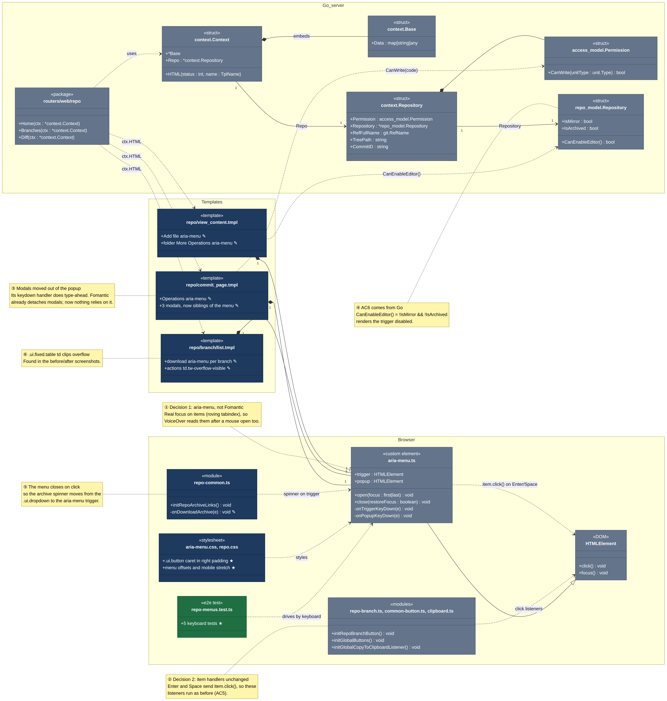
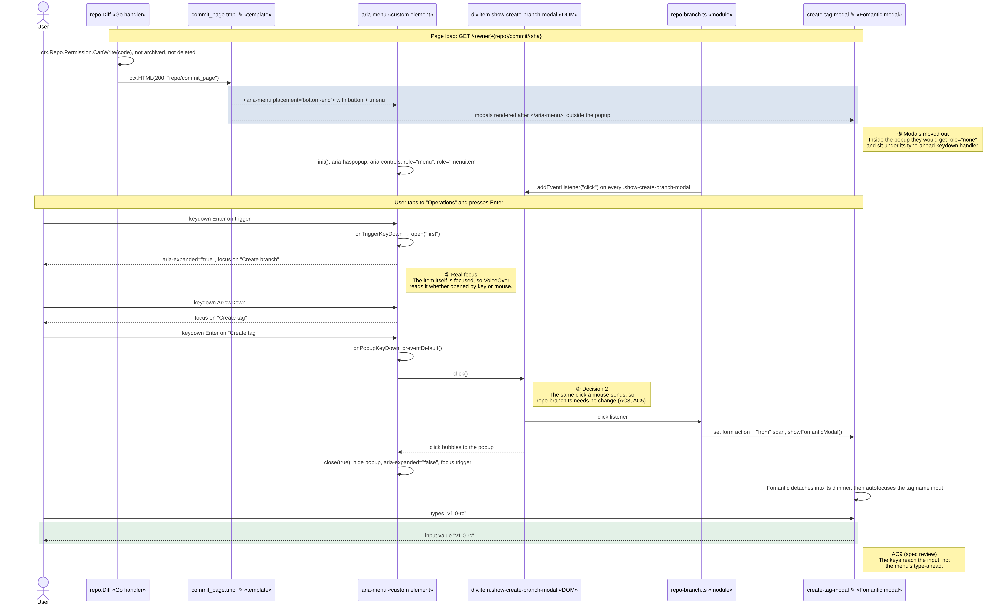

# Issue #108 -- Code tab, branch list and commit page action menus move to `<aria-menu>`

## Class Diagram

### Legend

**Layout.** The three bands follow a request: the **Go server** renders the **templates**, and the **browser** runs the markup they produce.

| Mark | Meaning |
| --- | --- |
| Grey box | Existing code this issue uses but doesn't change |
| Navy box | Code this issue modified |
| Green box | New code |
| ✎ / ★ on a member | Modified / new member |
| Amber note ①–⑥ | A design decision, attached by a dotted line |
| One box, three files | `repo-branch.ts`, `common-button.ts`, `clipboard.ts` play the same role (click listeners the items reuse), so they share a box |

**Arrow types.**

| Arrow | UML relationship | Used for | Why this one |
| --- | --- | --- | --- |
| Solid, hollow triangle | Generalisation | `aria-menu.ts` → `HTMLElement` | The element is declared as `class extends HTMLElement` |
| Solid, filled diamond | Composition | `context.Context` ◆ `context.Base`, `context.Repository` ◆ `Permission`, each template ◆ `aria-menu.ts` | The part has no life of its own: an embedded struct or value field is copied into its owner, and a rendered `<aria-menu>` exists only in that page's markup |
| Solid, open arrowhead | Directed association | `Context.Repo`, `context.Repository.Repository` | A pointer field: the struct keeps a reference it doesn't own, and only that side navigates to the other |
| Dashed, open arrowhead | Dependency | handlers → `Context` and templates, templates → Go methods, scripts → `aria-menu.ts` and `HTMLElement` | One side uses the other (a parameter, `ctx.HTML`, a template call, a runtime call or listener) without storing a reference |

I didn't use aggregation (hollow diamond). The pointer fields are the nearest case, but UML leaves aggregation's meaning loose, and "holds a reference it doesn't own" is said more precisely by a directed association. Numbers at the ends are multiplicities, for example a branch list renders `1..*` menus, one per branch.

**How Go maps to UML.** Go has no classes, so:

| Go construct | UML | Example |
| --- | --- | --- |
| Struct | Class with «struct» | `context.Context`, `repo_model.Repository` |
| Struct field / method with that receiver | Attribute / operation | `IsArchived`, `CanEnableEditor()` |
| Embedded struct | Composition | `*Base` inside `context.Context`: its fields and methods are promoted into the outer struct |
| Pointer field | Directed association | `Repo *Repository` |
| Value field | Composition | `Permission access_model.Permission` |
| Package of handler functions | Class with «package», one operation per exported function | `routers/web/repo` |
| Go template | Class with «template» | `repo/commit_page.tmpl` |

The TypeScript side follows the same rules: ES modules are «module», the web component is a «custom element», and CSS files are «stylesheet».

The Mermaid sources are `108-Jack-Donohue-class.mmd` and `108-Jack-Donohue-sequence.mmd`.

## Sequence Diagram

### Legend

| Mark | Meaning |
| --- | --- |
| Solid arrow | A call, event or request sent to the other participant |
| Dashed arrow | A result: rendered markup, a returned value, or what the user sees |
| Arrow back to the same lifeline | A step inside that participant, such as `open("first")` |
| ✎ on a participant | Modified by this issue; the others are existing code |
| Blue box | The markup this issue changed |
| Green box | The successful outcome |
| Wide yellow note | The start of a phase: page load, then the keyboard flow |
| Numbered note ①–③ | The same design decision as in the class diagram |

## Q&A

**Class diagram:**

1. Among all the classes shown in the diagram, which 1--2 are most central to understanding the codebase and solving the issue? Explain what role each one plays.

   The most central is `<aria-menu>` (`aria-menu.ts`), which is used for choosing an action from the menu. The fix came in as formatting instead of JS, because the issue was navigation order and selection, not functionality.

   The second is `commit_page.tmpl`. It saw a lot of changes because multiple Fomantic modals had to be moved out of the popup to after the closing `</aria-menu>` tag.

2. What is the most significant relationship shown in the diagram? Explain what it represents in the system and why it matters for understanding the solution.

   The most significant relationship is `aria-menu.ts` clicking the menu items (note ②). When pressing Enter on a menu item, it functions the same as if you had selected it through the existing mouse navigation, so no changes were needed to the items' existing click logic. The one script that was changed, `repo-common.ts`, needed to change because it controlled the placement of the loading throbber, and the element it used to find that spot no longer exists in these menus.

3. Looking back at your implementation, is there anything in this design you would change, and why?

   The modals were moved out of the menu because it was seen as a requirement. Even though Fomantic does this automatically, having it reflected in the code in a way that is easier to understand, and that doesn't conflict with other elements, doesn't hurt the design, even if it was redundant.

   The Branches page cells were allowed to overflow as a partial fix, because there is no easy answer on how to handle long names, and a proper fix would be more involved.

**Sequence diagram:**

1. What user action or system event starts the sequence, and what is the expected outcome when it completes successfully?

   The sequence starts with a user with write permissions attempting to access the commit page for the code. If all steps succeed, the dialog to create a tag is opened as an editable text field.

2. Identify the 2--3 most important steps in the sequence. For each one, describe what is happening and note whether it involves existing code or new/modified code from your solution.

   Two of the most important steps in the sequence are the rendering of the display and navigating through the menu.

   - **Rendering (modified):** we modified the `commit_page.tmpl` template to render an `<aria-menu>` with a separate button and menu, followed by the modals, re-using `init()` from the existing implementation, which adds the attributes.
   - **Navigating the menu (existing):** navigation of the menu is done with standard arrow key navigation, making use of existing `<aria-menu>` functionality, and changing the actual browser focus.

3. What error cases or alternative paths are not shown in the diagram, and why did you leave them out?

   The diagram was slimmed down because it is quite a busy diagram. For example, users without the ability to write to the page were not included, because they don't hold the permissions to add a new tag and so won't see the option to open the menu in the first place. Another instance is exiting the menu through standard keyboard inputs, which is processed the same as a normal exit through the `close()` function.

**Cross-cutting:**

4. If you used AI to create or check any part of the diagrams, describe what it produced, what you verified against the actual code, and what you had to correct or add. If AI was not used, write "N/A."

   For the diagrams, I had Claude Code (claude-opus-5-5) write them as Mermaid files because of my previous experience using them and their ability to be rendered natively on platforms like GitLab (though there's a limit of 2 per post, ask me how I know (don't)). Claude wrote them following the style of the diagrams that had been merged previously. The early implementations had bugs relating to colors, blank headers, and incorrect claims. I had Claude refine its layout, as it was a lot of separate elements linking back and forth, so Claude grouped it into three sections, which were then checked against the tests.

   Claude drafted the original Q&A answers. I went back and re-edited them, and Claude checked them for grammar and facts against the code, rewording a few phrases where they were wrong.
