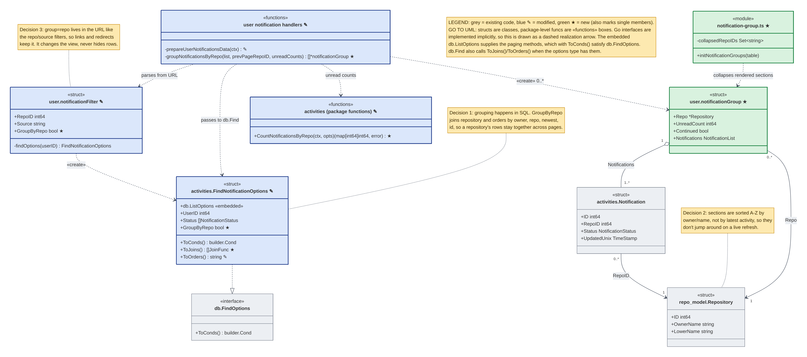
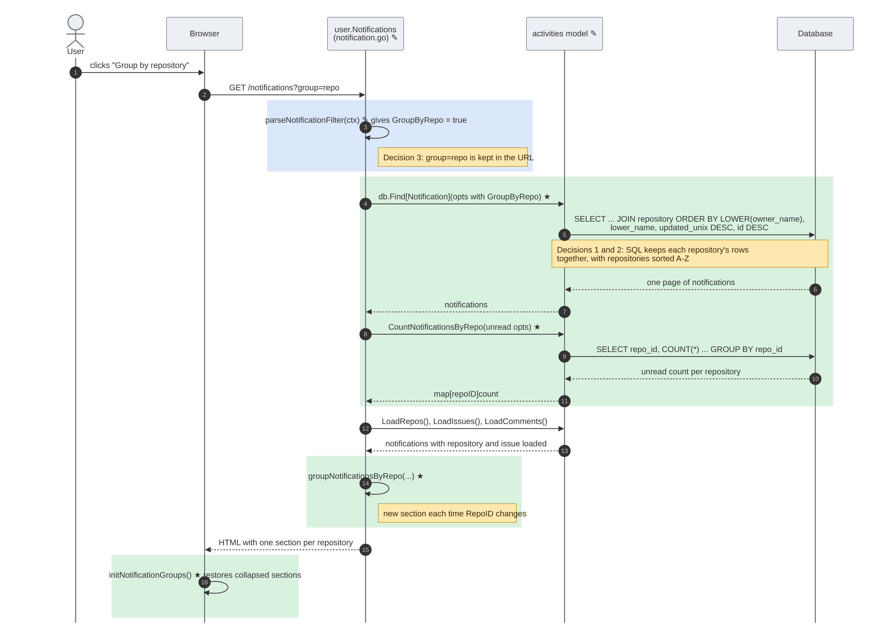

# Issue #117 -- Group notifications by repository

## Class Diagram

Grey boxes are existing code I found during concept location and impact analysis. Blue boxes marked ✎ were modified by PR #120, and green boxes marked ★ are new. Inside a box, ★ and ✎ after a member mark the members that were added or changed. The amber notes explain the design decisions from #117.

Only the classes and members that matter for the feature are shown; unrelated fields and methods are left out.

**Go to UML:** Go has no classes, so each struct is drawn as a class with its fields and methods. Go interfaces are satisfied implicitly, without an `implements` keyword, so `FindNotificationOptions` satisfying `db.FindOptions` is drawn as a dashed realization arrow. `FindNotificationOptions` embeds `db.ListOptions`, shown as an «embedded» member; it supplies the paging methods that, together with `ToConds()`, satisfy `db.FindOptions`. `db.Find` also calls `ToJoins()` and `ToOrders()` when the options type defines them. Package-level functions, such as the route handlers and `CountNotificationsByRepo`, are grouped in «functions» boxes, and the TypeScript file is a «module» box.

The Mermaid sources are `117-CarsonRackley-class.mmd` and `117-CarsonRackley-sequence.mmd`.

## Sequence Diagram

Steps in green boxes are new code from PR #120, and steps in the blue box use modified code. Everything else is existing code. ★ and ✎ in a message mark a new or changed call. The diagram shows the main success path for one page of grouped notifications.

## Q&A

**Class diagram:**

1. Among all the classes shown in the diagram, which 1--2 are most central to understanding the codebase and solving the issue? Explain what role each one plays.

   `FindNotificationOptions` and `notificationGroup`. `FindNotificationOptions` controls the database query: with `GroupByRepo` on, it joins the repository table and sorts by repository, so each repo's notifications come back together. `notificationGroup` is the new struct that holds one repository's section on the page: the repo, its unread count, and its notifications.

2. What is the most significant relationship shown in the diagram? Explain what it represents in the system and why it matters for understanding the solution.

   `FindNotificationOptions` realizing `db.FindOptions`. Because it satisfies that interface, the existing `db.Find` function can run the query without any changes. I only added `ToJoins()` and updated `ToOrders()`, and `db.Find` picks them up automatically. That is why grouping could be done in SQL without changing the shared database code.

3. Looking back at your implementation, is there anything in this design you would change, and why?

   I would consider putting `groupNotificationsByRepo` in the model or a service instead of the router, so it could be reused (for example by the API) and tested apart from the web handler.

**Sequence diagram:**

1. What user action or system event starts the sequence, and what is the expected outcome when it completes successfully?

   The user clicks "Group by repository", which loads `/notifications?group=repo`. The page then shows the notifications split into one section per repository, sorted A-Z, each with its unread count.

2. Identify the 2--3 most important steps in the sequence. For each one, describe what is happening and note whether it involves existing code or new/modified code from your solution.

   - Step 4–5, `db.Find` with `GroupByRepo` (new/modified): the query joins the repository table and orders by owner, repo, then newest, so each repo's rows are together.
   - Step 8–9, `CountNotificationsByRepo` (new): one `GROUP BY` query gets the unread count for every repository.
   - Step 14, `groupNotificationsByRepo` (new): walks the sorted list and starts a new section each time the repository changes.

3. What error cases or alternative paths are not shown in the diagram, and why did you leave them out?

   Not shown: page 2 or later (an extra one-row query checks whether the first section continues from the previous page), the live refresh when the unread count changes, notifications removed because the user lost access to the repo, and database errors. I left them out to keep the diagram focused on the main path.

**Cross-cutting:**

4. If you used AI to create or check any part of the diagrams, describe what it produced, what you verified against the actual code, and what you had to correct or add. If AI was not used, write "N/A."

   Claude Code (claude-opus-5-5) drafted both diagrams in Mermaid from PR #120 and drafted these Q&A answers. I checked the diagrams against the code on `main`. That check found missing details: the embedded `db.ListOptions`, the error return values, the previous-page query, and the Load calls. We then simplified the diagrams to only the most relevant parts. I reviewed and reworded the answers.
