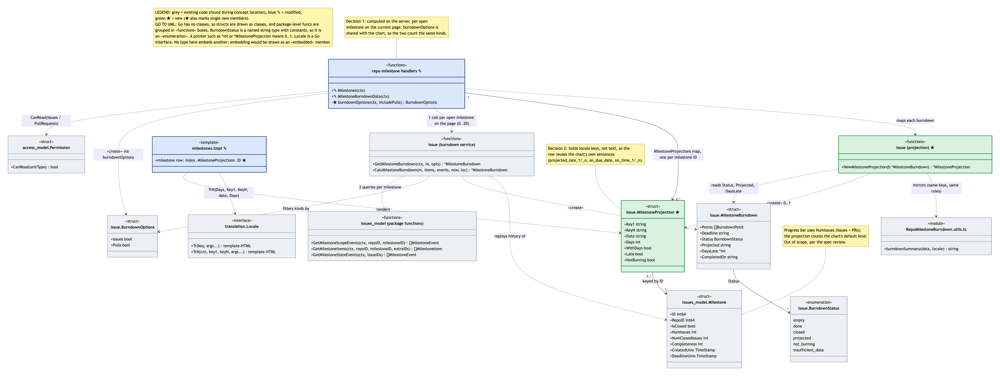
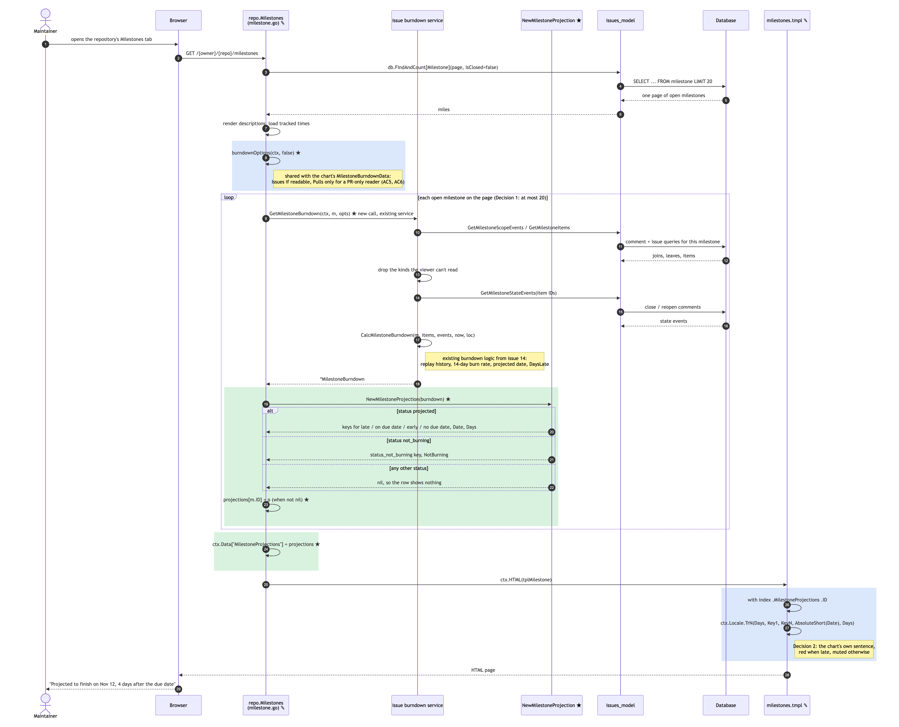

# Issue #131 -- Show each open milestone's projected finish on the milestones list

## Class Diagram

Grey boxes are existing code I found during concept location and impact analysis, mostly the burndown service from #14. Blue boxes marked ✎ were modified by PR #134, and green boxes marked ★ are new. Inside a box, ★ and ✎ before a member mark the members that were added or changed. The amber notes explain the two design decisions from #131 and the scope limit raised in the spec review.

Only the classes and members that matter for the feature are shown. `MilestoneBurndown`'s ideal line and change lists, for example, are left out.

**Go to UML:** Go has no classes, so each struct is drawn as a class with its fields. Package-level functions, such as the route handlers, the burndown service and `NewMilestoneProjection`, are grouped in «functions» boxes named after their package. `BurndownStatus` is a named `string` type with a set of constants, so it is drawn as an «enumeration». A Go pointer field or return value (`*int`, `*MilestoneProjection`) can be nil, so it is drawn with multiplicity 0..1. `translation.Locale` is a Go interface, which the template reaches through `ctx.Locale`. No type in this diagram embeds another struct; an embedded field would be drawn as an «embedded» member. The template and the TypeScript file aren't Go types, so they are drawn as «template» and «module» boxes.

The Mermaid sources are `131-arjunsb26-class.mmd` and `131-arjunsb26-sequence.mmd`.

## Sequence Diagram

Steps in green boxes are new code from PR #134, and steps in blue boxes use modified code. Everything else is existing code. ★ and ✎ in a message mark a new or changed call. Step 9 is a new call site for an existing service. The diagram shows the main success path for one page of open milestones.

## Q&A

**Class diagram:**

1. Among all the classes shown in the diagram, which 1--2 are most central to understanding the codebase and solving the issue? Explain what role each one plays.

   `MilestoneBurndown` and `MilestoneProjection`.
   - `MilestoneBurndown` already existed from #14. It is the result of replaying a milestone's history, and its `Status`, `Projected` and `DaysLate` fields already hold the answer the list needs, so the feature never recomputes a projection.
   - `MilestoneProjection` is the new struct between that result and the page. It holds locale keys and numbers, not finished text, so the template can render the chart's own sentence in the viewer's language. That's how the list and the chart say the same thing (AC5) without adding any new strings.

2. What is the most significant relationship shown in the diagram? Explain what it represents in the system and why it matters for understanding the solution.

   Both handlers depend on the new `burndownOptions` helper. That dependency holds the permission rule: count issues if the viewer can read them, and count pull requests only if the viewer can read them (and only by default for someone who can read nothing else). The route lets in a reader of either kind, so a check on the route alone isn't enough. In #14 I learned that a reader of issues only could otherwise see pull request titles in the chart. Before this PR, the rule lived inline in `MilestoneBurndownData`. Copying it into `Milestones` would have let the two drift apart, so both now call the one helper, and AC6's integration tests turn each unit off to check that nothing leaks.

3. Looking back at your implementation, is there anything in this design you would change, and why?

   The rule that picks a sentence from the status now exists twice: in Go (`NewMilestoneProjection`) and in TypeScript (`burndownSummary`), shown by the "mirrors" arrow. A new status or a change in wording has to touch both. With more time, I would have the server send the chart its summary key too, so there is only one copy. That changes #14's chart, which is why it was out of scope here. I'd also look at the per-milestone cost: each open milestone on the page runs three queries and reads its whole history. A batched query across the page's milestones would fix that if large repositories find the list slow.

**Sequence diagram:**

1. What user action or system event starts the sequence, and what is the expected outcome when it completes successfully?

   A maintainer opens a repository's Milestones tab, which sends `GET /{owner}/{repo}/milestones`. If it succeeds, every open milestone with enough history shows the chart's projection sentence next to its due date. A late one, for example, reads "Projected to finish on Nov 12, 4 days after the due date" in red. Milestones with too little history show nothing new.

2. Identify the 2--3 most important steps in the sequence. For each one, describe what is happening and note whether it involves existing code or new/modified code from your solution.

   - **Step 8, `burndownOptions(ctx, false)`:** new, but it is existing logic moved out of the chart's handler. It decides once, per request, which kinds of items this viewer's projections may count. Every later step depends on it for AC6.
   - **Steps 9–18, `GetMilestoneBurndown` for each milestone:** existing service, new call site. Calling the same service the chart uses is Decision 1. The service replays the milestone's history from the comment table and computes the 14-day burn rate and projected date, so the list can't disagree with the chart.
   - **Steps 19–23, `NewMilestoneProjection`:** new. It maps the burndown's status to a locale key pair and a day count, or to nil. Steps 26–27 in the modified template then turn that into the sentence with `TrN`, which picks the singular "1 day" form or the plural.

3. What error cases or alternative paths are not shown in the diagram, and why did you leave them out?

   - **The closed tab** (`?state=closed`): the handler skips the whole loop, so no projection is computed (AC4).
   - **A database error inside `GetMilestoneBurndown`:** the handler stops and returns a 500 with `ctx.ServerError`, like the other queries on this page.
   - **A viewer who can read neither issues nor pull requests:** the route rejects them before the handler runs.
   - **A page with no open milestones:** the loop doesn't run.

   I left these out to keep the diagram on the path that the feature changes. Apart from the closed tab, each one is existing behaviour of the page, and the closed tab is just the loop being skipped.

**Cross-cutting:**

4. If you used AI to create or check any part of the diagrams, describe what it produced, what you verified against the actual code, and what you had to correct or add. If AI was not used, write "N/A."

   Claude Code (claude-opus-5-5) drafted both Mermaid sources from the code in PR #134 and rendered them to PNG with the repository's own `mermaid` package in a headless browser. I checked every box, member and call against `routers/web/repo/milestone.go`, `services/issue/milestone_burndown.go`, `services/issue/milestone_projection.go` and `templates/repo/issue/milestones.tmpl`. Corrections made while reviewing the renders:
   - The first sequence draft coloured the whole loop green, which would have marked the existing burndown service as new code. Now only the new projection steps are green, and step 9 says it is a new call to an existing service.
   - A note containing "#14" was cut short, because Mermaid reads `#` as the start of a character code.
   - In the class diagram, a ✎ after `Milestones(ctx)` was shown as a return type.
   - Mermaid's default sizing squeezed the class diagram into an unreadable thumbnail, so it is now rendered at its natural size.
