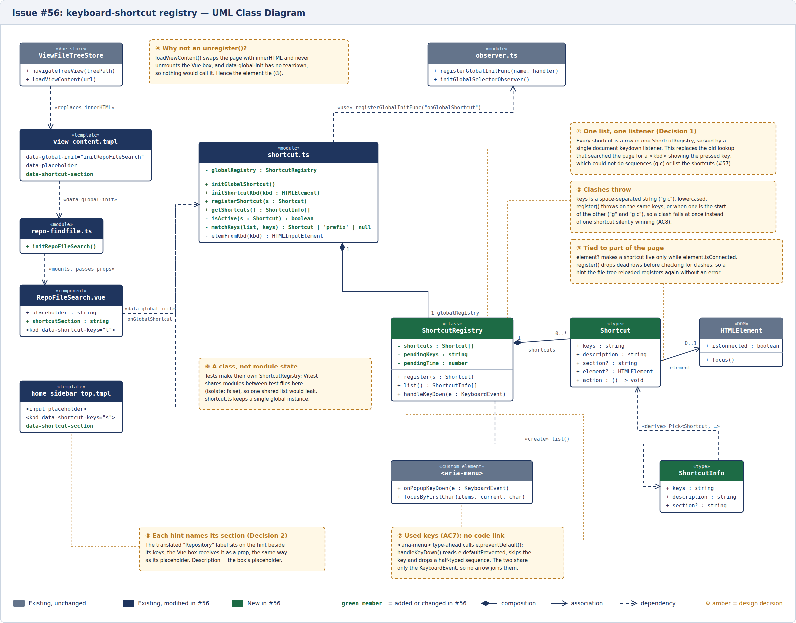
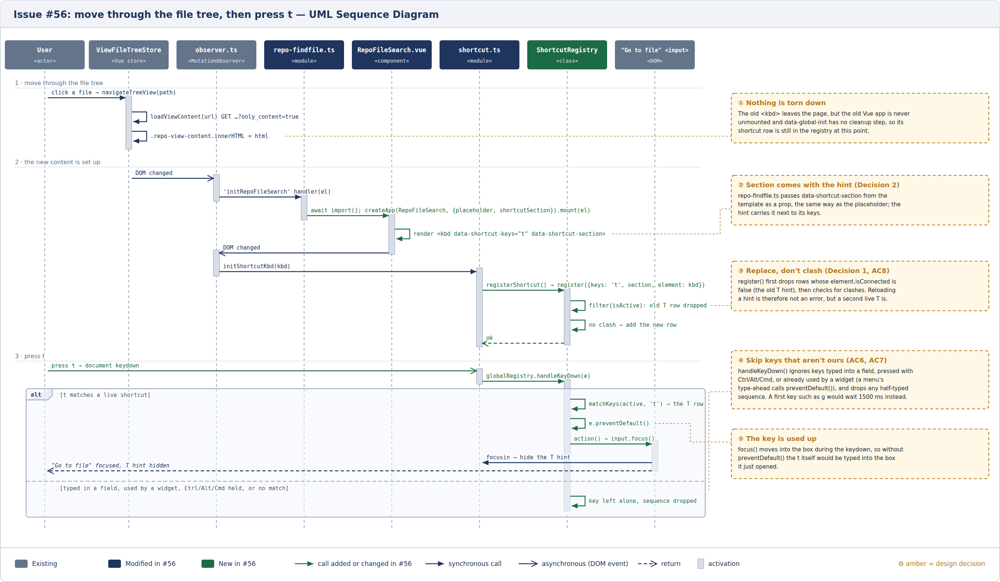

# Issue #56 -- Central keyboard-shortcut registry with chords

## Class Diagram

**Notation.** This issue is TypeScript, Vue and Go templates rather than Go, so the diagram maps
them as follows. A TypeScript `class` is a UML class. A module (a file of functions and
module-level variables, such as `shortcut.ts`) is a class with the «module» stereotype: exported
functions are `+`, unexported ones `-`. A TypeScript `type` is a class with «type», a Vue component
is a «component» with its props as attributes, a Go template is a «template» with the attributes it
renders, and a browser custom element is a «custom element». A `data-global-init` attribute that
makes one file run another's code is drawn as a dependency. In Go code the same approach maps a
struct to a class, an interface to an «interface» that structs realize, and struct embedding to
composition.

## Sequence Diagram

## Q&A

**Class diagram:**

1. Among all the classes shown in the diagram, which 1--2 are most central to understanding the codebase and solving the issue? Explain what role each one plays.

   The `ShortcutRegistry`, which is new in this PR, holds every shortcut on a page. Its `register()` function enforces the "clash" rule, which ensures that a set of keys has only one meaning on a page. This class was necessary because, prior to this PR, there was no central place for shortcut handling or behavior, and the HTML of the page itself was the only record of what shortcuts existed. The class also has the `handleKeyDown()` function, which handles all of the key presses.

2. What is the most significant relationship shown in the diagram? Explain what it represents in the system and why it matters for understanding the solution.

   A `Shortcut` can be attached to an `HTMLElement`. This is of utmost importance, especially from the point of view of lifetimes and avoiding clashes. Thanks to this association, the registry notices on its own when the element is no longer on the page (`element.isConnected`). Of course, this led to the introduced tech debt, as "on the page" is not the same as "visible", so a shortcut keeps working, and can still clash, even when its element is hidden.

3. Looking back at your implementation, is there anything in this design you would change, and why?

   There are two changes I would have made, but both would have been "intrusive" or unnecessary for the task at hand:

   - A clashing hint fails loudly and breaks the rest of the page's setup, but avoiding that meant handling the error differently from how the rest of Gitea's setup handles mistakes, which is not ideal.
   - Hidden elements count as present, as noted in 2. The solution could be a visibility check, but that also means key presses would need layout reads, so it is a tough decision to make.

**Sequence diagram:**

1. What user action or system event starts the sequence, and what is the expected outcome when it completes successfully?

   The sequence starts when the user clicks a file in the repository's file tree. This sets up the sequence by first requesting the new content to load in (without reloading the page), and then setting up the page's functionality, which in the process registers the shortcut.

   Once the user presses the key (in this case, t), the listener picks it up and focuses the "Go to file" box.

2. Identify the 2--3 most important steps in the sequence. For each one, describe what is happening and note whether it involves existing code or new/modified code from your solution.

   - The `registerShortcut()` function, which is new in this solution, is the core of the functionality that moved shortcuts from being embedded in the HTML to being centrally managed. It registers the shortcut, along with the details of everything that is needed for the shortcut to function.
   - The other important step is `globalRegistry.handleKeyDown(e)`, which is also new in this solution. It is part of centralizing the shortcuts, where there is now just one function that tracks and handles the processing of relevant key presses. It receives the page's key presses, processes them, and when it finds one it is tracking, sets off the required changes.

3. What error cases or alternative paths are not shown in the diagram, and why did you leave them out?

   A few things were left out: the error during a clash (e.g. a second live T hint), which throws during page setup; the details of how keys are processed, such as two-key sequences and the 1500 ms timeout, since no real page uses a sequence yet and the unit tests cover them; and the first page load, which is essentially just this diagram without the replacement of elements.

**Cross-cutting:**

4. If you used AI to create or check any part of the diagrams, describe what it produced, what you verified against the actual code, and what you had to correct or add. If AI was not used, write "N/A."

   AI (Claude Code, claude-opus-5-5) produced both diagrams, including their callouts, modelled on the course's reference diagrams (hence the similar style).

   For the class diagram, I inspected the diagram to ensure that all the included elements actually make sense; commits were small on purpose, and thus, many of the classes were familiar. For anything I did not understand, I had a quick look through the commits again to see where they came from.

   The sequence diagram was a bit harder, as is the case for most of Gitea's codebase, thanks to its many interacting components. Regardless, many of the events do make sense from the commits I reviewed and the changes they implemented. I also manually traced the `handleKeyDown()` function to see how the key processing happens.

   I did not find a need to change anything after the fact, other than a few guiding notes on scope. This was likely because the AI agent that produced these diagrams also implemented the changes.
