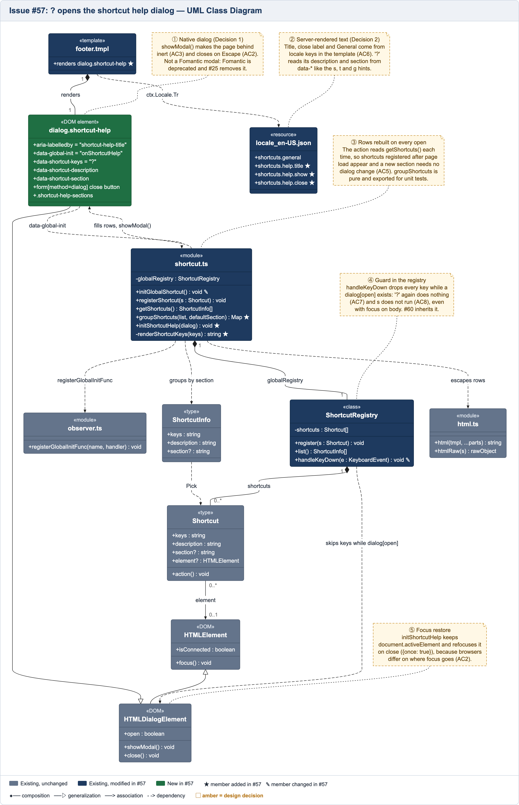
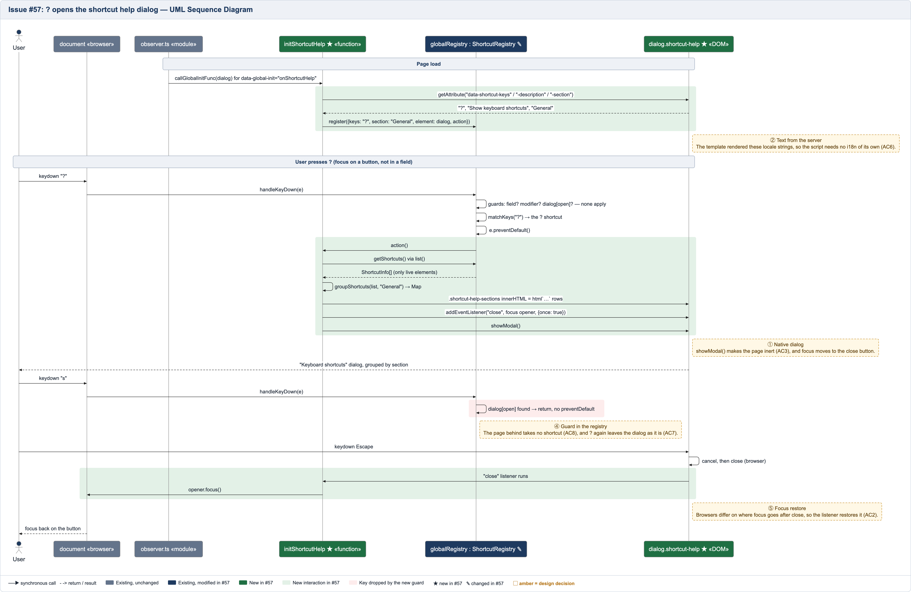

# Issue #57 -- `?` opens a shortcut help dialog built from the registry

## Class Diagram

The diagram uses UML notation for TypeScript and Go templates. Modules are marked as «module», types as «type», and templates as «template». Go structs are represented as classes, while interfaces use «interface». Struct embedding is shown as composition, since the embedded struct lives and dies with the outer one.

Grey represents existing code, navy represents modified code, and green represents new code. ★ indicates a new member, ✎ indicates a modified one, and the numbered amber notes explain design decisions.

The Mermaid source files are `57-controlled-opposition-class.mmd` and `57-controlled-opposition-sequence.mmd`.

## Sequence Diagram

## Q&A

**Class diagram:**

1. Among all the classes shown in the diagram, which 1--2 are most central to understanding the codebase and solving the issue? Explain what role each one plays.

   The two most important are `ShortcutRegistry` and `shortcut.ts`. The registry, introduced in #56, keeps track of shortcuts and handles key presses. Instead of maintaining a separate list, the help dialog gets the current shortcuts through `getShortcuts()`.

   The new logic is in `shortcut.ts`. `initShortcutHelp` registers the `?` shortcut and builds the dialog's contents, while `groupShortcuts` organizes shortcuts by section, putting "General" first.

2. What is the most significant relationship shown in the diagram? Explain what it represents in the system and why it matters for understanding the solution.

   The most important relationship is between `ShortcutRegistry` and `HTMLDialogElement`. Previously, shortcuts could still trigger while a dialog was open. I added a check in `handleKeyDown` to prevent that.

   This stops shortcuts like `s` from focusing the search box behind the dialog and prevents `?` from running again while it's open. The check is in the registry because it works wherever focus is; a listener on the dialog would miss a key pressed while focus is on `body`. It also means future native `<dialog>`s benefit from it without needing their own handling. Gitea's Fomantic modals are plain `
`s, so shortcuts still fire behind them.

3. Looking back at your implementation, is there anything in this design you would change, and why?

   I'd make the dialog check more specific. Right now, `dialog[open]` also matches non-modal dialogs, which could unnecessarily disable shortcuts. `dialog:modal` would be more accurate, but happy-dom doesn't properly match it in our unit tests.

   I'd also reconsider generating the shortcut rows with JavaScript template strings if we add more dialogs. It works fine here, but a shared helper might make sense later.

**Sequence diagram:**

1. What user action or system event starts the sequence, and what is the expected outcome when it completes successfully?

   The sequence starts when the page loads and `initShortcutHelp` registers the `?` shortcut. When the user presses `?` outside a text field, the help dialog opens and displays the available shortcuts grouped by section.

   The user can then press Escape to close it and return focus to where it was before.

2. Identify the 2--3 most important steps in the sequence. For each one, describe what is happening and note whether it involves existing code or new/modified code from your solution.

   - **Registering `?`:** The new `initShortcutHelp` function uses the existing `register` method from #56. It associates the shortcut with the dialog on that page.
   - **Opening the dialog:** The new action calls the existing `getShortcuts()`, passes the results through the new `groupShortcuts` function, and opens the dialog with `showModal()`. Reading the registry when the dialog opens ensures recently registered shortcuts are included.
   - **Blocking shortcuts:** I modified the existing `handleKeyDown` to ignore shortcuts while a dialog is open. This prevents shortcuts from affecting the page behind it.

3. What error cases or alternative paths are not shown in the diagram, and why did you leave them out?

   I left out a few paths that either already existed in #56 or behave similarly to what's shown:

   - Pressing `?` in a text field is ignored by the existing field check.
   - Clicking the close button produces the same close event as pressing Escape.
   - Registering another shortcut with `?` triggers the existing conflict error.
   - The initialization steps in `index.ts` are combined into one call to keep the diagram readable.

   These cases don't add much to explaining the changes made in #57.

**Cross-cutting:**

4. If you used AI to create or check any part of the diagrams, describe what it produced, what you verified against the actual code, and what you had to correct or add. If AI was not used, write "N/A."

   I used Claude Code (claude-opus-5-5) to generate both Mermaid diagrams, using the course examples and diagrams from #56 as references. It also rendered them using pele and Playwright.

   The initial diagrams had a few problems, including incorrect method notation, unreadable stereotypes, and section labels colored like design decisions. Claude corrected these and added a separate class for the new dialog.

   I checked the diagrams against the implementation and used the project's mise tasks to verify the code. These tasks build Gitea, run a temporary instance, and test the features in a browser, including the `?` dialog. They also check for unexpected results and JavaScript errors.
