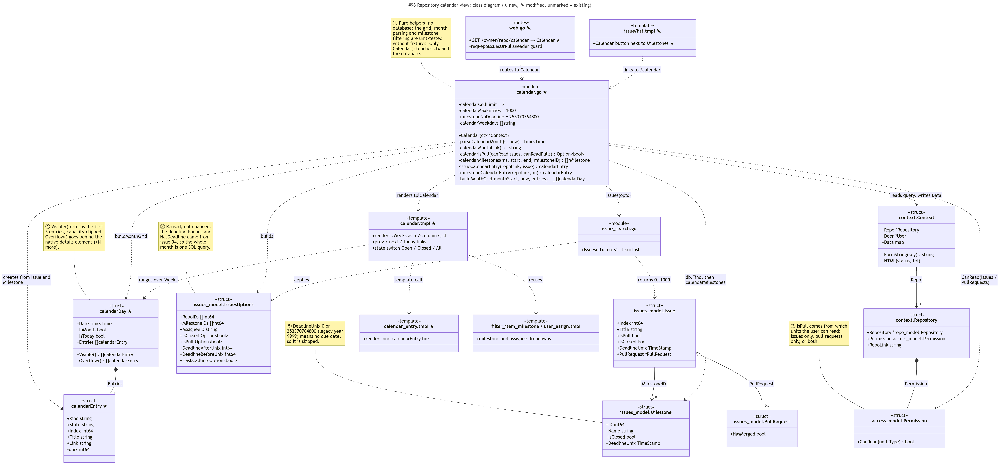
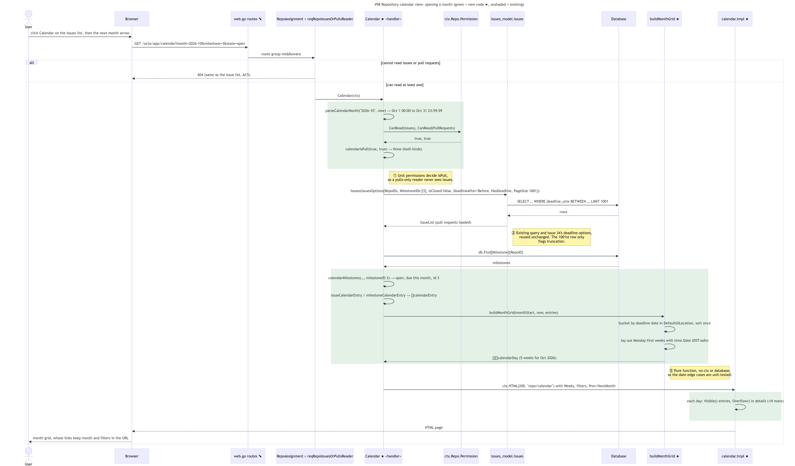

# Issue #98 -- Show milestone and issue deadlines in a repository calendar view

## Class Diagram

Source: [98-vvchopra-class.mmd](98-vvchopra-class.mmd)

**Legend.**
- ★ is new in this issue and ✎ is existing code changed by it. Unmarked boxes are existing Gitea code
  found during concept location and used unchanged.
- Yellow notes ①-⑤ mark the key design decisions.

**Notation (Go to UML).** Go has no classes:
- A Go **struct** is drawn as a UML class with «struct». Its exported fields and methods are `+`, and
  unexported ones are `-`.
- A Go **file of package-level functions** (such as `calendar.go` or `issue_search.go`) is a class with
  «module».
- A Go **template** is a class with «template», and the route table is «routes».
- A **struct field that holds a value** (`context.Repository.Permission`) is composition, because the
  value lives and dies with its owner.
- A **pointer field** (`Context.Repo`, `Issue.PullRequest`) is an association or aggregation, because
  the pointed-to object exists on its own.
- A **function that only calls or builds another type** is a dashed dependency.
- **Go interfaces** would be «interface» classes that structs realize, and **struct embedding** would be
  composition. Neither appears in this issue's code.

## Sequence Diagram

Source: [98-vvchopra-sequence.mmd](98-vvchopra-sequence.mmd)

Green blocks are new code (★). Unshaded steps are existing Gitea code.

## Q&A

**Class diagram:**

1. Among all the classes shown in the diagram, which 1--2 are most central to understanding the codebase and solving the issue? Explain what role each one plays.

   The struct most essential to my understanding of the code base for this issue is the Calendar.go
   module. Everything in this issue revolves around this module as the templates and the calendar is dependent on issues and PRs for getting their info on due dates.
  This helps to visualize how the codebase is setup in general, as one struct has dependencies on several
   different parts of the code.

2. What is the most significant relationship shown in the diagram? Explain what it represents in the system and why it matters for understanding the solution.

   The most significant relationship shown in the diagram is that the Calendar.go module uses the
   issues struct as it needs all the information behind an issue to be linked in the actual calendar.
   That shows the interesting nature of Go, because while the issues description is not new to this
   PR, the Calendar.go queries it for the calendar feature to work.

3. Looking back at your implementation, is there anything in this design you would change, and why?

   No, I brainstormed the spec process for this issue, and the design made sense and was relatively
   simple. The whole calendar module had to be created, and uses several different templates to
   actually project the calendar on the screen with the PRs and Issues that were due. So, you need
   the information on the PRs and Issues as described above.

**Sequence diagram:**

1. What user action or system event starts the sequence, and what is the expected outcome when it completes successfully?

   Clicking the calendar button on the PR or Issues page kicks off the sequence. Once completed, the
   calendar grid appears with the capability to click through the months, and view the due dates for
   different issues and PRs.

2. Identify the 2--3 most important steps in the sequence. For each one, describe what is happening and note whether it involves existing code or new/modified code from your solution.

   The first most important step would be clicking the calendar button on the PR or Issues page. This
   just makes the https request of the calendar in the link, the calendar button appearing in the list header is new code. The second most
   important step is that the calendar handler decides what day it is to show the correct month,
   while also checking the users permissions on viewing issues and prs. This is also new code. The
   third most important is using this information to actually render the calendar on the correct
   month, with the issues and prs sorted by the correct deadline. This is new code.

3. What error cases or alternative paths are not shown in the diagram, and why did you leave them out?

   Some cases that were left out are different situations for permissions: example being that a user
   can view PRs but not issues. This was just left out because the diagram is showing a specific
   situation where everything works how one would expect. Another path would be a month that has
   nothing due. This simply wouldn't be useful to showing the path of the diagram, as no issues or
   PRs are being retrieved.

**Cross-cutting:**

4. If you used AI to create or check any part of the diagrams, describe what it produced, what you verified against the actual code, and what you had to correct or add. If AI was not used, write "N/A."

   I used AI to create both diagrams based on the codebase. I then had it explain based on the
   pictures what changed in the code as a way of it verifying itself, and me verifying the work. The
   diagram made it much easier for me to understand the flow of the code. As some parts can be
   complicated. In general, this was a more simple flow to follow as it is really just a simple https
   request with a little bit of specific information.
